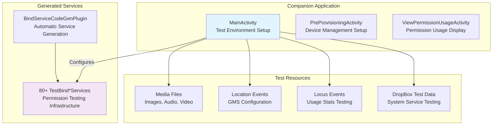
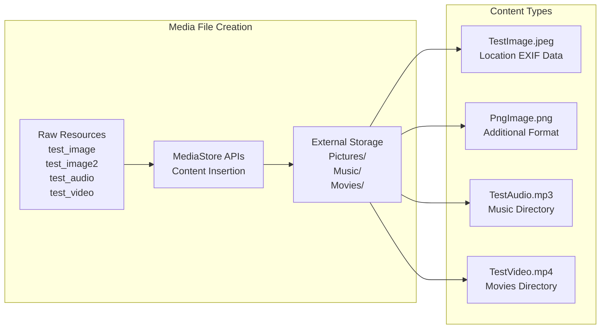
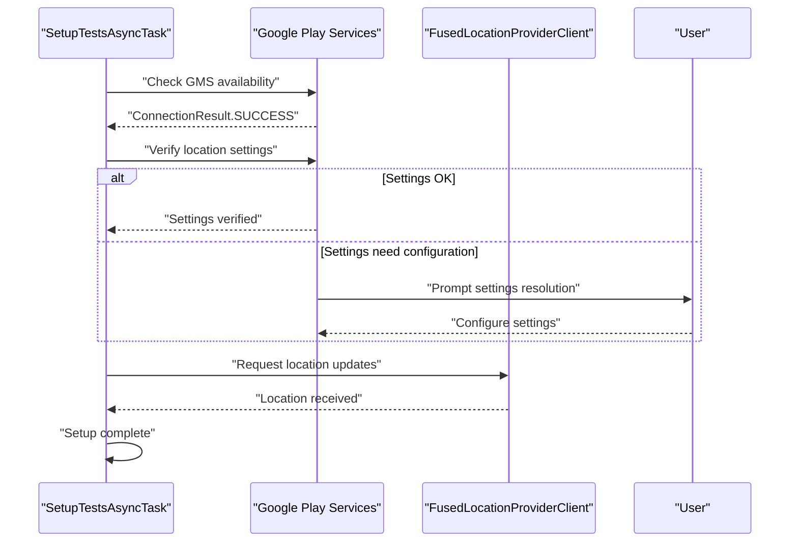
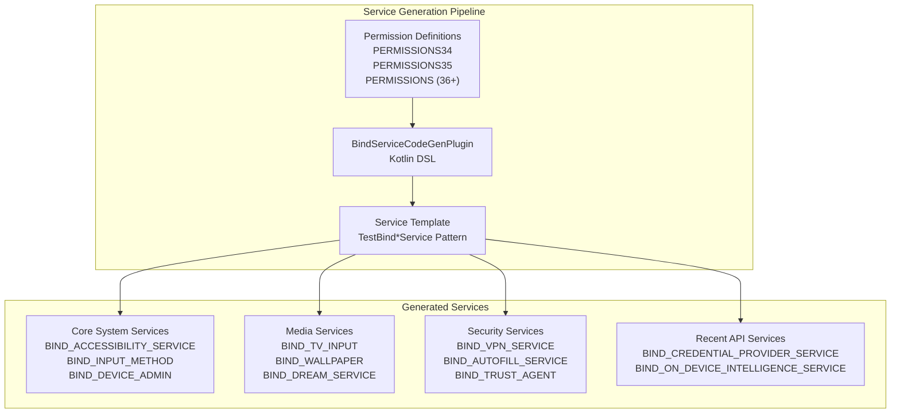
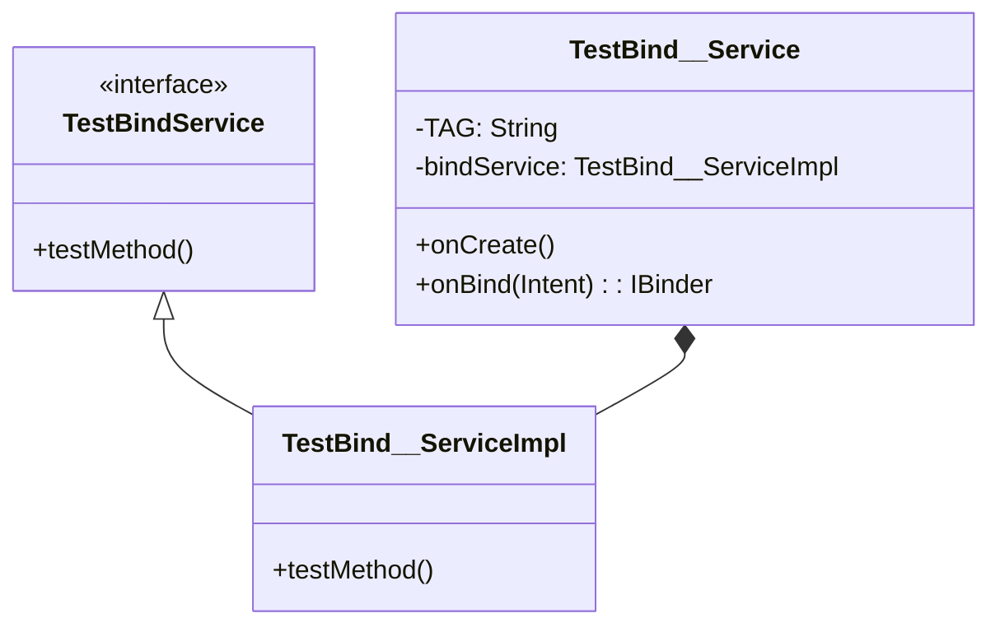
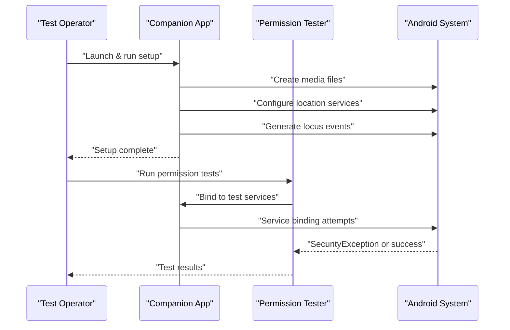

<!-- source: DeepWiki mcp.deepwiki.com · repo android/security-certification-resources · page 3.1 Companion Application · fetched 2026-10-23 -->

# Companion Application

Relevant source files

The following files were used as context for generating this wiki page:

- [niap-cc/Permissions/Companion/app/build.gradle](niap-cc/Permissions/Companion/app/build.gradle)
- [niap-cc/Permissions/Companion/app/src/main/AndroidManifest.xml](niap-cc/Permissions/Companion/app/src/main/AndroidManifest.xml)
- [niap-cc/Permissions/Companion/app/src/main/java/com/android/certifications/niap/permissions/companion/MainActivity.java](niap-cc/Permissions/Companion/app/src/main/java/com/android/certifications/niap/permissions/companion/MainActivity.java)
- [niap-cc/Permissions/Companion/app/src/main/res/layout/activity_main.xml](niap-cc/Permissions/Companion/app/src/main/res/layout/activity_main.xml)
- [niap-cc/Permissions/Companion/build.gradle.kts](niap-cc/Permissions/Companion/build.gradle.kts)

The Companion Application is a supporting Android application within the NIAP permission testing framework that prepares the test environment and provides infrastructure services for comprehensive permission testing. It works in conjunction with the main Permission Tester application to ensure all necessary resources, services, and device configurations are in place before permission tests are executed.

For information about the main permission testing framework, see [Permission Testing Framework](#2). For details about other supporting applications, see [Supporting Applications](#3).

## Purpose and Architecture

The Companion Application serves three primary functions:

1. **Test Environment Setup**: Creates media files, location data, and other resources required by specific permission tests
2. **Service Infrastructure**: Provides dozens of exported services that test various `BIND_*` permissions  
3. **Device Configuration**: Configures device settings and validates system state for testing scenarios

### Application Structure

**Sources:** [niap-cc/Permissions/Companion/app/src/main/AndroidManifest.xml:1-547](), [niap-cc/Permissions/Companion/app/src/main/java/com/android/certifications/niap/permissions/companion/MainActivity.java:1-656]()

## Build Configuration and Signing

The Companion Application uses a dual signing configuration to support different testing scenarios:

| Build Type | Signing Configuration | Purpose |
|------------|----------------------|---------|
| Debug | Platform signature | System-level permission testing |
| Release | Companion signature | Normal app permission testing |

The application automatically copies debug builds to the main Tester package directory for integrated deployment.

**Sources:** [niap-cc/Permissions/Companion/app/build.gradle:23-84]()

## Test Environment Setup

### Media Location Test Setup

The `MainActivity.setupMediaLocationTest()` method creates test media files with location metadata required for `ACCESS_MEDIA_LOCATION` permission testing:

**Sources:** [niap-cc/Permissions/Companion/app/src/main/java/com/android/certifications/niap/permissions/companion/MainActivity.java:481-585]()

### Location Services Configuration

For location-related permission tests, the application configures Google Play Services and validates location settings:

**Sources:** [niap-cc/Permissions/Companion/app/src/main/java/com/android/certifications/niap/permissions/companion/MainActivity.java:303-472]()

### Device Configuration Access

The application uses reflection to access `DeviceConfig` APIs for system-level configuration:

- `deviceConfigSetProperty()` - Sets device configuration properties
- `deviceConfigGetProperty()` - Retrieves device configuration values
- Primarily used for device policy manager feature flags

**Sources:** [niap-cc/Permissions/Companion/app/src/main/java/com/android/certifications/niap/permissions/companion/MainActivity.java:150-184]()

## Service Infrastructure for BIND Permission Testing

### Generated Service Architecture

The Companion Application provides comprehensive coverage of Android's `BIND_*` permissions through automatically generated services:

**Sources:** [niap-cc/Permissions/Companion/build.gradle.kts:43-148](), [niap-cc/Permissions/Companion/app/src/main/AndroidManifest.xml:76-543]()

### Service Implementation Pattern

Each generated service follows a consistent pattern:

Each service:
- Extends Android `Service` class
- Requires specific `BIND_*` permission for binding
- Implements `TestBindService.Stub` for IPC communication
- Provides `testMethod()` for permission verification

**Sources:** [niap-cc/Permissions/Companion/build.gradle.kts:80-132]()

### Permission Coverage by Android Version

| Android Version | New BIND Permissions | Examples |
|----------------|---------------------|----------|
| API 34 (Android 14) | 8 permissions | `BIND_CREDENTIAL_PROVIDER_SERVICE`, `BIND_SATELLITE_SERVICE` |
| API 35 (Android 15) | 4 permissions | `BIND_TV_AD_SERVICE`, `BIND_ON_DEVICE_INTELLIGENCE_SERVICE` |
| API 36+ | 5 permissions | `BIND_APP_FUNCTION_SERVICE`, `BIND_RKP_SERVICE` |

**Sources:** [niap-cc/Permissions/Companion/build.gradle.kts:45-67]()

## Permission Requirements

The Companion Application requests several permissions to support its testing functions:

### Runtime Permissions
- `ACCESS_FINE_LOCATION` - Location services setup
- `ACCESS_COARSE_LOCATION` - Location services setup  
- `CAMERA` - Test data for revocation scenarios

### System Permissions
- `READ_DEVICE_CONFIG` - Device configuration access
- `WRITE_DEVICE_CONFIG` - Device configuration modification

### Service-Specific Permissions
- `LAUNCH_DEVICE_MANAGER_SETUP` - Device management setup
- `START_VIEW_PERMISSION_USAGE` - Permission usage display

**Sources:** [niap-cc/Permissions/Companion/app/src/main/AndroidManifest.xml:25-31]()

## Integration with Testing Framework

### Deployment Integration

The Companion Application integrates with the main testing framework through:

1. **Automatic APK Deployment**: Debug builds are automatically copied to the Tester package directory
2. **Coordinated Installation**: Both applications are typically installed together on test devices
3. **Service Discovery**: Main tester discovers and binds to Companion services for permission testing

**Sources:** [niap-cc/Permissions/Companion/app/build.gradle:55-69]()

### Test Coordination

The Companion Application must be run first to ensure proper test environment setup before executing permission tests in the main tester application.

**Sources:** [niap-cc/Permissions/Companion/app/src/main/java/com/android/certifications/niap/permissions/companion/MainActivity.java:227-295]()

---

