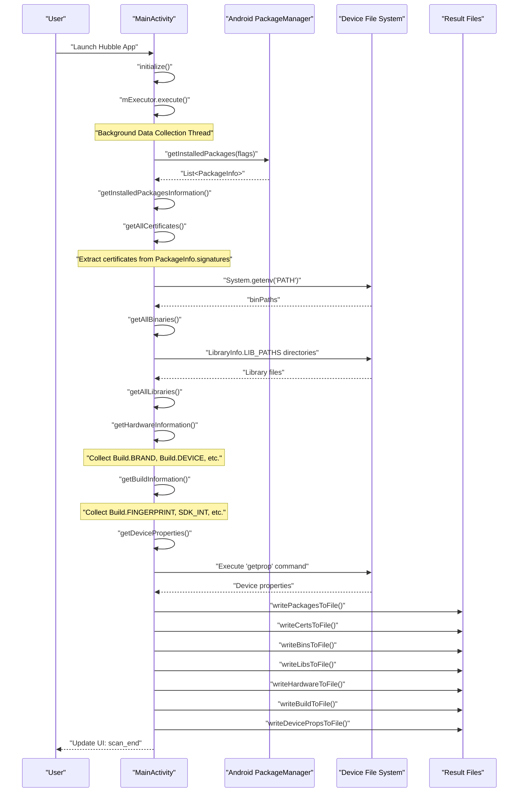
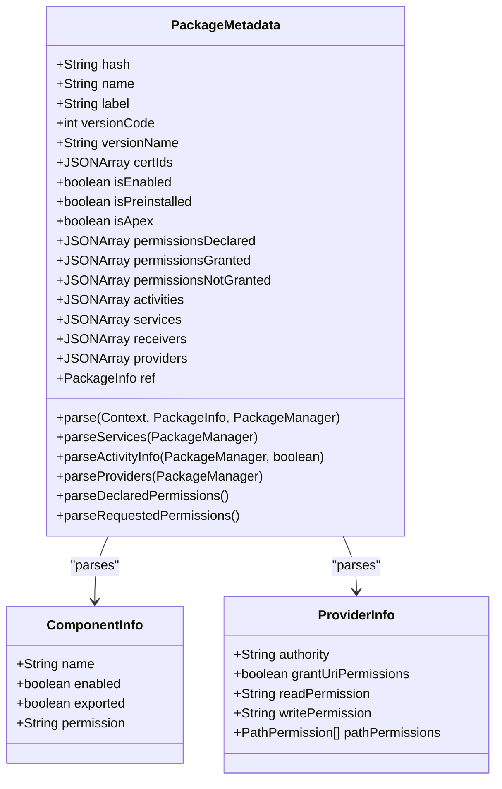
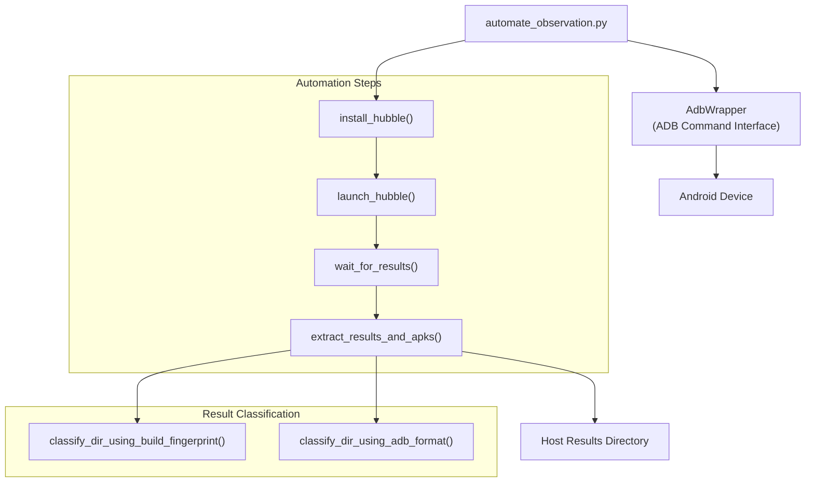

<!-- source: DeepWiki mcp.deepwiki.com · repo android/security-certification-resources · page 3.2 Hubble Data Collection · fetched 2026-10-23 -->

# Hubble Data Collection

<details>
<summary>Relevant source files</summary>

The following files were used as context for generating this wiki page:

- [uraniborg/AndroidStudioProject/Hubble/app/build.gradle](uraniborg/AndroidStudioProject/Hubble/app/build.gradle)
- [uraniborg/AndroidStudioProject/Hubble/app/src/main/java/com/uraniborg/hubble/MainActivity.java](uraniborg/AndroidStudioProject/Hubble/app/src/main/java/com/uraniborg/hubble/MainActivity.java)
- [uraniborg/AndroidStudioProject/Hubble/app/src/main/java/com/uraniborg/hubble/PackageMetadata.java](uraniborg/AndroidStudioProject/Hubble/app/src/main/java/com/uraniborg/hubble/PackageMetadata.java)
- [uraniborg/AndroidStudioProject/Hubble/build.gradle](uraniborg/AndroidStudioProject/Hubble/build.gradle)
- [uraniborg/AndroidStudioProject/Hubble/gradle.properties](uraniborg/AndroidStudioProject/Hubble/gradle.properties)
- [uraniborg/AndroidStudioProject/Hubble/gradle/wrapper/gradle-wrapper.properties](uraniborg/AndroidStudioProject/Hubble/gradle/wrapper/gradle-wrapper.properties)
- [uraniborg/README.md](uraniborg/README.md)
- [uraniborg/docs/hubble_results.md](uraniborg/docs/hubble_results.md)
- [uraniborg/scripts/python/automate_observation.py](uraniborg/scripts/python/automate_observation.py)

</details>


## Purpose and Scope

The Hubble Data Collection system is a specialized Android application within the Uraniborg project that performs comprehensive device fingerprinting and preinstalled application analysis. This system collects detailed information about Android devices including installed packages, signing certificates, system binaries, libraries, hardware characteristics, and build information for security certification and device analysis purposes.

For information about the broader testing framework that Hubble supports, see [Supporting Applications](#3). For details about automated deployment of Hubble, see the automation scripts described in this document.

## System Architecture

The Hubble application follows a single-activity architecture with background data collection and file output generation.

### Core Components Architecture

```mermaid
graph TB
    MainActivity["MainActivity<br/>(Main Orchestrator)"]
    PackageMetadata["PackageMetadata<br/>(Package Parser)"] 
    Utilities["Utilities<br/>(Helper Functions)"]
    BaseInfo["BaseInfo<br/>(Data Serialization)"]
    
    MainActivity --> PackageMetadata
    MainActivity --> Utilities
    PackageMetadata --> BaseInfo
    PackageMetadata --> Utilities
    
    subgraph "Data Collection Methods"
        getInstalledPackagesInformation["getInstalledPackagesInformation()"]
        getAllCertificates["getAllCertificates()"]
        getAllBinaries["getAllBinaries()"]
        getAllLibraries["getAllLibraries()"]
        getHardwareInformation["getHardwareInformation()"]
        getBuildInformation["getBuildInformation()"]
        getDeviceProperties["getDeviceProperties()"]
    end
    
    MainActivity --> getInstalledPackagesInformation
    MainActivity --> getAllCertificates
    MainActivity --> getAllBinaries
    MainActivity --> getAllLibraries
    MainActivity --> getHardwareInformation
    MainActivity --> getBuildInformation
    MainActivity --> getDeviceProperties
    
    subgraph "Output Files"
        packages_txt["packages.txt"]
        preinstalled_packages_txt["preinstalled_packages.txt"]
        certificates_txt["certificates.txt"]
        binaries_txt["binaries.txt"]
        libraries_txt["libraries.txt"]
        hardware_txt["hardware.txt"]
        build_txt["build.txt"]
        device_properties_txt["device_properties.txt"]
    end
    
    MainActivity --> packages_txt
    MainActivity --> preinstalled_packages_txt
    MainActivity --> certificates_txt
    MainActivity --> binaries_txt
    MainActivity --> libraries_txt
    MainActivity --> hardware_txt
    MainActivity --> build_txt
    MainActivity --> device_properties_txt
```



Sources: [uraniborg/AndroidStudioProject/Hubble/app/src/main/java/com/uraniborg/hubble/MainActivity.java:1-470](), [uraniborg/AndroidStudioProject/Hubble/app/src/main/java/com/uraniborg/hubble/PackageMetadata.java:1-522]()

## Data Collection Process

The Hubble data collection process executes sequentially in a background thread to avoid blocking the UI.

### Data Collection Flow



Sources: [uraniborg/AndroidStudioProject/Hubble/app/src/main/java/com/uraniborg/hubble/MainActivity.java:442-468]()

### Package Information Collection

The system uses extensive Android PackageManager flags to collect comprehensive package information:

| Flag | Purpose |
|------|---------|
| `PackageManager.GET_ACTIVITIES` | Retrieve activity components |
| `PackageManager.GET_SERVICES` | Retrieve service components |
| `PackageManager.GET_RECEIVERS` | Retrieve broadcast receiver components |
| `PackageManager.GET_PROVIDERS` | Retrieve content provider components |
| `PackageManager.GET_PERMISSIONS` | Retrieve declared permissions |
| `PackageManager.GET_SIGNING_CERTIFICATES` | Retrieve signing certificates (API 28+) |
| `MATCH_APEX` | Include APEX packages |
| `MATCH_HIDDEN_UNTIL_INSTALLED_COMPONENTS` | Include hidden/disabled packages |

Sources: [uraniborg/AndroidStudioProject/Hubble/app/src/main/java/com/uraniborg/hubble/MainActivity.java:98-127]()

## Package Metadata Processing

The `PackageMetadata` class handles detailed parsing of Android package information:

### PackageMetadata Data Structure



Sources: [uraniborg/AndroidStudioProject/Hubble/app/src/main/java/com/uraniborg/hubble/PackageMetadata.java:45-78](), [uraniborg/AndroidStudioProject/Hubble/app/src/main/java/com/uraniborg/hubble/PackageMetadata.java:88-150]()

### Special Permission Detection

The system identifies BIND permissions using pattern matching:

```java
private static final Pattern PERMISSION_PATTERN = Pattern.compile("[a-z\\.]+BIND_[\\w]+");
```

These permissions are collected in the `permissionsSpecial` set for services, activities, and receivers that require binding permissions.

Sources: [uraniborg/AndroidStudioProject/Hubble/app/src/main/java/com/uraniborg/hubble/PackageMetadata.java:79-79](), [uraniborg/AndroidStudioProject/Hubble/app/src/main/java/com/uraniborg/hubble/PackageMetadata.java:186-188]()

## Output File Generation

Hubble generates structured JSON output files with consistent formatting:

### Output File Structure

| File | Content | Key Fields |
|------|---------|------------|
| `packages.txt` | All installed packages | name, certIds, permissionsGranted, isPreinstalled |
| `preinstalled_packages.txt` | Only preinstalled packages | Subset of packages.txt |
| `certificates.txt` | Signing certificates | hash, encodedCert (Base64 DER) |
| `binaries.txt` | System binaries | hash, name, installPath, fileSizeInBytes |
| `libraries.txt` | System libraries | hash, name, installPath, bits (32/64) |
| `hardware.txt` | Hardware information | brand, deviceName, modelName, oem |
| `build.txt` | Build information | fingerprint, apiLevel, securityPatchLevel |
| `device_properties.txt` | Device properties | encodedDevProps (Base64 getprop output) |

All files use the format:
```json
{
  "version": "2.0.0",
  "totalXXX": count,
  "XXX": [array_of_objects]
}
```

Sources: [uraniborg/AndroidStudioProject/Hubble/app/src/main/java/com/uraniborg/hubble/MainActivity.java:66-67](), [uraniborg/AndroidStudioProject/Hubble/app/src/main/java/com/uraniborg/hubble/MainActivity.java:292-430]()

## Binary and Library Collection

The system enumerates accessible system binaries and libraries:

### Binary Collection Process
- Reads `PATH` environment variable using `System.getenv("PATH")`
- Enumerates all files in PATH directories
- Computes SHA256 hashes using `Utilities.computeSHA256DigestOfFile()`
- Stores in `mAllBinaries` HashMap keyed by hash

### Library Collection Process
- Searches predefined library paths in `LibraryInfo.LIB_PATHS`
- Determines architecture (32/64-bit) based on path containing "64"
- Computes SHA256 hashes and file sizes
- Stores in `mAllLibraries` HashMap keyed by hash

Sources: [uraniborg/AndroidStudioProject/Hubble/app/src/main/java/com/uraniborg/hubble/MainActivity.java:171-200](), [uraniborg/AndroidStudioProject/Hubble/app/src/main/java/com/uraniborg/hubble/MainActivity.java:202-229]()

## Automation Integration

The Python automation script `automate_observation.py` provides end-to-end deployment and data extraction:

### Automation Workflow



The automation script:
- Detects Hubble execution completion by monitoring logcat for `HUBBLE_RESULT_STRING`
- Classifies results using build fingerprint or device characteristics
- Optionally extracts APK files from the device
- Handles special cases like Xiaomi devices requiring manual installation

Sources: [uraniborg/scripts/python/automate_observation.py:39-42](), [uraniborg/scripts/python/automate_observation.py:318-322](), [uraniborg/scripts/python/automate_observation.py:503-617]()

## Build Configuration

The Hubble application uses standard Android build configuration:

- **Application ID**: `com.uraniborg.hubble`
- **Version**: 2.0.0 (versionCode 10)
- **Target SDK**: 35 (Android 14)
- **Minimum SDK**: 23 (Android 6.0)
- **Compile SDK**: 35

The version is maintained in both `build.gradle` and hardcoded in `MainActivity.VERSION` for consistency.

Sources: [uraniborg/AndroidStudioProject/Hubble/app/build.gradle:4-12](), [uraniborg/AndroidStudioProject/Hubble/app/src/main/java/com/uraniborg/hubble/MainActivity.java:52-52]()

---

