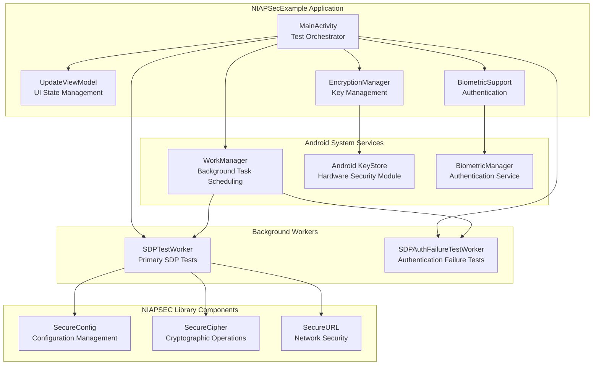
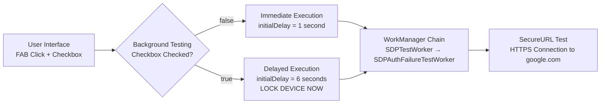
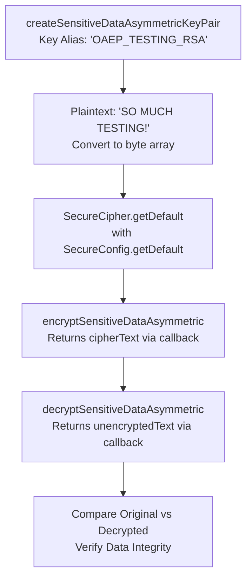
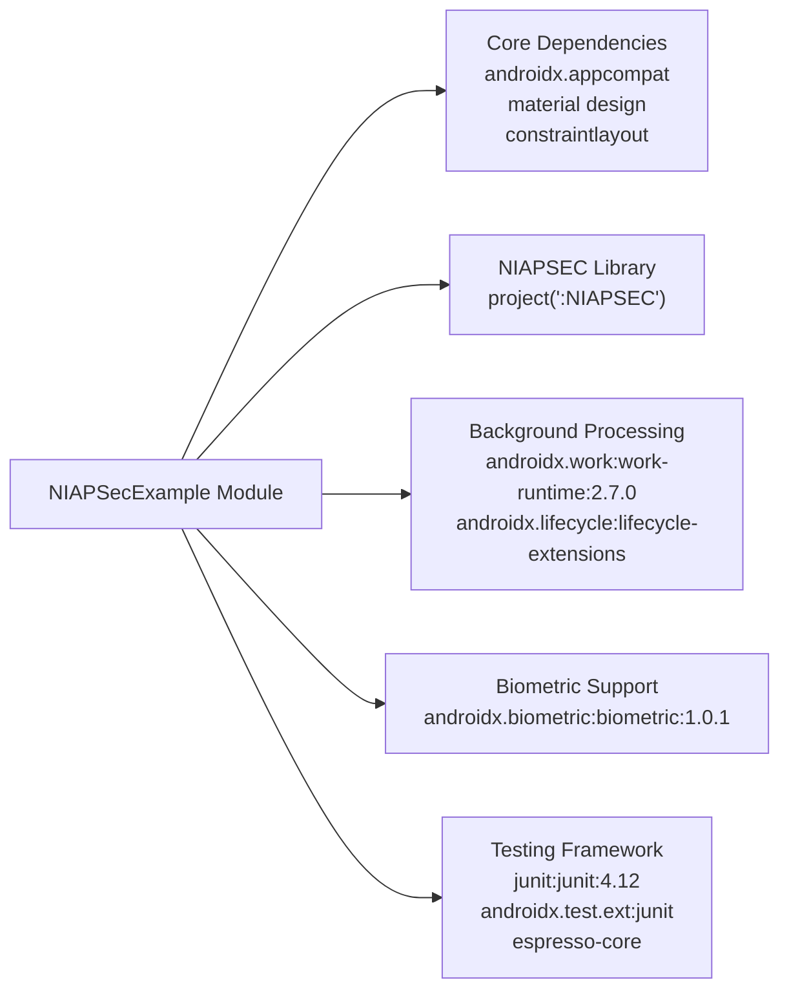

<!-- source: DeepWiki mcp.deepwiki.com · repo android/security-certification-resources · page 3.3 NIAP Sensitive Data Protection Example · fetched 2026-10-23 -->

# NIAP Sensitive Data Protection Example

Relevant source files

The following files were used as context for generating this wiki page:

- [niap-cc/NIAPSecExample/app/build.gradle](niap-cc/NIAPSecExample/app/build.gradle)
- [niap-cc/NIAPSecExample/app/src/main/AndroidManifest.xml](niap-cc/NIAPSecExample/app/src/main/AndroidManifest.xml)
- [niap-cc/NIAPSecExample/app/src/main/java/com/android/certifications/niap/MainActivity.java](niap-cc/NIAPSecExample/app/src/main/java/com/android/certifications/niap/MainActivity.java)
- [niap-cc/NIAPSecExample/build.gradle](niap-cc/NIAPSecExample/build.gradle)
- [niap-cc/NIAPSecExample/gradle.properties](niap-cc/NIAPSecExample/gradle.properties)
- [niap-cc/NIAPSecExample/gradle/wrapper/gradle-wrapper.properties](niap-cc/NIAPSecExample/gradle/wrapper/gradle-wrapper.properties)

## Purpose and Scope

The NIAP Sensitive Data Protection Example (`NIAPSecExample`) is a specialized Android application designed to demonstrate and test Sensitive Data Protection (SDP) requirements for NIAP Common Criteria certification. This application serves as a sample tool for Original Equipment Manufacturers (OEMs) to validate that cryptographic keys become unavailable for decryption operations when the Android device is locked, while still allowing encryption operations.

The application integrates with the NIAPSEC library to perform comprehensive testing of cryptographic operations, biometric authentication, secure network connections, and background service execution under various device lock states. For broader permission testing capabilities, see [Permission Testing Framework](#2). For other supporting applications in the testing ecosystem, see [Supporting Applications](#3).

## Application Architecture

The NIAPSecExample application follows a simple activity-based architecture with background worker integration for testing device lock scenarios.

**Sources:** [niap-cc/NIAPSecExample/app/src/main/java/com/android/certifications/niap/MainActivity.java:1-196]()

## Core SDP Testing Functionality

### Main Activity Test Orchestration

The `MainActivity` class serves as the primary interface for initiating SDP tests. It provides options for immediate testing or delayed execution to allow device locking before test execution.

**Sources:** [niap-cc/NIAPSecExample/app/src/main/java/com/android/certifications/niap/MainActivity.java:118-166]()

### Cryptographic Key Testing

The application includes OAEP (Optimal Asymmetric Encryption Padding) testing functionality to validate asymmetric encryption and decryption operations.

**Sources:** [niap-cc/NIAPSecExample/app/src/main/java/com/android/certifications/niap/MainActivity.java:173-195]()

## Background Testing Workflow

The application uses Android's `WorkManager` to execute tests in background scenarios, particularly when the device is locked to validate SDP compliance.

### WorkManager Test Chain

| Component | Purpose | Execution Timing |
|-----------|---------|------------------|
| `SDPTestWorker` | Primary SDP validation tests | Initial delay (1-6 seconds) |
| `SDPAuthFailureTestWorker` | Authentication failure scenarios | After SDPTestWorker completion |

### Device Lock Testing Protocol

The application implements a specific protocol for testing cryptographic operations while the device is locked:

1. **Pre-lock Setup**: User checks "Run in Background" checkbox
2. **Lock Warning**: Application logs warning messages to lock device
3. **Delayed Execution**: 6-second delay allows user to lock device
4. **Background Testing**: WorkManager executes tests while device is locked
5. **Key Availability Validation**: Tests verify keys are unavailable for decryption

**Sources:** [niap-cc/NIAPSecExample/app/src/main/java/com/android/certifications/niap/MainActivity.java:119-141]()

## Build Configuration and Dependencies

### Module Structure

The NIAPSecExample is configured as a standalone Android application module with specific dependencies for SDP testing.

| Configuration | Value | Purpose |
|---------------|-------|---------|
| Application ID | `com.android.certifications.niap.sdp` | Unique app identifier |
| Min SDK Version | 28 | Android 9+ requirement |
| Target SDK Version | 31 | Android 12 targeting |
| Compile SDK Version | 33 | Android 13 build tools |

### Key Dependencies

**Sources:** [niap-cc/NIAPSecExample/app/build.gradle:49-66]()

## Required Permissions

The application declares specific permissions necessary for SDP testing operations:

| Permission | Purpose |
|------------|---------|
| `INTERNET` | Network connectivity for TLS/OCSP tests |
| `ACCESS_NETWORK_STATE` | Network state monitoring |
| `ACCESS_WIFI_STATE` | WiFi configuration access |
| `ACCESS_FINE_LOCATION` | Location-based network testing |
| `FOREGROUND_SERVICE` | Background service execution |
| `WRITE_EXTERNAL_STORAGE` | Test data persistence |
| `READ_EXTERNAL_STORAGE` | Test data access |
| `USE_BIOMETRIC` | Biometric authentication testing |

**Sources:** [niap-cc/NIAPSecExample/app/src/main/AndroidManifest.xml:17-25]()

## Network Security Configuration

The application includes a custom network security configuration to support secure connection testing as part of SDP validation.

**Sources:** [niap-cc/NIAPSecExample/app/src/main/AndroidManifest.xml:34]()

---

