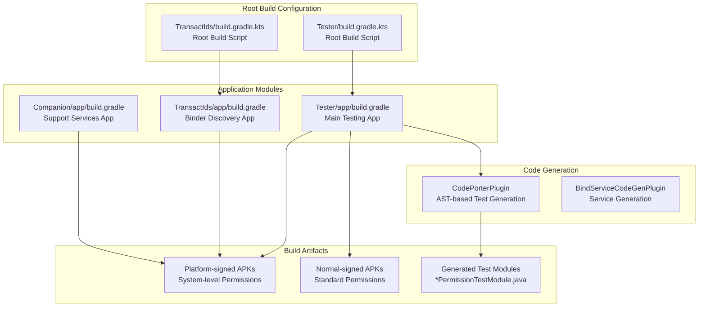
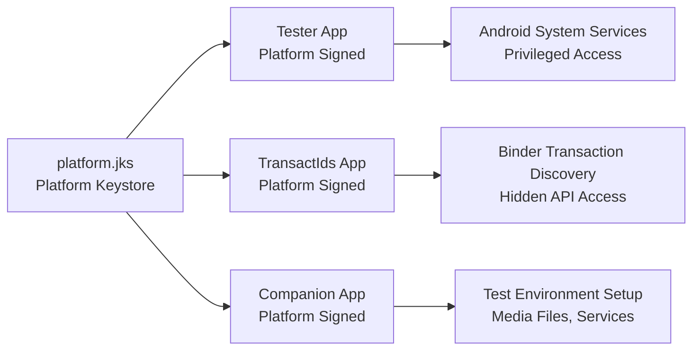
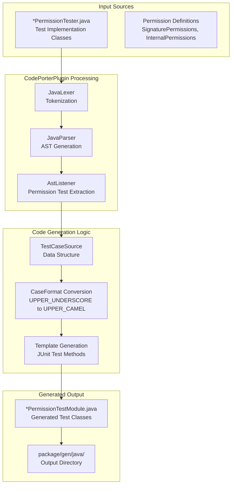
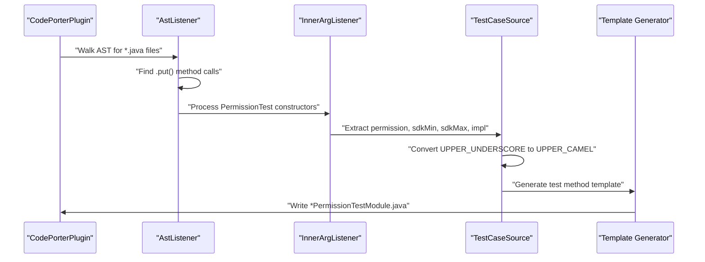
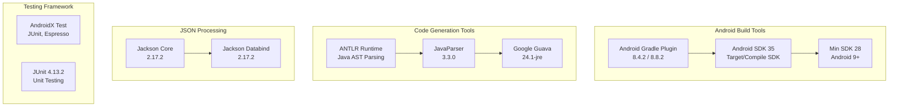
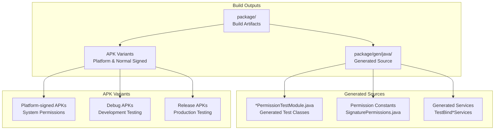

<!-- source: DeepWiki mcp.deepwiki.com · repo android/security-certification-resources · page 4 Build System and Code Generation · fetched 2026-10-23 -->

# Build System and Code Generation

Relevant source files

The following files were used as context for generating this wiki page:

- [niap-cc/Permissions/Companion/.aiexclude](niap-cc/Permissions/Companion/.aiexclude)
- [niap-cc/Permissions/Companion/gradle/wrapper/gradle-wrapper.properties](niap-cc/Permissions/Companion/gradle/wrapper/gradle-wrapper.properties)
- [niap-cc/Permissions/Tester/.aiexclude](niap-cc/Permissions/Tester/.aiexclude)
- [niap-cc/Permissions/Tester/.gitignore](niap-cc/Permissions/Tester/.gitignore)
- [niap-cc/Permissions/Tester/app/src/main/res/xml/preference.xml](niap-cc/Permissions/Tester/app/src/main/res/xml/preference.xml)
- [niap-cc/Permissions/Tester/build.gradle.kts](niap-cc/Permissions/Tester/build.gradle.kts)
- [niap-cc/Permissions/Tester/gradle/code-porter-plugin/plugin/src/main/kotlin/niap/codeporter/CodePorterPlugin.kt](niap-cc/Permissions/Tester/gradle/code-porter-plugin/plugin/src/main/kotlin/niap/codeporter/CodePorterPlugin.kt)
- [niap-cc/Permissions/Tester/gradle/code-porter-plugin/plugin/src/test/kotlin/org/example/CodePorterPluginTest.kt](niap-cc/Permissions/Tester/gradle/code-porter-plugin/plugin/src/test/kotlin/org/example/CodePorterPluginTest.kt)
- [niap-cc/Permissions/TransactIds/.aiexclude](niap-cc/Permissions/TransactIds/.aiexclude)
- [niap-cc/Permissions/TransactIds/app/build.gradle](niap-cc/Permissions/TransactIds/app/build.gradle)
- [niap-cc/Permissions/TransactIds/build.gradle.kts](niap-cc/Permissions/TransactIds/build.gradle.kts)
- [niap-cc/Permissions/TransactIds/gradle/wrapper/gradle-wrapper.properties](niap-cc/Permissions/TransactIds/gradle/wrapper/gradle-wrapper.properties)

This document covers the multi-module Gradle build system and automated code generation infrastructure that supports the Android Security Certification Resources framework. The build system orchestrates compilation of multiple Android applications with different signing configurations, while code generation tools automatically create test modules and supporting classes.

For detailed information about the generated permission test modules, see [Permission Test Modules](#5.2). For information about the runtime applications produced by this build system, see [Supporting Applications](#3).

## Multi-Module Build Architecture

The project uses a multi-module Gradle build system with several distinct Android applications, each serving different roles in the testing ecosystem. The build configuration supports both platform-signed and standard-signed variants to test different permission scenarios.

### Build System Overview

**Sources:** [niap-cc/Permissions/Tester/build.gradle.kts:18-32](), [niap-cc/Permissions/TransactIds/build.gradle.kts:18-29](), [niap-cc/Permissions/TransactIds/app/build.gradle:17-58]()

### Platform Signing Configuration

The build system implements platform signing to enable testing of signature-protected permissions that require system-level access. This configuration is critical for comprehensive permission testing.

| Module | Platform Signing | Purpose |
|--------|------------------|---------|
| Tester | Required | Tests signature permissions requiring platform certificate |
| TransactIds | Required | Accesses system services for binder transaction discovery |
| Companion | Required | Sets up test environment with privileged operations |

The signing configuration uses a shared platform keystore:

**Sources:** [niap-cc/Permissions/TransactIds/app/build.gradle:24-42]()

## Code Generation Pipeline

The build system includes sophisticated code generation tools that automatically create test modules and supporting classes from existing permission tester implementations.

### CodePorterPlugin Architecture

The `CodePorterPlugin` uses ANTLR-based Java AST parsing to analyze existing `*PermissionTester.java` files and generate corresponding `*PermissionTestModule.java` classes with JUnit-style test methods.

**Sources:** [niap-cc/Permissions/Tester/gradle/code-porter-plugin/plugin/src/main/kotlin/niap/codeporter/CodePorterPlugin.kt:47-64](), [niap-cc/Permissions/Tester/gradle/code-porter-plugin/plugin/src/main/kotlin/niap/codeporter/CodePorterPlugin.kt:199-223]()

### Permission Test Extraction Process

The code generation process extracts permission test definitions from `PermissionTest` object instantiations within the source testers and converts them into individual test methods:

**Sources:** [niap-cc/Permissions/Tester/gradle/code-porter-plugin/plugin/src/main/kotlin/niap/codeporter/CodePorterPlugin.kt:96-168](), [niap-cc/Permissions/Tester/gradle/code-porter-plugin/plugin/src/main/kotlin/niap/codeporter/CodePorterPlugin.kt:272-311]()

### Generated Test Module Structure

The `CodePorterPlugin` generates test modules following a consistent pattern with SDK version constraints and permission annotations:

| Generated Element | Purpose | Example |
|------------------|---------|---------|
| `@PermissionTestModule` | Class-level annotation | `name="Signature Test Cases"` |
| `@PermissionTest` | Method-level annotation | `permission=CAMERA, sdkMin=28` |
| Test Method Names | Camel case conversion | `testManageUsersPermission()` |
| SDK Constraints | Version-specific testing | `sdkMin=31, sdkMax=34` |

**Sources:** [niap-cc/Permissions/Tester/gradle/code-porter-plugin/plugin/src/main/kotlin/niap/codeporter/CodePorterPlugin.kt:260-268](), [niap-cc/Permissions/Tester/gradle/code-porter-plugin/plugin/src/main/kotlin/niap/codeporter/CodePorterPlugin.kt:301-306]()

## Build Dependencies and Tools

The build system integrates multiple specialized tools and dependencies to support both standard Android development and advanced system-level testing capabilities.

### Core Build Dependencies

**Sources:** [niap-cc/Permissions/Tester/build.gradle.kts:24-27](), [niap-cc/Permissions/TransactIds/app/build.gradle:67-83]()

### Gradle Wrapper Configuration

The project uses different Gradle wrapper versions across modules to ensure compatibility with various Android Gradle Plugin versions:

| Module | Gradle Version | Purpose |
|--------|----------------|---------|
| TransactIds | 8.10.2 | Latest features for binder discovery |
| Companion | 8.7 | Stable version for support services |
| Tester | 8.4.2 | Compatible with complex code generation |

**Sources:** [niap-cc/Permissions/TransactIds/gradle/wrapper/gradle-wrapper.properties:4](), [niap-cc/Permissions/Companion/gradle/wrapper/gradle-wrapper.properties:3]()

## Build Artifacts and Output Structure

The build system produces multiple APK variants and generated source files organized in a structured output directory:

**Sources:** [niap-cc/Permissions/Tester/gradle/code-porter-plugin/plugin/src/main/kotlin/niap/codeporter/CodePorterPlugin.kt:73-75](), [niap-cc/Permissions/Tester/.gitignore:44-45]()

---

