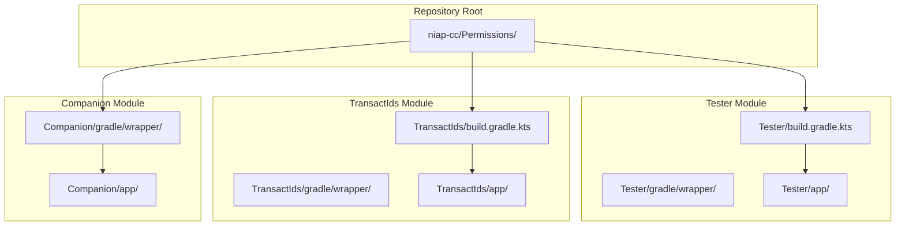
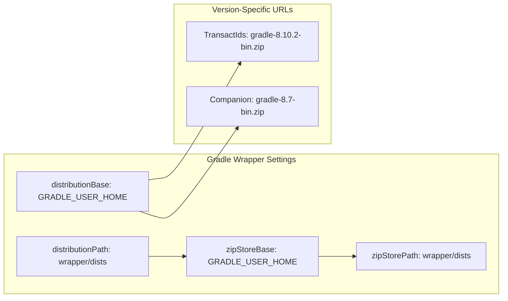
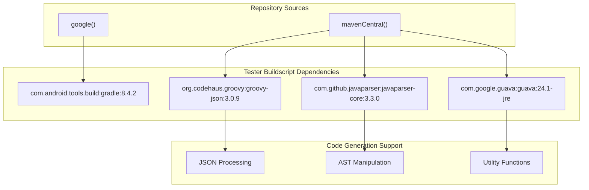
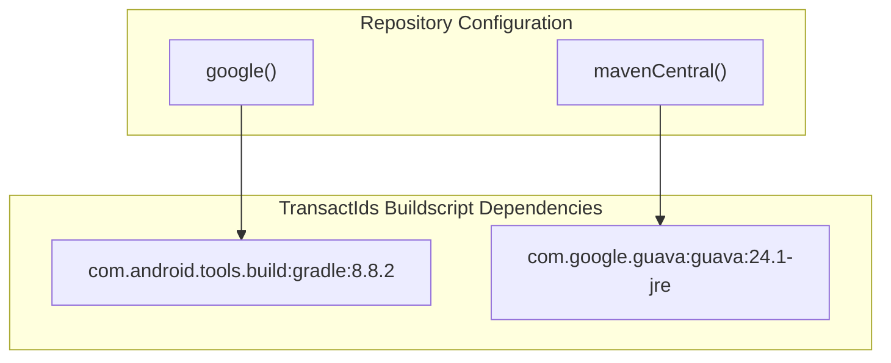
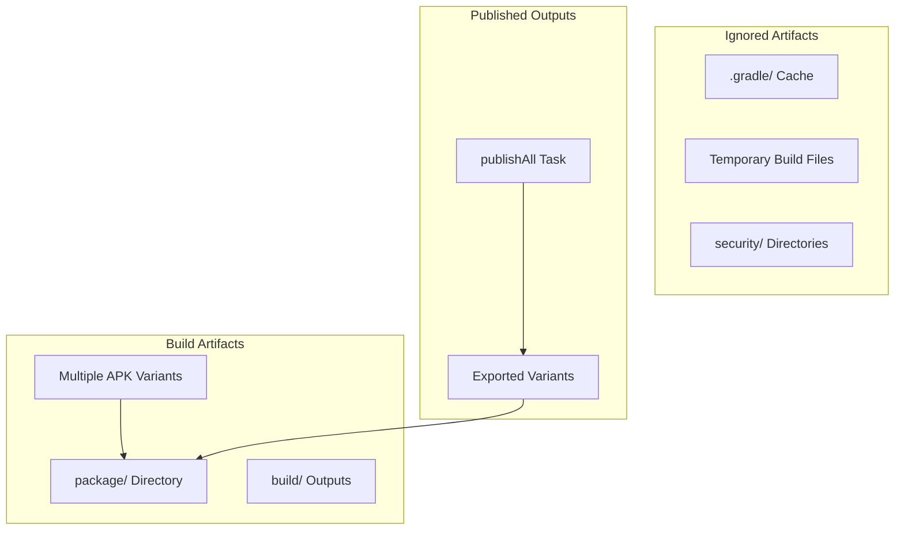
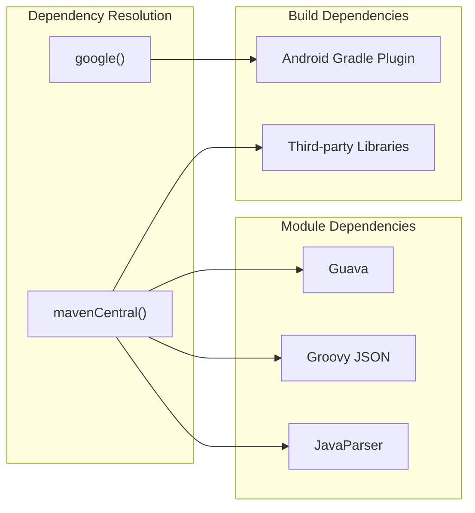

<!-- source: DeepWiki mcp.deepwiki.com · repo android/security-certification-resources · page 4.1 Gradle Build Configuration · fetched 2026-10-23 -->

# Gradle Build Configuration

Relevant source files

The following files were used as context for generating this wiki page:

- [niap-cc/Permissions/Companion/.aiexclude](niap-cc/Permissions/Companion/.aiexclude)
- [niap-cc/Permissions/Companion/gradle/wrapper/gradle-wrapper.properties](niap-cc/Permissions/Companion/gradle/wrapper/gradle-wrapper.properties)
- [niap-cc/Permissions/Tester/.aiexclude](niap-cc/Permissions/Tester/.aiexclude)
- [niap-cc/Permissions/Tester/.gitignore](niap-cc/Permissions/Tester/.gitignore)
- [niap-cc/Permissions/Tester/app/src/main/res/xml/preference.xml](niap-cc/Permissions/Tester/app/src/main/res/xml/preference.xml)
- [niap-cc/Permissions/Tester/build.gradle.kts](niap-cc/Permissions/Tester/build.gradle.kts)
- [niap-cc/Permissions/TransactIds/.aiexclude](niap-cc/Permissions/TransactIds/.aiexclude)
- [niap-cc/Permissions/TransactIds/build.gradle.kts](niap-cc/Permissions/TransactIds/build.gradle.kts)
- [niap-cc/Permissions/TransactIds/gradle/wrapper/gradle-wrapper.properties](niap-cc/Permissions/TransactIds/gradle/wrapper/gradle-wrapper.properties)

## Purpose and Scope

This document covers the Gradle build system configuration for the Android Security Certification Resources repository. The build system manages a multi-module project structure with multiple Android applications, automated code generation, and cross-module dependencies. For information about the automated code generation tools that integrate with this build system, see [Code Generation Tools](#4.2). For details about the specific applications built by this system, see [Supporting Applications](#3).

## Multi-Module Project Architecture

The repository implements a multi-module Gradle project structure with three primary Android applications, each with independent build configurations and Gradle wrapper versions.

### Project Structure Overview

Sources: [niap-cc/Permissions/Tester/build.gradle.kts:1-43](), [niap-cc/Permissions/TransactIds/build.gradle.kts:1-37](), [niap-cc/Permissions/Companion/gradle/wrapper/gradle-wrapper.properties:1-6]()

## Gradle Wrapper Configurations

Each module maintains its own Gradle wrapper configuration with different versions, allowing for independent build environments and gradual migration across Gradle versions.

### Gradle Version Matrix

| Module | Gradle Version | Distribution URL |
|--------|----------------|------------------|
| Tester | 8.4.2 (build.gradle.kts) | Standard |
| TransactIds | 8.10.2 | gradle-8.10.2-bin.zip |
| Companion | 8.7 | gradle-8.7-bin.zip |

### Wrapper Configuration Details

Sources: [niap-cc/Permissions/TransactIds/gradle/wrapper/gradle-wrapper.properties:1-7](), [niap-cc/Permissions/Companion/gradle/wrapper/gradle-wrapper.properties:1-6]()

## Build Dependencies and Classpaths

The build system configures different classpath dependencies for each module based on their specific requirements, particularly for code generation and Android build tools.

### Tester Module Dependencies

The Tester module includes the most comprehensive set of build dependencies, supporting code generation and JSON processing:

### TransactIds Module Dependencies

The TransactIds module uses a simpler dependency configuration focused on Android build tools:

Sources: [niap-cc/Permissions/Tester/build.gradle.kts:18-32](), [niap-cc/Permissions/TransactIds/build.gradle.kts:18-29]()

## Build Artifacts and Output Management

The build system manages multiple output artifacts and build variants, with specific configurations for packaging and deployment.

### Build Output Structure

### Gitignore Configuration

The build system excludes standard Android and Gradle build artifacts:

| Artifact Type | Patterns |
|---------------|----------|
| Android Generated | `bin`, `gen`, `libs`, `obj`, `lint.xml` |
| Android Studio | `.idea/*`, `*.iml`, `*.ipr`, `*.iws`, `.gradle`, `.externalNativeBuild` |
| Gradle | `.gradle/*`, `/build`, `/captures`, `buildout`, `out` |
| Security | `/security`, `/security/` |
| Package Output | `/package`, `/package/*` |

Sources: [niap-cc/Permissions/Tester/.gitignore:1-46](), [niap-cc/Permissions/Tester/build.gradle.kts:42-43]()

## Repository Configuration

All modules share a consistent repository configuration for dependency resolution, using Google's Android repository and Maven Central.

### Repository Resolution Order

The `allprojects` block ensures consistent repository configuration across all submodules, with Google's repository taking precedence for Android-specific dependencies.

Sources: [niap-cc/Permissions/Tester/build.gradle.kts:35-40](), [niap-cc/Permissions/TransactIds/build.gradle.kts:31-36]()

## AI Exclusion Configuration

The build system includes AI exclusion files to prevent sensitive security-related directories from being processed by AI tools during development.

### Exclusion Patterns

| Module | Excluded Directories |
|--------|---------------------|
| Tester | `/security/` |
| TransactIds | `/signature/` |
| Companion | `/security/` |

Sources: [niap-cc/Permissions/Tester/.aiexclude:1-2](), [niap-cc/Permissions/TransactIds/.aiexclude:1-1](), [niap-cc/Permissions/Companion/.aiexclude:1-2]()

---

