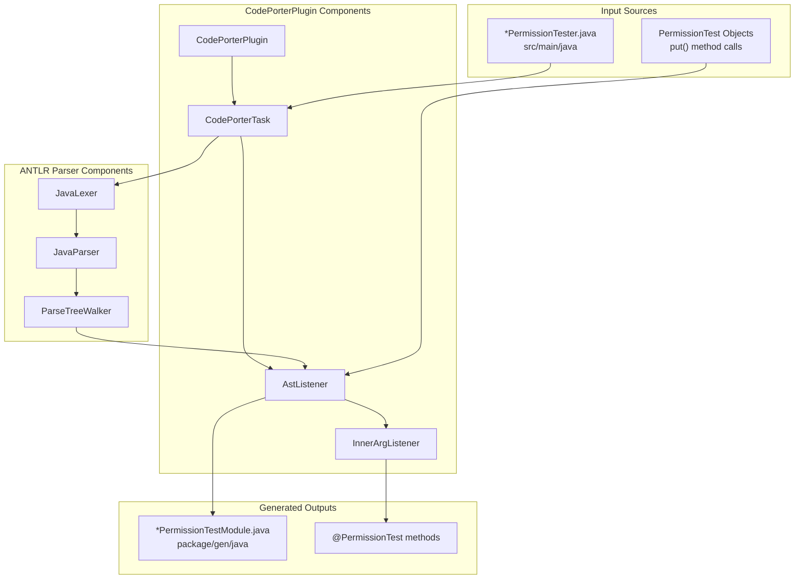
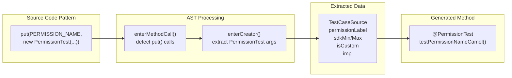
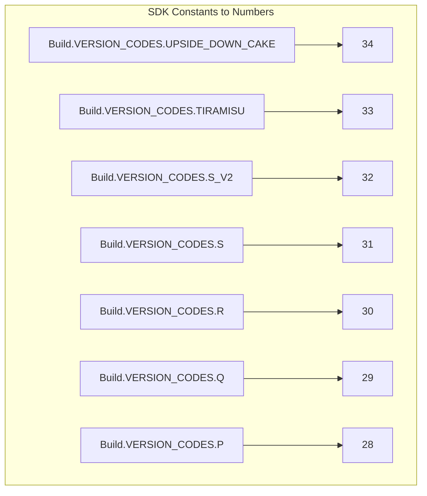
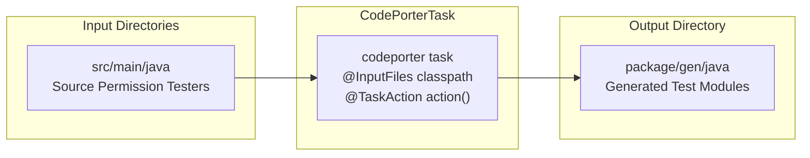
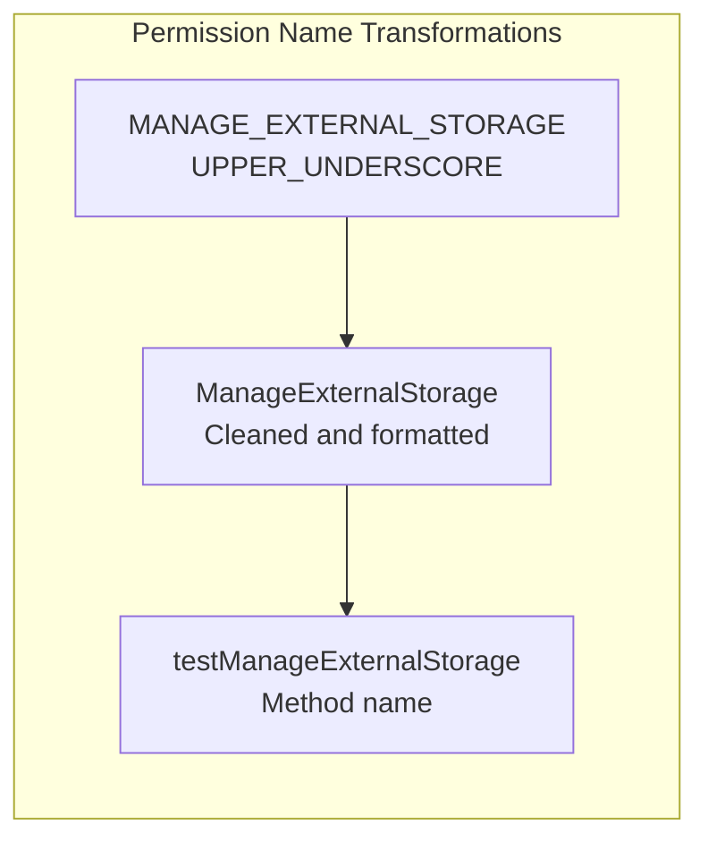
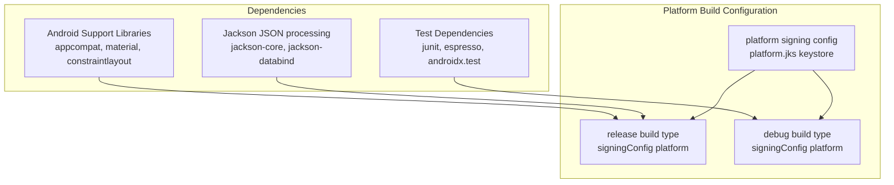
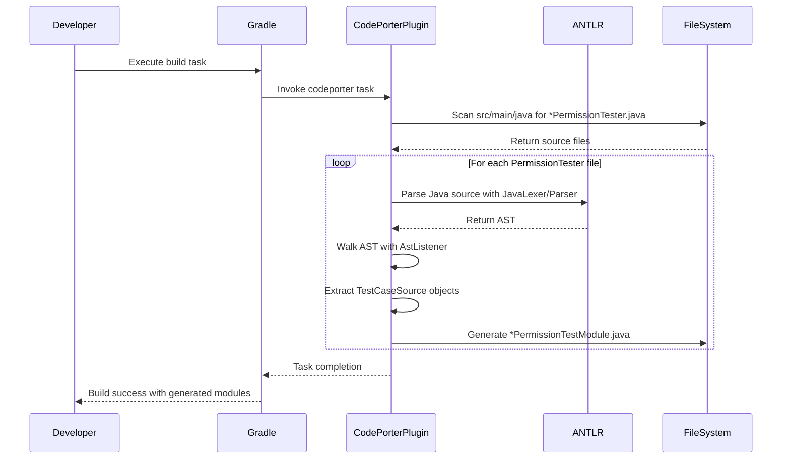

<!-- source: DeepWiki mcp.deepwiki.com · repo android/security-certification-resources · page 4.2 Code Generation Tools · fetched 2026-10-23 -->

# Code Generation Tools

<details>
<summary>Relevant source files</summary>

The following files were used as context for generating this wiki page:

- [niap-cc/Permissions/Tester/gradle/code-porter-plugin/plugin/src/main/kotlin/niap/codeporter/CodePorterPlugin.kt](niap-cc/Permissions/Tester/gradle/code-porter-plugin/plugin/src/main/kotlin/niap/codeporter/CodePorterPlugin.kt)
- [niap-cc/Permissions/Tester/gradle/code-porter-plugin/plugin/src/test/kotlin/org/example/CodePorterPluginTest.kt](niap-cc/Permissions/Tester/gradle/code-porter-plugin/plugin/src/test/kotlin/org/example/CodePorterPluginTest.kt)
- [niap-cc/Permissions/TransactIds/app/build.gradle](niap-cc/Permissions/TransactIds/app/build.gradle)

</details>


This document covers the automated code generation tools used in the Android Security Certification Resources project. These tools automatically generate Java test modules, permission constants, and other code artifacts from source definitions to ensure comprehensive test coverage and maintain consistency across different Android API levels.

For information about permission definitions that feed into code generation, see [Permission Definitions and Constants](#4.3). For details about the overall build system configuration, see [Gradle Build Configuration](#4.1).

## Overview

The project employs several code generation strategies to automatically create test code and supporting infrastructure:

- **CodePorterPlugin**: AST-based generation of permission test modules from existing tester implementations
- **Permission constant generation**: Automatic creation of permission constant classes from JSON definitions  
- **Transaction mapping generation**: SDK version-specific binder transaction ID mappings
- **Service binding code generation**: Generated service classes for companion app testing

## CodePorterPlugin Architecture

The `CodePorterPlugin` is the primary code generation tool, implemented as a Gradle plugin that uses ANTLR-based Java parsing to automatically generate test modules from existing permission tester classes.

### Plugin Structure



Sources: [niap-cc/Permissions/Tester/gradle/code-porter-plugin/plugin/src/main/kotlin/niap/codeporter/CodePorterPlugin.kt:47-64]()

### AST Parsing and Code Extraction

The plugin uses a sophisticated AST walking approach to extract test case definitions from existing Java source files:



The `AstListener` class processes method calls to identify `put()` operations, while the nested `InnerArgListener` extracts parameters from `PermissionTest` constructor calls.

Sources: [niap-cc/Permissions/Tester/gradle/code-porter-plugin/plugin/src/main/kotlin/niap/codeporter/CodePorterPlugin.kt:96-197]()

### Test Case Data Structure

The plugin extracts test case information into a structured format:

| Field | Description | Example |
|-------|-------------|---------|
| `permissionLabel` | Original permission constant name | `"CAMERA"` |
| `permissionLabelCamel` | CamelCase method name | `"Camera"` |
| `sdkMin` | Minimum SDK version | `28` |
| `sdkMax` | Maximum SDK version | `35` |
| `isCustom` | Custom test case flag | `true/false` |
| `impl` | Lambda implementation code | `"() -> { ... }"` |

Sources: [niap-cc/Permissions/Tester/gradle/code-porter-plugin/plugin/src/main/kotlin/niap/codeporter/CodePorterPlugin.kt:77-84]()

### SDK Version Mapping

The plugin includes logic to convert SDK version constants to numeric values for proper test targeting:



This mapping ensures generated test methods include proper `sdkMin` and `sdkMax` parameters for version-specific testing.

Sources: [niap-cc/Permissions/Tester/gradle/code-porter-plugin/plugin/src/main/kotlin/niap/codeporter/CodePorterPlugin.kt:119-150]()

## Generated Code Structure

### Permission Test Module Template

The plugin generates complete Java classes following this structure:

```mermaid
graph TB
    subgraph "Generated Class Structure"
        HEADER["License Header<br/>Package Declaration<br/>Imports"]
        ANNOTATION["@PermissionTestModule(name=...)"]] 
        CLASS["public class XPermissionTestModule<br/>extends PermissionTestModuleBase"]
        CONSTRUCTOR["Constructor with Activity parameter"]
        START["start() method override"]
        HELPER["systemService() helper method"]
        TESTS["Generated @PermissionTest methods"]
    end
    
    HEADER --> ANNOTATION
    ANNOTATION --> CLASS
    CLASS --> CONSTRUCTOR
    CONSTRUCTOR --> START
    START --> HELPER
    HELPER --> TESTS
```

Each generated class includes:
- Proper copyright header and imports
- `@PermissionTestModule` annotation with descriptive name
- Extension of `PermissionTestModuleBase`
- Individual `@PermissionTest` annotated methods for each permission

Sources: [niap-cc/Permissions/Tester/gradle/code-porter-plugin/plugin/src/main/kotlin/niap/codeporter/CodePorterPlugin.kt:224-271]()

### Lambda Expression Processing

The plugin handles different lambda expression formats from the source code:

| Input Format | Processing | Output |
|--------------|------------|---------|
| `() -> { code }` | Remove wrapper, adjust indentation | `code` with proper formatting |
| `() -> methodCall()` | Add semicolon, adjust indentation | `methodCall();` |
| Complex expressions | Preserve as-is | Original expression |

Sources: [niap-cc/Permissions/Tester/gradle/code-porter-plugin/plugin/src/main/kotlin/niap/codeporter/CodePorterPlugin.kt:288-300]()

## Build Integration

### Task Configuration

The `CodePorterTask` is configured as a Gradle task with specific input and output directories:



The task automatically creates the output directory if it doesn't exist and processes all `*PermissionTester.java` files found in the source tree.

Sources: [niap-cc/Permissions/Tester/gradle/code-porter-plugin/plugin/src/main/kotlin/niap/codeporter/CodePorterPlugin.kt:68-76](), [niap-cc/Permissions/Tester/gradle/code-porter-plugin/plugin/src/main/kotlin/niap/codeporter/CodePorterPlugin.kt:202-218]()

### Case Conversion Utilities

The plugin includes utility functions for converting between different naming conventions:



The conversion process removes common prefixes like `SignaturePermissions.permission.` and `android.permission.` before applying case format transformations.

Sources: [niap-cc/Permissions/Tester/gradle/code-porter-plugin/plugin/src/main/kotlin/niap/codeporter/CodePorterPlugin.kt:43-45](), [niap-cc/Permissions/Tester/gradle/code-porter-plugin/plugin/src/main/kotlin/niap/codeporter/CodePorterPlugin.kt:110-117]()

## Platform Integration and Signing

### Build Configuration for Generated Code

The generated code integrates with platform-signed build configurations, as evidenced by the TransactIds app build configuration:



This configuration ensures that generated code can access platform-level APIs and permissions required for comprehensive security testing.

Sources: [niap-cc/Permissions/TransactIds/app/build.gradle:24-58]()

## Code Generation Workflow

The complete code generation process follows this workflow:



This automated process ensures that permission test modules remain synchronized with their corresponding tester implementations, reducing manual maintenance overhead while ensuring comprehensive test coverage.

Sources: [niap-cc/Permissions/Tester/gradle/code-porter-plugin/plugin/src/main/kotlin/niap/codeporter/CodePorterPlugin.kt:199-348]()

---

