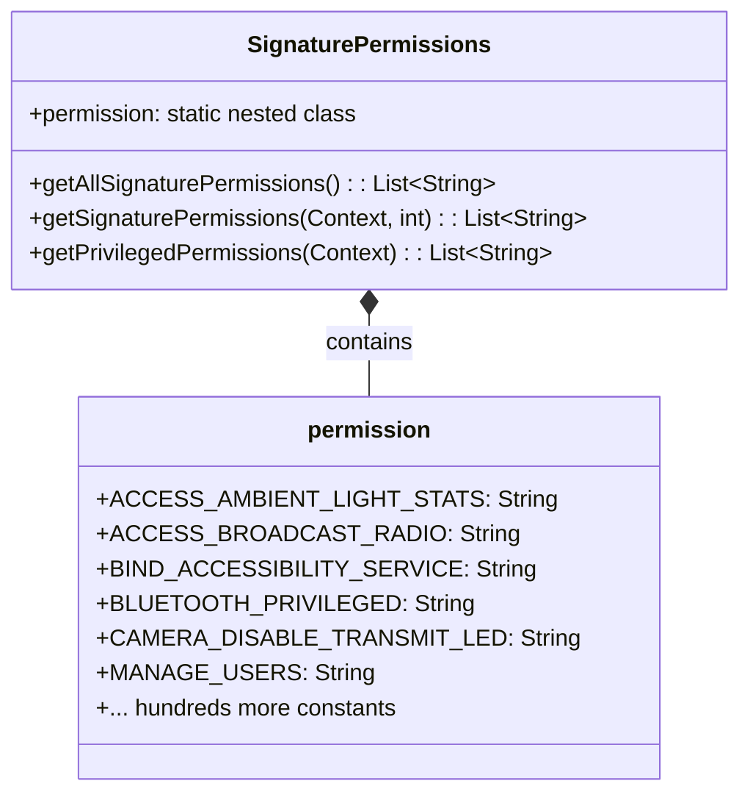
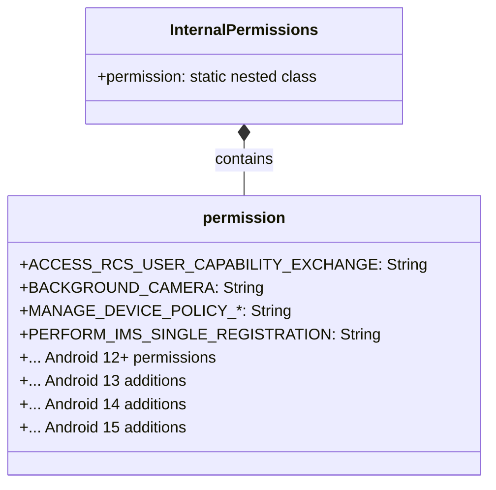
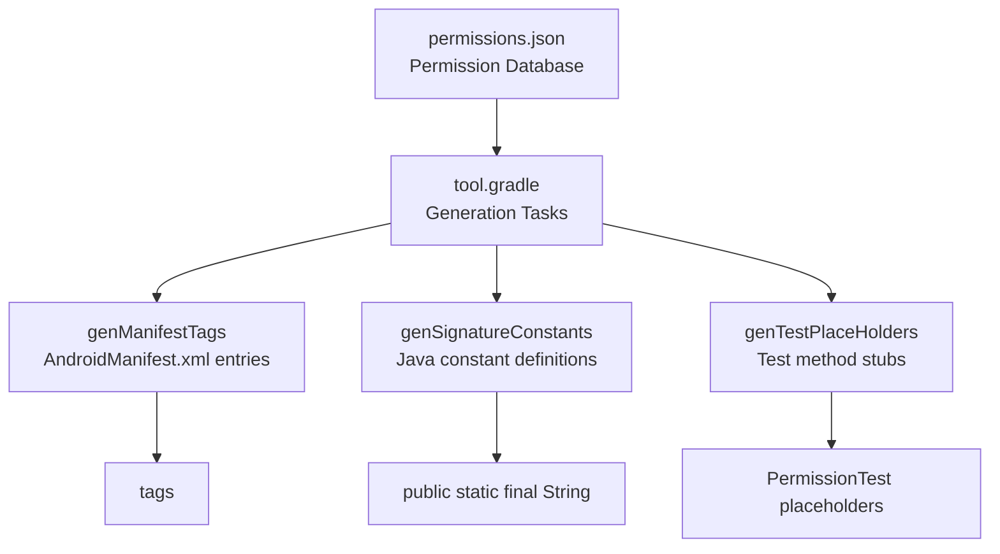
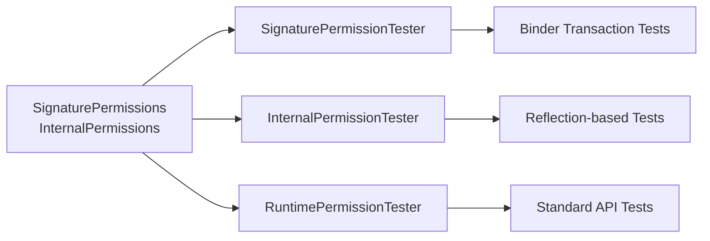
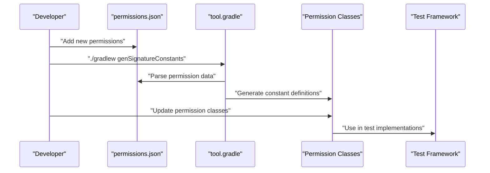

<!-- source: DeepWiki mcp.deepwiki.com · repo android/security-certification-resources · page 4.3 Permission Definitions and Constants · fetched 2026-10-23 -->

# Permission Definitions and Constants

<details>
<summary>Relevant source files</summary>

The following files were used as context for generating this wiki page:

- [niap-cc/Permissions/Tester/app/src/main/java/com/android/certifications/niap/permissions/utils/InternalPermissions.java](niap-cc/Permissions/Tester/app/src/main/java/com/android/certifications/niap/permissions/utils/InternalPermissions.java)
- [niap-cc/Permissions/Tester/app/src/main/java/com/android/certifications/niap/permissions/utils/SignaturePermissions.java](niap-cc/Permissions/Tester/app/src/main/java/com/android/certifications/niap/permissions/utils/SignaturePermissions.java)
- [niap-cc/Permissions/Tester/permissions.json](niap-cc/Permissions/Tester/permissions.json)
- [niap-cc/Permissions/Tester/tool.gradle](niap-cc/Permissions/Tester/tool.gradle)

</details>


This page documents the permission definition and constant generation system used by the Android security certification testing framework. The system maintains comprehensive lists of Android platform permissions organized by protection level and provides both manual constant definitions and automated generation tools.

For information about how these constants are used in actual permission testing, see [Permission Testing Framework](#2). For details on the build system infrastructure, see [Gradle Build Configuration](#4.1).

## Overview

The permission definitions system serves two primary purposes:
1. **Centralized Permission Management**: Maintains authoritative lists of Android platform permissions categorized by protection level (signature, internal, install)
2. **Constant Generation**: Provides build-time tools to generate Java constants and manifest entries from structured permission data

The system consists of manually maintained permission constant classes, a structured JSON permission database, and Gradle-based code generation tools.

## Permission Constant Classes

The framework provides two main classes that define platform permission constants:

### SignaturePermissions Class

The `SignaturePermissions` class contains definitions for all signature protection level permissions declared by the Android platform. These permissions are typically only available to system apps or apps signed with the platform certificate.



The class structure includes:
- **Static Constants**: Over 800 signature permission constants defined as `public static final String`
- **Filtering Methods**: Methods to retrieve permissions filtered by protection flags
- **Context Integration**: Methods that work with Android's `PermissionInfo` system

Sources: [niap-cc/Permissions/Tester/app/src/main/java/com/android/certifications/niap/permissions/utils/SignaturePermissions.java:37-596]()

### InternalPermissions Class

The `InternalPermissions` class defines internal protection level permissions introduced in Android 12. These permissions require additional qualification beyond platform signing.



Key characteristics:
- **Version-Organized**: Permissions grouped by Android version (12, 13, 14, 15)
- **Device Policy Focus**: Many permissions relate to device policy management
- **Specialized Protections**: Permissions that require specific conditions beyond signing

Sources: [niap-cc/Permissions/Tester/app/src/main/java/com/android/certifications/niap/permissions/utils/InternalPermissions.java:31-264]()

## Permission Data Source

### JSON Permission Database

The system uses a structured JSON file to maintain the authoritative list of permissions:

| Field | Description | Example Values |
|-------|-------------|----------------|
| `signature` | Platform signature permissions | `["CAMERA_HEADLESS_SYSTEM_USER", "THREAD_NETWORK_PRIVILEGED"]` |
| `install` | Install-time permissions | `["DETECT_SCREEN_RECORDING", "FOREGROUND_SERVICE_MEDIA_PROCESSING"]` |
| `internal` | Internal protection level permissions | `["MANAGE_DEVICE_POLICY_THREAD_NETWORK", "QUERY_DEVICE_STOLEN_STATE"]` |

The JSON structure organizes permissions by Android version (`V` for version 15 in the current example):

```json
{
  "V": {
    "signature": [...],
    "install": [...], 
    "internal": [...]
  }
}
```

Sources: [niap-cc/Permissions/Tester/permissions.json:1-72]()

## Code Generation System

### Gradle Build Tools

The build system provides automated tools for generating permission-related code from the JSON source:



### Generation Tasks

The system provides three main generation tasks:

#### 1. Manifest Tag Generation (`genManifestTags`)
Generates `<uses-permission>` XML tags for Android manifest files:

```xml
<!-- New signature permissions as of Android 15 -->
<uses-permission android:name="android.permission.CAMERA_HEADLESS_SYSTEM_USER" />
<uses-permission android:name="android.permission.THREAD_NETWORK_PRIVILEGED" />
```

#### 2. Constant Generation (`genSignatureConstants`)
Generates Java constant definitions for inclusion in permission classes:

```java
// New signature permissions as of Android 15
public static final String CAMERA_HEADLESS_SYSTEM_USER =
                "android.permission.CAMERA_HEADLESS_SYSTEM_USER";
public static final String THREAD_NETWORK_PRIVILEGED =
                "android.permission.THREAD_NETWORK_PRIVILEGED";
```

#### 3. Test Placeholder Generation (`genTestPlaceHolders`)
Creates boilerplate test method implementations:

```java
mPermissionTasks.put(permission.MANAGE_DEVICE_POLICY_THREAD_NETWORK,
                new PermissionTest(false, Build.VERSION_CODES.V, () -> {
                    mLogger.logDebug("Test case for MANAGE_DEVICE_POLICY_THREAD_NETWORK not implemented yet");
                }));
```

Sources: [niap-cc/Permissions/Tester/tool.gradle:21-72]()

## Integration with Testing Framework

### Usage in Permission Testers

The permission constants are extensively used throughout the testing framework:



### Constant Organization

The permission constants follow a consistent naming pattern:

| Pattern | Example | Usage |
|---------|---------|--------|
| `ACCESS_*` | `ACCESS_AMBIENT_LIGHT_STATS` | System resource access |
| `BIND_*` | `BIND_ACCESSIBILITY_SERVICE` | Service binding permissions |
| `MANAGE_*` | `MANAGE_DEVICE_POLICY_CAMERA` | Management capabilities |
| `READ_*/WRITE_*` | `READ_PRIVILEGED_PHONE_STATE` | Data access permissions |

### Version Management

The system tracks permission additions across Android versions:

- **Historical Permissions**: Core signature/internal permissions from earlier Android versions
- **Version-Specific Additions**: New permissions clearly marked by Android version
- **Deprecation Tracking**: Ability to identify when permissions were introduced

Sources: [niap-cc/Permissions/Tester/app/src/main/java/com/android/certifications/niap/permissions/utils/SignaturePermissions.java:598-800](), [niap-cc/Permissions/Tester/app/src/main/java/com/android/certifications/niap/permissions/utils/InternalPermissions.java:50-263]()

## Build Integration

### Workflow Integration

The permission definition system integrates with the overall build process:



### Maintenance Process

The system supports both automated and manual maintenance workflows:

1. **Automated Generation**: Use Gradle tasks to generate boilerplate code
2. **Manual Integration**: Copy generated constants into the appropriate permission classes
3. **Test Implementation**: Use generated placeholders as starting points for test development
4. **Version Tracking**: Organize new permissions by Android version

Sources: [niap-cc/Permissions/Tester/tool.gradle:2-7](), [niap-cc/Permissions/Tester/tool.gradle:42-48]()

---

