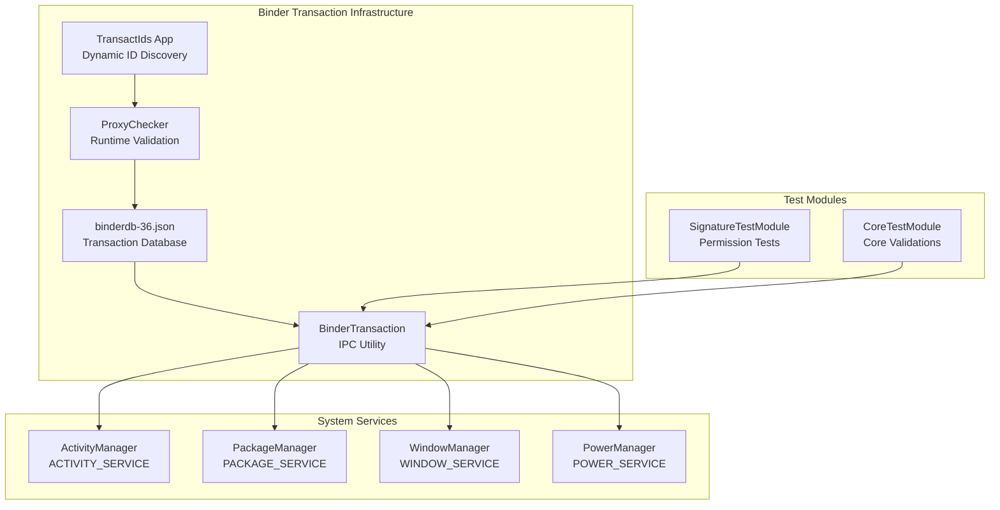
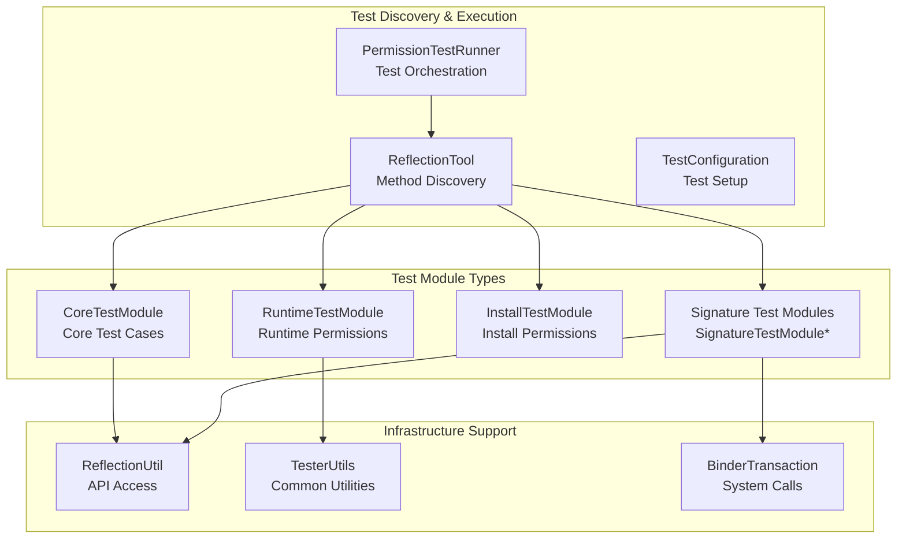
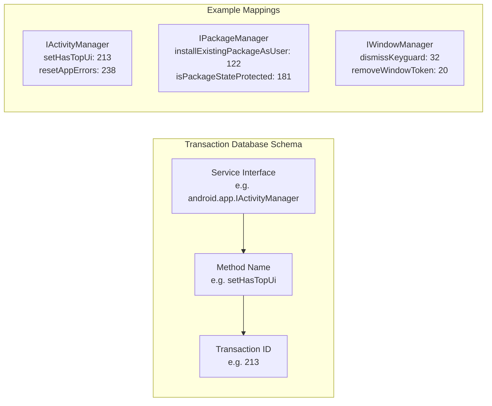
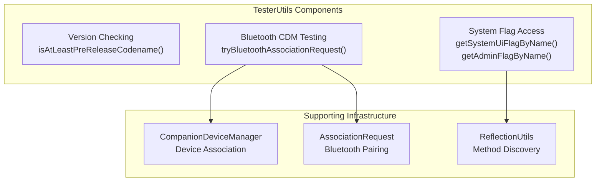
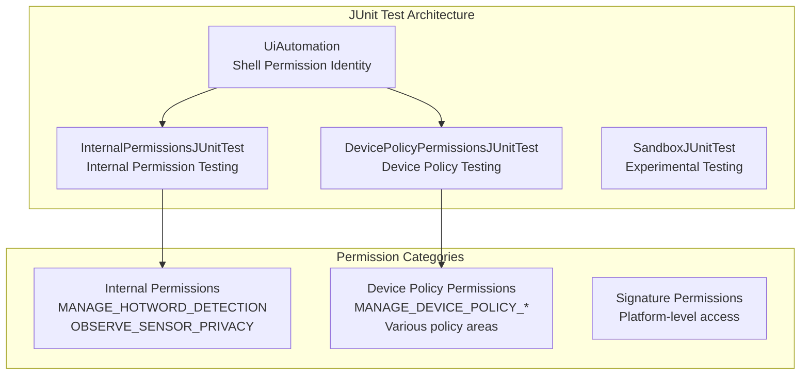
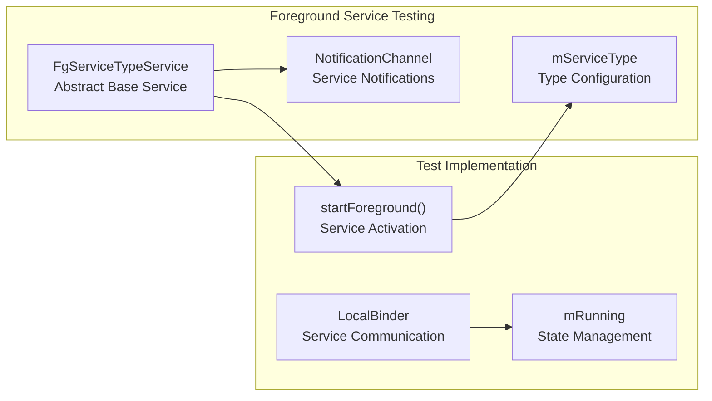

<!-- source: DeepWiki mcp.deepwiki.com · repo android/security-certification-resources · page 5 Advanced Testing Infrastructure · fetched 2026-10-23 -->

# Advanced Testing Infrastructure

Relevant source files

The following files were used as context for generating this wiki page:

- [niap-cc/Permissions/PermissionTester/app/src/main/assets/binderdb-36.json](niap-cc/Permissions/PermissionTester/app/src/main/assets/binderdb-36.json)
- [niap-cc/Permissions/PermissionTester/app/src/main/java/com/android/certification/niap/permission/dpctester/common/ReflectionUtil.java](niap-cc/Permissions/PermissionTester/app/src/main/java/com/android/certification/niap/permission/dpctester/common/ReflectionUtil.java)
- [niap-cc/Permissions/PermissionTester/app/src/main/java/com/android/certification/niap/permission/dpctester/service/FgServiceTypeService.java](niap-cc/Permissions/PermissionTester/app/src/main/java/com/android/certification/niap/permission/dpctester/service/FgServiceTypeService.java)
- [niap-cc/Permissions/PermissionTester/app/src/main/java/com/android/certification/niap/permission/dpctester/test/CoreTestModule.java](niap-cc/Permissions/PermissionTester/app/src/main/java/com/android/certification/niap/permission/dpctester/test/CoreTestModule.java)
- [niap-cc/Permissions/PermissionTester/app/src/main/java/com/android/certification/niap/permission/dpctester/test/SignatureTestModule.java](niap-cc/Permissions/PermissionTester/app/src/main/java/com/android/certification/niap/permission/dpctester/test/SignatureTestModule.java)
- [niap-cc/Permissions/PermissionTester/app/src/main/java/com/android/certification/niap/permission/dpctester/test/SignatureTestModuleQ.java](niap-cc/Permissions/PermissionTester/app/src/main/java/com/android/certification/niap/permission/dpctester/test/SignatureTestModuleQ.java)
- [niap-cc/Permissions/PermissionTester/app/src/main/java/com/android/certification/niap/permission/dpctester/test/SignatureTestModuleR.java](niap-cc/Permissions/PermissionTester/app/src/main/java/com/android/certification/niap/permission/dpctester/test/SignatureTestModuleR.java)
- [niap-cc/Permissions/PermissionTester/app/src/main/java/com/android/certification/niap/permission/dpctester/test/SignatureTestModuleS.java](niap-cc/Permissions/PermissionTester/app/src/main/java/com/android/certification/niap/permission/dpctester/test/SignatureTestModuleS.java)
- [niap-cc/Permissions/PermissionTester/app/src/main/java/com/android/certification/niap/permission/dpctester/test/runner/PermissionTestRunner.kt](niap-cc/Permissions/PermissionTester/app/src/main/java/com/android/certification/niap/permission/dpctester/test/runner/PermissionTestRunner.kt)
- [niap-cc/Permissions/Tester/app/src/androidTest/java/com/android/certifications/niap/permissions/DevicePolicyPermissionsJUnitTest.java](niap-cc/Permissions/Tester/app/src/androidTest/java/com/android/certifications/niap/permissions/DevicePolicyPermissionsJUnitTest.java)
- [niap-cc/Permissions/Tester/app/src/androidTest/java/com/android/certifications/niap/permissions/InternalPermissionsJUnitTest.java](niap-cc/Permissions/Tester/app/src/androidTest/java/com/android/certifications/niap/permissions/InternalPermissionsJUnitTest.java)
- [niap-cc/Permissions/Tester/app/src/androidTest/java/com/android/certifications/niap/permissions/SandboxJUnitTest.java](niap-cc/Permissions/Tester/app/src/androidTest/java/com/android/certifications/niap/permissions/SandboxJUnitTest.java)
- [niap-cc/Permissions/Tester/app/src/androidTest/java/com/android/certifications/niap/permissions/UDC_SignaturePermissions_test.java](niap-cc/Permissions/Tester/app/src/androidTest/java/com/android/certifications/niap/permissions/UDC_SignaturePermissions_test.java)
- [niap-cc/Permissions/Tester/app/src/main/aidl/android/app/ondeviceintelligence/IFeatureCallback.aidl](niap-cc/Permissions/Tester/app/src/main/aidl/android/app/ondeviceintelligence/IFeatureCallback.aidl)
- [niap-cc/Permissions/Tester/app/src/main/aidl/android/health/connect/migration/MigrationException.aidl](niap-cc/Permissions/Tester/app/src/main/aidl/android/health/connect/migration/MigrationException.aidl)
- [niap-cc/Permissions/Tester/app/src/main/java/android/app/ondeviceintelligence/Feature.java](niap-cc/Permissions/Tester/app/src/main/java/android/app/ondeviceintelligence/Feature.java)
- [niap-cc/Permissions/Tester/app/src/main/java/android/flags/SyncableFlag.java](niap-cc/Permissions/Tester/app/src/main/java/android/flags/SyncableFlag.java)
- [niap-cc/Permissions/Tester/app/src/main/java/android/health/connect/aidl/IMigrationCallback.java](niap-cc/Permissions/Tester/app/src/main/java/android/health/connect/aidl/IMigrationCallback.java)
- [niap-cc/Permissions/Tester/app/src/main/java/android/net/nsd/OffloadEngine.java](niap-cc/Permissions/Tester/app/src/main/java/android/net/nsd/OffloadEngine.java)
- [niap-cc/Permissions/Tester/app/src/main/java/com/android/certifications/niap/permissions/utils/TesterUtils.java](niap-cc/Permissions/Tester/app/src/main/java/com/android/certifications/niap/permissions/utils/TesterUtils.java)
- [niap-cc/Permissions/TransactIds/app/src/main/java/com/android/certifications/niap/permissions/transactids/ProxyChecker.java](niap-cc/Permissions/TransactIds/app/src/main/java/com/android/certifications/niap/permissions/transactids/ProxyChecker.java)

This document covers the low-level testing capabilities that form the foundation of the Android Security Certification Resources framework. The advanced testing infrastructure provides direct system service interaction, reflection-based API access, automated test discovery, and instrumentation-based test execution for comprehensive permission validation.

For information about the higher-level permission testing framework, see [Permission Testing Framework](#2). For details about build system integration, see [Build System and Code Generation](#4).

## Architecture Overview

The advanced testing infrastructure consists of four primary subsystems that work together to enable comprehensive Android permission testing:

### Binder Transaction Testing System

Sources: [niap-cc/Permissions/TransactIds/app/src/main/java/com/android/certifications/niap/permissions/transactids/ProxyChecker.java:1-135](), [niap-cc/Permissions/PermissionTester/app/src/main/assets/binderdb-36.json:1-100]()

### Test Module Execution Framework

Sources: [niap-cc/Permissions/PermissionTester/app/src/main/java/com/android/certification/niap/permission/dpctester/test/runner/PermissionTestRunner.kt:1-300](), [niap-cc/Permissions/PermissionTester/app/src/main/java/com/android/certification/niap/permission/dpctester/test/CoreTestModule.java:1-100]()

## Dynamic Transaction ID Discovery

The system uses a sophisticated approach to discover and validate Android system service transaction IDs at runtime:

### ProxyChecker Implementation

The `ProxyChecker` class provides runtime validation of binder transaction IDs across different Android versions:

| Component | Purpose | Key Methods |
|-----------|---------|-------------|
| `ProxyChecker` | Transaction ID validation | `check()`, `checkDeclaredMethod()` |
| `alt_descriptor` | Service descriptor mapping | Static initialization block |
| `Transacts` constants | Generated transaction definitions | Version-specific constants |

Sources: [niap-cc/Permissions/TransactIds/app/src/main/java/com/android/certifications/niap/permissions/transactids/ProxyChecker.java:15-135]()

### Transaction Database Structure

The `binderdb-36.json` file contains mappings of system service methods to their transaction IDs:

Sources: [niap-cc/Permissions/PermissionTester/app/src/main/assets/binderdb-36.json:1-50]()

## Reflection-Based API Access

The framework uses reflection utilities to access hidden and system APIs that are not available through the standard SDK:

### ReflectionUtil Core Functions

| Method | Purpose | Usage Pattern |
|--------|---------|---------------|
| `invoke(Object, String, Object...)` | Method invocation | General API calls |
| `invoke(Class, String, Class[], Object...)` | Typed method invocation | Precise parameter matching |
| `intConstant(Class, String)` | Constant access | Hidden constants |
| `stringConstant(Class, String)` | String constant access | Hidden string values |

Sources: [niap-cc/Permissions/PermissionTester/app/src/main/java/com/android/certification/niap/permission/dpctester/common/ReflectionUtil.java:1-200]()

### TesterUtils Extended Functionality

The `TesterUtils` class provides additional testing infrastructure:

Sources: [niap-cc/Permissions/Tester/app/src/main/java/com/android/certifications/niap/permissions/utils/TesterUtils.java:1-110]()

## JUnit Instrumentation Testing

The framework includes comprehensive JUnit test suites that leverage Android's instrumentation testing capabilities:

### Shell Identity Testing

Sources: [niap-cc/Permissions/Tester/app/src/androidTest/java/com/android/certifications/niap/permissions/InternalPermissionsJUnitTest.java:1-161](), [niap-cc/Permissions/Tester/app/src/androidTest/java/com/android/certifications/niap/permissions/DevicePolicyPermissionsJUnitTest.java:1-204]()

### Test Configuration System

The JUnit tests use a flexible configuration system for permission management:

| Configuration Type | Purpose | Implementation |
|-------------------|---------|----------------|
| `InternalTestConfiguration` | Internal permission testing | Shell identity adoption |
| `TestConfiguration` | Base configuration interface | Permission tester factory |
| `ErrorCollector` | Test result aggregation | JUnit rule integration |

Sources: [niap-cc/Permissions/Tester/app/src/androidTest/java/com/android/certifications/niap/permissions/InternalPermissionsJUnitTest.java:137-161]()

## Version-Specific Test Modules

The framework includes specialized test modules for different Android API levels:

### Test Module Hierarchy

```mermaid
graph TB
    subgraph "Base Classes"
        SignaturePermissionTestModuleBase["SignaturePermissionTestModuleBase<br/>Common Infrastructure"]
        PermissionTestModuleBase["PermissionTestModuleBase<br/>Abstract Base"]
    end
    
    subgraph "Version-Specific Modules"
        SignatureTestModule["SignatureTestModule<br/>Base Signature Tests"]
        SignatureTestModuleQ["SignatureTestModuleQ<br/>Android 10 (API 29)"]
        SignatureTestModuleR["SignatureTestModuleR<br/>Android 11 (API 30)"]
        SignatureTestModuleS["SignatureTestModuleS<br/>Android 12 (API 31-32)"]
        SignatureTestModuleT["SignatureTestModuleT<br/>Android 13 (API 33)"]
        SignatureTestModuleU["SignatureTestModuleU<br/>Android 14 (API 34)"]
        SignatureTestModuleV["SignatureTestModuleV<br/>Android 15 (API 35+)"]
    end
    
    subgraph "Specialized Modules"
        CoreTestModule["CoreTestModule<br/>Core Permission Tests"]
        RuntimeTestModule["RuntimeTestModule<br/>Runtime Permissions"]
        InstallTestModule["InstallTestModule<br/>Install Permissions"]
    end
    
    PermissionTestModuleBase --> SignaturePermissionTestModuleBase
    SignaturePermissionTestModuleBase --> SignatureTestModule
    SignaturePermissionTestModuleBase --> SignatureTestModuleQ
    SignaturePermissionTestModuleBase --> SignatureTestModuleR
    SignaturePermissionTestModuleBase --> SignatureTestModuleS
    SignaturePermissionTestModuleBase --> SignatureTestModuleT
    SignaturePermissionTestModuleBase --> SignatureTestModuleU
    SignaturePermissionTestModuleBase --> SignatureTestModuleV
    SignaturePermissionTestModuleBase --> CoreTestModule
```

Sources: [niap-cc/Permissions/PermissionTester/app/src/main/java/com/android/certification/niap/permission/dpctester/test/SignatureTestModule.java:107-128](), [niap-cc/Permissions/PermissionTester/app/src/main/java/com/android/certification/niap/permission/dpctester/test/SignatureTestModuleQ.java:71-84]()

## Advanced Testing Capabilities

The infrastructure provides several sophisticated testing mechanisms:

### Foreground Service Type Testing

The framework includes specialized services for testing foreground service type permissions:

Sources: [niap-cc/Permissions/PermissionTester/app/src/main/java/com/android/certification/niap/permission/dpctester/service/FgServiceTypeService.java:40-112]()

### AIDL Interface Testing

The framework includes AIDL interfaces for testing system service interactions:

| Interface | Purpose | Location |
|-----------|---------|----------|
| `IFeatureCallback` | OnDeviceIntelligence feature testing | [android.app.ondeviceintelligence](#) |
| `IMigrationCallback` | HealthConnect migration testing | [android.health.connect.aidl](#) |
| `OffloadEngine` | Network service discovery testing | [android.net.nsd](#) |

Sources: [niap-cc/Permissions/Tester/app/src/main/aidl/android/app/ondeviceintelligence/IFeatureCallback.aidl:1-29](), [niap-cc/Permissions/Tester/app/src/main/java/android/health/connect/aidl/IMigrationCallback.java:1-173]()

The advanced testing infrastructure forms the technical foundation that enables the Android Security Certification Resources framework to perform comprehensive, low-level validation of Android's permission system across multiple API levels and permission types.

---

