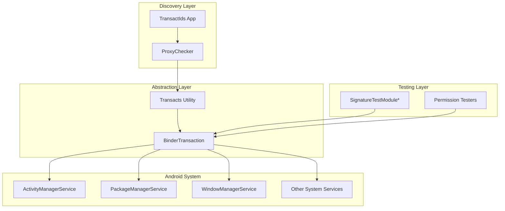
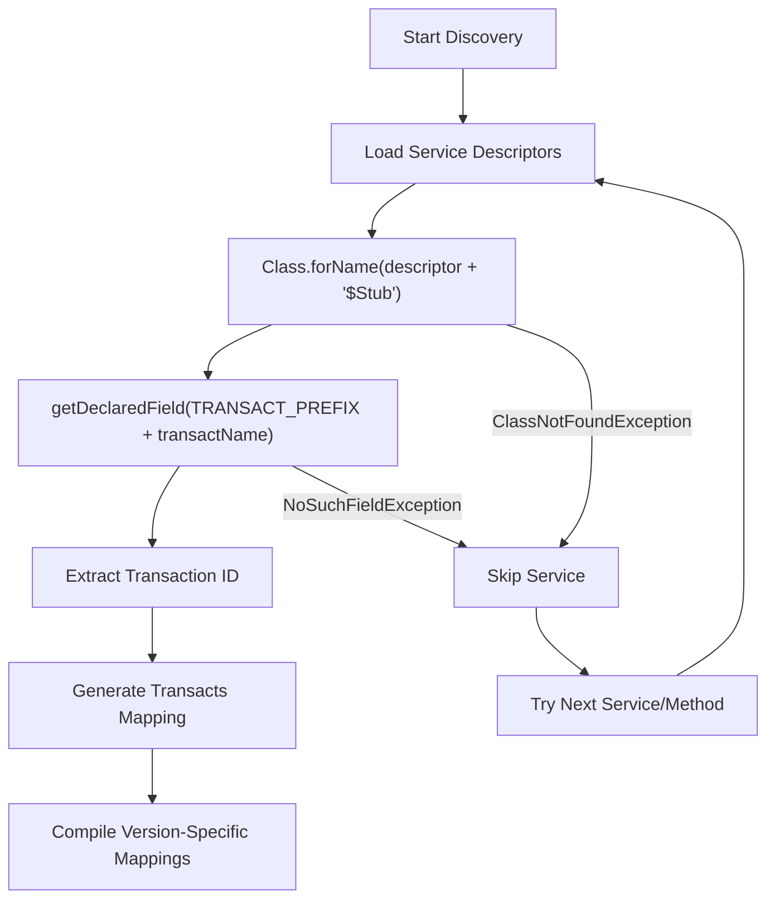
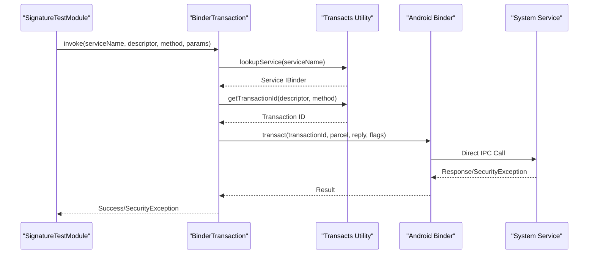
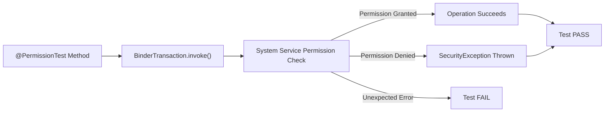
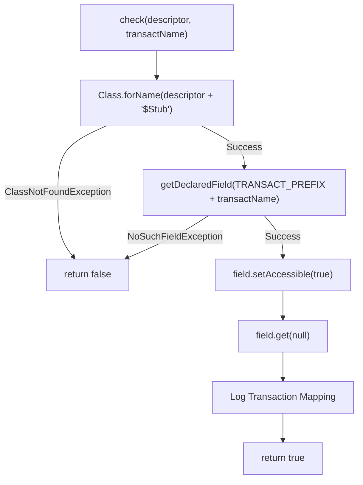

<!-- source: DeepWiki mcp.deepwiki.com · repo android/security-certification-resources · page 5.1 Binder Transaction Testing · fetched 2026-10-23 -->

# Binder Transaction Testing

<details>
<summary>Relevant source files</summary>

The following files were used as context for generating this wiki page:

- [niap-cc/Permissions/PermissionTester/app/src/main/java/com/android/certification/niap/permission/dpctester/test/SignatureTestModule.java](niap-cc/Permissions/PermissionTester/app/src/main/java/com/android/certification/niap/permission/dpctester/test/SignatureTestModule.java)
- [niap-cc/Permissions/PermissionTester/app/src/main/java/com/android/certification/niap/permission/dpctester/test/SignatureTestModuleQ.java](niap-cc/Permissions/PermissionTester/app/src/main/java/com/android/certification/niap/permission/dpctester/test/SignatureTestModuleQ.java)
- [niap-cc/Permissions/PermissionTester/app/src/main/java/com/android/certification/niap/permission/dpctester/test/SignatureTestModuleR.java](niap-cc/Permissions/PermissionTester/app/src/main/java/com/android/certification/niap/permission/dpctester/test/SignatureTestModuleR.java)
- [niap-cc/Permissions/PermissionTester/app/src/main/java/com/android/certification/niap/permission/dpctester/test/SignatureTestModuleS.java](niap-cc/Permissions/PermissionTester/app/src/main/java/com/android/certification/niap/permission/dpctester/test/SignatureTestModuleS.java)
- [niap-cc/Permissions/Tester/app/src/androidTest/java/com/android/certifications/niap/permissions/UDC_SignaturePermissions_test.java](niap-cc/Permissions/Tester/app/src/androidTest/java/com/android/certifications/niap/permissions/UDC_SignaturePermissions_test.java)
- [niap-cc/Permissions/Tester/app/src/main/aidl/android/app/ondeviceintelligence/IFeatureCallback.aidl](niap-cc/Permissions/Tester/app/src/main/aidl/android/app/ondeviceintelligence/IFeatureCallback.aidl)
- [niap-cc/Permissions/Tester/app/src/main/java/android/app/ondeviceintelligence/Feature.java](niap-cc/Permissions/Tester/app/src/main/java/android/app/ondeviceintelligence/Feature.java)
- [niap-cc/Permissions/TransactIds/app/src/main/java/com/android/certifications/niap/permissions/transactids/ProxyChecker.java](niap-cc/Permissions/TransactIds/app/src/main/java/com/android/certifications/niap/permissions/transactids/ProxyChecker.java)

</details>


## Purpose and Scope

The Binder Transaction Testing system provides direct access to Android system services through low-level binder IPC calls, bypassing standard Android SDK APIs. This infrastructure is essential for testing signature-level permissions that protect sensitive system operations. The system dynamically discovers transaction IDs across Android versions and executes direct binder calls to verify permission enforcement at the platform level.

For information about the higher-level permission testing framework that uses this infrastructure, see [Permission Testing Framework](#2). For details about signature permission testing specifically, see [Signature Permission Testing](#2.1).

## Core Architecture

The binder transaction testing system consists of four primary components working together to enable direct system service interaction:



**Sources:** [niap-cc/Permissions/TransactIds/app/src/main/java/com/android/certifications/niap/permissions/transactids/ProxyChecker.java:1-134](), [niap-cc/Permissions/PermissionTester/app/src/main/java/com/android/certification/niap/permission/dpctester/test/SignatureTestModule.java:1-100]()

## Transaction Discovery Process

The `TransactIds` application uses reflection-based discovery to identify available binder transaction methods across different Android versions. The `ProxyChecker` class serves as the core discovery engine:



The discovery process maps service interface descriptors to their internal Android names and discovers available transaction methods:

| Service Interface | Internal Descriptor | Alternative Name |
|------------------|-------------------|------------------|
| `android.app.IActivityManager` | `ACTIVITY_DESCRIPTOR` | Activity management operations |
| `android.content.pm.IPackageManager` | `PACKAGE_DESCRIPTOR` | Package installation/management |
| `android.view.IWindowManager` | `WINDOW_DESCRIPTOR` | Window system operations |
| `android.media.IAudioService` | `AUDIO_DESCRIPTOR` | Audio system control |

**Sources:** [niap-cc/Permissions/TransactIds/app/src/main/java/com/android/certifications/niap/permissions/transactids/ProxyChecker.java:16-53](), [niap-cc/Permissions/TransactIds/app/src/main/java/com/android/certifications/niap/permissions/transactids/ProxyChecker.java:96-132]()

## BinderTransaction Execution Framework

The `BinderTransaction` class provides the execution engine for invoking system service methods directly through binder IPC. This bypasses Android's public API surface and directly accesses the underlying service implementations:



The execution flow demonstrates how binder transactions bypass normal Android API layers to directly test permission enforcement at the system service level.

**Sources:** [niap-cc/Permissions/PermissionTester/app/src/main/java/com/android/certification/niap/permission/dpctester/test/SignatureTestModule.java:154-159](), [niap-cc/Permissions/PermissionTester/app/src/main/java/com/android/certification/niap/permission/dpctester/test/SignatureTestModuleQ.java:89-91]()

## Permission Testing Integration

Signature permission tests leverage the binder transaction infrastructure to validate permission enforcement. Each test follows a consistent pattern of attempting privileged operations and expecting `SecurityException` responses when permissions are not granted:



Example signature permission test implementation:

```java
@PermissionTest(permission = "ACCESS_CONTENT_PROVIDERS_EXTERNALLY")
public void testAccessContentProvidersExternally() {
    BinderTransaction.getInstance().invoke(
        Transacts.ACTIVITY_SERVICE, 
        Transacts.ACTIVITY_DESCRIPTOR,
        "getContentProviderExternal",
        "settings", 0, getActivityToken(), getTAG());
}
```

This test validates that the `ACCESS_CONTENT_PROVIDERS_EXTERNALLY` permission properly protects the `getContentProviderExternal` method in `ActivityManagerService`.

**Sources:** [niap-cc/Permissions/PermissionTester/app/src/main/java/com/android/certification/niap/permission/dpctester/test/SignatureTestModule.java:153-159](), [niap-cc/Permissions/PermissionTester/app/src/main/java/com/android/certification/niap/permission/dpctester/test/SignatureTestModule.java:167-171]()

## Dynamic Transaction ID Discovery

The `ProxyChecker` implements reflection-based discovery to handle Android version compatibility. Transaction IDs and available methods vary across Android releases, requiring dynamic detection:



The discovery process generates version-specific transaction mappings that are compiled into the testing applications. This enables the same test code to work across different Android API levels by automatically using the correct transaction IDs for each version.

**Sources:** [niap-cc/Permissions/TransactIds/app/src/main/java/com/android/certifications/niap/permissions/transactids/ProxyChecker.java:96-132](), [niap-cc/Permissions/TransactIds/app/src/main/java/com/android/certifications/niap/permissions/transactids/ProxyChecker.java:108-131]()

## Service Descriptor Mapping

The system maintains mappings between public service interface names and their internal Android descriptors. This abstraction layer enables consistent access to system services regardless of internal implementation changes:

| Public Interface | Internal Descriptor | Service Functionality |
|-----------------|-------------------|---------------------|
| `IActivityManager` | `ACTIVITY_DESCRIPTOR` | Activity lifecycle, process management |
| `IPackageManager` | `PACKAGE_DESCRIPTOR` | Package installation, permissions |
| `IWindowManager` | `WINDOW_DESCRIPTOR` | Window operations, display management |
| `ITelephony` | `TELEPHONY_DESCRIPTOR` | Telephony operations, SIM access |
| `IDevicePolicyManager` | `DEVICE_POLICY_DESCRIPTOR` | Device administration policies |
| `IInputManager` | `INPUT_DESCRIPTOR` | Input device management |

The alternative descriptor mapping provides a stable interface for test code while accommodating internal Android changes across versions.

**Sources:** [niap-cc/Permissions/TransactIds/app/src/main/java/com/android/certifications/niap/permissions/transactids/ProxyChecker.java:20-45](), [niap-cc/Permissions/TransactIds/app/src/main/java/com/android/certifications/niap/permissions/transactids/ProxyChecker.java:114-118]()

## Implementation Considerations

The binder transaction testing system requires careful handling of several technical challenges:

- **Version Compatibility**: Transaction IDs change between Android versions, requiring dynamic discovery
- **Permission Timing**: Some permissions are checked before parameter validation, while others are checked after
- **Service Availability**: Not all services are available on all devices (e.g., automotive-specific services)
- **Error Handling**: Distinguishing between permission failures and other types of errors

The system handles these challenges through bypass mechanisms, version-specific test modules, and careful exception analysis to ensure accurate permission testing results.

**Sources:** [niap-cc/Permissions/TransactIds/app/src/main/java/com/android/certifications/niap/permissions/transactids/ProxyChecker.java:124-129](), [niap-cc/Permissions/PermissionTester/app/src/main/java/com/android/certification/niap/permission/dpctester/test/SignatureTestModuleS.java:161-173]()

---

