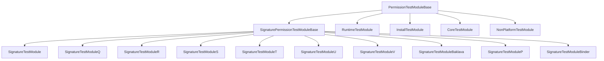
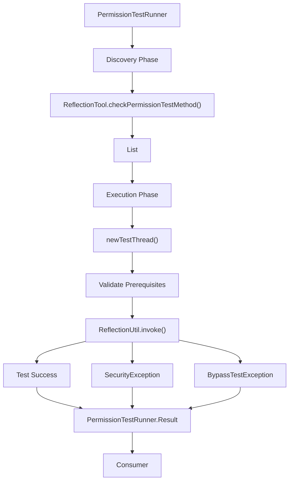
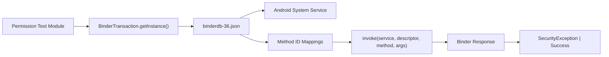

<!-- source: DeepWiki mcp.deepwiki.com · repo android/security-certification-resources · page 5.2 Permission Test Modules · fetched 2026-10-23 -->

# Permission Test Modules

<details>
<summary>Relevant source files</summary>

The following files were used as context for generating this wiki page:

- [niap-cc/Permissions/PermissionTester/app/src/main/assets/binderdb-36.json](niap-cc/Permissions/PermissionTester/app/src/main/assets/binderdb-36.json)
- [niap-cc/Permissions/PermissionTester/app/src/main/java/com/android/certification/niap/permission/dpctester/common/ReflectionUtil.java](niap-cc/Permissions/PermissionTester/app/src/main/java/com/android/certification/niap/permission/dpctester/common/ReflectionUtil.java)
- [niap-cc/Permissions/PermissionTester/app/src/main/java/com/android/certification/niap/permission/dpctester/service/FgServiceTypeService.java](niap-cc/Permissions/PermissionTester/app/src/main/java/com/android/certification/niap/permission/dpctester/service/FgServiceTypeService.java)
- [niap-cc/Permissions/PermissionTester/app/src/main/java/com/android/certification/niap/permission/dpctester/test/CoreTestModule.java](niap-cc/Permissions/PermissionTester/app/src/main/java/com/android/certification/niap/permission/dpctester/test/CoreTestModule.java)
- [niap-cc/Permissions/PermissionTester/app/src/main/java/com/android/certification/niap/permission/dpctester/test/InstallTestModule.java](niap-cc/Permissions/PermissionTester/app/src/main/java/com/android/certification/niap/permission/dpctester/test/InstallTestModule.java)
- [niap-cc/Permissions/PermissionTester/app/src/main/java/com/android/certification/niap/permission/dpctester/test/NonPlatformTestModule.java](niap-cc/Permissions/PermissionTester/app/src/main/java/com/android/certification/niap/permission/dpctester/test/NonPlatformTestModule.java)
- [niap-cc/Permissions/PermissionTester/app/src/main/java/com/android/certification/niap/permission/dpctester/test/RuntimeTestModule.java](niap-cc/Permissions/PermissionTester/app/src/main/java/com/android/certification/niap/permission/dpctester/test/RuntimeTestModule.java)
- [niap-cc/Permissions/PermissionTester/app/src/main/java/com/android/certification/niap/permission/dpctester/test/SignatureTestModuleBaklava.java](niap-cc/Permissions/PermissionTester/app/src/main/java/com/android/certification/niap/permission/dpctester/test/SignatureTestModuleBaklava.java)
- [niap-cc/Permissions/PermissionTester/app/src/main/java/com/android/certification/niap/permission/dpctester/test/SignatureTestModuleP.java](niap-cc/Permissions/PermissionTester/app/src/main/java/com/android/certification/niap/permission/dpctester/test/SignatureTestModuleP.java)
- [niap-cc/Permissions/PermissionTester/app/src/main/java/com/android/certification/niap/permission/dpctester/test/SignatureTestModuleT.java](niap-cc/Permissions/PermissionTester/app/src/main/java/com/android/certification/niap/permission/dpctester/test/SignatureTestModuleT.java)
- [niap-cc/Permissions/PermissionTester/app/src/main/java/com/android/certification/niap/permission/dpctester/test/SignatureTestModuleU.java](niap-cc/Permissions/PermissionTester/app/src/main/java/com/android/certification/niap/permission/dpctester/test/SignatureTestModuleU.java)
- [niap-cc/Permissions/PermissionTester/app/src/main/java/com/android/certification/niap/permission/dpctester/test/SignatureTestModuleV.java](niap-cc/Permissions/PermissionTester/app/src/main/java/com/android/certification/niap/permission/dpctester/test/SignatureTestModuleV.java)
- [niap-cc/Permissions/PermissionTester/app/src/main/java/com/android/certification/niap/permission/dpctester/test/runner/PermissionTestModuleBase.kt](niap-cc/Permissions/PermissionTester/app/src/main/java/com/android/certification/niap/permission/dpctester/test/runner/PermissionTestModuleBase.kt)
- [niap-cc/Permissions/PermissionTester/app/src/main/java/com/android/certification/niap/permission/dpctester/test/runner/PermissionTestRunner.kt](niap-cc/Permissions/PermissionTester/app/src/main/java/com/android/certification/niap/permission/dpctester/test/runner/PermissionTestRunner.kt)

</details>


This document covers the permission test modules that implement specific permission tests within the Android Security Certification Resources framework. These modules contain the actual test implementations for verifying permission enforcement across different Android API levels and permission types.

For information about the overall permission testing framework architecture, see [Permission Testing Framework](#2). For details about binder transaction testing infrastructure, see [Binder Transaction Testing](#5.1).

## Test Module Architecture

Permission test modules are organized as specialized classes that contain collections of individual permission tests. Each module focuses on a specific category of permissions (signature, runtime, install) or Android API level.

## Module Class Hierarchy



**Sources:** [niap-cc/Permissions/PermissionTester/app/src/main/java/com/android/certification/niap/permission/dpctester/test/runner/PermissionTestModuleBase.kt:1-188](), [niap-cc/Permissions/PermissionTester/app/src/main/java/com/android/certification/niap/permission/dpctester/test/RuntimeTestModule.java:115-116](), [niap-cc/Permissions/PermissionTester/app/src/main/java/com/android/certification/niap/permission/dpctester/test/InstallTestModule.java:136-137]()

## Test Module Categories

### Signature Permission Modules

Version-specific modules test platform signature permissions for different Android API levels:

| Module | Android Version | API Level | Annotation |
|--------|----------------|-----------|------------|
| `SignatureTestModuleP` | Android 9 (Pie) | 28 | `@PermissionTestModule(name="Signature 28(P) Test Cases",prflabel = "Pie(9)")` |
| `SignatureTestModuleT` | Android 13 (Tiramisu) | 33 | `@PermissionTestModule(name="Signature 33(T) Test Cases",prflabel = "Tiramisu(13)")` |
| `SignatureTestModuleU` | Android 14 (UDC) | 34 | `@PermissionTestModule(name="Signature 34(U) Test Cases",prflabel = "UDC(14)")` |
| `SignatureTestModuleV` | Android 15 (VIC) | 35 | `@PermissionTestModule(name="Signature 35(V) Test Cases",prflabel="VIC(15)")` |
| `SignatureTestModuleBaklava` | Android 16 (Baklava) | 36 | `@PermissionTestModule(name="Signature 36(Baklava) Test Cases",prflabel="Baklava(16)")` |

### Permission Type Modules

| Module | Purpose | Annotation |
|--------|---------|------------|
| `RuntimeTestModule` | Tests dangerous/runtime permissions | `@PermissionTestModule(name="Runtime Test Cases",prflabel = "Runtime Permissions")` |
| `InstallTestModule` | Tests install-time permissions | `@PermissionTestModule(name="Install Test Cases",label = "Run Install Permission Test",sync = true)` |
| `CoreTestModule` | Tests core permission categories | `@PermissionTestModule(name="Core Permission Test Cases",label = "Run Core Tests")` |

**Sources:** [niap-cc/Permissions/PermissionTester/app/src/main/java/com/android/certification/niap/permission/dpctester/test/SignatureTestModuleU.java:90](), [niap-cc/Permissions/PermissionTester/app/src/main/java/com/android/certification/niap/permission/dpctester/test/SignatureTestModuleBaklava.java:103](), [niap-cc/Permissions/PermissionTester/app/src/main/java/com/android/certification/niap/permission/dpctester/test/RuntimeTestModule.java:115](), [niap-cc/Permissions/PermissionTester/app/src/main/java/com/android/certification/niap/permission/dpctester/test/InstallTestModule.java:136]()

## Test Implementation Structure

### Test Method Definition

Individual permission tests are defined as methods annotated with `@PermissionTest`:

```java
@PermissionTest(permission="ACCESS_AMBIENT_CONTEXT_EVENT", sdkMin=34, sdkMax=34)
public void testAccessAmbientContextEvent(){
    @SuppressLint("WrongConstant") Object ambientContextManager
            = mContext.getSystemService("ambient_context");
    
    ReflectionUtil.invoke(ambientContextManager,
            "queryAmbientContextServiceStatus", new Class[]{Set.class, Executor.class,
                    Consumer.class}, eventTypes, executor, null);
}
```

## Test Execution Flow



**Sources:** [niap-cc/Permissions/PermissionTester/app/src/main/java/com/android/certification/niap/permission/dpctester/test/runner/PermissionTestRunner.kt:68-142](), [niap-cc/Permissions/PermissionTester/app/src/main/java/com/android/certification/niap/permission/dpctester/test/runner/PermissionTestModuleBase.kt:105]()

## Test Implementation Patterns

### Direct API Testing

Many tests directly invoke Android framework APIs:

```java
@PermissionTest(permission=CAMERA)
public void testCamera(){
    CameraManager mCameraManager = systemService(CameraManager.class);
    String[] cameras = mCameraManager.getCameraIdList();
    systemService(CameraManager.class).openCamera(cameras[0], cameraCallback,
            new Handler(Looper.getMainLooper()));
}
```

### Binder Transaction Testing

For signature permissions, tests often use direct binder transactions:

```java
@PermissionTest(permission="SUBSCRIBE_TO_KEYGUARD_LOCKED_STATE", sdkMin=34)
public void subscribeToKeyguardLockedState(){
    BinderTransaction.getInstance().invoke(Transacts.WINDOW_SERVICE,
            Transacts.WINDOW_DESCRIPTOR,
            "addKeyguardLockedStateListener", listener);
}
```

### Reflection-Based Testing

Hidden APIs are accessed through reflection:

```java
@PermissionTest(permission="ACCESS_ULTRASOUND", sdkMin=33)
public void testAccessUltrasound(){
    ReflectionUtil.invoke(systemService(AudioManager.class),
            "isUltrasoundSupported");
}
```

**Sources:** [niap-cc/Permissions/PermissionTester/app/src/main/java/com/android/certification/niap/permission/dpctester/test/RuntimeTestModule.java:312-342](), [niap-cc/Permissions/PermissionTester/app/src/main/java/com/android/certification/niap/permission/dpctester/test/SignatureTestModuleU.java:123-141](), [niap-cc/Permissions/PermissionTester/app/src/main/java/com/android/certification/niap/permission/dpctester/test/SignatureTestModuleT.java:482-486]()

## Version-Specific Implementation Details

### Android U (API 34) Examples

The `SignatureTestModuleU` class contains 47 test methods covering permissions introduced or modified in Android 14:

- `testScheduleExactAlarm()` - Tests `SCHEDULE_EXACT_ALARM` permission
- `testDeleteStagedHealthConnectRemoteData()` - Tests health data management permissions  
- `testManageClipboardAccessNotification()` - Tests clipboard access notification controls

### Android Baklava (API 36) Examples  

The `SignatureTestModuleBaklava` class includes tests for cutting-edge permissions:

- `testManageGlobalSoundQualityService()` - Tests media quality management
- `testCopyAccounts()` - Tests cross-user account operations
- `testVibrateVendorEffects()` - Tests vendor-specific vibration patterns

**Sources:** [niap-cc/Permissions/PermissionTester/app/src/main/java/com/android/certification/niap/permission/dpctester/test/SignatureTestModuleU.java:100-746](), [niap-cc/Permissions/PermissionTester/app/src/main/java/com/android/certification/niap/permission/dpctester/test/SignatureTestModuleBaklava.java:137-703]()

## Binder Transaction Integration

Permission test modules leverage the binder transaction database for direct system service communication:



The binder database maps method names to transaction IDs for each Android version:

```json
"android.os.IPowerManager": {
  "reboot": 52,
  "acquireWakeLock": 1,
  "releaseLowPowerStandbyPorts": 50
}
```

**Sources:** [niap-cc/Permissions/PermissionTester/app/src/main/assets/binderdb-36.json:40-50](), [niap-cc/Permissions/PermissionTester/app/src/main/java/com/android/certification/niap/permission/dpctester/test/SignatureTestModuleU.java:137-139]()

## Test Result Processing

The `PermissionTestRunner` processes test outcomes through a comprehensive result handling system:

```kotlin
val result = Result(
    success=success,
    throwable=throwable, 
    source=testCase,
    bypassed=bypassed,
    granted=ActivityCompat.checkSelfPermission(root.mContext, testCase.permission)
            == PackageManager.PERMISSION_GRANTED,
    api_successful=apisuccess,
    platform_signature_match=isPlatformSignatureMatch
)
```

Test outcomes are categorized as:
- **Success**: Permission granted and API executed successfully
- **Security Exception**: Permission denied, API blocked (expected for negative tests)
- **Bypassed**: Test skipped due to missing prerequisites or hardware features
- **Unexpected Failure**: Unexpected errors during test execution

**Sources:** [niap-cc/Permissions/PermissionTester/app/src/main/java/com/android/certification/niap/permission/dpctester/test/runner/PermissionTestRunner.kt:221-233](), [niap-cc/Permissions/PermissionTester/app/src/main/java/com/android/certification/niap/permission/dpctester/test/runner/PermissionTestRunner.kt:170-206]()

---

