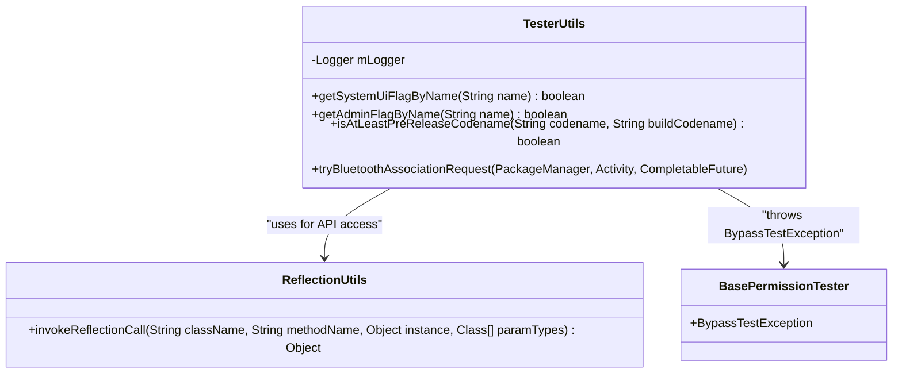
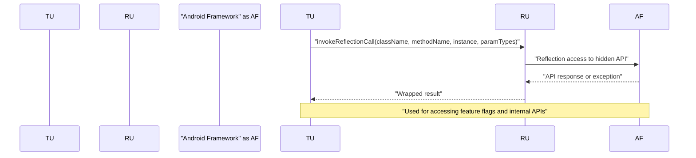
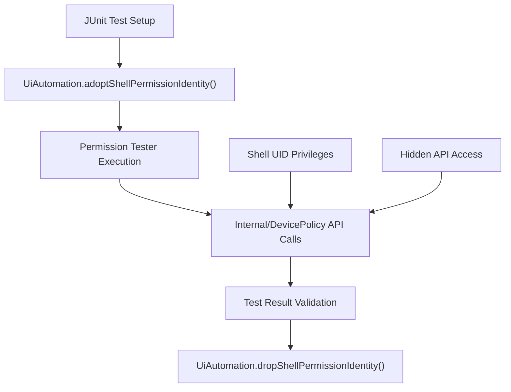
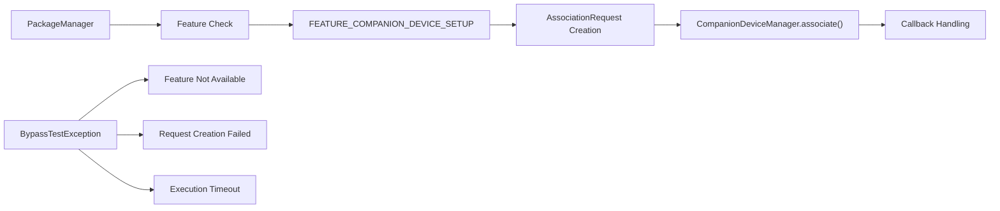
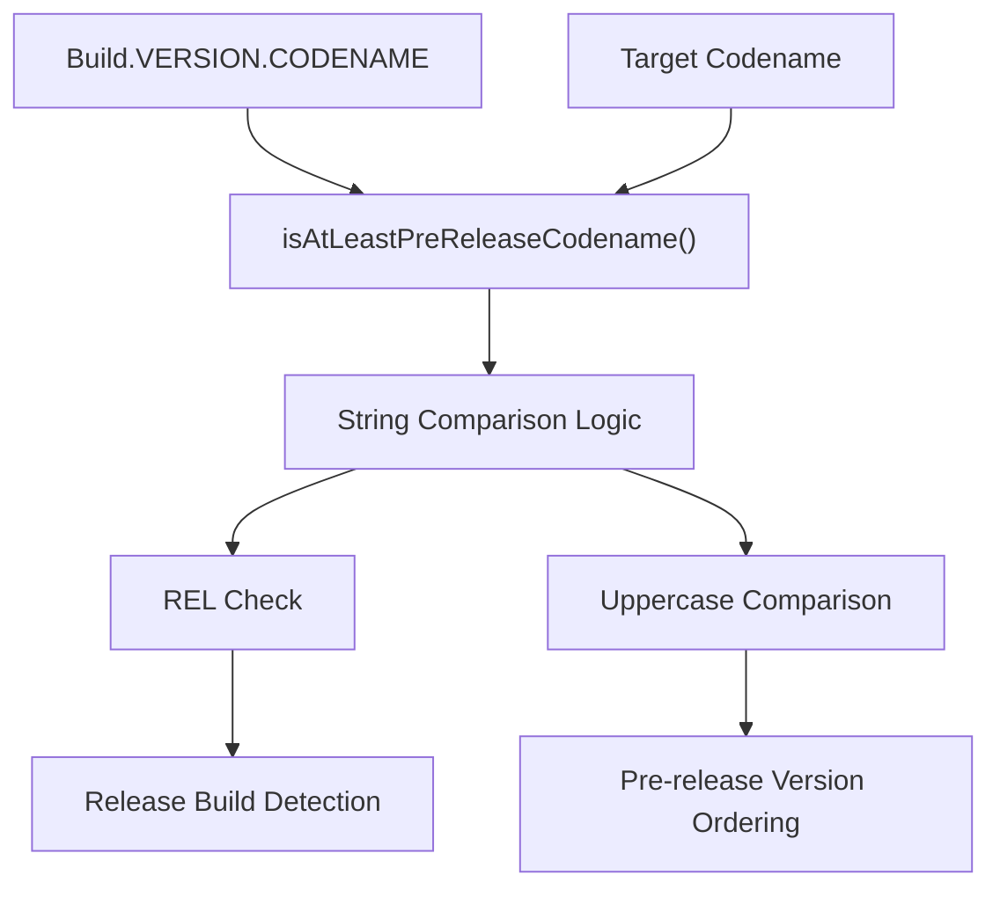
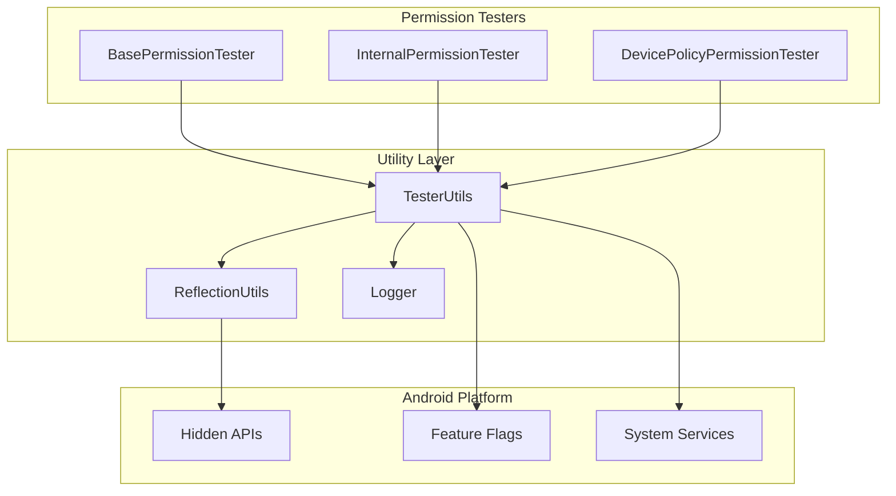

<!-- source: DeepWiki mcp.deepwiki.com · repo android/security-certification-resources · page 5.3 Utility Functions and Reflection · fetched 2026-10-23 -->

# Utility Functions and Reflection

Relevant source files

The following files were used as context for generating this wiki page:

- [niap-cc/Permissions/Tester/app/src/androidTest/java/com/android/certifications/niap/permissions/DevicePolicyPermissionsJUnitTest.java](niap-cc/Permissions/Tester/app/src/androidTest/java/com/android/certifications/niap/permissions/DevicePolicyPermissionsJUnitTest.java)
- [niap-cc/Permissions/Tester/app/src/androidTest/java/com/android/certifications/niap/permissions/InternalPermissionsJUnitTest.java](niap-cc/Permissions/Tester/app/src/androidTest/java/com/android/certifications/niap/permissions/InternalPermissionsJUnitTest.java)
- [niap-cc/Permissions/Tester/app/src/androidTest/java/com/android/certifications/niap/permissions/SandboxJUnitTest.java](niap-cc/Permissions/Tester/app/src/androidTest/java/com/android/certifications/niap/permissions/SandboxJUnitTest.java)
- [niap-cc/Permissions/Tester/app/src/main/aidl/android/health/connect/migration/MigrationException.aidl](niap-cc/Permissions/Tester/app/src/main/aidl/android/health/connect/migration/MigrationException.aidl)
- [niap-cc/Permissions/Tester/app/src/main/java/android/flags/SyncableFlag.java](niap-cc/Permissions/Tester/app/src/main/java/android/flags/SyncableFlag.java)
- [niap-cc/Permissions/Tester/app/src/main/java/android/health/connect/aidl/IMigrationCallback.java](niap-cc/Permissions/Tester/app/src/main/java/android/health/connect/aidl/IMigrationCallback.java)
- [niap-cc/Permissions/Tester/app/src/main/java/android/net/nsd/OffloadEngine.java](niap-cc/Permissions/Tester/app/src/main/java/android/net/nsd/OffloadEngine.java)
- [niap-cc/Permissions/Tester/app/src/main/java/com/android/certifications/niap/permissions/utils/TesterUtils.java](niap-cc/Permissions/Tester/app/src/main/java/com/android/certifications/niap/permissions/utils/TesterUtils.java)

This document covers the utility functions, reflection-based API access mechanisms, and common testing helpers that support the Android Security Certification Resources permission testing framework. These utilities provide low-level access to hidden Android APIs, feature flag checking, and specialized testing capabilities that enable comprehensive permission validation.

For information about direct binder transaction testing, see [Binder Transaction Testing](#5.1). For details about the JUnit test suite implementations, see [JUnit Test Suites](#5.4).

## Core Utility Classes

The permission testing framework relies on several utility classes that provide reflection-based access to hidden Android APIs and common testing functionality.

### TesterUtils Class

The `TesterUtils` class serves as the primary utility hub for permission testing operations, providing reflection-based feature flag access and specialized testing helpers.

The `TesterUtils` class provides several key capabilities:
- **Feature Flag Access**: Methods like `getSystemUiFlagByName()` and `getAdminFlagByName()` use reflection to access Android's internal feature flags
- **Version Compatibility**: The `isAtLeastPreReleaseCodename()` method enables version-specific testing logic
- **Specialized API Testing**: The `tryBluetoothAssociationRequest()` method provides controlled testing of companion device management APIs

Sources: [niap-cc/Permissions/Tester/app/src/main/java/com/android/certifications/niap/permissions/utils/TesterUtils.java:41-109]()

## Reflection-Based API Access

The framework extensively uses Java reflection to access hidden Android APIs that are not available through the public SDK. This enables testing of internal and signature-level permissions that protect platform functionality.

### Reflection Call Pattern

The reflection pattern is used throughout the testing framework to:
- Access feature flags from `com.android.systemui.shared.Flags` and `android.app.admin.flags.Flags`
- Invoke methods on internal system service interfaces
- Test permission-protected APIs that are not publicly accessible

Sources: [niap-cc/Permissions/Tester/app/src/main/java/com/android/certifications/niap/permissions/utils/TesterUtils.java:48-59]()

## Shell Identity Adoption for Testing

The JUnit test infrastructure provides sophisticated shell identity adoption capabilities that enable testing of permissions normally unavailable to regular applications.

### Shell Permission Identity Pattern

The shell identity adoption mechanism allows tests to:
- Gain access to internal and signature-level permissions normally unavailable to apps
- Test APIs protected by permissions like `MANAGE_DEVICE_POLICY_*` and other internal permissions
- Validate that permission enforcement works correctly for privileged operations

Sources: [niap-cc/Permissions/Tester/app/src/androidTest/java/com/android/certifications/niap/permissions/InternalPermissionsJUnitTest.java:122-124](), [niap-cc/Permissions/Tester/app/src/androidTest/java/com/android/certifications/niap/permissions/DevicePolicyPermissionsJUnitTest.java:167-169]()

## Specialized Testing Helpers

### Companion Device Management Testing

The framework includes specialized helpers for testing companion device management APIs, which require careful setup and exception handling.

The `tryBluetoothAssociationRequest()` method demonstrates the pattern used throughout the framework for testing complex APIs:
1. Feature availability validation using `PackageManager.hasSystemFeature()`
2. Asynchronous request creation with timeout handling
3. Proper exception wrapping with `BypassTestException` for unsupported scenarios
4. Callback-based result handling

Sources: [niap-cc/Permissions/Tester/app/src/main/java/com/android/certifications/niap/permissions/utils/TesterUtils.java:80-107]()

## Version-Specific Testing Logic

The utility functions provide version compatibility checking to enable conditional test execution based on Android API levels and codenames.

### Version Compatibility Framework

The version checking logic handles:
- **Release Build Detection**: Identifies "REL" builds and treats them as released versions
- **Codename Comparison**: Performs lexicographic comparison of uppercase codenames for pre-release versions
- **Test Conditional Logic**: Enables or disables specific tests based on platform version capabilities

Sources: [niap-cc/Permissions/Tester/app/src/main/java/com/android/certifications/niap/permissions/utils/TesterUtils.java:61-69]()

## Integration with Permission Testing Framework

The utility functions integrate closely with the broader permission testing infrastructure, providing essential capabilities for test execution and result validation.

### Utility Integration Architecture

The utilities provide:
- **Exception Handling**: Standardized `BypassTestException` for unsupported test scenarios
- **Logging Integration**: Consistent logging through the `LoggerFactory` framework
- **Reflection Abstraction**: Simplified access to hidden APIs through `ReflectionUtils`
- **Feature Detection**: Runtime capability checking for conditional test execution

Sources: [niap-cc/Permissions/Tester/app/src/main/java/com/android/certifications/niap/permissions/utils/TesterUtils.java:28-32](), [niap-cc/Permissions/Tester/app/src/androidTest/java/com/android/certifications/niap/permissions/InternalPermissionsJUnitTest.java:119-135]()

---

