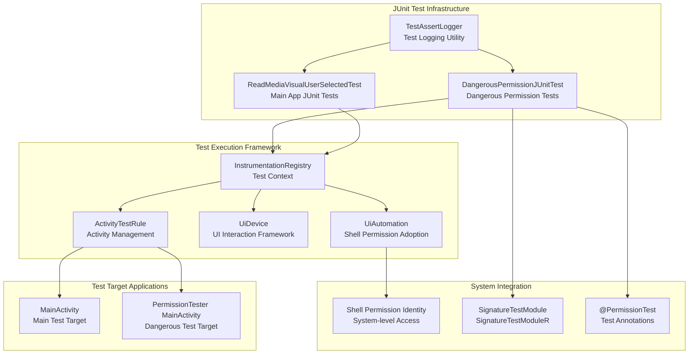
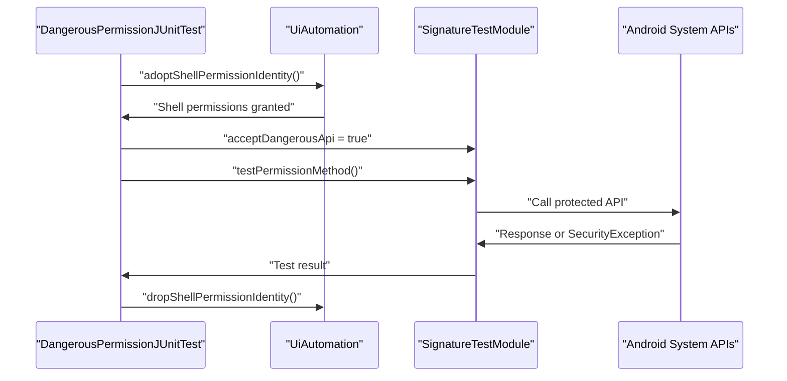
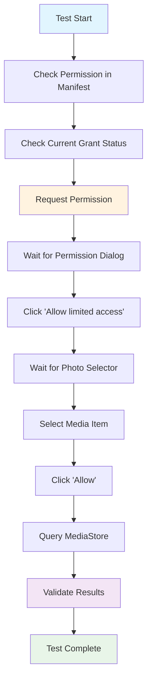
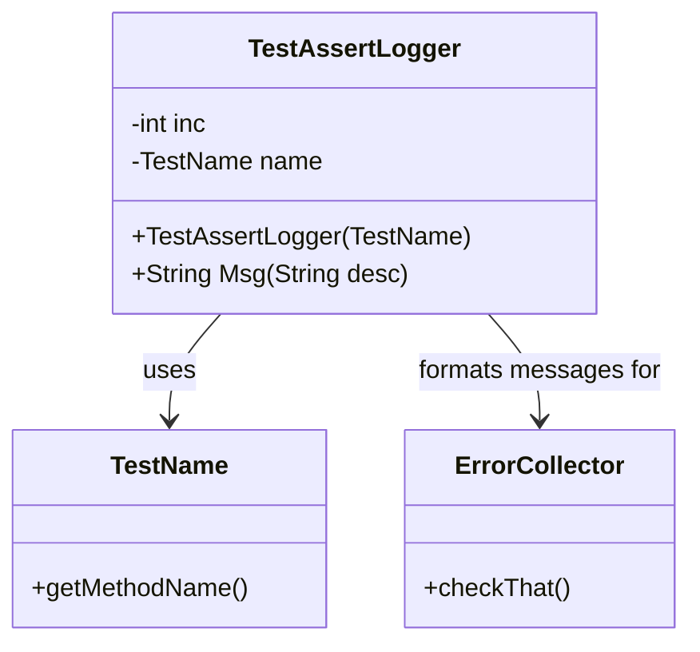

<!-- source: DeepWiki mcp.deepwiki.com · repo android/security-certification-resources · page 5.4 JUnit Test Suites · fetched 2026-10-23 -->

# JUnit Test Suites

Relevant source files

The following files were used as context for generating this wiki page:

- [niap-cc/Permissions/PermissionTester/app/src/androidTest/java/com/android/certification/niap/permission/dpctester/DangerousPermissionJUnitTest.java](niap-cc/Permissions/PermissionTester/app/src/androidTest/java/com/android/certification/niap/permission/dpctester/DangerousPermissionJUnitTest.java)
- [niap-cc/Permissions/PermissionTester/app/src/androidTest/java/com/android/certification/niap/permission/dpctester/TestAssertLogger.java](niap-cc/Permissions/PermissionTester/app/src/androidTest/java/com/android/certification/niap/permission/dpctester/TestAssertLogger.java)
- [niap-cc/Permissions/PermissionTester/app/src/main/java/com/android/certification/niap/permission/dpctester/common/DevicePolicyManagerGateway.java](niap-cc/Permissions/PermissionTester/app/src/main/java/com/android/certification/niap/permission/dpctester/common/DevicePolicyManagerGateway.java)
- [niap-cc/Permissions/PermissionTester/app/src/main/java/com/android/certification/niap/permission/dpctester/common/Util.java](niap-cc/Permissions/PermissionTester/app/src/main/java/com/android/certification/niap/permission/dpctester/common/Util.java)
- [niap-cc/Permissions/Tester/app/src/androidTest/java/com/android/certifications/niap/permissions/ReadMediaVisualUserSelectedTest.java](niap-cc/Permissions/Tester/app/src/androidTest/java/com/android/certifications/niap/permissions/ReadMediaVisualUserSelectedTest.java)
- [niap-cc/Permissions/Tester/app/src/main/aidl/android/net/nsd/AdvertisingRequest.aidl](niap-cc/Permissions/Tester/app/src/main/aidl/android/net/nsd/AdvertisingRequest.aidl)
- [niap-cc/Permissions/Tester/app/src/main/aidl/android/net/nsd/INsdManagerCallback.aidl](niap-cc/Permissions/Tester/app/src/main/aidl/android/net/nsd/INsdManagerCallback.aidl)
- [niap-cc/Permissions/Tester/app/src/main/aidl/android/net/nsd/INsdServiceConnector.aidl](niap-cc/Permissions/Tester/app/src/main/aidl/android/net/nsd/INsdServiceConnector.aidl)
- [niap-cc/Permissions/Tester/app/src/main/aidl/android/net/nsd/IOffloadEngine.aidl](niap-cc/Permissions/Tester/app/src/main/aidl/android/net/nsd/IOffloadEngine.aidl)
- [niap-cc/Permissions/Tester/app/src/main/aidl/android/net/nsd/OffloadServiceInfo.aidl](niap-cc/Permissions/Tester/app/src/main/aidl/android/net/nsd/OffloadServiceInfo.aidl)
- [niap-cc/Permissions/Tester/app/src/main/java/android/net/nsd/AdvertisingRequest.java](niap-cc/Permissions/Tester/app/src/main/java/android/net/nsd/AdvertisingRequest.java)
- [niap-cc/Permissions/Tester/app/src/main/java/android/net/nsd/OffloadServiceInfo.java](niap-cc/Permissions/Tester/app/src/main/java/android/net/nsd/OffloadServiceInfo.java)

This section documents the instrumentation-based JUnit test suites within the Android Security Certification Resources framework. These test suites provide automated testing capabilities for dangerous permissions, shell identity adoption, and specific permission scenarios that require user interaction or system-level privileges.

For information about the main permission testing framework, see [Permission Testing Framework](#2). For details about binder transaction testing, see [Binder Transaction Testing](#5.1).

## Overview

The JUnit test suites complement the main permission testing framework by providing automated, instrumentation-based testing for permissions that:
- Require dangerous or system-level access
- Need shell identity adoption for testing
- Involve complex user interface interactions
- Could severely impact system stability (marked as "dangerous")

The test suites are organized into two main applications: the main Permissions Tester app and the specialized PermissionTester app for dangerous permissions.

## Test Suite Architecture

Sources: [niap-cc/Permissions/Tester/app/src/androidTest/java/com/android/certifications/niap/permissions/ReadMediaVisualUserSelectedTest.java:1-237](), [niap-cc/Permissions/PermissionTester/app/src/androidTest/java/com/android/certification/niap/permission/dpctester/DangerousPermissionJUnitTest.java:1-221]()

## Dangerous Permission Testing

The `DangerousPermissionJUnitTest` class provides automated testing for permissions that could severely impact the user interface or system stability. These tests adopt shell permission identity to access system-level APIs.

### Test Class Structure

| Component | Purpose | Key Features |
|-----------|---------|--------------|
| `DangerousPermissionJUnitTest` | Main test orchestrator | Shell identity adoption, dangerous API acceptance |
| `@PermissionTest` annotation | Test metadata | Permission name, SDK version constraints |
| `SignatureTestModule` | Test implementation | Platform signature permission testing |
| `SignatureTestModuleR` | Android R+ tests | Version-specific permission testing |

### Shell Identity Adoption

The test suite uses `UiAutomation.adoptShellPermissionIdentity()` to gain access to permissions that normal apps cannot hold but are granted to the shell UID:

Sources: [niap-cc/Permissions/PermissionTester/app/src/androidTest/java/com/android/certification/niap/permission/dpctester/DangerousPermissionJUnitTest.java:125-137]()

### Test Method Pattern

Each dangerous permission test follows a consistent pattern:

1. **Setup**: Adopt shell permission identity in `@BeforeClass`
2. **Test Method**: Annotated with `@PermissionTest(permission = "PERMISSION_NAME")`
3. **Execution**: Call corresponding method in `SignatureTestModule`
4. **Cleanup**: Drop shell permission identity in `@AfterClass`

Examples of dangerous permissions tested:
- `FORCE_BACK` - Force activity back navigation
- `RETRIEVE_WINDOW_CONTENT` - Access window content for accessibility
- `RETRIEVE_WINDOW_TOKEN` - Retrieve activity window tokens
- `REBOOT` - System reboot capability (executed last)

Sources: [niap-cc/Permissions/PermissionTester/app/src/androidTest/java/com/android/certification/niap/permission/dpctester/DangerousPermissionJUnitTest.java:170-218]()

## Media Permission Testing

The `ReadMediaVisualUserSelectedTest` provides comprehensive testing for the `READ_MEDIA_VISUAL_USER_SELECTED` permission, which involves complex user interface interactions for media access.

### Test Flow Architecture

### UI Automation Components

The media permission test relies heavily on UI automation to simulate user interactions:

| UI Component | Selector Pattern | Purpose |
|--------------|------------------|---------|
| Limited Access Button | `By.textStartsWith("Allow limited")` | Grant partial media access |
| Photo Selector | `By.textStartsWith("Select photos and videos")` | Open media selection interface |
| Media Cards | `By.clazz(CardView.class)` | Individual media items |
| Allow Button | `By.textStartsWith("Allow")` | Confirm media selection |

Sources: [niap-cc/Permissions/Tester/app/src/androidTest/java/com/android/certifications/niap/permissions/ReadMediaVisualUserSelectedTest.java:160-195]()

## Test Assertion and Logging

### TestAssertLogger Utility

The `TestAssertLogger` class provides enhanced logging capabilities for test assertions:

The logger creates structured log messages with format: `methodName(###):description` where `###` is an incrementing counter for each assertion within a test method.

Sources: [niap-cc/Permissions/PermissionTester/app/src/androidTest/java/com/android/certification/niap/permission/dpctester/TestAssertLogger.java:21-35]()

## Test Execution Framework

### ActivityTestRule Integration

Both test suites use `ActivityTestRule` to manage test activities:

- **ReadMediaVisualUserSelectedTest**: Uses `MainActivity` from the main permissions tester app
- **DangerousPermissionJUnitTest**: Uses `MainActivity` from the PermissionTester app

### Error Collection Pattern

Tests use JUnit's `ErrorCollector` rule to collect multiple assertion failures within a single test:

- Allows tests to continue execution after assertion failures
- Collects all failures and reports them together
- Particularly useful for comprehensive permission testing scenarios

### Test Ordering

The dangerous permission tests use `@FixMethodOrder(MethodSorters.NAME_ASCENDING)` to ensure predictable test execution order, with the `REBOOT` test explicitly named `x_testReboot()` to execute last.

Sources: [niap-cc/Permissions/PermissionTester/app/src/androidTest/java/com/android/certification/niap/permission/dpctester/DangerousPermissionJUnitTest.java:55-66](), [niap-cc/Permissions/Tester/app/src/androidTest/java/com/android/certifications/niap/permissions/ReadMediaVisualUserSelectedTest.java:83-85]()

## SDK Version Handling

The test framework includes sophisticated SDK version management for permission testing:

### Version-Specific Test Execution

Tests can specify SDK version constraints using the `@PermissionTest` annotation:
- `sdkMin`: Minimum SDK version required
- `sdkMax`: Maximum SDK version supported
- Tests are automatically skipped if the current SDK version falls outside the specified range

### Multi-Module Architecture

The dangerous permission tests utilize multiple test modules:
- `SignatureTestModule`: General signature permission tests
- `SignatureTestModuleR`: Android R (API 30+) specific tests

This architecture allows for version-specific test implementations while maintaining a consistent test interface.

Sources: [niap-cc/Permissions/PermissionTester/app/src/androidTest/java/com/android/certification/niap/permission/dpctester/DangerousPermissionJUnitTest.java:164-168](), [niap-cc/Permissions/PermissionTester/app/src/androidTest/java/com/android/certification/niap/permission/dpctester/DangerousPermissionJUnitTest.java:196-199]()

---

