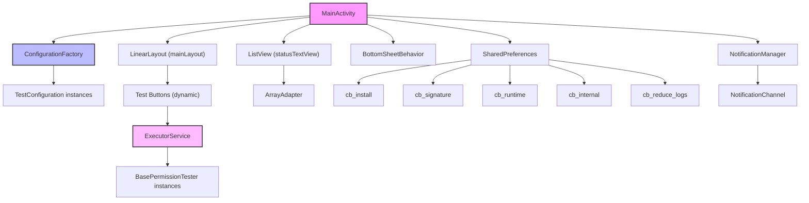
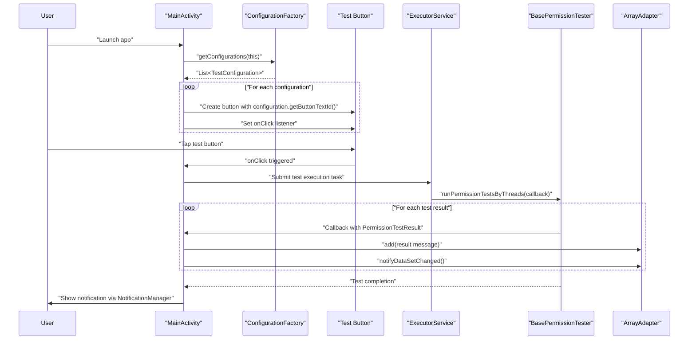
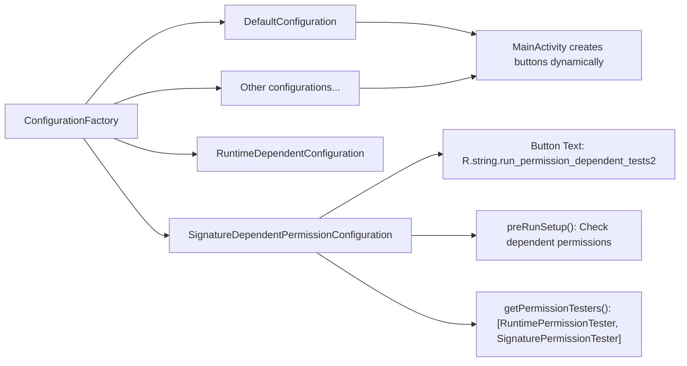
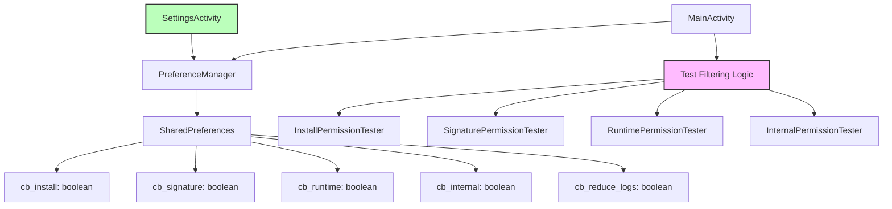
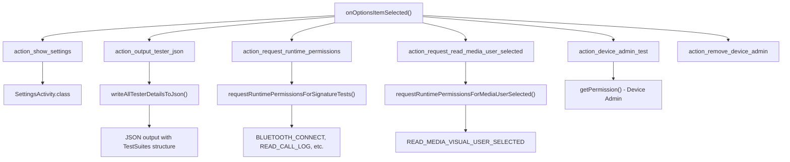
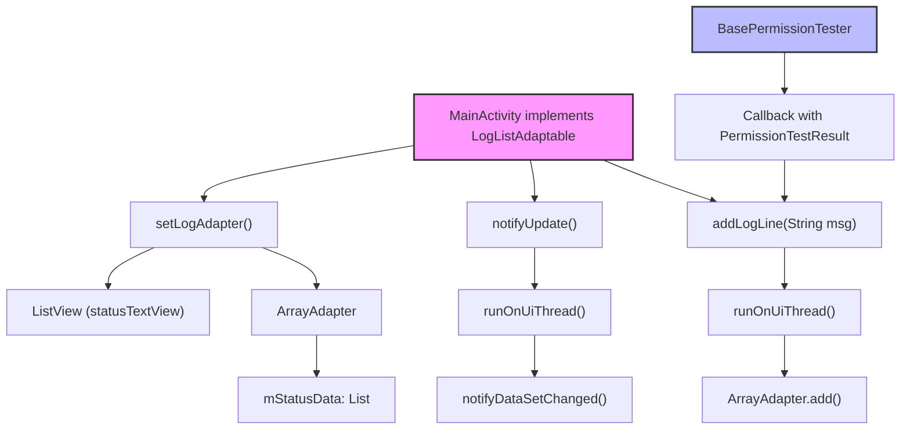
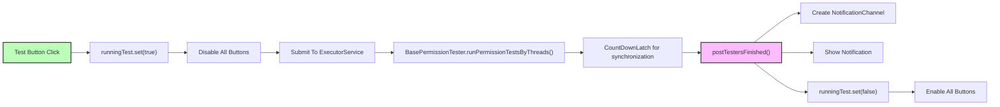

<!-- source: DeepWiki mcp.deepwiki.com · repo android/security-certification-resources · page 6 User Interface and Configuration · fetched 2026-10-23 -->

# User Interface and Configuration

<details>
<summary>Relevant source files</summary>

The following files were used as context for generating this wiki page:

- [niap-cc/Permissions/Tester/app/src/main/AndroidManifest.xml](niap-cc/Permissions/Tester/app/src/main/AndroidManifest.xml)
- [niap-cc/Permissions/Tester/app/src/main/java/com/android/certifications/niap/permissions/activities/MainActivity.java](niap-cc/Permissions/Tester/app/src/main/java/com/android/certifications/niap/permissions/activities/MainActivity.java)
- [niap-cc/Permissions/Tester/app/src/main/java/com/android/certifications/niap/permissions/config/SignatureDependentPermissionConfiguration.java](niap-cc/Permissions/Tester/app/src/main/java/com/android/certifications/niap/permissions/config/SignatureDependentPermissionConfiguration.java)
- [niap-cc/Permissions/Tester/app/src/main/res/layout/activity_main.xml](niap-cc/Permissions/Tester/app/src/main/res/layout/activity_main.xml)
- [niap-cc/Permissions/Tester/app/src/main/res/menu/main.xml](niap-cc/Permissions/Tester/app/src/main/res/menu/main.xml)
- [niap-cc/Permissions/Tester/app/src/main/res/values/strings.xml](niap-cc/Permissions/Tester/app/src/main/res/values/strings.xml)

</details>


This document covers the user interface components and configuration system for the Android Permission Testing Framework's main application. It details how users interact with the testing framework through the `MainActivity` interface, configure test execution preferences, and monitor test results. 

For information about the underlying permission testing logic, see [Permission Testing Framework](#2). For details about specific test configurations, see [Test Configuration System](#2.5).

## Main User Interface Architecture

The primary user interface is implemented in `MainActivity`, which serves as the test orchestration hub. The activity dynamically creates test execution buttons based on available configurations and provides real-time status monitoring through a scrollable log display.

### UI Component Structure



**MainActivity UI Flow**



Sources: [niap-cc/Permissions/Tester/app/src/main/java/com/android/certifications/niap/permissions/activities/MainActivity.java:120-393](), [niap-cc/Permissions/Tester/app/src/main/res/layout/activity_main.xml:17-91]()

## Test Configuration System

The configuration system determines which tests are available and how they are executed. Each configuration represents a different testing scenario and provides its own set of permission testers.

### Configuration Loading and Button Generation

The `MainActivity` dynamically creates test buttons based on configurations returned by `ConfigurationFactory.getConfigurations()`. Each configuration provides:

- Button text via `getButtonTextId()` 
- Pre-run setup logic via `preRunSetup()`
- Permission testers via `getPermissionTesters()`



**Configuration Interface Implementation**

The `TestConfiguration` interface defines the contract that all configurations must implement:

| Method | Purpose | Example Return |
|--------|---------|----------------|
| `preRunSetup()` | Validate preconditions | Throws `BypassConfigException` if deps not met |
| `getPermissionTesters()` | Return test instances | `[RuntimePermissionTester, SignaturePermissionTester]` |
| `getButtonTextId()` | UI button text resource | `R.string.run_permission_dependent_tests2` |
| `getRuntimePermissions()` | Runtime perms to request | `Optional.of([UWB_RANGING])` |
| `getSignaturePermissions()` | Signature perms to test | `Optional.of([RADIO_SCAN_WITHOUT_LOCATION])` |

Sources: [niap-cc/Permissions/Tester/app/src/main/java/com/android/certifications/niap/permissions/config/SignatureDependentPermissionConfiguration.java:44-117](), [niap-cc/Permissions/Tester/app/src/main/java/com/android/certifications/niap/permissions/activities/MainActivity.java:255-272]()

## User Preferences and Settings

Test execution behavior is controlled through `SharedPreferences` with boolean flags for each test category. Users configure these through the `SettingsActivity`.

### Preference System Architecture



**Test Category Filtering Logic**

The `MainActivity` checks preferences before executing each tester type:

```java
// From MainActivity.java lines 288-302
boolean run_install = sp.getBoolean("cb_install", false);
boolean run_signature = sp.getBoolean("cb_signature", false);  
boolean run_runtime = sp.getBoolean("cb_runtime", false);
boolean run_internal = sp.getBoolean("cb_internal", false);
m_reduce_logs = sp.getBoolean("cb_reduce_logs", false);

for (BasePermissionTester permissionTester : testers) {
    String block = permissionTester.getClass().getSimpleName();
    if (block.equals("SignaturePermissionTester") && !run_signature) continue;
    if (block.equals("InstallPermissionTester") && !run_install) continue;
    if (block.equals("RuntimePermissionTester") && !run_runtime) continue;
    if (block.equals("InternalPermissionTester") && !run_internal) continue;
    // Execute tester...
}
```

Sources: [niap-cc/Permissions/Tester/app/src/main/java/com/android/certifications/niap/permissions/activities/MainActivity.java:285-302](), [niap-cc/Permissions/Tester/app/src/main/AndroidManifest.xml:54-61]()

## Menu System and Actions

The application provides a menu system with specialized actions for test setup and debugging. Menu items are defined in the action bar and accessed through the options menu.

### Menu Actions Overview



**Key Menu Functions**

| Menu Action | Method | Purpose |
|-------------|--------|---------|
| Settings | `action_show_settings` | Launch `SettingsActivity` for preferences |
| Output JSON | `action_output_tester_json` | Export all test metadata to JSON file |
| Request Runtime | `action_request_runtime_permissions` | Request runtime permissions needed for signature tests |
| Media User Selected | `action_request_read_media_user_selected` | Request media access permissions |
| Device Admin | `action_device_admin_test` | Register app as device administrator |

The JSON output functionality creates a comprehensive test inventory:

```java
// TestSuites structure for JSON export
TestSuites gsonTestSuites = new TestSuites();
for(BasePermissionTester s : sources) {
    TestCategory gsonCategory = new TestCategory(testCategory);
    Map<String,BasePermissionTester.PermissionTest> tests = s.getRegisteredPermissions();
    // Add test details with API level constraints
    gsonCategory.tests.add(new Test(key, test.mMinApiLevel, test.mMaxApiLevel));
}
```

Sources: [niap-cc/Permissions/Tester/app/src/main/java/com/android/certifications/niap/permissions/activities/MainActivity.java:417-459](), [niap-cc/Permissions/Tester/app/src/main/res/menu/main.xml:1-41](), [niap-cc/Permissions/Tester/app/src/main/java/com/android/certifications/niap/permissions/activities/MainActivity.java:534-600]()

## Status Display and Logging

The application provides real-time test status through a `ListView` that displays log messages with different severity levels. The logging system implements the `LogListAdaptable` interface to enable UI updates from test threads.

### Logging Architecture



**Log Message Categories**

The logging system categorizes messages by type using the `Logger` interface:

| Log Type | Method | Usage | UI Display |
|----------|--------|-------|------------|
| System | `sLogger.logSystem()` | Test block lifecycle | Always shown |
| Info | `sLogger.logInfo()` | Test pass results | Shown unless `cb_reduce_logs` |
| Error | `sLogger.logError()` | Test failures | Always shown |

**Test Result Display Flow**

```java
// Test result callback processing in MainActivity
permissionTester.runPermissionTestsByThreads((result) -> {
    runOnUiThread(() -> {
        if (result.getResult()) {
            if (!m_reduce_logs) sLogger.logInfo("Passed:" + result);
        } else {
            sLogger.logError("Failure:" + result);
            errorPermissions.add(result.getName());
            errorCnt.incrementAndGet();
        }
        notifyUpdate();
    });
});
```

**Bottom Sheet UI Behavior**

The main layout uses `BottomSheetBehavior` to provide an expandable/collapsible interface:

- Test buttons are contained in the bottom sheet (`mainLayout`)
- Status log occupies the main screen area (`statusTextView`)
- Users can toggle between expanded and collapsed states
- Peek height set to 60dp with elevation for visual separation

Sources: [niap-cc/Permissions/Tester/app/src/main/java/com/android/certifications/niap/permissions/activities/MainActivity.java:146-163](), [niap-cc/Permissions/Tester/app/src/main/java/com/android/certifications/niap/permissions/activities/MainActivity.java:310-333](), [niap-cc/Permissions/Tester/app/src/main/res/layout/activity_main.xml:65-89]()

## Test Execution and Notification System

When tests complete, the application provides user feedback through Android notifications and UI state management. The system uses `ExecutorService` for background test execution while maintaining UI responsiveness.

### Execution State Management



**Notification System Implementation**

The completion notification provides test status feedback when the app is not in foreground:

```java
// Notification creation in postTestersFinished()
NotificationChannel channel = new NotificationChannel(TAG, channelName, 
    NotificationManager.IMPORTANCE_DEFAULT);
NotificationManager notificationManager = getSystemService(NotificationManager.class);

Notification notification = new Notification.Builder(mContext, TAG)
    .setContentTitle(resources.getText(R.string.status_notification_title))
    .setContentText(message)
    .setSmallIcon(R.drawable.ic_launcher_foreground)
    .setContentIntent(pendingIntent)
    .setAutoCancel(true)
    .build();
```

The system ensures thread safety using `AtomicBoolean runningTest` to prevent concurrent test execution and uses `CountDownLatch` for synchronization between test threads and the UI thread.

Sources: [niap-cc/Permissions/Tester/app/src/main/java/com/android/certifications/niap/permissions/activities/MainActivity.java:174-203](), [niap-cc/Permissions/Tester/app/src/main/java/com/android/certifications/niap/permissions/activities/MainActivity.java:274-362](), [niap-cc/Permissions/Tester/app/src/main/res/values/strings.xml:17-59]()