# Page: Overview

# Overview

<details>
<summary>Relevant source files</summary>

The following files were used as context for generating this wiki page:

- [niap-cc/Permissions/Companion/app/build.gradle](niap-cc/Permissions/Companion/app/build.gradle)
- [niap-cc/Permissions/Companion/app/src/main/AndroidManifest.xml](niap-cc/Permissions/Companion/app/src/main/AndroidManifest.xml)
- [niap-cc/Permissions/Companion/app/src/main/java/com/android/certifications/niap/permissions/companion/MainActivity.java](niap-cc/Permissions/Companion/app/src/main/java/com/android/certifications/niap/permissions/companion/MainActivity.java)
- [niap-cc/Permissions/Companion/app/src/main/res/layout/activity_main.xml](niap-cc/Permissions/Companion/app/src/main/res/layout/activity_main.xml)
- [niap-cc/Permissions/Companion/build.gradle.kts](niap-cc/Permissions/Companion/build.gradle.kts)
- [niap-cc/Permissions/Tester/app/build.gradle](niap-cc/Permissions/Tester/app/build.gradle)
- [niap-cc/Permissions/Tester/app/src/androidTest/AndroidManifest.xml](niap-cc/Permissions/Tester/app/src/androidTest/AndroidManifest.xml)
- [niap-cc/Permissions/Tester/app/src/main/AndroidManifest.xml](niap-cc/Permissions/Tester/app/src/main/AndroidManifest.xml)
- [niap-cc/Permissions/Tester/app/src/main/java/com/android/certifications/niap/permissions/InstallPermissionTester.java](niap-cc/Permissions/Tester/app/src/main/java/com/android/certifications/niap/permissions/InstallPermissionTester.java)
- [niap-cc/Permissions/Tester/app/src/main/java/com/android/certifications/niap/permissions/SignaturePermissionTester.java](niap-cc/Permissions/Tester/app/src/main/java/com/android/certifications/niap/permissions/SignaturePermissionTester.java)
- [niap-cc/Permissions/Tester/app/src/main/java/com/android/certifications/niap/permissions/activities/MainActivity.java](niap-cc/Permissions/Tester/app/src/main/java/com/android/certifications/niap/permissions/activities/MainActivity.java)
- [niap-cc/Permissions/Tester/app/src/main/java/com/android/certifications/niap/permissions/config/SignatureDependentPermissionConfiguration.java](niap-cc/Permissions/Tester/app/src/main/java/com/android/certifications/niap/permissions/config/SignatureDependentPermissionConfiguration.java)
- [niap-cc/Permissions/Tester/app/src/main/java/com/android/certifications/niap/permissions/utils/SdkV_Transacts.java](niap-cc/Permissions/Tester/app/src/main/java/com/android/certifications/niap/permissions/utils/SdkV_Transacts.java)
- [niap-cc/Permissions/Tester/app/src/main/java/com/android/certifications/niap/permissions/utils/Transacts.java](niap-cc/Permissions/Tester/app/src/main/java/com/android/certifications/niap/permissions/utils/Transacts.java)
- [niap-cc/Permissions/Tester/app/src/noperm/AndroidManifest.xml](niap-cc/Permissions/Tester/app/src/noperm/AndroidManifest.xml)
- [niap-cc/Permissions/Tester/app/src/normal/AndroidManifest.xml](niap-cc/Permissions/Tester/app/src/normal/AndroidManifest.xml)
- [niap-cc/Permissions/Tester/app/src/platform/AndroidManifest.xml](niap-cc/Permissions/Tester/app/src/platform/AndroidManifest.xml)
- [niap-cc/Permissions/TransactIds/app/src/main/java/com/android/certifications/niap/permissions/transactids/MainActivity.java](niap-cc/Permissions/TransactIds/app/src/main/java/com/android/certifications/niap/permissions/transactids/MainActivity.java)
- [niap-cc/Permissions/TransactIds/app/src/main/java/com/android/certifications/niap/permissions/transactids/Transacts.java](niap-cc/Permissions/TransactIds/app/src/main/java/com/android/certifications/niap/permissions/transactids/Transacts.java)

</details>


This document provides an overview of the Android Security Certification Resources repository, a comprehensive testing framework designed for NIAP (National Information Assurance Partnership) Common Criteria certification of Android devices. The framework validates that Android platform permissions are properly enforced by testing various permission protection levels through direct API invocation and system service interaction.

The repository contains multiple specialized applications that work together to thoroughly test Android's permission system, from basic install permissions to complex signature-level permissions that require platform signing. For detailed information about specific permission testing approaches, see [Permission Testing Framework](#2). For details about the build system and code generation tools, see [Build System and Code Generation](#4).

## System Architecture

The Android Security Certification Resources framework consists of four main applications that work together to provide comprehensive permission testing capabilities:

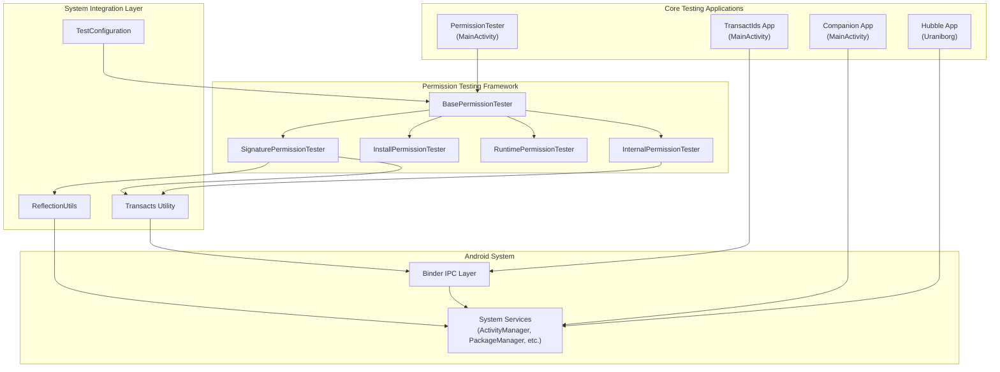

**Sources:** [niap-cc/Permissions/Tester/app/src/main/java/com/android/certifications/niap/permissions/activities/MainActivity.java:120-400](), [niap-cc/Permissions/Tester/app/src/main/java/com/android/certifications/niap/permissions/SignaturePermissionTester.java:280-320](), [niap-cc/Permissions/TransactIds/app/src/main/java/com/android/certifications/niap/permissions/transactids/MainActivity.java:83-142]()

## Core Applications

### Permission Tester Application
The main testing application (`MainActivity`) orchestrates permission tests across different protection levels. It uses a configuration-driven approach where `ConfigurationFactory` provides different test scenarios, and specialized tester classes handle specific permission types.

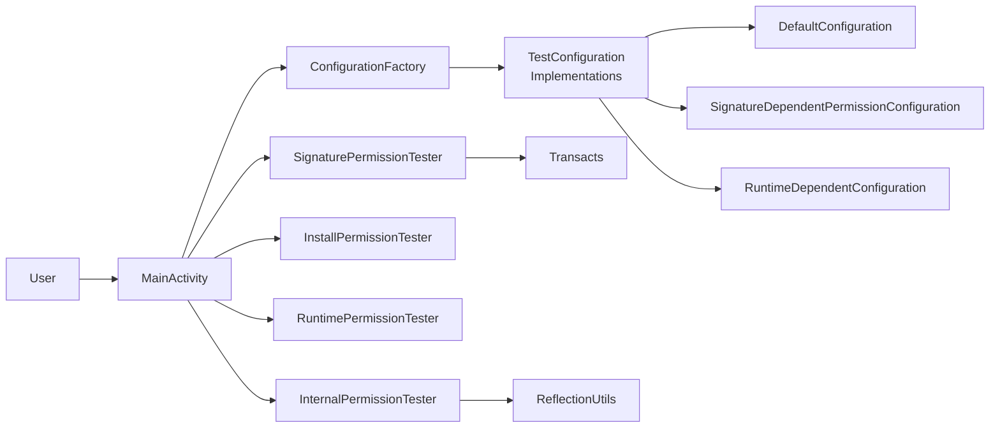

**Sources:** [niap-cc/Permissions/Tester/app/src/main/java/com/android/certifications/niap/permissions/activities/MainActivity.java:255-280](), [niap-cc/Permissions/Tester/app/src/main/java/com/android/certifications/niap/permissions/config/SignatureDependentPermissionConfiguration.java:44-117]()

### TransactIds Discovery Application
The `TransactIds` application (`MainActivity`) dynamically discovers binder transaction IDs for system services. Since transaction IDs can vary between device implementations, this tool uses reflection to query AIDL stub classes and generate device-specific transaction mappings.

### Companion Application
The `Companion` application prepares the test environment by setting up required resources like media files, configuring location services, and providing test services that other applications can bind to for permission validation.

### Hubble Data Collection
The `Hubble` application (part of the Uraniborg project) collects device information and preinstalled application data for analysis during certification testing.

**Sources:** [niap-cc/Permissions/TransactIds/app/src/main/java/com/android/certifications/niap/permissions/transactids/MainActivity.java:73-142](), [niap-cc/Permissions/Companion/app/src/main/java/com/android/certifications/niap/permissions/companion/MainActivity.java:86-150]()

## Permission Testing Framework

The framework implements a hierarchical testing architecture with `BasePermissionTester` as the foundation and specialized testers for different permission protection levels:

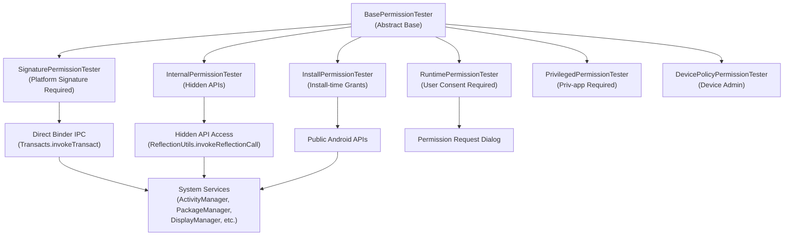

**Sources:** [niap-cc/Permissions/Tester/app/src/main/java/com/android/certifications/niap/permissions/SignaturePermissionTester.java:280-380](), [niap-cc/Permissions/Tester/app/src/main/java/com/android/certifications/niap/permissions/InstallPermissionTester.java:213-260]()

## Build System and Multi-Module Structure

The project uses a sophisticated Gradle build system with automated code generation and multiple application variants:

| Component | Purpose | Build Variants |
|-----------|---------|----------------|
| Permission Tester | Main testing app | `normal`, `platform`, `noperm` |
| Companion | Test environment setup | `debug`, `release` |
| TransactIds | Transaction ID discovery | Platform-signed only |
| Hubble | Device data collection | Standard build |

The build system includes custom Gradle plugins for code generation:
- `CodePorterPlugin` - Generates test modules from existing tester classes
- `BindServiceCodeGenPlugin` - Creates service classes for BIND_* permission testing
- Permission constant generation from `permissions.json`

**Sources:** [niap-cc/Permissions/Tester/app/build.gradle:19-137](), [niap-cc/Permissions/Companion/app/build.gradle:17-96](), [niap-cc/Permissions/Companion/build.gradle.kts:43-148]()

## System Service Integration

The framework achieves comprehensive permission testing through multiple integration approaches:

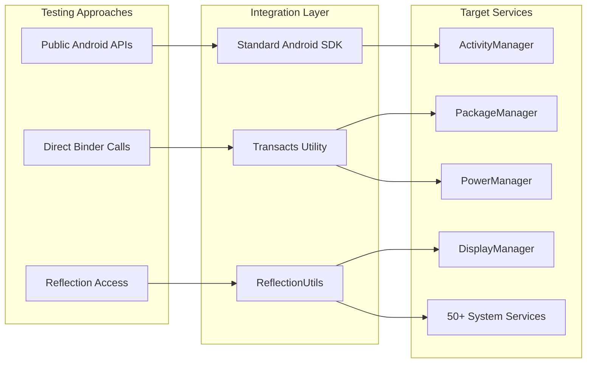

The `Transacts` utility class defines constants for over 50 system services and provides device-specific transaction ID mappings through generated subclasses like `SdkV_Transacts` for different Android API levels.

**Sources:** [niap-cc/Permissions/Tester/app/src/main/java/com/android/certifications/niap/permissions/utils/Transacts.java:59-320](), [niap-cc/Permissions/Tester/app/src/main/java/com/android/certifications/niap/permissions/utils/SdkV_Transacts.java:21-500]()

---

# Page: Permission Testing Framework

# Permission Testing Framework

<details>
<summary>Relevant source files</summary>

The following files were used as context for generating this wiki page:

- [niap-cc/Permissions/Tester/app/src/main/AndroidManifest.xml](niap-cc/Permissions/Tester/app/src/main/AndroidManifest.xml)
- [niap-cc/Permissions/Tester/app/src/main/java/com/android/certifications/niap/permissions/BasePermissionTester.java](niap-cc/Permissions/Tester/app/src/main/java/com/android/certifications/niap/permissions/BasePermissionTester.java)
- [niap-cc/Permissions/Tester/app/src/main/java/com/android/certifications/niap/permissions/DevicePolicyPermissionTester.java](niap-cc/Permissions/Tester/app/src/main/java/com/android/certifications/niap/permissions/DevicePolicyPermissionTester.java)
- [niap-cc/Permissions/Tester/app/src/main/java/com/android/certifications/niap/permissions/GmsPermissionTester.java](niap-cc/Permissions/Tester/app/src/main/java/com/android/certifications/niap/permissions/GmsPermissionTester.java)
- [niap-cc/Permissions/Tester/app/src/main/java/com/android/certifications/niap/permissions/NonPlatformPermissionTester.java](niap-cc/Permissions/Tester/app/src/main/java/com/android/certifications/niap/permissions/NonPlatformPermissionTester.java)
- [niap-cc/Permissions/Tester/app/src/main/java/com/android/certifications/niap/permissions/PrivilegedPermissionTester.java](niap-cc/Permissions/Tester/app/src/main/java/com/android/certifications/niap/permissions/PrivilegedPermissionTester.java)
- [niap-cc/Permissions/Tester/app/src/main/java/com/android/certifications/niap/permissions/RuntimePermissionTester.java](niap-cc/Permissions/Tester/app/src/main/java/com/android/certifications/niap/permissions/RuntimePermissionTester.java)
- [niap-cc/Permissions/Tester/app/src/main/java/com/android/certifications/niap/permissions/activities/MainActivity.java](niap-cc/Permissions/Tester/app/src/main/java/com/android/certifications/niap/permissions/activities/MainActivity.java)
- [niap-cc/Permissions/Tester/app/src/main/java/com/android/certifications/niap/permissions/config/RuntimeDependentPermissionConfiguration.java](niap-cc/Permissions/Tester/app/src/main/java/com/android/certifications/niap/permissions/config/RuntimeDependentPermissionConfiguration.java)
- [niap-cc/Permissions/Tester/app/src/main/java/com/android/certifications/niap/permissions/config/SignatureDependentPermissionConfiguration.java](niap-cc/Permissions/Tester/app/src/main/java/com/android/certifications/niap/permissions/config/SignatureDependentPermissionConfiguration.java)

</details>


## Purpose and Scope

The Permission Testing Framework provides the core architecture for testing Android permission enforcement across different protection levels and system components. This framework serves as the foundation for verifying that platform permissions properly guard their associated APIs, resources, and system services according to NIAP Common Criteria requirements.

The framework supports testing of runtime permissions, signature permissions, install permissions, internal permissions, privileged permissions, and device policy permissions. For details about specific permission tester implementations, see [Signature Permission Testing](#2.1), [Runtime Permission Testing](#2.2), [Install Permission Testing](#2.3), and [Internal Permission Testing](#2.4). For information about test orchestration and user interface, see [User Interface and Configuration](#6).

## Core Architecture Overview

The Permission Testing Framework follows a template method pattern with `BasePermissionTester` as the abstract foundation and specialized implementations for different permission types.

### Class Hierarchy and Relationships

```mermaid
classDiagram
    class BasePermissionTester {
        <<abstract>>
        +TestConfiguration mConfiguration
        +Activity mActivity
        +Transacts mTransacts
        +runPermissionTest(String, PermissionTest)
        +runPermissionTests()* 
        +runPermissionTestsByThreads(Consumer)*
        +getRegisteredPermissions()*
        +isPermissionGranted(String)
    }
    
    class RuntimePermissionTester {
        -Map~String,PermissionTest~ mPermissionTasks
        -WallpaperManager mWallpaperManager
        -SensorManager mSensorManager
        +runPermissionTests()
        +runPermissionTestsByThreads(Consumer)
    }
    
    class SignaturePermissionTester {
        -Map~String,PermissionTest~ mPermissionTasks
        -Set~String~ mSignaturePermissions
        +runPermissionTests()
        +runPermissionTestsByThreads(Consumer)
    }
    
    class InternalPermissionTester {
        -Map~String,PermissionTest~ mPermissionTasks
        +runPermissionTests()
        +runPermissionTestsByThreads(Consumer)
    }
    
    class InstallPermissionTester {
        -Map~String,PermissionTest~ mPermissionTasks
        +runPermissionTests()
        +runPermissionTestsByThreads(Consumer)
    }
    
    class DevicePolicyPermissionTester {
        -Map~String,PermissionTest~ mPermissionTasks
        -DevicePolicyManager dpm
        +runPermissionTests()
        +runPermissionTestsByThreads(Consumer)
    }
    
    class GmsPermissionTester {
        -Map~String,PermissionTest~ mPermissionTasks
        +runPermissionTests()
        +runPermissionTestsByThreads(Consumer)
    }
    
    class PermissionTest {
        +boolean mIsCustom
        +Runnable mTestRunnable
        +int mMinApiLevel
        +int mMaxApiLevel
        +runTest()
    }
    
    BasePermissionTester <|-- RuntimePermissionTester
    BasePermissionTester <|-- SignaturePermissionTester
    BasePermissionTester <|-- InternalPermissionTester
    BasePermissionTester <|-- InstallPermissionTester
    BasePermissionTester <|-- DevicePolicyPermissionTester
    BasePermissionTester <|-- GmsPermissionTester
    BasePermissionTester --> PermissionTest : "uses"
```

Sources: [niap-cc/Permissions/Tester/app/src/main/java/com/android/certifications/niap/permissions/BasePermissionTester.java:1-455](), [niap-cc/Permissions/Tester/app/src/main/java/com/android/certifications/niap/permissions/RuntimePermissionTester.java:1-100](), [niap-cc/Permissions/Tester/app/src/main/java/com/android/certifications/niap/permissions/DevicePolicyPermissionTester.java:1-50]()

## BasePermissionTester Foundation

The `BasePermissionTester` class provides the foundational infrastructure for all permission testing implementations. It establishes common initialization patterns, permission verification utilities, and test execution frameworks.

### Core Components and Initialization

The base class initializes essential Android system components and testing infrastructure:

| Component | Purpose | Initialization |
|-----------|---------|----------------|
| `TestConfiguration` | Defines test parameters and permissions | Passed via constructor |
| `Activity` and `Context` | Android runtime context | Passed via constructor |
| `Transacts` | Direct binder transaction utility | Created for device API level |
| `PackageManager` | Permission and signature verification | Retrieved from context |
| `Signature` | App signing certificate | Extracted for platform signature matching |

The constructor performs critical setup including platform signature verification and platform permission enumeration:

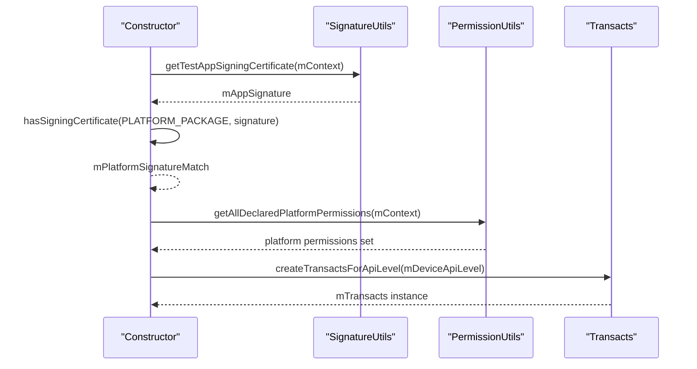

Sources: [niap-cc/Permissions/Tester/app/src/main/java/com/android/certifications/niap/permissions/BasePermissionTester.java:146-182]()

### PermissionTest Encapsulation

The `PermissionTest` class encapsulates individual permission verification logic with support for API level targeting and custom test behaviors:

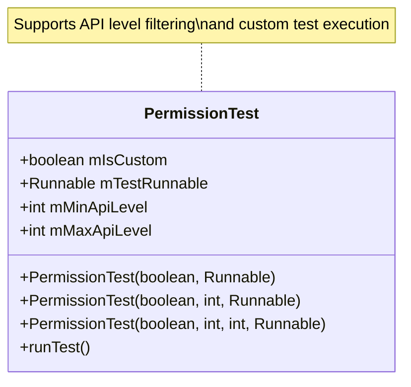

Sources: [niap-cc/Permissions/Tester/app/src/main/java/com/android/certifications/niap/permissions/BasePermissionTester.java:355-420]()

## Permission Test Execution Model

The framework implements both synchronous and asynchronous test execution patterns to support different testing scenarios and user interface requirements.

### Test Execution Flow

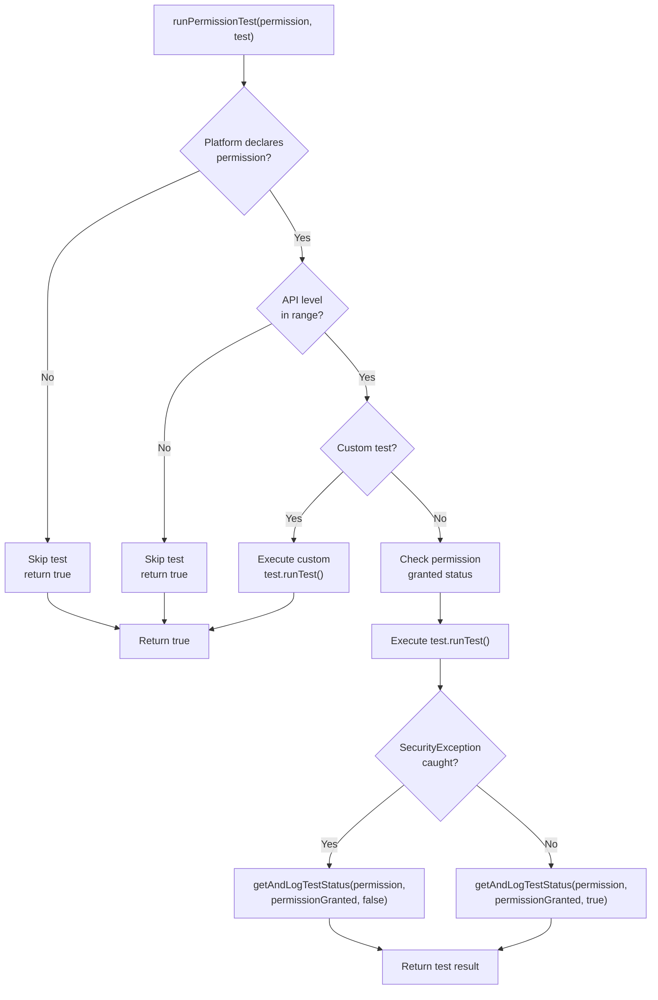

The framework provides two execution models:

1. **Synchronous Execution** via `runPermissionTests()` - Traditional sequential testing
2. **Asynchronous Execution** via `runPermissionTestsByThreads(Consumer<Result>)` - Threaded testing with callback reporting

Sources: [niap-cc/Permissions/Tester/app/src/main/java/com/android/certifications/niap/permissions/BasePermissionTester.java:239-311]()

### Result Reporting System

The framework implements a standardized result reporting mechanism through the `Result` class:

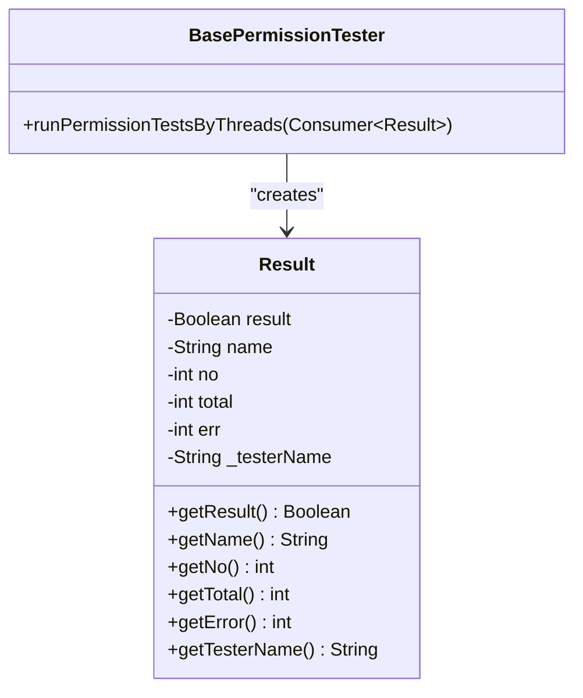

Sources: [niap-cc/Permissions/Tester/app/src/main/java/com/android/certifications/niap/permissions/BasePermissionTester.java:62-118]()

## Exception Handling and Test Classification

The framework defines specialized exceptions for different test failure scenarios:

| Exception Type | Purpose | Usage |
|----------------|---------|-------|
| `BypassTestException` | Device doesn't meet test requirements | Test should be skipped |
| `UnexpectedPermissionTestFailureException` | Unexpected test failure | Test should be marked as error |
| `SecurityException` | Expected permission denial | Normal test flow validation |

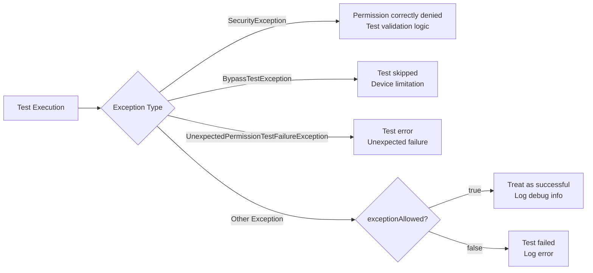

Sources: [niap-cc/Permissions/Tester/app/src/main/java/com/android/certifications/niap/permissions/BasePermissionTester.java:275-311](), [niap-cc/Permissions/Tester/app/src/main/java/com/android/certifications/niap/permissions/BasePermissionTester.java:426-453]()

## Integration with Test Orchestration

The Permission Testing Framework integrates with the main application through the `MainActivity` orchestration system, which manages test configuration selection and execution coordination.

### Test Configuration Integration

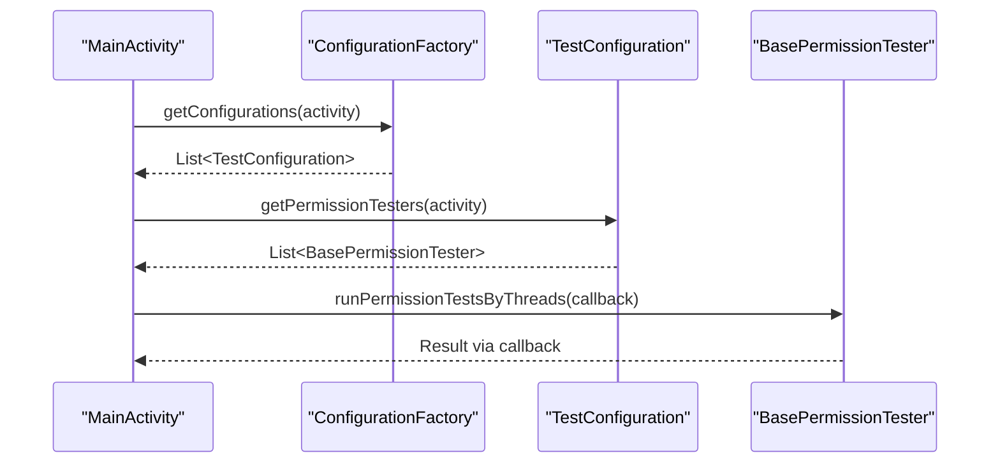

The framework supports multiple execution models through the `TestConfiguration` interface, allowing for different permission testing scenarios such as runtime-dependent permissions, signature-dependent permissions, and install-only permissions.

Sources: [niap-cc/Permissions/Tester/app/src/main/java/com/android/certifications/niap/permissions/activities/MainActivity.java:293-362](), [niap-cc/Permissions/Tester/app/src/main/java/com/android/certifications/niap/permissions/config/SignatureDependentPermissionConfiguration.java:82-88]()

---

# Page: Signature Permission Testing

# Signature Permission Testing

<details>
<summary>Relevant source files</summary>

The following files were used as context for generating this wiki page:

- [niap-cc/Permissions/Tester/app/src/main/java/com/android/certifications/niap/permissions/SignaturePermissionTester.java](niap-cc/Permissions/Tester/app/src/main/java/com/android/certifications/niap/permissions/SignaturePermissionTester.java)
- [niap-cc/Permissions/Tester/app/src/main/java/com/android/certifications/niap/permissions/utils/SdkV_Transacts.java](niap-cc/Permissions/Tester/app/src/main/java/com/android/certifications/niap/permissions/utils/SdkV_Transacts.java)
- [niap-cc/Permissions/Tester/app/src/main/java/com/android/certifications/niap/permissions/utils/Transacts.java](niap-cc/Permissions/Tester/app/src/main/java/com/android/certifications/niap/permissions/utils/Transacts.java)
- [niap-cc/Permissions/Tester/app/src/noperm/AndroidManifest.xml](niap-cc/Permissions/Tester/app/src/noperm/AndroidManifest.xml)
- [niap-cc/Permissions/TransactIds/app/src/main/java/com/android/certifications/niap/permissions/transactids/MainActivity.java](niap-cc/Permissions/TransactIds/app/src/main/java/com/android/certifications/niap/permissions/transactids/MainActivity.java)
- [niap-cc/Permissions/TransactIds/app/src/main/java/com/android/certifications/niap/permissions/transactids/Transacts.java](niap-cc/Permissions/TransactIds/app/src/main/java/com/android/certifications/niap/permissions/transactids/Transacts.java)

</details>


This document covers the signature permission testing subsystem within the Android Security Certification Resources framework. This system verifies that signature-level permissions properly guard their corresponding APIs, resources, and system services. For information about other permission types, see [Runtime Permission Testing](#2.2), [Install Permission Testing](#2.3), and [Internal Permission Testing](#2.4).

## Purpose and Scope

The signature permission testing system validates that Android platform permissions declared with `protectionLevel="signature"` correctly enforce access control. These permissions can only be granted to applications signed with the same signing key as the platform, ensuring that only system-level applications can access protected functionality.

The system operates by:
- Attempting to invoke APIs protected by signature permissions from a non-platform-signed application
- Expecting `SecurityException` to be thrown when permission checks fail
- Using both standard Android APIs and direct Binder transaction calls to test comprehensive coverage
- Supporting version-specific permission testing across different Android API levels

## Architecture Overview

The signature permission testing system integrates with the broader permission testing framework through a layered architecture that separates test orchestration, permission validation, and low-level system interaction.

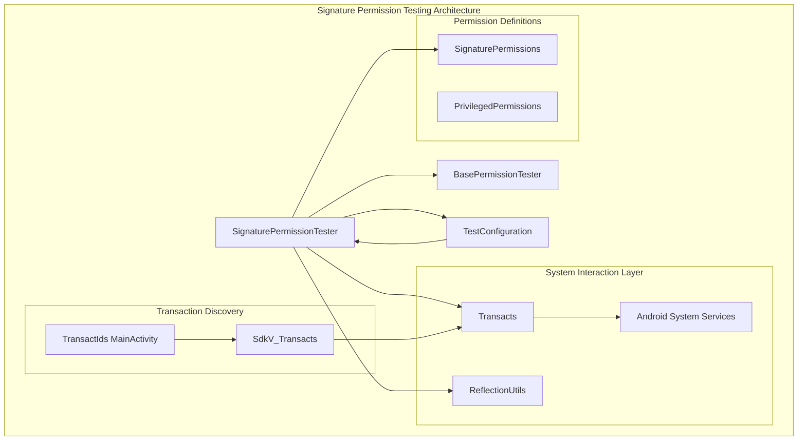

**Sources:** [niap-cc/Permissions/Tester/app/src/main/java/com/android/certifications/niap/permissions/SignaturePermissionTester.java:269-380](), [niap-cc/Permissions/Tester/app/src/main/java/com/android/certifications/niap/permissions/utils/Transacts.java:50-59]()

## Core Components

### SignaturePermissionTester Class

The `SignaturePermissionTester` class extends `BasePermissionTester` and serves as the primary orchestrator for signature permission validation. It maintains collections of signature permissions and implements test methods for each protected API.

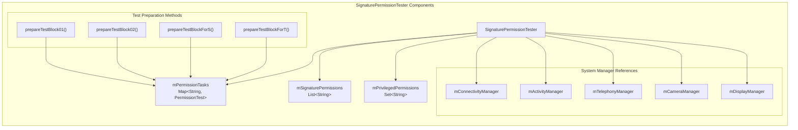

**Sources:** [niap-cc/Permissions/Tester/app/src/main/java/com/android/certifications/niap/permissions/SignaturePermissionTester.java:280-380](), [niap-cc/Permissions/Tester/app/src/main/java/com/android/certifications/niap/permissions/SignaturePermissionTester.java:319-320]()

### Permission Test Organization

The system organizes permission tests into versioned blocks based on Android API levels, with each block containing tests for permissions introduced or modified in specific Android versions.

| Test Block | Method | API Level | Permission Count |
|------------|--------|-----------|------------------|
| Block 01 | `prepareTestBlock01()` | Base/Legacy | ~50 permissions |
| Block 02 | `prepareTestBlock02()` | API updates | ~30 permissions |
| QPR Block | `prepareTestBlockForQPR()` | Quarterly updates | ~15 permissions |
| S Block | `prepareTestBlockForS()` | Android 12 | ~25 permissions |
| T Block | `prepareTestBlockForT()` | Android 13 | ~20 permissions |
| U Block | `prepareTestBlockForU()` | Android 14 | ~15 permissions |
| V Block | `prepareTestBlockForV()` | Android 15 | ~10 permissions |

**Sources:** [niap-cc/Permissions/Tester/app/src/main/java/com/android/certifications/niap/permissions/SignaturePermissionTester.java:368-378]()

## Binder Transaction Testing Mechanism

Signature permission testing relies heavily on direct Binder transaction calls to bypass higher-level Android API abstractions and test permissions at the system service level.

### Transacts Utility Framework

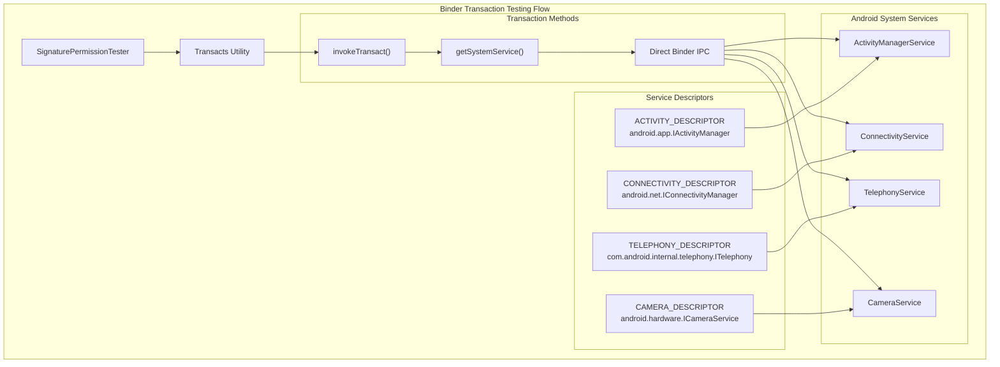

**Sources:** [niap-cc/Permissions/Tester/app/src/main/java/com/android/certifications/niap/permissions/utils/Transacts.java:50-59](), [niap-cc/Permissions/Tester/app/src/main/java/com/android/certifications/niap/permissions/utils/Transacts.java:63-321]()

### Transaction ID Discovery

The framework includes a dedicated application for discovering device-specific Binder transaction IDs, which can vary between Android versions and device implementations.

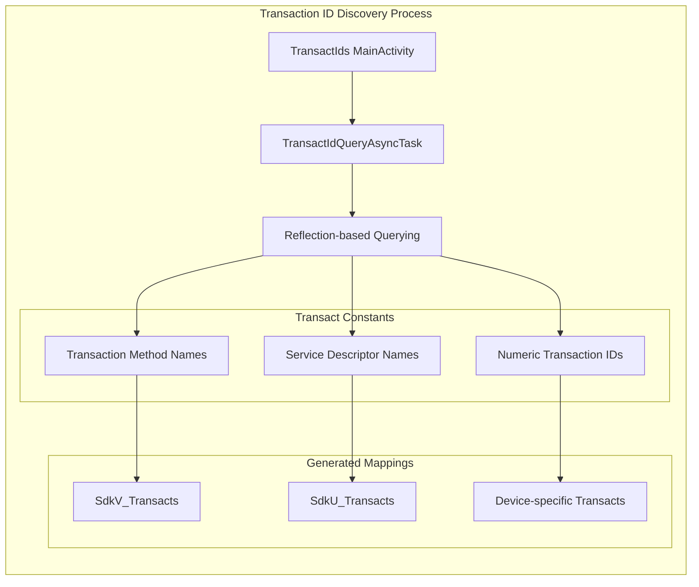

**Sources:** [niap-cc/Permissions/TransactIds/app/src/main/java/com/android/certifications/niap/permissions/transactids/MainActivity.java:73-143](), [niap-cc/Permissions/Tester/app/src/main/java/com/android/certifications/niap/permissions/utils/SdkV_Transacts.java:21-24]()

## Test Execution Flow

Individual signature permission tests follow a consistent pattern of API invocation and security exception validation.

### Permission Test Implementation Pattern

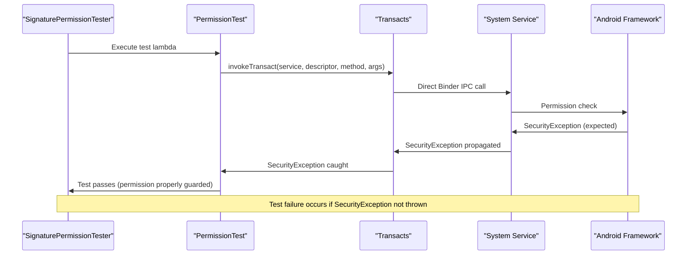

**Sources:** [niap-cc/Permissions/Tester/app/src/main/java/com/android/certifications/niap/permissions/SignaturePermissionTester.java:385-516]()

### Example Permission Test Implementations

The system includes hundreds of specific permission tests. Here are representative examples:

**ACCESS_CACHE_FILESYSTEM Test:**
```
mPermissionTasks.put(permission.ACCESS_CACHE_FILESYSTEM, 
    new PermissionTest(false, () -> {
        File f = new File(Environment.getDownloadCacheDirectory(), 
                         "test_access_cache_filesystem.out");
        f.createNewFile(); // Should throw SecurityException
    }));
```

**CONNECTIVITY_INTERNAL Test:**
```
mPermissionTasks.put(permission.CONNECTIVITY_INTERNAL,
    new PermissionTest(false, () -> {
        mTransacts.invokeTransact(Transacts.CONNECTIVITY_SERVICE,
                                 Transacts.CONNECTIVITY_DESCRIPTOR,
                                 Transacts.getActiveNetworkForUid, mUid, false);
    }));
```

**Sources:** [niap-cc/Permissions/Tester/app/src/main/java/com/android/certifications/niap/permissions/SignaturePermissionTester.java:391-408](), [niap-cc/Permissions/Tester/app/src/main/java/com/android/certifications/niap/permissions/SignaturePermissionTester.java:676-681]()

## Integration with Permission Testing Framework

The signature permission tester integrates with the broader framework through the `TestConfiguration` system and shares infrastructure with other permission testers.

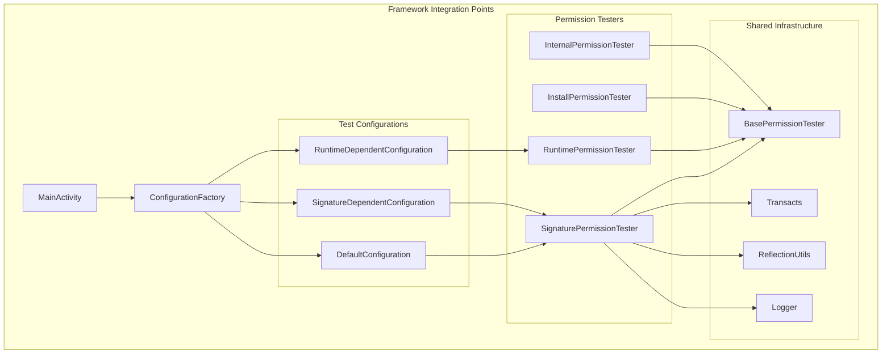

**Sources:** [niap-cc/Permissions/Tester/app/src/main/java/com/android/certifications/niap/permissions/SignaturePermissionTester.java:280-282](), [niap-cc/Permissions/Tester/app/src/main/java/com/android/certifications/niap/permissions/SignaturePermissionTester.java:321-322]()

## Platform Signing Requirements

The signature permission testing validates the fundamental Android security model where certain permissions can only be granted to applications signed with the platform's signing key. The testing application itself must be built in two variants:

- **Platform-signed variant**: Used for testing privileged permissions that require platform signature
- **Non-platform-signed variant**: Used for signature permission testing to ensure SecurityExceptions are properly thrown

This dual-variant approach ensures comprehensive validation of Android's permission enforcement at both the signature and privileged levels.

**Sources:** [niap-cc/Permissions/Tester/app/src/main/java/com/android/certifications/niap/permissions/SignaturePermissionTester.java:269-278](), [niap-cc/Permissions/Tester/app/src/noperm/AndroidManifest.xml:1-19]()

---

# Page: Runtime Permission Testing

# Runtime Permission Testing

<details>
<summary>Relevant source files</summary>

The following files were used as context for generating this wiki page:

- [niap-cc/Permissions/Tester/app/src/main/java/com/android/certifications/niap/permissions/BasePermissionTester.java](niap-cc/Permissions/Tester/app/src/main/java/com/android/certifications/niap/permissions/BasePermissionTester.java)
- [niap-cc/Permissions/Tester/app/src/main/java/com/android/certifications/niap/permissions/DevicePolicyPermissionTester.java](niap-cc/Permissions/Tester/app/src/main/java/com/android/certifications/niap/permissions/DevicePolicyPermissionTester.java)
- [niap-cc/Permissions/Tester/app/src/main/java/com/android/certifications/niap/permissions/GmsPermissionTester.java](niap-cc/Permissions/Tester/app/src/main/java/com/android/certifications/niap/permissions/GmsPermissionTester.java)
- [niap-cc/Permissions/Tester/app/src/main/java/com/android/certifications/niap/permissions/NonPlatformPermissionTester.java](niap-cc/Permissions/Tester/app/src/main/java/com/android/certifications/niap/permissions/NonPlatformPermissionTester.java)
- [niap-cc/Permissions/Tester/app/src/main/java/com/android/certifications/niap/permissions/PrivilegedPermissionTester.java](niap-cc/Permissions/Tester/app/src/main/java/com/android/certifications/niap/permissions/PrivilegedPermissionTester.java)
- [niap-cc/Permissions/Tester/app/src/main/java/com/android/certifications/niap/permissions/RuntimePermissionTester.java](niap-cc/Permissions/Tester/app/src/main/java/com/android/certifications/niap/permissions/RuntimePermissionTester.java)
- [niap-cc/Permissions/Tester/app/src/main/java/com/android/certifications/niap/permissions/config/RuntimeDependentPermissionConfiguration.java](niap-cc/Permissions/Tester/app/src/main/java/com/android/certifications/niap/permissions/config/RuntimeDependentPermissionConfiguration.java)

</details>


Runtime permission testing verifies that Android APIs properly enforce permission requirements for permissions that require user consent. This testing framework validates that protected APIs throw `SecurityException` when permissions are denied and function correctly when permissions are granted.

For signature permission testing, see [Signature Permission Testing](#2.1). For install-time permission testing, see [Install Permission Testing](#2.3).

## Purpose and Scope

Runtime permissions in Android require explicit user consent, either through the `-g` flag during `adb install` or through runtime permission dialogs. The `RuntimePermissionTester` validates that:

- APIs protected by runtime permissions throw `SecurityException` when the permission is not granted
- APIs function correctly when the permission is granted
- Permission dependencies are properly handled
- Version-specific permission behaviors are correctly implemented

Sources: [niap-cc/Permissions/Tester/app/src/main/java/com/android/certifications/niap/permissions/RuntimePermissionTester.java:135-141]()

## Architecture Overview

The runtime permission testing architecture centers around the `RuntimePermissionTester` class, which extends `BasePermissionTester` and manages individual permission tests through a structured framework.

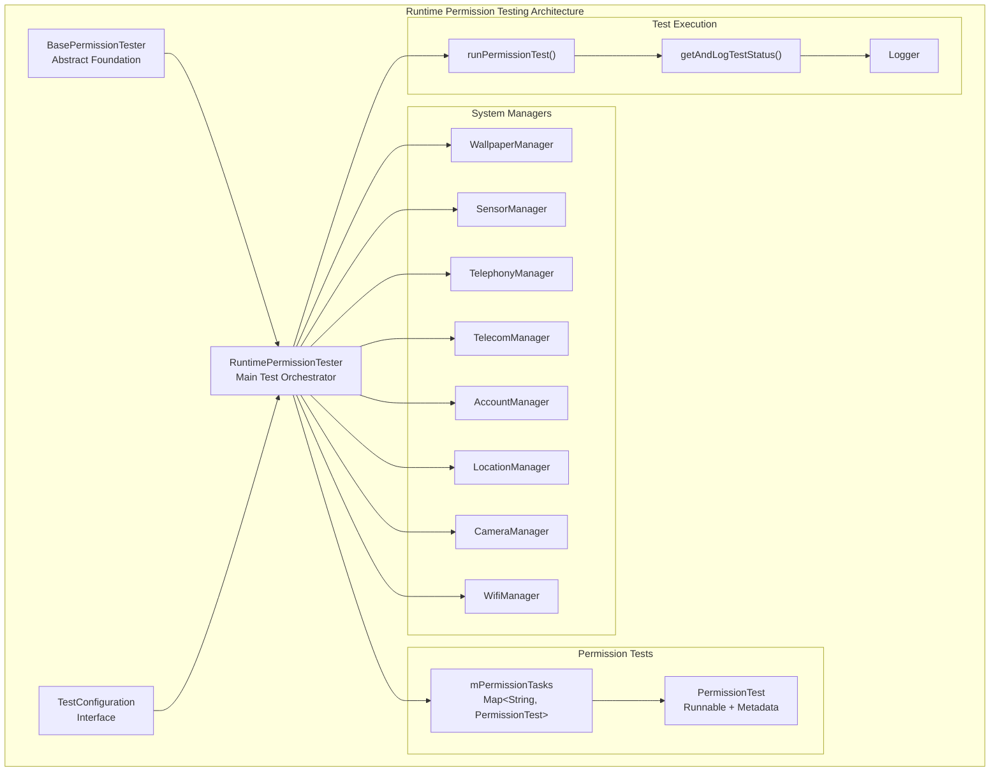

Sources: [niap-cc/Permissions/Tester/app/src/main/java/com/android/certifications/niap/permissions/RuntimePermissionTester.java:142-172](), [niap-cc/Permissions/Tester/app/src/main/java/com/android/certifications/niap/permissions/BasePermissionTester.java:56-182]()

## Permission Test Structure

Each runtime permission test is encapsulated in a `PermissionTest` object that contains the test logic and metadata about API level requirements.

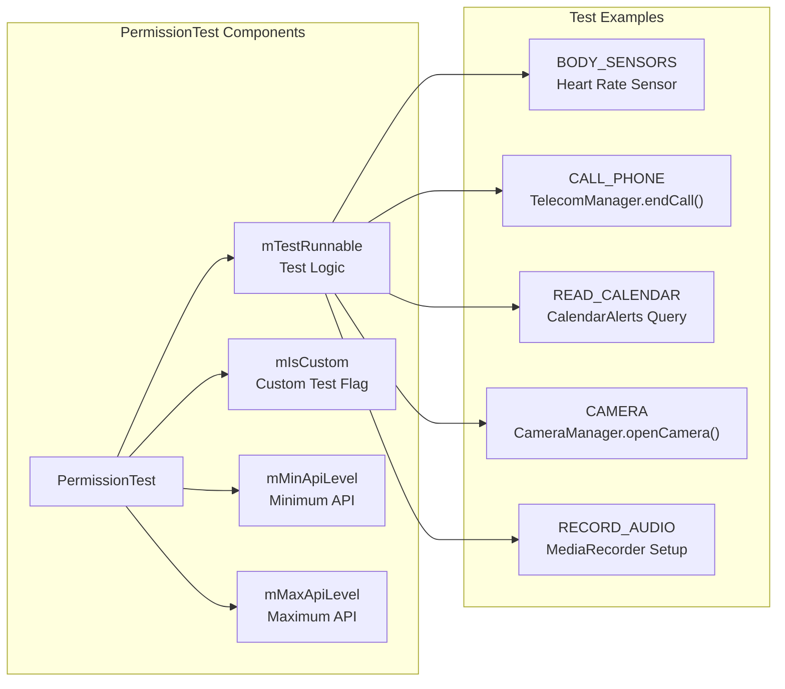

### Example Permission Test Implementation

| Permission | API Tested | Expected Behavior |
|------------|------------|-------------------|
| `BODY_SENSORS` | `SensorManager.getDefaultSensor(TYPE_HEART_RATE)` | Returns null if permission denied |
| `CALL_PHONE` | `TelecomManager.endCall()` | Throws SecurityException if denied |
| `READ_CALENDAR` | `ContentResolver.query(CalendarAlerts.CONTENT_URI)` | Throws SecurityException if denied |
| `CAMERA` | `CameraManager.openCamera()` | Fails in callback if denied |
| `RECORD_AUDIO` | `MediaRecorder.prepare()` | Throws RuntimeException if denied |

Sources: [niap-cc/Permissions/Tester/app/src/main/java/com/android/certifications/niap/permissions/RuntimePermissionTester.java:178-418](), [niap-cc/Permissions/Tester/app/src/main/java/com/android/certifications/niap/permissions/BasePermissionTester.java:355-421]()

## Test Execution Flow

The runtime permission testing follows a structured execution pattern that validates permission enforcement across different grant states.

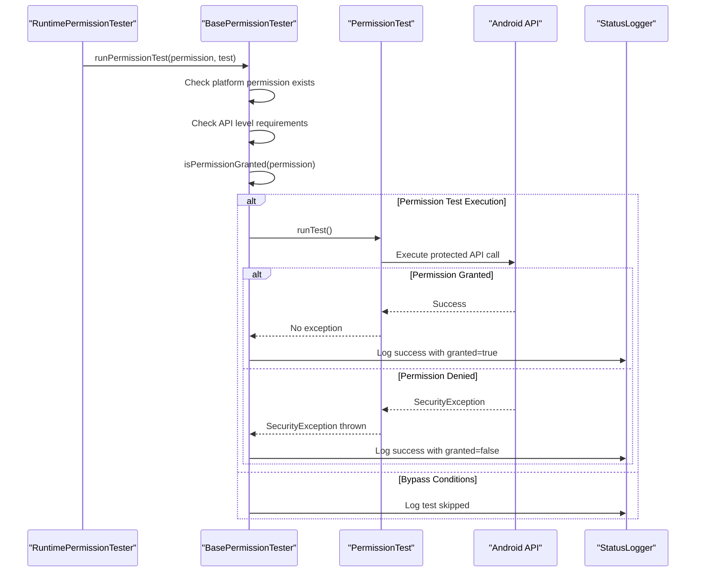

Sources: [niap-cc/Permissions/Tester/app/src/main/java/com/android/certifications/niap/permissions/BasePermissionTester.java:239-311]()

## Dependency Handling

Some runtime permissions require other permissions to be granted for effective testing. The `RuntimeDependentPermissionConfiguration` handles these dependency scenarios.

```mermaid
graph TB
    subgraph "Permission Dependencies"
        RDPC["RuntimeDependentPermissionConfiguration"]
        
        subgraph "Required Permissions"
            REQ1["READ_MEDIA_IMAGES<br/>(Android 13+)"]
            REQ2["READ_EXTERNAL_STORAGE<br/>(Pre-Android 13)"]
            REQ3["READ_PHONE_NUMBERS"]
        end
        
        subgraph "Permissions Under Test"
            PUT1["ACCESS_MEDIA_LOCATION"]
            PUT2["SEND_SMS"]
        end
        
        subgraph "Test Flow"
            PreRun["preRunSetup()"]
            ReqPerm["Request Required Permissions"]
            Wait["CountDownLatch.await()"]
            Test["Run Dependent Tests"]
        end
    end
    
    RDPC --> REQ1
    RDPC --> REQ2
    RDPC --> REQ3
    RDPC --> PUT1
    RDPC --> PUT2
    
    PUT1 --> REQ1
    PUT1 --> REQ2
    PUT2 --> REQ3
    
    RDPC --> PreRun
    PreRun --> ReqPerm
    ReqPerm --> Wait
    Wait --> Test
```

### Dependency Resolution Process

The dependency resolution follows this sequence:

1. **Prerequisite Check**: Verify required permissions are declared in manifest
2. **Grant State Validation**: Ensure required permissions are not already granted
3. **Runtime Request**: Use `ActivityCompat.requestPermissions()` to request consent
4. **Synchronization**: Use `CountDownLatch` to wait for user response
5. **Test Execution**: Proceed with dependent permission tests

Sources: [niap-cc/Permissions/Tester/app/src/main/java/com/android/certifications/niap/permissions/config/RuntimeDependentPermissionConfiguration.java:50-153]()

## Version-Specific Testing

Runtime permissions have evolved across Android versions, requiring version-aware test execution.

| Android Version | New Runtime Permissions | Test Considerations |
|-----------------|------------------------|---------------------|
| API 28 (P) | Base runtime permissions | Foundation testing |
| API 29 (Q) | `ACTIVITY_RECOGNITION`, `ACCESS_MEDIA_LOCATION` | Sensor and media access |
| API 31 (S) | `BLUETOOTH_ADVERTISE`, `BLUETOOTH_CONNECT`, `BLUETOOTH_SCAN`, `UWB_RANGING` | Bluetooth and UWB features |
| API 33 (T) | `READ_MEDIA_AUDIO`, `READ_MEDIA_IMAGES`, `READ_MEDIA_VIDEO`, `POST_NOTIFICATIONS`, `NEARBY_WIFI_DEVICES` | Granular media and notification access |

### Version-Specific Implementation Pattern

```mermaid
graph LR
    subgraph "API Level Gating"
        Check["SDK_INT Check"]
        MinAPI["test.mMinApiLevel"]
        MaxAPI["test.mMaxApiLevel"]
        Device["mDeviceApiLevel"]
    end
    
    subgraph "Test Examples"
        T33["Android 13+ Tests<br/>READ_MEDIA_*<br/>POST_NOTIFICATIONS"]
        T31["Android 12 Tests<br/>BLUETOOTH_*<br/>UWB_RANGING"]
        T29["Android 10 Tests<br/>ACTIVITY_RECOGNITION"]
    end
    
    Check --> MinAPI
    Check --> MaxAPI
    Check --> Device
    
    MinAPI --> T33
    MinAPI --> T31
    MinAPI --> T29
```

Sources: [niap-cc/Permissions/Tester/app/src/main/java/com/android/certifications/niap/permissions/RuntimePermissionTester.java:424-741](), [niap-cc/Permissions/Tester/app/src/main/java/com/android/certifications/niap/permissions/BasePermissionTester.java:254-264]()

## Threading and Parallel Execution

The framework supports both sequential and parallel test execution through the `runPermissionTestsByThreads()` method.

```mermaid
graph TB
    subgraph "Parallel Test Execution"
        RTT["runPermissionTestsByThreads()"]
        CB["Consumer&lt;Result&gt; callback"]
        
        subgraph "Thread Management"
            T1["Thread 1<br/>Permission Test"]
            T2["Thread 2<br/>Permission Test"]
            T3["Thread N<br/>Permission Test"]
            Join["thread.join(THREAD_JOIN_DELAY)"]
        end
        
        subgraph "Result Tracking"
            AC["AtomicInteger cnt"]
            AE["AtomicInteger err"]
            Result["Result(success, name, no, total, err)"]
        end
    end
    
    RTT --> CB
    RTT --> T1
    RTT --> T2
    RTT --> T3
    
    T1 --> Join
    T2 --> Join
    T3 --> Join
    
    T1 --> AC
    T2 --> AC
    T3 --> AC
    
    AC --> Result
    AE --> Result
    Result --> CB
```

Sources: [niap-cc/Permissions/Tester/app/src/main/java/com/android/certifications/niap/permissions/BasePermissionTester.java:196](), [niap-cc/Permissions/Tester/app/src/main/java/com/android/certifications/niap/permissions/BasePermissionTester.java:58-61]()

## Integration with Test Configuration System

Runtime permission testing integrates with the broader test configuration system to support different testing scenarios and build variants.

```mermaid
graph LR
    subgraph "Configuration Integration"
        CF["ConfigurationFactory"]
        TC["TestConfiguration"]
        
        subgraph "Runtime Configurations"
            Default["DefaultConfiguration"]
            Dependent["RuntimeDependentConfiguration"]
            InstallOnly["InstallPermissionOnlyConfiguration"]
        end
        
        subgraph "Permission Lists"
            GetPerms["getPermissions()"]
            RuntimePerms["getRuntimePermissions()"]
            Optional["Optional&lt;List&lt;String&gt;&gt;"]
        end
    end
    
    CF --> TC
    TC --> Default
    TC --> Dependent
    TC --> InstallOnly
    
    TC --> GetPerms
    TC --> RuntimePerms
    GetPerms --> Optional
    RuntimePerms --> Optional
```

Sources: [niap-cc/Permissions/Tester/app/src/main/java/com/android/certifications/niap/permissions/config/RuntimeDependentPermissionConfiguration.java:216-227](), [niap-cc/Permissions/Tester/app/src/main/java/com/android/certifications/niap/permissions/config/TestConfiguration.java]()

---

# Page: Install Permission Testing

# Install Permission Testing

<details>
<summary>Relevant source files</summary>

The following files were used as context for generating this wiki page:

- [niap-cc/Permissions/Tester/app/build.gradle](niap-cc/Permissions/Tester/app/build.gradle)
- [niap-cc/Permissions/Tester/app/src/androidTest/AndroidManifest.xml](niap-cc/Permissions/Tester/app/src/androidTest/AndroidManifest.xml)
- [niap-cc/Permissions/Tester/app/src/main/java/com/android/certifications/niap/permissions/InstallPermissionTester.java](niap-cc/Permissions/Tester/app/src/main/java/com/android/certifications/niap/permissions/InstallPermissionTester.java)
- [niap-cc/Permissions/Tester/app/src/normal/AndroidManifest.xml](niap-cc/Permissions/Tester/app/src/normal/AndroidManifest.xml)
- [niap-cc/Permissions/Tester/app/src/platform/AndroidManifest.xml](niap-cc/Permissions/Tester/app/src/platform/AndroidManifest.xml)

</details>


This document covers the install permission testing capabilities within the Android Security Certification Resources framework. Install permission testing validates that install-time permissions properly guard their associated APIs and resources. Install permissions are granted automatically upon app installation when declared in the AndroidManifest.xml using `<uses-permission>` tags, unlike runtime permissions which require user consent.

For signature permission testing that requires platform certificates, see [Signature Permission Testing](#2.1). For runtime permissions that require user interaction, see [Runtime Permission Testing](#2.2).

## Build Variants and Signing Configuration

The install permission testing system uses multiple build variants to test different permission scenarios based on app signing and permission declarations.

```mermaid
graph TB
    subgraph "Build Variants"
        Normal["normal<br/>- Regular app signing<br/>- Install permissions only"]
        Noperm["noperm<br/>- Regular app signing<br/>- Minimal permissions"]
        Platform["platform<br/>- Platform signing<br/>- All permission types"]
    end
    
    subgraph "Signing Configs"
        NormSig["normal.jks<br/>Regular Certificate"]
        PlatSig["platform.jks<br/>Platform Certificate"]
    end
    
    subgraph "Permission Sets"
        InstallPerms["Install Permissions<br/>ACCESS_NETWORK_STATE<br/>INTERNET<br/>VIBRATE<br/>WAKE_LOCK"]
        SigPerms["Signature Permissions<br/>BIND_* permissions<br/>System APIs"]
        AllPerms["Complete Permission Set<br/>Install + Signature + Runtime"]
    end
    
    Normal --> NormSig
    Noperm --> NormSig
    Platform --> PlatSig
    
    Normal --> InstallPerms
    Noperm --> InstallPerms
    Platform --> AllPerms
```

**Sources:** [niap-cc/Permissions/Tester/app/build.gradle:28-51](), [niap-cc/Permissions/Tester/app/build.gradle:110-124]()

The build configuration defines three product flavors in the `flavorDimensions "settings"`:

| Flavor | Signing | Purpose |
|--------|---------|---------|
| `normal` | `signingConfigs.norm` | Tests install permissions with regular app signing |
| `noperm` | `signingConfigs.norm` | Tests behavior when permissions are not declared |
| `platform` | `signingConfigs.platform` | Tests all permission types with platform signing |

**Sources:** [niap-cc/Permissions/Tester/app/build.gradle:110-124]()

## Core Testing Architecture

The `InstallPermissionTester` class implements the core testing logic for install permissions, extending the `BasePermissionTester` foundation.

```mermaid
graph TB
    subgraph "InstallPermissionTester Architecture"
        IPT["InstallPermissionTester"]
        BPT["BasePermissionTester"]
        TC["TestConfiguration"]
        PT["PermissionTest"]
        
        IPT --> BPT
        IPT --> TC
        IPT --> PT
    end
    
    subgraph "System Services"
        CM["ConnectivityManager"]
        WM["WifiManager"]
        BM["BluetoothManager"]
        AM["ActivityManager"]
        AuM["AudioManager"]
        PM["PowerManager"]
        
        IPT --> CM
        IPT --> WM
        IPT --> BM
        IPT --> AM
        IPT --> AuM
        IPT --> PM
    end
    
    subgraph "Permission Test Map"
        PTMap["mPermissionTasks<br/>Map<String, PermissionTest>"]
        AN["ACCESS_NETWORK_STATE"]
        INT["INTERNET"]
        VIB["VIBRATE"]
        WL["WAKE_LOCK"]
        
        PTMap --> AN
        PTMap --> INT
        PTMap --> VIB
        PTMap --> WL
    end
    
    IPT --> PTMap
```

**Sources:** [niap-cc/Permissions/Tester/app/src/main/java/com/android/certifications/niap/permissions/InstallPermissionTester.java:213-256]()

## Permission Test Implementation

Each install permission test is implemented as a `PermissionTest` object that defines the test logic and expected behavior.

```mermaid
graph LR
    subgraph "PermissionTest Structure"
        PT["PermissionTest"]
        Flag["customTest: boolean"]
        MinSDK["minSdkVersion"]
        MaxSDK["maxSdkVersion"]
        TestLogic["test: Supplier<?>"]
        
        PT --> Flag
        PT --> MinSDK
        PT --> MaxSDK
        PT --> TestLogic
    end
    
    subgraph "Test Examples"
        ANS["ACCESS_NETWORK_STATE<br/>mConnectivityManager.getActiveNetwork()"]
        INT["INTERNET<br/>new ServerSocket(0)"]
        VIB["VIBRATE<br/>mVibrator.vibrate()"]
        BT["BLUETOOTH<br/>mBluetoothAdapter.getAddress()"]
        
        TestLogic --> ANS
        TestLogic --> INT
        TestLogic --> VIB
        TestLogic --> BT
    end
```

**Sources:** [niap-cc/Permissions/Tester/app/src/main/java/com/android/certifications/niap/permissions/InstallPermissionTester.java:256-300]()

### Key Permission Tests

| Permission | Test Method | Version Range |
|------------|-------------|---------------|
| `ACCESS_NETWORK_STATE` | `mConnectivityManager.getActiveNetwork()` | All versions |
| `INTERNET` | `new ServerSocket(0)` | All versions |
| `VIBRATE` | `mVibrator.vibrate()` | All versions |
| `BLUETOOTH` | `mBluetoothAdapter.getAddress()` | API 28-30 only |
| `WAKE_LOCK` | `mPowerManager.newWakeLock()` | All versions |

**Sources:** [niap-cc/Permissions/Tester/app/src/main/java/com/android/certifications/niap/permissions/InstallPermissionTester.java:258-710]()

## Foreground Service Type Testing

Starting with Android 14 (API 34), foreground services require specific type permissions in addition to the base `FOREGROUND_SERVICE` permission.

```mermaid
graph TB
    subgraph "Foreground Service Evolution"
        FS["FOREGROUND_SERVICE<br/>API 28-33"]
        FSTypes["Foreground Service Types<br/>API 34+"]
        
        FS --> FSTypes
    end
    
    subgraph "Service Type Permissions"
        FSC["FOREGROUND_SERVICE_CAMERA<br/>FgCameraService"]
        FSL["FOREGROUND_SERVICE_LOCATION<br/>FgLocationService"]
        FSM["FOREGROUND_SERVICE_MICROPHONE<br/>FgMicrophoneService"]
        FSP["FOREGROUND_SERVICE_PHONE_CALL<br/>FgPhoneCallService"]
        FSD["FOREGROUND_SERVICE_DATA_SYNC<br/>FgDataSyncService"]
        
        FSTypes --> FSC
        FSTypes --> FSL
        FSTypes --> FSM
        FSTypes --> FSP
        FSTypes --> FSD
    end
    
    subgraph "Test Implementation"
        StartFS["startForegroundService()"]
        BindFS["tryBindingForegroundService()"]
        
        FSC --> StartFS
        FSL --> StartFS
        FSM --> StartFS
        
        StartFS --> BindFS
    end
```

**Sources:** [niap-cc/Permissions/Tester/app/src/main/java/com/android/certifications/niap/permissions/InstallPermissionTester.java:376-509]()

### Foreground Service Type Tests

The system tests each foreground service type by:

1. Starting the appropriate service with `startForegroundService()`
2. Attempting to bind to the service with `tryBindingForegroundService()`
3. Handling exceptions that indicate permission denial

```java
// Example test pattern for foreground service types
mPermissionTasks.put(FOREGROUND_SERVICE_CAMERA, new PermissionTest(true,
        Build.VERSION_CODES.UPSIDE_DOWN_CAKE, () -> {
    Intent serviceIntent = new Intent(mActivity, FgCameraService.class);
    try {
        mActivity.startForegroundService(serviceIntent);
        tryBindingForegroundService(serviceIntent);
    } catch(Throwable t) {
        mLogger.logDebug("FOREGROUND_SERVICE_CAMERA", t);
    }
}));
```

**Sources:** [niap-cc/Permissions/Tester/app/src/main/java/com/android/certifications/niap/permissions/InstallPermissionTester.java:376-387]()

## Test Execution Flow

The install permission testing follows a systematic execution pattern that validates permission enforcement.

```mermaid
sequenceDiagram
    participant TC as "TestConfiguration"
    participant IPT as "InstallPermissionTester"
    participant PM as "PackageManager"
    participant SS as "SystemService"
    participant Logger as "Logger"
    
    TC->>IPT: runPermissionTests()
    
    loop For each permission in mPermissionTasks
        IPT->>PM: isPermissionGranted(permission)
        PM-->>IPT: boolean granted
        
        alt Permission granted
            IPT->>SS: invoke protected API
            SS-->>IPT: success (expected)
            IPT->>Logger: logTestSuccess()
        else Permission not granted
            IPT->>SS: invoke protected API
            SS-->>IPT: SecurityException (expected)
            IPT->>Logger: logTestError()
        end
    end
    
    IPT-->>TC: test results
```

**Sources:** [niap-cc/Permissions/Tester/app/src/main/java/com/android/certifications/niap/permissions/InstallPermissionTester.java:213-256]()

## Manifest Permission Declaration

Install permissions must be declared in the appropriate AndroidManifest.xml files for each build variant.

### Platform Variant Permissions

The platform variant includes comprehensive permission declarations for testing signature and system permissions:

```xml
<uses-permission android:name="android.permission.ACCESS_NETWORK_STATE" />
<uses-permission android:name="android.permission.INTERNET" />
<uses-permission android:name="android.permission.VIBRATE" />
<uses-permission android:name="android.permission.FOREGROUND_SERVICE" />
<uses-permission android:name="android.permission.FOREGROUND_SERVICE_CAMERA" />
<uses-permission android:name="android.permission.FOREGROUND_SERVICE_LOCATION" />
```

**Sources:** [niap-cc/Permissions/Tester/app/src/platform/AndroidManifest.xml:27-42]()

### Normal Variant Permissions

The normal variant focuses on install permissions available to regular applications:

```xml
<uses-permission android:name="android.permission.ACCESS_NETWORK_STATE" />
<uses-permission android:name="android.permission.INTERNET" />
<uses-permission android:name="android.permission.VIBRATE" />
<uses-permission android:name="android.permission.WAKE_LOCK" />
```

**Sources:** [niap-cc/Permissions/Tester/app/src/normal/AndroidManifest.xml:23-74]()

## Error Handling and Edge Cases

The install permission tester includes sophisticated error handling for various edge cases:

### Version-Specific Permission Handling

Some permissions have specific API level ranges where they are applicable:

- `BLUETOOTH` and `BLUETOOTH_ADMIN`: Only tested on API 28-30 (replaced by runtime permissions in API 31+)
- `FOREGROUND_SERVICE`: Only tested on API 28-33 (replaced by type-specific permissions in API 34+)
- Foreground service type permissions: Only tested on API 34+

**Sources:** [niap-cc/Permissions/Tester/app/src/main/java/com/android/certifications/niap/permissions/InstallPermissionTester.java:276-299](), [niap-cc/Permissions/Tester/app/src/main/java/com/android/certifications/niap/permissions/InstallPermissionTester.java:361-375]()

### Bypass Conditions

The testing framework includes bypass mechanisms for tests that cannot be performed due to device limitations:

- Hardware dependencies (NFC adapter, IR emitter, Bluetooth adapter)
- UI-affecting tests that could cause test instability
- Version-specific API availability

**Sources:** [niap-cc/Permissions/Tester/app/src/main/java/com/android/certifications/niap/permissions/InstallPermissionTester.java:278-282](), [niap-cc/Permissions/Tester/app/src/main/java/com/android/certifications/niap/permissions/InstallPermissionTester.java:575-577]()

---

# Page: Internal Permission Testing

# Internal Permission Testing

<details>
<summary>Relevant source files</summary>

The following files were used as context for generating this wiki page:

- [niap-cc/Permissions/Tester/app/src/main/java/com/android/certifications/niap/permissions/InternalPermissionTester.java](niap-cc/Permissions/Tester/app/src/main/java/com/android/certifications/niap/permissions/InternalPermissionTester.java)
- [niap-cc/Permissions/Tester/app/src/main/java/com/android/certifications/niap/permissions/utils/ReflectionUtils.java](niap-cc/Permissions/Tester/app/src/main/java/com/android/certifications/niap/permissions/utils/ReflectionUtils.java)

</details>


This document covers the internal platform permission testing capabilities within the Android Security Certification Resources framework. Internal permissions are platform permissions with special protection levels that require more than just platform signature verification, often involving role-based checks, system service validation, or other specialized authorization mechanisms.

For signature permission testing, see [Signature Permission Testing](#2.1). For runtime permission testing, see [Runtime Permission Testing](#2.2). For install permission testing, see [Install Permission Testing](#2.3).

## Overview

Internal permissions differ from signature permissions in that applications cannot be granted these permissions solely by being signed with the platform signing key. Instead, internal permissions require additional authorization mechanisms such as:

- Specific system roles or capabilities
- Direct system service integration
- Hidden API access patterns
- Binder transaction-level authorization

The `InternalPermissionTester` class validates that these permissions properly protect their associated APIs by attempting to invoke protected functionality and verifying that `SecurityException`s are thrown when access is denied.

Sources: [niap-cc/Permissions/Tester/app/src/main/java/com/android/certifications/niap/permissions/InternalPermissionTester.java:97-103]()

## Architecture Overview

```mermaid
graph TB
    IPermTester["InternalPermissionTester"]
    BasePermTester["BasePermissionTester"]
    PermissionTest["PermissionTest"]
    ReflectionUtils["ReflectionUtils"]
    Transacts["Transacts"]
    InternalPerms["InternalPermissions"]
    
    IPermTester --|extends| BasePermTester
    IPermTester --|contains| PermissionTest
    IPermTester --|uses| ReflectionUtils
    IPermTester --|uses| Transacts
    IPermTester --|references| InternalPerms
    
    subgraph "Test Execution Methods"
        runPermissionTests["runPermissionTests()"]
        runPermissionTestsByThreads["runPermissionTestsByThreads()"]
        getRegisteredPermissions["getRegisteredPermissions()"]
    end
    
    subgraph "Core Testing Techniques"
        BinderTransacts["Binder Transaction Calls"]
        ReflectionCalls["Reflection API Calls"]
        HiddenAPI["Hidden API Access"]
        SystemServices["System Service Integration"]
    end
    
    IPermTester --> runPermissionTests
    IPermTester --> runPermissionTestsByThreads
    IPermTester --> getRegisteredPermissions
    
    PermissionTest --> BinderTransacts
    PermissionTest --> ReflectionCalls
    PermissionTest --> HiddenAPI
    PermissionTest --> SystemServices
```

Sources: [niap-cc/Permissions/Tester/app/src/main/java/com/android/certifications/niap/permissions/InternalPermissionTester.java:104-118](), [niap-cc/Permissions/Tester/app/src/main/java/com/android/certifications/niap/permissions/InternalPermissionTester.java:571-602]()

## Test Implementation Structure

The `InternalPermissionTester` maintains a `Map<String, PermissionTest>` called `mPermissionTasks` that associates each internal permission with its corresponding test implementation. Each test is designed to invoke the protected API and expect a `SecurityException` when the permission is not granted.

```mermaid
graph LR
    subgraph "Permission Test Registration"
        Constructor["InternalPermissionTester Constructor"]
        PermissionMap["mPermissionTasks Map"]
        Constructor --> PermissionMap
    end
    
    subgraph "Individual Permission Tests"
        MANAGE_HOTWORD["MANAGE_HOTWORD_DETECTION"]
        OBSERVE_SENSOR["OBSERVE_SENSOR_PRIVACY"]
        DOMAIN_VERIFICATION["DOMAIN_VERIFICATION_AGENT"]
        ACCESS_RCS["ACCESS_RCS_USER_CAPABILITY_EXCHANGE"]
        ASSOCIATE_COMPANION["ASSOCIATE_COMPANION_DEVICES"]
        CREATE_VIRTUAL["CREATE_VIRTUAL_DEVICE"]
        MANAGE_SAFETY["MANAGE_SAFETY_CENTER"]
    end
    
    PermissionMap --> MANAGE_HOTWORD
    PermissionMap --> OBSERVE_SENSOR
    PermissionMap --> DOMAIN_VERIFICATION
    PermissionMap --> ACCESS_RCS
    PermissionMap --> ASSOCIATE_COMPANION
    PermissionMap --> CREATE_VIRTUAL
    PermissionMap --> MANAGE_SAFETY
    
    subgraph "Test Execution Flow"
        runPermissionTest["runPermissionTest()"]
        invokeTransact["mTransacts.invokeTransact()"]
        invokeReflection["ReflectionUtils.invokeReflectionCall()"]
        SecurityCheck["SecurityException Expected"]
    end
    
    MANAGE_HOTWORD --> runPermissionTest
    runPermissionTest --> invokeTransact
    runPermissionTest --> invokeReflection
    invokeTransact --> SecurityCheck
    invokeReflection --> SecurityCheck
```

Sources: [niap-cc/Permissions/Tester/app/src/main/java/com/android/certifications/niap/permissions/InternalPermissionTester.java:114-118](), [niap-cc/Permissions/Tester/app/src/main/java/com/android/certifications/niap/permissions/InternalPermissionTester.java:120-569]()

## Key Testing Techniques

### Binder Transaction Integration

Internal permission tests frequently use the `Transacts` utility to make direct binder calls to system services. This bypasses standard Android API layers and tests permission enforcement at the system service level.

```mermaid
graph TD
    PermissionTest["Permission Test Lambda"]
    TransactsCall["mTransacts.invokeTransact()"]
    SystemService["Android System Service"]
    PermissionCheck["Service Permission Check"]
    SecurityException["SecurityException Thrown"]
    
    PermissionTest --> TransactsCall
    TransactsCall --> SystemService
    SystemService --> PermissionCheck
    PermissionCheck --> SecurityException
    
    subgraph "Example: OBSERVE_SENSOR_PRIVACY"
        SensorPrivacyService["SENSOR_PRIVACY_SERVICE"]
        IsSensorPrivacyEnabled["isSensorPrivacyEnabled"]
    end
    
    TransactsCall -.-> SensorPrivacyService
    SensorPrivacyService --> IsSensorPrivacyEnabled
```

Sources: [niap-cc/Permissions/Tester/app/src/main/java/com/android/certifications/niap/permissions/InternalPermissionTester.java:144-148](), [niap-cc/Permissions/Tester/app/src/main/java/com/android/certifications/niap/permissions/InternalPermissionTester.java:73]()

### Reflection-Based API Access

The tester uses `ReflectionUtils` to access hidden APIs and instantiate objects that are not part of the public SDK. This is essential for testing internal permissions that protect non-public functionality.

| Reflection Method | Purpose | Example Usage |
|------------------|---------|---------------|
| `invokeReflectionCall()` | Call hidden methods | Accessing SafetyCenterManager APIs |
| `stubHiddenObject()` | Create hidden objects | VirtualDeviceParams construction |
| `stubRemoteCallback()` | Create callback stubs | Remote callback implementations |

Sources: [niap-cc/Permissions/Tester/app/src/main/java/com/android/certifications/niap/permissions/utils/ReflectionUtils.java:56-69](), [niap-cc/Permissions/Tester/app/src/main/java/com/android/certifications/niap/permissions/InternalPermissionTester.java:24-26]()

### Version-Specific Implementation

Internal permission tests include version checks to ensure tests only run on appropriate Android versions:

```mermaid
graph LR
    PermissionTest["PermissionTest Constructor"]
    VersionCheck["Build.VERSION_CODES Check"]
    TestExecution["Test Lambda Execution"]
    VersionSpecific["Version-Specific Logic"]
    
    PermissionTest --> VersionCheck
    VersionCheck --> TestExecution
    TestExecution --> VersionSpecific
    
    subgraph "Version Parameters"
        MinVersion["Minimum SDK Version"]
        MaxVersion["Maximum SDK Version (Optional)"]
        CurrentVersion["Build.VERSION.SDK_INT"]
    end
    
    VersionCheck --> MinVersion
    VersionCheck --> MaxVersion
    VersionCheck --> CurrentVersion
```

Sources: [niap-cc/Permissions/Tester/app/src/main/java/com/android/certifications/niap/permissions/InternalPermissionTester.java:121](), [niap-cc/Permissions/Tester/app/src/main/java/com/android/certifications/niap/permissions/InternalPermissionTester.java:206-207]()

## Specific Permission Test Examples

### MANAGE_HOTWORD_DETECTION

This permission protects voice interaction service APIs. The test invokes the `updateState` transaction on the `VOICE_INTERACTION_SERVICE` and handles a special case where the permission check passes but the caller validation fails.

Sources: [niap-cc/Permissions/Tester/app/src/main/java/com/android/certifications/niap/permissions/InternalPermissionTester.java:120-142]()

### CREATE_VIRTUAL_DEVICE

Tests the virtual device creation APIs by using reflection to construct `VirtualDeviceParams` objects and invoke the `createVirtualDevice` transaction with version-specific parameter handling.

Sources: [niap-cc/Permissions/Tester/app/src/main/java/com/android/certifications/niap/permissions/InternalPermissionTester.java:229-266]()

### MANAGE_DEVICE_LOCK_STATE

Implements complex callback-based testing using different interface versions between Android 14 and 15, demonstrating the evolution of internal permission APIs across Android versions.

Sources: [niap-cc/Permissions/Tester/app/src/main/java/com/android/certifications/niap/permissions/InternalPermissionTester.java:422-535]()

## Test Execution and Results

The `InternalPermissionTester` provides two execution modes:

### Sequential Execution

The `runPermissionTests()` method executes all registered permission tests sequentially and returns a boolean indicating overall success.

Sources: [niap-cc/Permissions/Tester/app/src/main/java/com/android/certifications/niap/permissions/InternalPermissionTester.java:571-602]()

### Threaded Execution  

The `runPermissionTestsByThreads()` method executes tests in parallel threads with timeout handling, providing real-time progress callbacks.

Sources: [niap-cc/Permissions/Tester/app/src/main/java/com/android/certifications/niap/permissions/InternalPermissionTester.java:603-629]()

## Integration with Framework Components

The `InternalPermissionTester` integrates with several framework components:

- **BasePermissionTester**: Provides common testing infrastructure and `PermissionTest` class
- **Transacts**: Enables direct binder transaction calls to system services  
- **ReflectionUtils**: Provides reflection utilities for hidden API access
- **InternalPermissions**: Contains permission constant definitions
- **TestConfiguration**: Specifies which internal permissions to test

Sources: [niap-cc/Permissions/Tester/app/src/main/java/com/android/certifications/niap/permissions/InternalPermissionTester.java:23](), [niap-cc/Permissions/Tester/app/src/main/java/com/android/certifications/niap/permissions/InternalPermissionTester.java:63-74]()

---

# Page: Test Configuration System

# Test Configuration System

<details>
<summary>Relevant source files</summary>

The following files were used as context for generating this wiki page:

- [niap-cc/Permissions/PermissionTester/app/src/androidTest/java/com/android/certification/niap/permission/dpctester/InternalPermissionJUnitTest.java](niap-cc/Permissions/PermissionTester/app/src/androidTest/java/com/android/certification/niap/permission/dpctester/InternalPermissionJUnitTest.java)
- [niap-cc/Permissions/PermissionTester/app/src/main/java/com/android/certification/niap/permission/dpctester/test/GmsTestModule.java](niap-cc/Permissions/PermissionTester/app/src/main/java/com/android/certification/niap/permission/dpctester/test/GmsTestModule.java)
- [niap-cc/Permissions/PermissionTester/app/src/main/java/com/android/certification/niap/permission/dpctester/test/InternalTestModule.java](niap-cc/Permissions/PermissionTester/app/src/main/java/com/android/certification/niap/permission/dpctester/test/InternalTestModule.java)
- [niap-cc/Permissions/PermissionTester/app/src/main/java/com/android/certification/niap/permission/dpctester/test/tool/ReflectionTool.kt](niap-cc/Permissions/PermissionTester/app/src/main/java/com/android/certification/niap/permission/dpctester/test/tool/ReflectionTool.kt)
- [niap-cc/Permissions/Tester/app/src/main/java/com/android/certifications/niap/permissions/config/ConfigurationFactory.java](niap-cc/Permissions/Tester/app/src/main/java/com/android/certifications/niap/permissions/config/ConfigurationFactory.java)
- [niap-cc/Permissions/Tester/app/src/main/java/com/android/certifications/niap/permissions/config/DevicePolicyConfiguration.java](niap-cc/Permissions/Tester/app/src/main/java/com/android/certifications/niap/permissions/config/DevicePolicyConfiguration.java)
- [niap-cc/Permissions/Tester/app/src/main/java/com/android/certifications/niap/permissions/config/InstallPermissionOnlyConfiguration.java](niap-cc/Permissions/Tester/app/src/main/java/com/android/certifications/niap/permissions/config/InstallPermissionOnlyConfiguration.java)
- [niap-cc/Permissions/Tester/app/src/main/java/com/android/certifications/niap/permissions/config/TestConfiguration.java](niap-cc/Permissions/Tester/app/src/main/java/com/android/certifications/niap/permissions/config/TestConfiguration.java)
- [niap-cc/Permissions/Tester/app/src/main/java/com/android/certifications/niap/permissions/utils/PermissionUtils.java](niap-cc/Permissions/Tester/app/src/main/java/com/android/certifications/niap/permissions/utils/PermissionUtils.java)
- [niap-cc/Permissions/Tester/app/src/main/java/com/android/certifications/niap/permissions/utils/SdkT_Transacts.java](niap-cc/Permissions/Tester/app/src/main/java/com/android/certifications/niap/permissions/utils/SdkT_Transacts.java)
- [niap-cc/Permissions/Tester/app/src/main/java/com/android/certifications/niap/permissions/utils/SdkU_Transacts.java](niap-cc/Permissions/Tester/app/src/main/java/com/android/certifications/niap/permissions/utils/SdkU_Transacts.java)
- [niap-cc/Permissions/TransactIds/app/src/androidTest/java/AndroidManifest.xml](niap-cc/Permissions/TransactIds/app/src/androidTest/java/AndroidManifest.xml)

</details>


## Purpose and Scope

The Test Configuration System provides a flexible framework for orchestrating Android permission tests across different device states and signing configurations. This system determines which permission testers to execute and how to configure them based on the application's signing status, requested permissions, and device capabilities.

For information about the specific permission testers that are configured by this system, see [Permission Testing Framework](#2). For details about individual tester implementations, see [Signature Permission Testing](#2.1), [Runtime Permission Testing](#2.2), [Install Permission Testing](#2.3), and [Internal Permission Testing](#2.4).

## Configuration Architecture

The configuration system follows a factory pattern where `ConfigurationFactory` analyzes the device and application state to determine appropriate test configurations.

```mermaid
graph TD
    MainActivity["MainActivity"] --> ConfigurationFactory["ConfigurationFactory.getConfigurations()"]
    
    ConfigurationFactory --> SignatureCheck{"Platform Signature Check"}
    ConfigurationFactory --> DebugCheck{"Debug Mode Check"}
    ConfigurationFactory --> PermissionCheck{"Permission Analysis"}
    
    SignatureCheck -->|"Platform Signed"| PlatformConfigs["Platform Signed Configurations"]
    SignatureCheck -->|"Non-Platform"| DefaultConfigs["Default Configurations"]
    
    DebugCheck -->|"Debug Mode"| DebugConfiguration["DebugConfiguration"]
    
    PlatformConfigs --> PlatformSignedDefaultConfiguration["PlatformSignedDefaultConfiguration"]
    PlatformConfigs --> SignatureDependentPermissionConfiguration["SignatureDependentPermissionConfiguration"]
    PlatformConfigs --> NonFrameworkPermissionConfiguration["NonFrameworkPermissionConfiguration"]
    PlatformConfigs --> ManageBiometricDialogConfiguration["ManageBiometricDialogConfiguration"]
    
    DefaultConfigs --> DEFAULT_CONFIGURATION["DEFAULT_CONFIGURATION (Anonymous)"]
    DefaultConfigs --> RuntimeDependentPermissionConfiguration["RuntimeDependentPermissionConfiguration"]
    DefaultConfigs --> InstallPermissionOnlyConfiguration["InstallPermissionOnlyConfiguration"]
    DefaultConfigs --> GmsPermissionConfiguration["GmsPermissionConfiguration"]
    DefaultConfigs --> DevicePolicyConfiguration["DevicePolicyConfiguration"]
    
    PermissionCheck --> ConfigEnable{"Configuration.enabled()"}
    ConfigEnable -->|"Enabled"| IncludeConfig["Include in Results"]
    ConfigEnable -->|"Disabled"| SkipConfig["Skip Configuration"]
```

Sources: [niap-cc/Permissions/Tester/app/src/main/java/com/android/certifications/niap/permissions/config/ConfigurationFactory.java:52-108]()

## TestConfiguration Interface

The `TestConfiguration` interface defines the contract for all configuration implementations, specifying which permission testers to run and which permissions to test.

```mermaid
graph LR
    TestConfiguration["TestConfiguration Interface"] --> Methods["Core Methods"]
    
    Methods --> preRunSetup["preRunSetup()"]
    Methods --> getPermissionTesters["getPermissionTesters()"]
    Methods --> onRequestPermissionsResult["onRequestPermissionsResult()"]
    
    TestConfiguration --> PermissionFilters["Permission Filters"]
    PermissionFilters --> getInstallPermissions["getInstallPermissions()"]
    PermissionFilters --> getRuntimePermissions["getRuntimePermissions()"]
    PermissionFilters --> getSignaturePermissions["getSignaturePermissions()"]
    PermissionFilters --> getPrivilegedPermissions["getPrivilegedPermissions()"]
    PermissionFilters --> getInternalPermissions["getInternalPermissions()"]
    
    TestConfiguration --> PermissionSkips["Permission Skips"]
    PermissionSkips --> getSkippedSignaturePermissions["getSkippedSignaturePermissions()"]
    PermissionSkips --> getSkippedInternalPermissions["getSkippedInternalPermissions()"]
    
    TestConfiguration --> UIConfig["UI Configuration"]
    UIConfig --> getButtonTextId["getButtonTextId()"]
```

Sources: [niap-cc/Permissions/Tester/app/src/main/java/com/android/certifications/niap/permissions/config/TestConfiguration.java:45-155]()

## Configuration Decision Flow

The `ConfigurationFactory` implements sophisticated logic to determine which configurations are appropriate for the current device and application state.

```mermaid
flowchart TD
    Start["ConfigurationFactory.getConfigurations()"] --> DebugMode{"Constants.USE_DEBUG_CONFIG"}
    
    DebugMode -->|"true"| ReturnDebug["Return Collections.singletonList(DebugConfiguration)"]
    
    DebugMode -->|"false"| PlatformSigCheck{"SignatureUtils.hasSameSigningCertificateAsPackage(PLATFORM_PACKAGE)"}
    
    PlatformSigCheck -->|"true"| CheckPlatformPermissions{"SignatureDependentPermissionConfiguration.areDependentPermissionsGranted()"}
    
    CheckPlatformPermissions -->|"true"| CreatePlatformConfigs["Create Platform Configuration List"]
    CheckPlatformPermissions -->|"false"| ReturnSigDependent["Return SignatureDependentPermissionConfiguration"]
    
    CreatePlatformConfigs --> AddPlatformDefault["Add PlatformSignedDefaultConfiguration"]
    AddPlatformDefault --> AddNonFramework["Add NonFrameworkPermissionConfiguration"]
    AddNonFramework --> AddAdditional["Add Additional Configurations"]
    AddAdditional --> AddBiometric["Add ManageBiometricDialogConfiguration"]
    
    PlatformSigCheck -->|"false"| GetDefaultConfigs["getDefaultConfigurations()"]
    
    GetDefaultConfigs --> AddDefaultConfig["Add DEFAULT_CONFIGURATION"]
    AddDefaultConfig --> CheckInstallPermissionOnly{"InstallPermissionOnlyConfiguration.enabled()"}
    
    CheckInstallPermissionOnly -->|"true"| AddInstallOnly["Add InstallPermissionOnlyConfiguration"]
    CheckInstallPermissionOnly -->|"false"| SkipInstallOnly["Skip InstallPermissionOnlyConfiguration"]
    
    AddInstallOnly --> AddNonFramework2["Add NonFrameworkPermissionConfiguration"]
    SkipInstallOnly --> AddNonFramework2
    AddNonFramework2 --> AddAdditional2["Add Additional Configurations"]
    
    AddAdditional2 --> CheckRuntimeDependent{"RuntimeDependentPermissionConfiguration.checkStatusOfConfig()"}
    CheckRuntimeDependent -->|"true"| AddRuntimeDependent["Add RuntimeDependentPermissionConfiguration"]
    CheckRuntimeDependent -->|"false"| SkipRuntimeDependent["Skip RuntimeDependentPermissionConfiguration"]
    
    AddRuntimeDependent --> ReturnConfigurations["Return Configuration List"]
    SkipRuntimeDependent --> ReturnConfigurations
    ReturnDebug --> ReturnConfigurations
    ReturnSigDependent --> ReturnConfigurations
    AddBiometric --> ReturnConfigurations
```

Sources: [niap-cc/Permissions/Tester/app/src/main/java/com/android/certifications/niap/permissions/config/ConfigurationFactory.java:52-108](), [niap-cc/Permissions/Tester/app/src/main/java/com/android/certifications/niap/permissions/config/ConfigurationFactory.java:114-127](), [niap-cc/Permissions/Tester/app/src/main/java/com/android/certifications/niap/permissions/config/ConfigurationFactory.java:137-151]()

## Configuration-to-Tester Mapping

Each configuration determines which `BasePermissionTester` implementations to instantiate and execute.

| Configuration Class | Permission Testers | Primary Use Case |
|---------------------|-------------------|------------------|
| `DEFAULT_CONFIGURATION` | `RuntimePermissionTester`, `SignaturePermissionTester`, `PrivilegedPermissionTester`, `InternalPermissionTester`, `InstallPermissionTester` | Standard platform permission testing |
| `SignatureDependentPermissionConfiguration` | Platform-specific testers | Apps signed with platform key requiring runtime permissions |
| `RuntimeDependentPermissionConfiguration` | Runtime permission focused testers | Apps with specific runtime permission configurations |
| `InstallPermissionOnlyConfiguration` | `InstallPermissionTester` only | Apps with no permission manifest (install-time testing only) |
| `DevicePolicyConfiguration` | `DevicePolicyPermissionTester` | Device policy manager testing |
| `GmsPermissionConfiguration` | Google Play Services permission testers | GMS-specific permission validation |

```mermaid
graph TD
    TestConfiguration["TestConfiguration.getPermissionTesters()"] --> TesterCreation["Tester Creation Logic"]
    
    TesterCreation --> RuntimePermissionTester["new RuntimePermissionTester(this, activity)"]
    TesterCreation --> SignaturePermissionTester["new SignaturePermissionTester(this, activity)"]
    TesterCreation --> PrivilegedPermissionTester["new PrivilegedPermissionTester(this, activity)"]
    TesterCreation --> InternalPermissionTester["new InternalPermissionTester(this, activity)"]
    TesterCreation --> InstallPermissionTester["new InstallPermissionTester(this, activity)"]
    
    TesterCreation --> ConditionalLogic{"Conditional Logic"}
    ConditionalLogic --> PrivilegedCheck{"Constants.USE_PRIVILEGED_PERMISSION_TESTER"}
    ConditionalLogic --> NoPermCheck{"PermissionUtils.isNoPermissionManifest()"}
    
    PrivilegedCheck -->|"true"| IncludePrivileged["Include PrivilegedPermissionTester"]
    PrivilegedCheck -->|"false"| SkipPrivileged["Skip PrivilegedPermissionTester"]
    
    NoPermCheck -->|"true"| SkipInstall["Skip InstallPermissionTester (avoid ANR)"]
    NoPermCheck -->|"false"| IncludeInstall["Include InstallPermissionTester"]
```

Sources: [niap-cc/Permissions/Tester/app/src/main/java/com/android/certifications/niap/permissions/config/TestConfiguration.java:55-71]()

## Specialized Configuration Examples

### InstallPermissionOnlyConfiguration

This configuration is designed for applications with no permission declarations in their manifest, focusing solely on install-time permission testing to avoid ANR issues.

```mermaid
graph LR
    InstallPermissionOnlyConfiguration --> EnabledCheck["enabled() method"]
    EnabledCheck --> PermissionUtils.isNoPermissionManifest["PermissionUtils.isNoPermissionManifest()"]
    PermissionUtils.isNoPermissionManifest --> InternetCheck["Check for INTERNET permission"]
    InternetCheck -->|"Not granted"| ReturnTrue["Return true (no-permission manifest)"]
    InternetCheck -->|"Granted"| ReturnFalse["Return false (has permissions)"]
    
    InstallPermissionOnlyConfiguration --> TesterCreation["getPermissionTesters()"]
    TesterCreation --> SingleTester["Collections.singletonList(new InstallPermissionTester())"]
```

Sources: [niap-cc/Permissions/Tester/app/src/main/java/com/android/certifications/niap/permissions/config/InstallPermissionOnlyConfiguration.java:45-47](), [niap-cc/Permissions/Tester/app/src/main/java/com/android/certifications/niap/permissions/utils/PermissionUtils.java:93-96]()

### DevicePolicyConfiguration

This configuration enables device policy manager testing when specific device configuration flags are enabled.

```mermaid
graph LR
    DevicePolicyConfiguration --> EnabledCheck["enabled() method"]
    EnabledCheck --> DeviceConfigCheck1["ReflectionUtils.deviceConfigGetProperty('device_policy_manager', 'enable_device_policy_engine')"]
    EnabledCheck --> DeviceConfigCheck2["ReflectionUtils.deviceConfigGetProperty('device_policy_manager', 'enable_permission_based_access')"]
    
    DeviceConfigCheck1 --> BooleanAnd["Both properties == 'true'"]
    DeviceConfigCheck2 --> BooleanAnd
    BooleanAnd -->|"true"| ConfigEnabled["Configuration Enabled"]
    BooleanAnd -->|"false"| ConfigDisabled["Configuration Disabled"]
    
    DevicePolicyConfiguration --> PreRunSetup["preRunSetup()"]
    PreRunSetup --> EnabledPreCheck{"enabled()"}
    EnabledPreCheck -->|"false"| ThrowBypassException["throw BypassConfigException"]
    EnabledPreCheck -->|"true"| ProceedWithSetup["Proceed with setup"]
```

Sources: [niap-cc/Permissions/Tester/app/src/main/java/com/android/certifications/niap/permissions/config/DevicePolicyConfiguration.java:45-51](), [niap-cc/Permissions/Tester/app/src/main/java/com/android/certifications/niap/permissions/config/DevicePolicyConfiguration.java:54-59]()

## Permission Filtering and Scoping

Configurations can filter which permissions are tested through optional filter methods, allowing fine-grained control over test execution.

```mermaid
graph TD
    BasePermissionTester["BasePermissionTester"] --> GetPermissions["Get Permissions to Test"]
    
    GetPermissions --> ConfigurationCheck["Check TestConfiguration filters"]
    
    ConfigurationCheck --> RuntimeFilter{"configuration.getRuntimePermissions()"}
    ConfigurationCheck --> SignatureFilter{"configuration.getSignaturePermissions()"}
    ConfigurationCheck --> InstallFilter{"configuration.getInstallPermissions()"}
    ConfigurationCheck --> InternalFilter{"configuration.getInternalPermissions()"}
    ConfigurationCheck --> PrivilegedFilter{"configuration.getPrivilegedPermissions()"}
    
    RuntimeFilter -->|"Optional.empty()"| AllRuntimePermissions["Test all runtime permissions"]
    RuntimeFilter -->|"Optional.of(List)"| FilteredRuntimePermissions["Test only specified runtime permissions"]
    
    SignatureFilter -->|"Optional.empty()"| AllSignaturePermissions["Test all signature permissions"]
    SignatureFilter -->|"Optional.of(List)"| FilteredSignaturePermissions["Test only specified signature permissions"]
    
    ConfigurationCheck --> SkipFilters{"configuration.getSkippedSignaturePermissions()"}
    SkipFilters -->|"Optional.of(Set)"| RemoveSkippedPermissions["Remove specified permissions from test set"]
    SkipFilters -->|"Optional.empty()"| NoSkipping["No permissions skipped"]
```

Sources: [niap-cc/Permissions/Tester/app/src/main/java/com/android/certifications/niap/permissions/config/TestConfiguration.java:82-146]()

## Integration with Test Modules

The configuration system integrates with the broader test module architecture, particularly in determining which test methods to execute based on configuration state.

```mermaid
graph TD
    PermissionTestModule["Permission Test Modules"] --> PrepareMethod["prepare() method"]
    PrepareMethod --> ConfigurationAnalysis["Analyze TestConfiguration"]
    
    ConfigurationAnalysis --> PermissionAvailability["Check permission availability"]
    ConfigurationAnalysis --> SignatureMatch["Check signature requirements"]
    ConfigurationAnalysis --> SDKSupport["Check SDK version support"]
    
    PermissionAvailability --> PermissionGranted{"Permission granted state"}
    SignatureMatch --> GmsSignatureMatch["GMS signature matching"]
    SignatureMatch --> PlatformSignatureMatch["Platform signature matching"]
    
    PermissionGranted -->|"Expected state"| TestPassed["Test result: PASSED"]
    PermissionGranted -->|"Unexpected state"| TestFailed["Test result: FAILED"]
    
    SDKSupport -->|"Not supported"| TestSkipped["Test result: SKIPPED"]
    SDKSupport -->|"Supported"| ContinueTest["Continue with test execution"]
```

Sources: [niap-cc/Permissions/PermissionTester/app/src/main/java/com/android/certification/niap/permission/dpctester/test/GmsTestModule.java:186-225](), [niap-cc/Permissions/PermissionTester/app/src/androidTest/java/com/android/certification/niap/permission/dpctester/InternalPermissionJUnitTest.java:196-233]()

---

# Page: Supporting Applications

# Supporting Applications

<details>
<summary>Relevant source files</summary>

The following files were used as context for generating this wiki page:

- [niap-cc/NIAPSecExample/app/build.gradle](niap-cc/NIAPSecExample/app/build.gradle)
- [niap-cc/NIAPSecExample/app/src/main/AndroidManifest.xml](niap-cc/NIAPSecExample/app/src/main/AndroidManifest.xml)
- [niap-cc/NIAPSecExample/app/src/main/java/com/android/certifications/niap/MainActivity.java](niap-cc/NIAPSecExample/app/src/main/java/com/android/certifications/niap/MainActivity.java)
- [niap-cc/NIAPSecExample/build.gradle](niap-cc/NIAPSecExample/build.gradle)
- [niap-cc/NIAPSecExample/gradle.properties](niap-cc/NIAPSecExample/gradle.properties)
- [niap-cc/NIAPSecExample/gradle/wrapper/gradle-wrapper.properties](niap-cc/NIAPSecExample/gradle/wrapper/gradle-wrapper.properties)
- [niap-cc/Permissions/Companion/app/build.gradle](niap-cc/Permissions/Companion/app/build.gradle)
- [niap-cc/Permissions/Companion/app/src/main/AndroidManifest.xml](niap-cc/Permissions/Companion/app/src/main/AndroidManifest.xml)
- [niap-cc/Permissions/Companion/app/src/main/java/com/android/certifications/niap/permissions/companion/MainActivity.java](niap-cc/Permissions/Companion/app/src/main/java/com/android/certifications/niap/permissions/companion/MainActivity.java)
- [niap-cc/Permissions/Companion/app/src/main/res/layout/activity_main.xml](niap-cc/Permissions/Companion/app/src/main/res/layout/activity_main.xml)
- [niap-cc/Permissions/Companion/build.gradle.kts](niap-cc/Permissions/Companion/build.gradle.kts)
- [uraniborg/AndroidStudioProject/Hubble/app/build.gradle](uraniborg/AndroidStudioProject/Hubble/app/build.gradle)
- [uraniborg/AndroidStudioProject/Hubble/app/src/main/java/com/uraniborg/hubble/MainActivity.java](uraniborg/AndroidStudioProject/Hubble/app/src/main/java/com/uraniborg/hubble/MainActivity.java)
- [uraniborg/AndroidStudioProject/Hubble/app/src/main/java/com/uraniborg/hubble/PackageMetadata.java](uraniborg/AndroidStudioProject/Hubble/app/src/main/java/com/uraniborg/hubble/PackageMetadata.java)
- [uraniborg/AndroidStudioProject/Hubble/build.gradle](uraniborg/AndroidStudioProject/Hubble/build.gradle)
- [uraniborg/AndroidStudioProject/Hubble/gradle.properties](uraniborg/AndroidStudioProject/Hubble/gradle.properties)
- [uraniborg/AndroidStudioProject/Hubble/gradle/wrapper/gradle-wrapper.properties](uraniborg/AndroidStudioProject/Hubble/gradle/wrapper/gradle-wrapper.properties)
- [uraniborg/README.md](uraniborg/README.md)
- [uraniborg/docs/hubble_results.md](uraniborg/docs/hubble_results.md)
- [uraniborg/scripts/python/automate_observation.py](uraniborg/scripts/python/automate_observation.py)

</details>


This document provides an overview of the supporting applications that complement the main Permission Testing Framework in the Android Security Certification Resources repository. These applications work together to create a comprehensive testing environment for NIAP Common Criteria certification and Android security validation.

The supporting applications handle test environment setup, device data collection, and specialized security testing requirements. For detailed information about the core permission testing framework, see [Permission Testing Framework](#2). For advanced testing infrastructure including binder transactions and reflection utilities, see [Advanced Testing Infrastructure](#5).

## Application Architecture Overview

The supporting application ecosystem consists of three primary components that work alongside the main permission testing framework:

```mermaid
graph TB
    subgraph "Main Testing Framework"
        PTF["Permission Testing Framework<br/>MainActivity"]
    end
    
    subgraph "Supporting Applications"
        COMPANION["Companion Application<br/>com.android.certifications.niap.permissions.companion"]
        HUBBLE["Hubble Data Collection<br/>com.uraniborg.hubble"]
        NIAPSEC["NIAPSecExample<br/>com.android.certifications.niap.niapsecexample"]
    end
    
    subgraph "Test Environment"
        DEVICE["Android Device Under Test"]
        SERVICES["System Services"]
        MEDIA["Media Files & Location Data"]
        CRYPTO["Cryptographic Keys & SDP"]
    end
    
    PTF --> COMPANION
    COMPANION --> DEVICE
    COMPANION --> SERVICES
    COMPANION --> MEDIA
    
    HUBBLE --> DEVICE
    HUBBLE --> SERVICES
    
    NIAPSEC --> CRYPTO
    NIAPSEC --> DEVICE
    
    style PTF fill:#ffcccc
    style COMPANION fill:#ccffcc
    style HUBBLE fill:#ccccff
    style NIAPSEC fill:#ffffcc
```

**Sources:** [niap-cc/Permissions/Companion/app/src/main/AndroidManifest.xml:17-89](), [uraniborg/AndroidStudioProject/Hubble/app/src/main/java/com/uraniborg/hubble/MainActivity.java:46-88](), [niap-cc/NIAPSecExample/app/src/main/java/com/android/certifications/niap/MainActivity.java:62-101]()

## Companion Application

The **Companion Application** serves as the primary test environment setup tool, providing essential infrastructure for permission testing scenarios.

### Key Responsibilities

| Component | Purpose | Implementation |
|-----------|---------|----------------|
| Test Environment Setup | Prepares device state for permission tests | `MainActivity.SetupTestsAsyncTask` |
| BIND Permission Testing | Provides services for BIND_* permission validation | Multiple `TestBind*Service` classes |
| Media Content Creation | Creates test files for media-related permissions | `setupMediaLocationTest()` |
| Location Service Setup | Configures GPS/location services for testing | `setupLocationTest()` |
| Device Policy Setup | Configures device policy flags for Android 14+ | DeviceConfig property management |

### Service Infrastructure

The Companion application declares numerous exported services protected by specific BIND_* permissions:

```mermaid
graph LR
    subgraph "Companion Services"
        BIND_SERVICES["BIND_* Permission Services"]
        MAIN_ACTIVITY["MainActivity"]
        PRE_PROVISION["PreProvisioningActivity"]
        VIEW_PERMISSION["ViewPermissionUsageActivity"]
    end
    
    subgraph "Service Categories"
        TELECOM["Telecom Services<br/>BIND_INCALL_SERVICE<br/>BIND_CALL_REDIRECTION_SERVICE"]
        DEVICE_ADMIN["Device Admin Services<br/>BIND_DEVICE_ADMIN<br/>BIND_TRUST_AGENT"]
        SYSTEM_UI["System UI Services<br/>BIND_WALLPAPER<br/>BIND_DREAM_SERVICE"]
        ACCESSIBILITY["Accessibility Services<br/>BIND_ACCESSIBILITY_SERVICE<br/>BIND_INPUT_METHOD"]
    end
    
    BIND_SERVICES --> TELECOM
    BIND_SERVICES --> DEVICE_ADMIN  
    BIND_SERVICES --> SYSTEM_UI
    BIND_SERVICES --> ACCESSIBILITY
    
    MAIN_ACTIVITY --> BIND_SERVICES
```

**Sources:** [niap-cc/Permissions/Companion/app/src/main/AndroidManifest.xml:76-543](), [niap-cc/Permissions/Companion/app/src/main/java/com/android/certifications/niap/permissions/companion/MainActivity.java:85-295]()

## Hubble Data Collection

**Hubble** is part of the Uraniborg project and provides comprehensive device data collection and analysis capabilities for Android security assessment.

### Data Collection Scope

The `MainActivity` class orchestrates collection of multiple data types:

```mermaid
graph TD
    HUBBLE_MAIN["MainActivity<br/>com.uraniborg.hubble"]
    
    subgraph "Collection Methods"
        GET_PACKAGES["getInstalledPackagesInformation()"]
        GET_CERTS["getAllCertificates()"]
        GET_BINS["getAllBinaries()"]
        GET_LIBS["getAllLibraries()"]
        GET_HW["getHardwareInformation()"]
        GET_BUILD["getBuildInformation()"]
        GET_PROPS["getDeviceProperties()"]
    end
    
    subgraph "Output Files"
        PACKAGES_TXT["packages.txt"]
        CERTS_TXT["certificates.txt"]
        BINS_TXT["binaries.txt"]
        LIBS_TXT["libraries.txt"]
        HW_TXT["hardware.txt"]
        BUILD_TXT["build.txt"]
        PROPS_TXT["device_properties.txt"]
    end
    
    HUBBLE_MAIN --> GET_PACKAGES --> PACKAGES_TXT
    HUBBLE_MAIN --> GET_CERTS --> CERTS_TXT
    HUBBLE_MAIN --> GET_BINS --> BINS_TXT
    HUBBLE_MAIN --> GET_LIBS --> LIBS_TXT
    HUBBLE_MAIN --> GET_HW --> HW_TXT
    HUBBLE_MAIN --> GET_BUILD --> BUILD_TXT
    HUBBLE_MAIN --> GET_PROPS --> PROPS_TXT
```

### Package Analysis Features

| Data Type | Collection Method | Key Information Extracted |
|-----------|------------------|---------------------------|
| Installed Packages | `PackageManager.getInstalledPackages()` | Package metadata, permissions, signatures |
| Certificates | `SigningInfo` extraction | X.509 certificates, signature verification |
| System Binaries | PATH environment scanning | Executable analysis, hash verification |
| System Libraries | Library path enumeration | Native library analysis |
| Hardware Info | `Build` class properties | Device fingerprinting |
| Build Properties | System properties via `getprop` | Build configuration analysis |

**Sources:** [uraniborg/AndroidStudioProject/Hubble/app/src/main/java/com/uraniborg/hubble/MainActivity.java:98-289](), [uraniborg/AndroidStudioProject/Hubble/app/src/main/java/com/uraniborg/hubble/PackageMetadata.java:82-150]()

## NIAP Sensitive Data Protection Example

The **NIAPSecExample** application provides specialized testing for Sensitive Data Protection (SDP) requirements as part of NIAP Common Criteria certification.

### SDP Testing Architecture

```mermaid
graph TB
    subgraph "NIAPSecExample Application"
        MAIN_ACTIVITY["MainActivity<br/>com.android.certifications.niap"]
        SDP_WORKER["SDPTestWorker"]
        SDP_FAIL_WORKER["SDPAuthFailureTestWorker"]
        WORK_MANAGER["WorkManager"]
    end
    
    subgraph "NIAPSEC Library Components"
        SECURE_CONFIG["SecureConfig"]
        SECURE_CIPHER["SecureCipher"]
        SECURE_URL["SecureURL"]
        BIOMETRIC_SUPPORT["BiometricSupport"]
    end
    
    subgraph "Test Scenarios"
        BACKGROUND_TEST["Background Execution<br/>(Device Locked)"]
        CRYPTO_TEST["Cryptographic Operations"]
        TLS_TEST["TLS/OCSP Validation"]
        KEY_AVAILABILITY["Key Availability Testing"]
    end
    
    MAIN_ACTIVITY --> WORK_MANAGER
    WORK_MANAGER --> SDP_WORKER
    WORK_MANAGER --> SDP_FAIL_WORKER
    
    SDP_WORKER --> SECURE_CONFIG
    SDP_WORKER --> SECURE_CIPHER
    SDP_WORKER --> SECURE_URL
    SDP_WORKER --> BIOMETRIC_SUPPORT
    
    SECURE_CIPHER --> BACKGROUND_TEST
    SECURE_CIPHER --> CRYPTO_TEST
    SECURE_URL --> TLS_TEST
    BIOMETRIC_SUPPORT --> KEY_AVAILABILITY
```

### Key Testing Features

| Test Category | Implementation | Purpose |
|---------------|----------------|---------|
| Background Execution | `WorkManager` with delay | Verify key unavailability when device locked |
| Cryptographic Operations | `SecureCipher.encryptSensitiveDataAsymmetric()` | Test OAEP encryption/decryption |
| TLS Validation | `SecureURL.openConnection()` | Verify secure network connections |
| Authentication Failure | `SDPAuthFailureTestWorker` | Test failed authentication scenarios |

**Sources:** [niap-cc/NIAPSecExample/app/src/main/java/com/android/certifications/niap/MainActivity.java:118-166](), [niap-cc/NIAPSecExample/app/src/main/AndroidManifest.xml:13-49]()

## Inter-Application Coordination

The supporting applications work together to create a comprehensive testing environment:

### Build System Integration

```mermaid
graph TB
    subgraph "Build Configuration"
        COMPANION_BUILD["Companion/app/build.gradle"]
        HUBBLE_BUILD["Hubble/app/build.gradle"]
        NIAPSEC_BUILD["NIAPSecExample/app/build.gradle"]
    end
    
    subgraph "Signing Configurations"
        PLATFORM_SIGNING["Platform Signing<br/>(platform.jks)"]
        COMPANION_SIGNING["Companion Signing<br/>(companion.jks)"]
        NORMAL_SIGNING["Normal App Signing"]
    end
    
    subgraph "Target SDK Levels"
        SDK_36["API Level 36<br/>(Companion)"]
        SDK_35["API Level 35<br/>(Hubble)"]
        SDK_31["API Level 31<br/>(NIAPSecExample)"]
    end
    
    COMPANION_BUILD --> PLATFORM_SIGNING
    COMPANION_BUILD --> SDK_36
    
    HUBBLE_BUILD --> NORMAL_SIGNING
    HUBBLE_BUILD --> SDK_35
    
    NIAPSEC_BUILD --> NORMAL_SIGNING
    NIAPSEC_BUILD --> SDK_31
```

### Application Package Identifiers

| Application | Package Name | Primary Purpose |
|-------------|--------------|-----------------|
| Companion | `com.android.certifications.niap.permissions.companion` | Test environment setup and BIND_* permission testing |
| Hubble | `com.uraniborg.hubble` | Device data collection and analysis |
| NIAPSecExample | `com.android.certifications.niap.niapsecexample` | Sensitive Data Protection testing |

**Sources:** [niap-cc/Permissions/Companion/app/build.gradle:43-51](), [uraniborg/AndroidStudioProject/Hubble/app/build.gradle:4-12](), [niap-cc/NIAPSecExample/app/build.gradle:25-31]()

## Testing Workflow Integration

These supporting applications integrate into the overall permission testing workflow by providing essential infrastructure and specialized testing capabilities that complement the main Permission Testing Framework. The Companion application prepares the test environment, Hubble provides device analysis capabilities, and NIAPSecExample validates cryptographic security requirements.

For detailed implementation information about each application, see the respective sub-sections: [Companion Application](#3.1), [Hubble Data Collection](#3.2), and [NIAP Sensitive Data Protection Example](#3.3).

---

# Page: Companion Application

# Companion Application

<details>
<summary>Relevant source files</summary>

The following files were used as context for generating this wiki page:

- [niap-cc/Permissions/Companion/app/build.gradle](niap-cc/Permissions/Companion/app/build.gradle)
- [niap-cc/Permissions/Companion/app/src/main/AndroidManifest.xml](niap-cc/Permissions/Companion/app/src/main/AndroidManifest.xml)
- [niap-cc/Permissions/Companion/app/src/main/java/com/android/certifications/niap/permissions/companion/MainActivity.java](niap-cc/Permissions/Companion/app/src/main/java/com/android/certifications/niap/permissions/companion/MainActivity.java)
- [niap-cc/Permissions/Companion/app/src/main/res/layout/activity_main.xml](niap-cc/Permissions/Companion/app/src/main/res/layout/activity_main.xml)
- [niap-cc/Permissions/Companion/build.gradle.kts](niap-cc/Permissions/Companion/build.gradle.kts)

</details>


The Companion Application is a supporting Android application within the NIAP permission testing framework that prepares the test environment and provides infrastructure services for comprehensive permission testing. It works in conjunction with the main Permission Tester application to ensure all necessary resources, services, and device configurations are in place before permission tests are executed.

For information about the main permission testing framework, see [Permission Testing Framework](#2). For details about other supporting applications, see [Supporting Applications](#3).

## Purpose and Architecture

The Companion Application serves three primary functions:

1. **Test Environment Setup**: Creates media files, location data, and other resources required by specific permission tests
2. **Service Infrastructure**: Provides dozens of exported services that test various `BIND_*` permissions  
3. **Device Configuration**: Configures device settings and validates system state for testing scenarios

### Application Structure

```mermaid
graph TB
    subgraph "Companion Application"
        MainActivity["MainActivity<br/>Test Environment Setup"]
        PreProvisioningActivity["PreProvisioningActivity<br/>Device Management Setup"]
        ViewPermissionUsageActivity["ViewPermissionUsageActivity<br/>Permission Usage Display"]
    end
    
    subgraph "Generated Services"
        BindServices["80+ TestBind*Services<br/>Permission Testing Infrastructure"]
        CodeGen["BindServiceCodeGenPlugin<br/>Automatic Service Generation"]
    end
    
    subgraph "Test Resources"
        MediaFiles["Media Files<br/>Images, Audio, Video"]
        LocationData["Location Events<br/>GMS Configuration"]
        LocusEvents["Locus Events<br/>Usage Stats Testing"]
        DropBoxData["DropBox Test Data<br/>System Service Testing"]
    end
    
    MainActivity --> MediaFiles
    MainActivity --> LocationData
    MainActivity --> LocusEvents
    MainActivity --> DropBoxData
    
    CodeGen --> BindServices
    
    MainActivity --> |"Configures"| BindServices
    
    style MainActivity fill:#e1f5fe
    style BindServices fill:#f3e5f5
```

**Sources:** [niap-cc/Permissions/Companion/app/src/main/AndroidManifest.xml:1-547](), [niap-cc/Permissions/Companion/app/src/main/java/com/android/certifications/niap/permissions/companion/MainActivity.java:1-656]()

## Build Configuration and Signing

The Companion Application uses a dual signing configuration to support different testing scenarios:

| Build Type | Signing Configuration | Purpose |
|------------|----------------------|---------|
| Debug | Platform signature | System-level permission testing |
| Release | Companion signature | Normal app permission testing |

The application automatically copies debug builds to the main Tester package directory for integrated deployment.

**Sources:** [niap-cc/Permissions/Companion/app/build.gradle:23-84]()

## Test Environment Setup

### Media Location Test Setup

The `MainActivity.setupMediaLocationTest()` method creates test media files with location metadata required for `ACCESS_MEDIA_LOCATION` permission testing:

```mermaid
graph LR
    subgraph "Media File Creation"
        Resources["Raw Resources<br/>test_image<br/>test_image2<br/>test_audio<br/>test_video"]
        MediaStore["MediaStore APIs<br/>Content Insertion"]
        Storage["External Storage<br/>Pictures/<br/>Music/<br/>Movies/"]
    end
    
    Resources --> MediaStore
    MediaStore --> Storage
    
    subgraph "Content Types"
        JPEG["TestImage.jpeg<br/>Location EXIF Data"]
        PNG["PngImage.png<br/>Additional Format"]
        Audio["TestAudio.mp3<br/>Music Directory"]
        Video["TestVideo.mp4<br/>Movies Directory"]
    end
    
    Storage --> JPEG
    Storage --> PNG  
    Storage --> Audio
    Storage --> Video
```

**Sources:** [niap-cc/Permissions/Companion/app/src/main/java/com/android/certifications/niap/permissions/companion/MainActivity.java:481-585]()

### Location Services Configuration

For location-related permission tests, the application configures Google Play Services and validates location settings:

```mermaid
sequenceDiagram
    participant Setup as "SetupTestsAsyncTask"
    participant GMS as "Google Play Services"
    participant LocationClient as "FusedLocationProviderClient"
    participant User as "User"
    
    Setup->>GMS: "Check GMS availability"
    GMS-->>Setup: "ConnectionResult.SUCCESS"
    Setup->>GMS: "Verify location settings"
    alt Settings OK
        GMS-->>Setup: "Settings verified"
    else Settings need configuration
        GMS->>User: "Prompt settings resolution"
        User-->>GMS: "Configure settings"
    end
    Setup->>LocationClient: "Request location updates"
    LocationClient-->>Setup: "Location received"
    Setup->>Setup: "Setup complete"
```

**Sources:** [niap-cc/Permissions/Companion/app/src/main/java/com/android/certifications/niap/permissions/companion/MainActivity.java:303-472]()

### Device Configuration Access

The application uses reflection to access `DeviceConfig` APIs for system-level configuration:

- `deviceConfigSetProperty()` - Sets device configuration properties
- `deviceConfigGetProperty()` - Retrieves device configuration values
- Primarily used for device policy manager feature flags

**Sources:** [niap-cc/Permissions/Companion/app/src/main/java/com/android/certifications/niap/permissions/companion/MainActivity.java:150-184]()

## Service Infrastructure for BIND Permission Testing

### Generated Service Architecture

The Companion Application provides comprehensive coverage of Android's `BIND_*` permissions through automatically generated services:

```mermaid
graph TB
    subgraph "Service Generation Pipeline"
        PermissionList["Permission Definitions<br/>PERMISSIONS34<br/>PERMISSIONS35<br/>PERMISSIONS (36+)"]
        CodeGenPlugin["BindServiceCodeGenPlugin<br/>Kotlin DSL"]
        ServiceTemplate["Service Template<br/>TestBind*Service Pattern"]
    end
    
    subgraph "Generated Services"
        CoreServices["Core System Services<br/>BIND_ACCESSIBILITY_SERVICE<br/>BIND_INPUT_METHOD<br/>BIND_DEVICE_ADMIN"]
        MediaServices["Media Services<br/>BIND_TV_INPUT<br/>BIND_WALLPAPER<br/>BIND_DREAM_SERVICE"]
        SecurityServices["Security Services<br/>BIND_VPN_SERVICE<br/>BIND_AUTOFILL_SERVICE<br/>BIND_TRUST_AGENT"]
        RecentServices["Recent API Services<br/>BIND_CREDENTIAL_PROVIDER_SERVICE<br/>BIND_ON_DEVICE_INTELLIGENCE_SERVICE"]
    end
    
    PermissionList --> CodeGenPlugin
    CodeGenPlugin --> ServiceTemplate
    ServiceTemplate --> CoreServices
    ServiceTemplate --> MediaServices
    ServiceTemplate --> SecurityServices
    ServiceTemplate --> RecentServices
```

**Sources:** [niap-cc/Permissions/Companion/build.gradle.kts:43-148](), [niap-cc/Permissions/Companion/app/src/main/AndroidManifest.xml:76-543]()

### Service Implementation Pattern

Each generated service follows a consistent pattern:

```mermaid
classDiagram
    class TestBindService {
        <<interface>>
        +testMethod()
    }
    
    class TestBind__Service {
        -TAG: String
        -bindService: TestBind__ServiceImpl
        +onCreate()
        +onBind(Intent): IBinder
    }
    
    class TestBind__ServiceImpl {
        +testMethod()
    }
    
    TestBindService <|-- TestBind__ServiceImpl
    TestBind__Service *-- TestBind__ServiceImpl
```

Each service:
- Extends Android `Service` class
- Requires specific `BIND_*` permission for binding
- Implements `TestBindService.Stub` for IPC communication
- Provides `testMethod()` for permission verification

**Sources:** [niap-cc/Permissions/Companion/build.gradle.kts:80-132]()

### Permission Coverage by Android Version

| Android Version | New BIND Permissions | Examples |
|----------------|---------------------|----------|
| API 34 (Android 14) | 8 permissions | `BIND_CREDENTIAL_PROVIDER_SERVICE`, `BIND_SATELLITE_SERVICE` |
| API 35 (Android 15) | 4 permissions | `BIND_TV_AD_SERVICE`, `BIND_ON_DEVICE_INTELLIGENCE_SERVICE` |
| API 36+ | 5 permissions | `BIND_APP_FUNCTION_SERVICE`, `BIND_RKP_SERVICE` |

**Sources:** [niap-cc/Permissions/Companion/build.gradle.kts:45-67]()

## Permission Requirements

The Companion Application requests several permissions to support its testing functions:

### Runtime Permissions
- `ACCESS_FINE_LOCATION` - Location services setup
- `ACCESS_COARSE_LOCATION` - Location services setup  
- `CAMERA` - Test data for revocation scenarios

### System Permissions
- `READ_DEVICE_CONFIG` - Device configuration access
- `WRITE_DEVICE_CONFIG` - Device configuration modification

### Service-Specific Permissions
- `LAUNCH_DEVICE_MANAGER_SETUP` - Device management setup
- `START_VIEW_PERMISSION_USAGE` - Permission usage display

**Sources:** [niap-cc/Permissions/Companion/app/src/main/AndroidManifest.xml:25-31]()

## Integration with Testing Framework

### Deployment Integration

The Companion Application integrates with the main testing framework through:

1. **Automatic APK Deployment**: Debug builds are automatically copied to the Tester package directory
2. **Coordinated Installation**: Both applications are typically installed together on test devices
3. **Service Discovery**: Main tester discovers and binds to Companion services for permission testing

**Sources:** [niap-cc/Permissions/Companion/app/build.gradle:55-69]()

### Test Coordination

```mermaid
sequenceDiagram
    participant User as "Test Operator"
    participant Companion as "Companion App"
    participant Tester as "Permission Tester"
    participant System as "Android System"
    
    User->>Companion: "Launch & run setup"
    Companion->>System: "Create media files"
    Companion->>System: "Configure location services"
    Companion->>System: "Generate locus events"
    Companion-->>User: "Setup complete"
    
    User->>Tester: "Run permission tests"
    Tester->>Companion: "Bind to test services"
    Companion->>System: "Service binding attempts"
    System-->>Tester: "SecurityException or success"
    Tester-->>User: "Test results"
```

The Companion Application must be run first to ensure proper test environment setup before executing permission tests in the main tester application.

**Sources:** [niap-cc/Permissions/Companion/app/src/main/java/com/android/certifications/niap/permissions/companion/MainActivity.java:227-295]()

---

# Page: Hubble Data Collection

# Hubble Data Collection

<details>
<summary>Relevant source files</summary>

The following files were used as context for generating this wiki page:

- [uraniborg/AndroidStudioProject/Hubble/app/build.gradle](uraniborg/AndroidStudioProject/Hubble/app/build.gradle)
- [uraniborg/AndroidStudioProject/Hubble/app/src/main/java/com/uraniborg/hubble/MainActivity.java](uraniborg/AndroidStudioProject/Hubble/app/src/main/java/com/uraniborg/hubble/MainActivity.java)
- [uraniborg/AndroidStudioProject/Hubble/app/src/main/java/com/uraniborg/hubble/PackageMetadata.java](uraniborg/AndroidStudioProject/Hubble/app/src/main/java/com/uraniborg/hubble/PackageMetadata.java)
- [uraniborg/AndroidStudioProject/Hubble/build.gradle](uraniborg/AndroidStudioProject/Hubble/build.gradle)
- [uraniborg/AndroidStudioProject/Hubble/gradle.properties](uraniborg/AndroidStudioProject/Hubble/gradle.properties)
- [uraniborg/AndroidStudioProject/Hubble/gradle/wrapper/gradle-wrapper.properties](uraniborg/AndroidStudioProject/Hubble/gradle/wrapper/gradle-wrapper.properties)
- [uraniborg/README.md](uraniborg/README.md)
- [uraniborg/docs/hubble_results.md](uraniborg/docs/hubble_results.md)
- [uraniborg/scripts/python/automate_observation.py](uraniborg/scripts/python/automate_observation.py)

</details>


## Purpose and Scope

The Hubble Data Collection system is a specialized Android application within the Uraniborg project that performs comprehensive device fingerprinting and preinstalled application analysis. This system collects detailed information about Android devices including installed packages, signing certificates, system binaries, libraries, hardware characteristics, and build information for security certification and device analysis purposes.

For information about the broader testing framework that Hubble supports, see [Supporting Applications](#3). For details about automated deployment of Hubble, see the automation scripts described in this document.

## System Architecture

The Hubble application follows a single-activity architecture with background data collection and file output generation.

### Core Components Architecture

```mermaid
graph TB
    MainActivity["MainActivity<br/>(Main Orchestrator)"]
    PackageMetadata["PackageMetadata<br/>(Package Parser)"] 
    Utilities["Utilities<br/>(Helper Functions)"]
    BaseInfo["BaseInfo<br/>(Data Serialization)"]
    
    MainActivity --> PackageMetadata
    MainActivity --> Utilities
    PackageMetadata --> BaseInfo
    PackageMetadata --> Utilities
    
    subgraph "Data Collection Methods"
        getInstalledPackagesInformation["getInstalledPackagesInformation()"]
        getAllCertificates["getAllCertificates()"]
        getAllBinaries["getAllBinaries()"]
        getAllLibraries["getAllLibraries()"]
        getHardwareInformation["getHardwareInformation()"]
        getBuildInformation["getBuildInformation()"]
        getDeviceProperties["getDeviceProperties()"]
    end
    
    MainActivity --> getInstalledPackagesInformation
    MainActivity --> getAllCertificates
    MainActivity --> getAllBinaries
    MainActivity --> getAllLibraries
    MainActivity --> getHardwareInformation
    MainActivity --> getBuildInformation
    MainActivity --> getDeviceProperties
    
    subgraph "Output Files"
        packages_txt["packages.txt"]
        preinstalled_packages_txt["preinstalled_packages.txt"]
        certificates_txt["certificates.txt"]
        binaries_txt["binaries.txt"]
        libraries_txt["libraries.txt"]
        hardware_txt["hardware.txt"]
        build_txt["build.txt"]
        device_properties_txt["device_properties.txt"]
    end
    
    MainActivity --> packages_txt
    MainActivity --> preinstalled_packages_txt
    MainActivity --> certificates_txt
    MainActivity --> binaries_txt
    MainActivity --> libraries_txt
    MainActivity --> hardware_txt
    MainActivity --> build_txt
    MainActivity --> device_properties_txt
```

Sources: [uraniborg/AndroidStudioProject/Hubble/app/src/main/java/com/uraniborg/hubble/MainActivity.java:1-470](), [uraniborg/AndroidStudioProject/Hubble/app/src/main/java/com/uraniborg/hubble/PackageMetadata.java:1-522]()

## Data Collection Process

The Hubble data collection process executes sequentially in a background thread to avoid blocking the UI.

### Data Collection Flow

```mermaid
sequenceDiagram
    participant User as "User"
    participant MainActivity as "MainActivity"
    participant PackageManager as "Android PackageManager"
    participant FileSystem as "Device File System"
    participant OutputFiles as "Result Files"
    
    User->>MainActivity: "Launch Hubble App"
    MainActivity->>MainActivity: "initialize()"
    MainActivity->>MainActivity: "mExecutor.execute()"
    
    Note over MainActivity: "Background Data Collection Thread"
    
    MainActivity->>PackageManager: "getInstalledPackages(flags)"
    PackageManager-->>MainActivity: "List<PackageInfo>"
    MainActivity->>MainActivity: "getInstalledPackagesInformation()"
    
    MainActivity->>MainActivity: "getAllCertificates()"
    Note over MainActivity: "Extract certificates from PackageInfo.signatures"
    
    MainActivity->>FileSystem: "System.getenv('PATH')"
    FileSystem-->>MainActivity: "binPaths"
    MainActivity->>MainActivity: "getAllBinaries()"
    
    MainActivity->>FileSystem: "LibraryInfo.LIB_PATHS directories"
    FileSystem-->>MainActivity: "Library files"
    MainActivity->>MainActivity: "getAllLibraries()"
    
    MainActivity->>MainActivity: "getHardwareInformation()"
    Note over MainActivity: "Collect Build.BRAND, Build.DEVICE, etc."
    
    MainActivity->>MainActivity: "getBuildInformation()"
    Note over MainActivity: "Collect Build.FINGERPRINT, SDK_INT, etc."
    
    MainActivity->>MainActivity: "getDeviceProperties()"
    MainActivity->>FileSystem: "Execute 'getprop' command"
    FileSystem-->>MainActivity: "Device properties"
    
    MainActivity->>OutputFiles: "writePackagesToFile()"
    MainActivity->>OutputFiles: "writeCertsToFile()"
    MainActivity->>OutputFiles: "writeBinsToFile()"
    MainActivity->>OutputFiles: "writeLibsToFile()"
    MainActivity->>OutputFiles: "writeHardwareToFile()"
    MainActivity->>OutputFiles: "writeBuildToFile()"
    MainActivity->>OutputFiles: "writeDevicePropsToFile()"
    
    MainActivity-->>User: "Update UI: scan_end"
```

Sources: [uraniborg/AndroidStudioProject/Hubble/app/src/main/java/com/uraniborg/hubble/MainActivity.java:442-468]()

### Package Information Collection

The system uses extensive Android PackageManager flags to collect comprehensive package information:

| Flag | Purpose |
|------|---------|
| `PackageManager.GET_ACTIVITIES` | Retrieve activity components |
| `PackageManager.GET_SERVICES` | Retrieve service components |
| `PackageManager.GET_RECEIVERS` | Retrieve broadcast receiver components |
| `PackageManager.GET_PROVIDERS` | Retrieve content provider components |
| `PackageManager.GET_PERMISSIONS` | Retrieve declared permissions |
| `PackageManager.GET_SIGNING_CERTIFICATES` | Retrieve signing certificates (API 28+) |
| `MATCH_APEX` | Include APEX packages |
| `MATCH_HIDDEN_UNTIL_INSTALLED_COMPONENTS` | Include hidden/disabled packages |

Sources: [uraniborg/AndroidStudioProject/Hubble/app/src/main/java/com/uraniborg/hubble/MainActivity.java:98-127]()

## Package Metadata Processing

The `PackageMetadata` class handles detailed parsing of Android package information:

### PackageMetadata Data Structure

```mermaid
classDiagram
    class PackageMetadata {
        +String hash
        +String name
        +String label
        +int versionCode
        +String versionName
        +JSONArray certIds
        +boolean isEnabled
        +boolean isPreinstalled
        +boolean isApex
        +JSONArray permissionsDeclared
        +JSONArray permissionsGranted
        +JSONArray permissionsNotGranted
        +JSONArray activities
        +JSONArray services
        +JSONArray receivers
        +JSONArray providers
        +PackageInfo ref
        +parse(Context, PackageInfo, PackageManager)
        +parseServices(PackageManager)
        +parseActivityInfo(PackageManager, boolean)
        +parseProviders(PackageManager)
        +parseDeclaredPermissions()
        +parseRequestedPermissions()
    }
    
    class ComponentInfo {
        +String name
        +boolean enabled
        +boolean exported
        +String permission
    }
    
    class ProviderInfo {
        +String authority
        +boolean grantUriPermissions
        +String readPermission
        +String writePermission
        +PathPermission[] pathPermissions
    }
    
    PackageMetadata --> ComponentInfo : "parses"
    PackageMetadata --> ProviderInfo : "parses"
```

Sources: [uraniborg/AndroidStudioProject/Hubble/app/src/main/java/com/uraniborg/hubble/PackageMetadata.java:45-78](), [uraniborg/AndroidStudioProject/Hubble/app/src/main/java/com/uraniborg/hubble/PackageMetadata.java:88-150]()

### Special Permission Detection

The system identifies BIND permissions using pattern matching:

```java
private static final Pattern PERMISSION_PATTERN = Pattern.compile("[a-z\\.]+BIND_[\\w]+");
```

These permissions are collected in the `permissionsSpecial` set for services, activities, and receivers that require binding permissions.

Sources: [uraniborg/AndroidStudioProject/Hubble/app/src/main/java/com/uraniborg/hubble/PackageMetadata.java:79-79](), [uraniborg/AndroidStudioProject/Hubble/app/src/main/java/com/uraniborg/hubble/PackageMetadata.java:186-188]()

## Output File Generation

Hubble generates structured JSON output files with consistent formatting:

### Output File Structure

| File | Content | Key Fields |
|------|---------|------------|
| `packages.txt` | All installed packages | name, certIds, permissionsGranted, isPreinstalled |
| `preinstalled_packages.txt` | Only preinstalled packages | Subset of packages.txt |
| `certificates.txt` | Signing certificates | hash, encodedCert (Base64 DER) |
| `binaries.txt` | System binaries | hash, name, installPath, fileSizeInBytes |
| `libraries.txt` | System libraries | hash, name, installPath, bits (32/64) |
| `hardware.txt` | Hardware information | brand, deviceName, modelName, oem |
| `build.txt` | Build information | fingerprint, apiLevel, securityPatchLevel |
| `device_properties.txt` | Device properties | encodedDevProps (Base64 getprop output) |

All files use the format:
```json
{
  "version": "2.0.0",
  "totalXXX": count,
  "XXX": [array_of_objects]
}
```

Sources: [uraniborg/AndroidStudioProject/Hubble/app/src/main/java/com/uraniborg/hubble/MainActivity.java:66-67](), [uraniborg/AndroidStudioProject/Hubble/app/src/main/java/com/uraniborg/hubble/MainActivity.java:292-430]()

## Binary and Library Collection

The system enumerates accessible system binaries and libraries:

### Binary Collection Process
- Reads `PATH` environment variable using `System.getenv("PATH")`
- Enumerates all files in PATH directories
- Computes SHA256 hashes using `Utilities.computeSHA256DigestOfFile()`
- Stores in `mAllBinaries` HashMap keyed by hash

### Library Collection Process
- Searches predefined library paths in `LibraryInfo.LIB_PATHS`
- Determines architecture (32/64-bit) based on path containing "64"
- Computes SHA256 hashes and file sizes
- Stores in `mAllLibraries` HashMap keyed by hash

Sources: [uraniborg/AndroidStudioProject/Hubble/app/src/main/java/com/uraniborg/hubble/MainActivity.java:171-200](), [uraniborg/AndroidStudioProject/Hubble/app/src/main/java/com/uraniborg/hubble/MainActivity.java:202-229]()

## Automation Integration

The Python automation script `automate_observation.py` provides end-to-end deployment and data extraction:

### Automation Workflow

```mermaid
graph TD
    automate_observation["automate_observation.py"]
    AdbWrapper["AdbWrapper<br/>(ADB Command Interface)"]
    device["Android Device"]
    results_dir["Host Results Directory"]
    
    automate_observation --> AdbWrapper
    AdbWrapper --> device
    
    subgraph "Automation Steps"
        install["install_hubble()"]
        launch["launch_hubble()"]
        wait["wait_for_results()"]
        extract["extract_results_and_apks()"]
    end
    
    automate_observation --> install
    install --> launch
    launch --> wait
    wait --> extract
    extract --> results_dir
    
    subgraph "Result Classification"
        build_fingerprint["classify_dir_using_build_fingerprint()"]
        adb_format["classify_dir_using_adb_format()"]
    end
    
    extract --> build_fingerprint
    extract --> adb_format
```

The automation script:
- Detects Hubble execution completion by monitoring logcat for `HUBBLE_RESULT_STRING`
- Classifies results using build fingerprint or device characteristics
- Optionally extracts APK files from the device
- Handles special cases like Xiaomi devices requiring manual installation

Sources: [uraniborg/scripts/python/automate_observation.py:39-42](), [uraniborg/scripts/python/automate_observation.py:318-322](), [uraniborg/scripts/python/automate_observation.py:503-617]()

## Build Configuration

The Hubble application uses standard Android build configuration:

- **Application ID**: `com.uraniborg.hubble`
- **Version**: 2.0.0 (versionCode 10)
- **Target SDK**: 35 (Android 14)
- **Minimum SDK**: 23 (Android 6.0)
- **Compile SDK**: 35

The version is maintained in both `build.gradle` and hardcoded in `MainActivity.VERSION` for consistency.

Sources: [uraniborg/AndroidStudioProject/Hubble/app/build.gradle:4-12](), [uraniborg/AndroidStudioProject/Hubble/app/src/main/java/com/uraniborg/hubble/MainActivity.java:52-52]()

---

# Page: NIAP Sensitive Data Protection Example

# NIAP Sensitive Data Protection Example

<details>
<summary>Relevant source files</summary>

The following files were used as context for generating this wiki page:

- [niap-cc/NIAPSecExample/app/build.gradle](niap-cc/NIAPSecExample/app/build.gradle)
- [niap-cc/NIAPSecExample/app/src/main/AndroidManifest.xml](niap-cc/NIAPSecExample/app/src/main/AndroidManifest.xml)
- [niap-cc/NIAPSecExample/app/src/main/java/com/android/certifications/niap/MainActivity.java](niap-cc/NIAPSecExample/app/src/main/java/com/android/certifications/niap/MainActivity.java)
- [niap-cc/NIAPSecExample/build.gradle](niap-cc/NIAPSecExample/build.gradle)
- [niap-cc/NIAPSecExample/gradle.properties](niap-cc/NIAPSecExample/gradle.properties)
- [niap-cc/NIAPSecExample/gradle/wrapper/gradle-wrapper.properties](niap-cc/NIAPSecExample/gradle/wrapper/gradle-wrapper.properties)

</details>


## Purpose and Scope

The NIAP Sensitive Data Protection Example (`NIAPSecExample`) is a specialized Android application designed to demonstrate and test Sensitive Data Protection (SDP) requirements for NIAP Common Criteria certification. This application serves as a sample tool for Original Equipment Manufacturers (OEMs) to validate that cryptographic keys become unavailable for decryption operations when the Android device is locked, while still allowing encryption operations.

The application integrates with the NIAPSEC library to perform comprehensive testing of cryptographic operations, biometric authentication, secure network connections, and background service execution under various device lock states. For broader permission testing capabilities, see [Permission Testing Framework](#2). For other supporting applications in the testing ecosystem, see [Supporting Applications](#3).

## Application Architecture

The NIAPSecExample application follows a simple activity-based architecture with background worker integration for testing device lock scenarios.

```mermaid
graph TB
    subgraph "NIAPSecExample Application"
        MainActivity["MainActivity<br/>Test Orchestrator"]
        UpdateViewModel["UpdateViewModel<br/>UI State Management"]
        EncryptionManager["EncryptionManager<br/>Key Management"]
        BiometricSupport["BiometricSupport<br/>Authentication"]
    end
    
    subgraph "Background Workers"
        SDPTestWorker["SDPTestWorker<br/>Primary SDP Tests"]
        SDPAuthFailureTestWorker["SDPAuthFailureTestWorker<br/>Authentication Failure Tests"]
    end
    
    subgraph "NIAPSEC Library Components"
        SecureConfig["SecureConfig<br/>Configuration Management"]
        SecureCipher["SecureCipher<br/>Cryptographic Operations"]
        SecureURL["SecureURL<br/>Network Security"]
    end
    
    subgraph "Android System Services"
        WorkManager["WorkManager<br/>Background Task Scheduling"]
        KeyStore["Android KeyStore<br/>Hardware Security Module"]
        BiometricManager["BiometricManager<br/>Authentication Service"]
    end
    
    MainActivity --> UpdateViewModel
    MainActivity --> EncryptionManager
    MainActivity --> BiometricSupport
    MainActivity --> SDPTestWorker
    MainActivity --> SDPAuthFailureTestWorker
    
    SDPTestWorker --> SecureConfig
    SDPTestWorker --> SecureCipher
    SDPTestWorker --> SecureURL
    
    MainActivity --> WorkManager
    EncryptionManager --> KeyStore
    BiometricSupport --> BiometricManager
    
    WorkManager --> SDPTestWorker
    WorkManager --> SDPAuthFailureTestWorker
```

**Sources:** [niap-cc/NIAPSecExample/app/src/main/java/com/android/certifications/niap/MainActivity.java:1-196]()

## Core SDP Testing Functionality

### Main Activity Test Orchestration

The `MainActivity` class serves as the primary interface for initiating SDP tests. It provides options for immediate testing or delayed execution to allow device locking before test execution.

```mermaid
flowchart LR
    UserInput["User Interface<br/>FAB Click + Checkbox"]
    TestDecision{"Background Testing<br/>Checkbox Checked?"}
    ImmediateTest["Immediate Execution<br/>initialDelay = 1 second"]
    DelayedTest["Delayed Execution<br/>initialDelay = 6 seconds<br/>LOCK DEVICE NOW"]
    
    WorkerChain["WorkManager Chain<br/>SDPTestWorker → SDPAuthFailureTestWorker"]
    SecureURLTest["SecureURL Test<br/>HTTPS Connection to google.com"]
    
    UserInput --> TestDecision
    TestDecision -->|"false"| ImmediateTest
    TestDecision -->|"true"| DelayedTest
    ImmediateTest --> WorkerChain
    DelayedTest --> WorkerChain
    WorkerChain --> SecureURLTest
```

**Sources:** [niap-cc/NIAPSecExample/app/src/main/java/com/android/certifications/niap/MainActivity.java:118-166]()

### Cryptographic Key Testing

The application includes OAEP (Optimal Asymmetric Encryption Padding) testing functionality to validate asymmetric encryption and decryption operations.

```mermaid
graph TD
    CreateKeyPair["createSensitiveDataAsymmetricKeyPair<br/>Key Alias: 'OAEP_TESTING_RSA'"]
    PlaintextData["Plaintext: 'SO MUCH TESTING!'<br/>Convert to byte array"]
    
    SecureCipherInit["SecureCipher.getDefault<br/>with SecureConfig.getDefault"]
    
    EncryptOperation["encryptSensitiveDataAsymmetric<br/>Returns cipherText via callback"]
    DecryptOperation["decryptSensitiveDataAsymmetric<br/>Returns unencryptedText via callback"]
    
    ValidationCheck["Compare Original vs Decrypted<br/>Verify Data Integrity"]
    
    CreateKeyPair --> PlaintextData
    PlaintextData --> SecureCipherInit
    SecureCipherInit --> EncryptOperation
    EncryptOperation --> DecryptOperation
    DecryptOperation --> ValidationCheck
```

**Sources:** [niap-cc/NIAPSecExample/app/src/main/java/com/android/certifications/niap/MainActivity.java:173-195]()

## Background Testing Workflow

The application uses Android's `WorkManager` to execute tests in background scenarios, particularly when the device is locked to validate SDP compliance.

### WorkManager Test Chain

| Component | Purpose | Execution Timing |
|-----------|---------|------------------|
| `SDPTestWorker` | Primary SDP validation tests | Initial delay (1-6 seconds) |
| `SDPAuthFailureTestWorker` | Authentication failure scenarios | After SDPTestWorker completion |

### Device Lock Testing Protocol

The application implements a specific protocol for testing cryptographic operations while the device is locked:

1. **Pre-lock Setup**: User checks "Run in Background" checkbox
2. **Lock Warning**: Application logs warning messages to lock device
3. **Delayed Execution**: 6-second delay allows user to lock device
4. **Background Testing**: WorkManager executes tests while device is locked
5. **Key Availability Validation**: Tests verify keys are unavailable for decryption

**Sources:** [niap-cc/NIAPSecExample/app/src/main/java/com/android/certifications/niap/MainActivity.java:119-141]()

## Build Configuration and Dependencies

### Module Structure

The NIAPSecExample is configured as a standalone Android application module with specific dependencies for SDP testing.

| Configuration | Value | Purpose |
|---------------|-------|---------|
| Application ID | `com.android.certifications.niap.sdp` | Unique app identifier |
| Min SDK Version | 28 | Android 9+ requirement |
| Target SDK Version | 31 | Android 12 targeting |
| Compile SDK Version | 33 | Android 13 build tools |

### Key Dependencies

```mermaid
graph LR
    NIAPSecExample["NIAPSecExample Module"]
    
    CoreDeps["Core Dependencies<br/>androidx.appcompat<br/>material design<br/>constraintlayout"]
    
    NIAPSECLib["NIAPSEC Library<br/>project(':NIAPSEC')"]
    
    WorkDeps["Background Processing<br/>androidx.work:work-runtime:2.7.0<br/>androidx.lifecycle:lifecycle-extensions"]
    
    BiometricDeps["Biometric Support<br/>androidx.biometric:biometric:1.0.1"]
    
    TestDeps["Testing Framework<br/>junit:junit:4.12<br/>androidx.test.ext:junit<br/>espresso-core"]
    
    NIAPSecExample --> CoreDeps
    NIAPSecExample --> NIAPSECLib
    NIAPSecExample --> WorkDeps
    NIAPSecExample --> BiometricDeps
    NIAPSecExample --> TestDeps
```

**Sources:** [niap-cc/NIAPSecExample/app/build.gradle:49-66]()

## Required Permissions

The application declares specific permissions necessary for SDP testing operations:

| Permission | Purpose |
|------------|---------|
| `INTERNET` | Network connectivity for TLS/OCSP tests |
| `ACCESS_NETWORK_STATE` | Network state monitoring |
| `ACCESS_WIFI_STATE` | WiFi configuration access |
| `ACCESS_FINE_LOCATION` | Location-based network testing |
| `FOREGROUND_SERVICE` | Background service execution |
| `WRITE_EXTERNAL_STORAGE` | Test data persistence |
| `READ_EXTERNAL_STORAGE` | Test data access |
| `USE_BIOMETRIC` | Biometric authentication testing |

**Sources:** [niap-cc/NIAPSecExample/app/src/main/AndroidManifest.xml:17-25]()

## Network Security Configuration

The application includes a custom network security configuration to support secure connection testing as part of SDP validation.

**Sources:** [niap-cc/NIAPSecExample/app/src/main/AndroidManifest.xml:34]()

---

# Page: Build System and Code Generation

# Build System and Code Generation

<details>
<summary>Relevant source files</summary>

The following files were used as context for generating this wiki page:

- [niap-cc/Permissions/Companion/.aiexclude](niap-cc/Permissions/Companion/.aiexclude)
- [niap-cc/Permissions/Companion/gradle/wrapper/gradle-wrapper.properties](niap-cc/Permissions/Companion/gradle/wrapper/gradle-wrapper.properties)
- [niap-cc/Permissions/Tester/.aiexclude](niap-cc/Permissions/Tester/.aiexclude)
- [niap-cc/Permissions/Tester/.gitignore](niap-cc/Permissions/Tester/.gitignore)
- [niap-cc/Permissions/Tester/app/src/main/res/xml/preference.xml](niap-cc/Permissions/Tester/app/src/main/res/xml/preference.xml)
- [niap-cc/Permissions/Tester/build.gradle.kts](niap-cc/Permissions/Tester/build.gradle.kts)
- [niap-cc/Permissions/Tester/gradle/code-porter-plugin/plugin/src/main/kotlin/niap/codeporter/CodePorterPlugin.kt](niap-cc/Permissions/Tester/gradle/code-porter-plugin/plugin/src/main/kotlin/niap/codeporter/CodePorterPlugin.kt)
- [niap-cc/Permissions/Tester/gradle/code-porter-plugin/plugin/src/test/kotlin/org/example/CodePorterPluginTest.kt](niap-cc/Permissions/Tester/gradle/code-porter-plugin/plugin/src/test/kotlin/org/example/CodePorterPluginTest.kt)
- [niap-cc/Permissions/TransactIds/.aiexclude](niap-cc/Permissions/TransactIds/.aiexclude)
- [niap-cc/Permissions/TransactIds/app/build.gradle](niap-cc/Permissions/TransactIds/app/build.gradle)
- [niap-cc/Permissions/TransactIds/build.gradle.kts](niap-cc/Permissions/TransactIds/build.gradle.kts)
- [niap-cc/Permissions/TransactIds/gradle/wrapper/gradle-wrapper.properties](niap-cc/Permissions/TransactIds/gradle/wrapper/gradle-wrapper.properties)

</details>


This document covers the multi-module Gradle build system and automated code generation infrastructure that supports the Android Security Certification Resources framework. The build system orchestrates compilation of multiple Android applications with different signing configurations, while code generation tools automatically create test modules and supporting classes.

For detailed information about the generated permission test modules, see [Permission Test Modules](#5.2). For information about the runtime applications produced by this build system, see [Supporting Applications](#3).

## Multi-Module Build Architecture

The project uses a multi-module Gradle build system with several distinct Android applications, each serving different roles in the testing ecosystem. The build configuration supports both platform-signed and standard-signed variants to test different permission scenarios.

### Build System Overview

```mermaid
graph TB
    subgraph "Root Build Configuration"
        ROOT_TESTER["Tester/build.gradle.kts<br/>Root Build Script"]
        ROOT_TRANSACT["TransactIds/build.gradle.kts<br/>Root Build Script"]
    end
    
    subgraph "Application Modules"
        TESTER_APP["Tester/app/build.gradle<br/>Main Testing App"]
        TRANSACT_APP["TransactIds/app/build.gradle<br/>Binder Discovery App"]
        COMPANION_APP["Companion/app/build.gradle<br/>Support Services App"]
    end
    
    subgraph "Code Generation"
        CODE_PORTER["CodePorterPlugin<br/>AST-based Test Generation"]
        BIND_SERVICE["BindServiceCodeGenPlugin<br/>Service Generation"]
    end
    
    subgraph "Build Artifacts"
        PLATFORM_SIGNED["Platform-signed APKs<br/>System-level Permissions"]
        NORMAL_SIGNED["Normal-signed APKs<br/>Standard Permissions"]
        GENERATED_TESTS["Generated Test Modules<br/>*PermissionTestModule.java"]
    end
    
    ROOT_TESTER --> TESTER_APP
    ROOT_TRANSACT --> TRANSACT_APP
    
    CODE_PORTER --> GENERATED_TESTS
    TESTER_APP --> CODE_PORTER
    
    TESTER_APP --> PLATFORM_SIGNED
    TESTER_APP --> NORMAL_SIGNED
    TRANSACT_APP --> PLATFORM_SIGNED
    COMPANION_APP --> PLATFORM_SIGNED
```

**Sources:** [niap-cc/Permissions/Tester/build.gradle.kts:18-32](), [niap-cc/Permissions/TransactIds/build.gradle.kts:18-29](), [niap-cc/Permissions/TransactIds/app/build.gradle:17-58]()

### Platform Signing Configuration

The build system implements platform signing to enable testing of signature-protected permissions that require system-level access. This configuration is critical for comprehensive permission testing.

| Module | Platform Signing | Purpose |
|--------|------------------|---------|
| Tester | Required | Tests signature permissions requiring platform certificate |
| TransactIds | Required | Accesses system services for binder transaction discovery |
| Companion | Required | Sets up test environment with privileged operations |

The signing configuration uses a shared platform keystore:

```mermaid
graph LR
    KEYSTORE["platform.jks<br/>Platform Keystore"] --> TESTER["Tester App<br/>Platform Signed"]
    KEYSTORE --> TRANSACT["TransactIds App<br/>Platform Signed"]  
    KEYSTORE --> COMPANION["Companion App<br/>Platform Signed"]
    
    TESTER --> SYS_SERVICES["Android System Services<br/>Privileged Access"]
    TRANSACT --> BINDER_DISCOVERY["Binder Transaction Discovery<br/>Hidden API Access"]
    COMPANION --> TEST_SETUP["Test Environment Setup<br/>Media Files, Services"]
```

**Sources:** [niap-cc/Permissions/TransactIds/app/build.gradle:24-42]()

## Code Generation Pipeline

The build system includes sophisticated code generation tools that automatically create test modules and supporting classes from existing permission tester implementations.

### CodePorterPlugin Architecture

The `CodePorterPlugin` uses ANTLR-based Java AST parsing to analyze existing `*PermissionTester.java` files and generate corresponding `*PermissionTestModule.java` classes with JUnit-style test methods.

```mermaid
graph TD
    subgraph "Input Sources"
        TESTER_JAVA["*PermissionTester.java<br/>Test Implementation Classes"]
        PERM_DEFS["Permission Definitions<br/>SignaturePermissions, InternalPermissions"]
    end
    
    subgraph "CodePorterPlugin Processing"
        JAVA_LEXER["JavaLexer<br/>Tokenization"]
        JAVA_PARSER["JavaParser<br/>AST Generation"]
        AST_LISTENER["AstListener<br/>Permission Test Extraction"]
    end
    
    subgraph "Code Generation Logic"
        TEST_CASE_SOURCE["TestCaseSource<br/>Data Structure"]
        CASE_FORMAT["CaseFormat Conversion<br/>UPPER_UNDERSCORE to UPPER_CAMEL"]
        TEMPLATE_GEN["Template Generation<br/>JUnit Test Methods"]
    end
    
    subgraph "Generated Output"
        TEST_MODULES["*PermissionTestModule.java<br/>Generated Test Classes"]
        GEN_OUT_JAVA["package/gen/java/<br/>Output Directory"]
    end
    
    TESTER_JAVA --> JAVA_LEXER
    JAVA_LEXER --> JAVA_PARSER
    JAVA_PARSER --> AST_LISTENER
    
    AST_LISTENER --> TEST_CASE_SOURCE
    TEST_CASE_SOURCE --> CASE_FORMAT
    CASE_FORMAT --> TEMPLATE_GEN
    
    TEMPLATE_GEN --> TEST_MODULES
    TEST_MODULES --> GEN_OUT_JAVA
```

**Sources:** [niap-cc/Permissions/Tester/gradle/code-porter-plugin/plugin/src/main/kotlin/niap/codeporter/CodePorterPlugin.kt:47-64](), [niap-cc/Permissions/Tester/gradle/code-porter-plugin/plugin/src/main/kotlin/niap/codeporter/CodePorterPlugin.kt:199-223]()

### Permission Test Extraction Process

The code generation process extracts permission test definitions from `PermissionTest` object instantiations within the source testers and converts them into individual test methods:

```mermaid
sequenceDiagram
    participant CP as "CodePorterPlugin"
    participant AL as "AstListener"
    participant IAL as "InnerArgListener"
    participant TCS as "TestCaseSource"
    participant TG as "Template Generator"
    
    CP->>AL: "Walk AST for *.java files"
    AL->>AL: "Find .put() method calls"
    AL->>IAL: "Process PermissionTest constructors"
    IAL->>TCS: "Extract permission, sdkMin, sdkMax, impl"
    TCS->>TCS: "Convert UPPER_UNDERSCORE to UPPER_CAMEL"
    TCS->>TG: "Generate test method template"
    TG->>CP: "Write *PermissionTestModule.java"
```

**Sources:** [niap-cc/Permissions/Tester/gradle/code-porter-plugin/plugin/src/main/kotlin/niap/codeporter/CodePorterPlugin.kt:96-168](), [niap-cc/Permissions/Tester/gradle/code-porter-plugin/plugin/src/main/kotlin/niap/codeporter/CodePorterPlugin.kt:272-311]()

### Generated Test Module Structure

The `CodePorterPlugin` generates test modules following a consistent pattern with SDK version constraints and permission annotations:

| Generated Element | Purpose | Example |
|------------------|---------|---------|
| `@PermissionTestModule` | Class-level annotation | `name="Signature Test Cases"` |
| `@PermissionTest` | Method-level annotation | `permission=CAMERA, sdkMin=28` |
| Test Method Names | Camel case conversion | `testManageUsersPermission()` |
| SDK Constraints | Version-specific testing | `sdkMin=31, sdkMax=34` |

**Sources:** [niap-cc/Permissions/Tester/gradle/code-porter-plugin/plugin/src/main/kotlin/niap/codeporter/CodePorterPlugin.kt:260-268](), [niap-cc/Permissions/Tester/gradle/code-porter-plugin/plugin/src/main/kotlin/niap/codeporter/CodePorterPlugin.kt:301-306]()

## Build Dependencies and Tools

The build system integrates multiple specialized tools and dependencies to support both standard Android development and advanced system-level testing capabilities.

### Core Build Dependencies

```mermaid
graph TB
    subgraph "Android Build Tools"
        AGP["Android Gradle Plugin<br/>8.4.2 / 8.8.2"]
        SDK35["Android SDK 35<br/>Target/Compile SDK"]
        MIN_SDK["Min SDK 28<br/>Android 9+"]
    end
    
    subgraph "Code Generation Tools"
        ANTLR["ANTLR Runtime<br/>Java AST Parsing"]
        JAVAPARSER["JavaParser<br/>3.3.0"]
        GUAVA["Google Guava<br/>24.1-jre"]
    end
    
    subgraph "JSON Processing"
        JACKSON_CORE["Jackson Core<br/>2.17.2"]
        JACKSON_DATABIND["Jackson Databind<br/>2.17.2"]
    end
    
    subgraph "Testing Framework"
        ANDROIDX_TEST["AndroidX Test<br/>JUnit, Espresso"]
        JUNIT["JUnit 4.13.2<br/>Unit Testing"]
    end
    
    AGP --> SDK35
    SDK35 --> MIN_SDK
    
    ANTLR --> JAVAPARSER
    JAVAPARSER --> GUAVA
    
    JACKSON_CORE --> JACKSON_DATABIND
```

**Sources:** [niap-cc/Permissions/Tester/build.gradle.kts:24-27](), [niap-cc/Permissions/TransactIds/app/build.gradle:67-83]()

### Gradle Wrapper Configuration

The project uses different Gradle wrapper versions across modules to ensure compatibility with various Android Gradle Plugin versions:

| Module | Gradle Version | Purpose |
|--------|----------------|---------|
| TransactIds | 8.10.2 | Latest features for binder discovery |
| Companion | 8.7 | Stable version for support services |
| Tester | 8.4.2 | Compatible with complex code generation |

**Sources:** [niap-cc/Permissions/TransactIds/gradle/wrapper/gradle-wrapper.properties:4](), [niap-cc/Permissions/Companion/gradle/wrapper/gradle-wrapper.properties:3]()

## Build Artifacts and Output Structure

The build system produces multiple APK variants and generated source files organized in a structured output directory:

```mermaid
graph TB
    subgraph "Build Outputs"
        PACKAGE_DIR["package/<br/>Build Artifacts"]
        GEN_JAVA["package/gen/java/<br/>Generated Source"]
        APKS["APK Variants<br/>Platform & Normal Signed"]
    end
    
    subgraph "Generated Sources"
        TEST_MODULES["*PermissionTestModule.java<br/>Generated Test Classes"]
        CONSTANTS["Permission Constants<br/>SignaturePermissions.java"]
        SERVICES["Generated Services<br/>TestBind*Services"]
    end
    
    subgraph "APK Variants"
        PLATFORM_APK["Platform-signed APKs<br/>System Permissions"]
        DEBUG_APK["Debug APKs<br/>Development Testing"]
        RELEASE_APK["Release APKs<br/>Production Testing"]
    end
    
    PACKAGE_DIR --> GEN_JAVA
    PACKAGE_DIR --> APKS
    
    GEN_JAVA --> TEST_MODULES
    GEN_JAVA --> CONSTANTS
    GEN_JAVA --> SERVICES
    
    APKS --> PLATFORM_APK
    APKS --> DEBUG_APK
    APKS --> RELEASE_APK
```

**Sources:** [niap-cc/Permissions/Tester/gradle/code-porter-plugin/plugin/src/main/kotlin/niap/codeporter/CodePorterPlugin.kt:73-75](), [niap-cc/Permissions/Tester/.gitignore:44-45]()

---

# Page: Gradle Build Configuration

# Gradle Build Configuration

<details>
<summary>Relevant source files</summary>

The following files were used as context for generating this wiki page:

- [niap-cc/Permissions/Companion/.aiexclude](niap-cc/Permissions/Companion/.aiexclude)
- [niap-cc/Permissions/Companion/gradle/wrapper/gradle-wrapper.properties](niap-cc/Permissions/Companion/gradle/wrapper/gradle-wrapper.properties)
- [niap-cc/Permissions/Tester/.aiexclude](niap-cc/Permissions/Tester/.aiexclude)
- [niap-cc/Permissions/Tester/.gitignore](niap-cc/Permissions/Tester/.gitignore)
- [niap-cc/Permissions/Tester/app/src/main/res/xml/preference.xml](niap-cc/Permissions/Tester/app/src/main/res/xml/preference.xml)
- [niap-cc/Permissions/Tester/build.gradle.kts](niap-cc/Permissions/Tester/build.gradle.kts)
- [niap-cc/Permissions/TransactIds/.aiexclude](niap-cc/Permissions/TransactIds/.aiexclude)
- [niap-cc/Permissions/TransactIds/build.gradle.kts](niap-cc/Permissions/TransactIds/build.gradle.kts)
- [niap-cc/Permissions/TransactIds/gradle/wrapper/gradle-wrapper.properties](niap-cc/Permissions/TransactIds/gradle/wrapper/gradle-wrapper.properties)

</details>


## Purpose and Scope

This document covers the Gradle build system configuration for the Android Security Certification Resources repository. The build system manages a multi-module project structure with multiple Android applications, automated code generation, and cross-module dependencies. For information about the automated code generation tools that integrate with this build system, see [Code Generation Tools](#4.2). For details about the specific applications built by this system, see [Supporting Applications](#3).

## Multi-Module Project Architecture

The repository implements a multi-module Gradle project structure with three primary Android applications, each with independent build configurations and Gradle wrapper versions.

### Project Structure Overview

```mermaid
graph TB
    subgraph "Repository Root"
        ROOT["niap-cc/Permissions/"]
    end
    
    subgraph "Tester Module"
        TESTER_BUILD["Tester/build.gradle.kts"]
        TESTER_WRAPPER["Tester/gradle/wrapper/"]
        TESTER_APP["Tester/app/"]
    end
    
    subgraph "TransactIds Module"
        TRANSACT_BUILD["TransactIds/build.gradle.kts"]
        TRANSACT_WRAPPER["TransactIds/gradle/wrapper/"]
        TRANSACT_APP["TransactIds/app/"]
    end
    
    subgraph "Companion Module"
        COMPANION_WRAPPER["Companion/gradle/wrapper/"]
        COMPANION_APP["Companion/app/"]
    end
    
    ROOT --> TESTER_BUILD
    ROOT --> TRANSACT_BUILD
    ROOT --> COMPANION_WRAPPER
    
    TESTER_BUILD --> TESTER_APP
    TRANSACT_BUILD --> TRANSACT_APP
    COMPANION_WRAPPER --> COMPANION_APP
```

Sources: [niap-cc/Permissions/Tester/build.gradle.kts:1-43](), [niap-cc/Permissions/TransactIds/build.gradle.kts:1-37](), [niap-cc/Permissions/Companion/gradle/wrapper/gradle-wrapper.properties:1-6]()

## Gradle Wrapper Configurations

Each module maintains its own Gradle wrapper configuration with different versions, allowing for independent build environments and gradual migration across Gradle versions.

### Gradle Version Matrix

| Module | Gradle Version | Distribution URL |
|--------|----------------|------------------|
| Tester | 8.4.2 (build.gradle.kts) | Standard |
| TransactIds | 8.10.2 | gradle-8.10.2-bin.zip |
| Companion | 8.7 | gradle-8.7-bin.zip |

### Wrapper Configuration Details

```mermaid
graph LR
    subgraph "Gradle Wrapper Settings"
        DIST_BASE["distributionBase: GRADLE_USER_HOME"]
        DIST_PATH["distributionPath: wrapper/dists"]
        ZIP_BASE["zipStoreBase: GRADLE_USER_HOME"]
        ZIP_PATH["zipStorePath: wrapper/dists"]
    end
    
    subgraph "Version-Specific URLs"
        TRANSACT_URL["TransactIds: gradle-8.10.2-bin.zip"]
        COMPANION_URL["Companion: gradle-8.7-bin.zip"]
    end
    
    DIST_BASE --> TRANSACT_URL
    DIST_BASE --> COMPANION_URL
    DIST_PATH --> ZIP_BASE
    ZIP_BASE --> ZIP_PATH
```

Sources: [niap-cc/Permissions/TransactIds/gradle/wrapper/gradle-wrapper.properties:1-7](), [niap-cc/Permissions/Companion/gradle/wrapper/gradle-wrapper.properties:1-6]()

## Build Dependencies and Classpaths

The build system configures different classpath dependencies for each module based on their specific requirements, particularly for code generation and Android build tools.

### Tester Module Dependencies

The Tester module includes the most comprehensive set of build dependencies, supporting code generation and JSON processing:

```mermaid
graph TB
    subgraph "Tester Buildscript Dependencies"
        AGP["com.android.tools.build:gradle:8.4.2"]
        GUAVA["com.google.guava:guava:24.1-jre"]
        GROOVY["org.codehaus.groovy:groovy-json:3.0.9"]
        JAVAPARSER["com.github.javaparser:javaparser-core:3.3.0"]
    end
    
    subgraph "Repository Sources"
        GOOGLE["google()"]
        MAVEN["mavenCentral()"]
    end
    
    GOOGLE --> AGP
    MAVEN --> GUAVA
    MAVEN --> GROOVY
    MAVEN --> JAVAPARSER
    
    subgraph "Code Generation Support"
        GROOVY --> JSON_PROCESSING["JSON Processing"]
        JAVAPARSER --> AST_MANIPULATION["AST Manipulation"]
        GUAVA --> UTILITIES["Utility Functions"]
    end
```

### TransactIds Module Dependencies

The TransactIds module uses a simpler dependency configuration focused on Android build tools:

```mermaid
graph TB
    subgraph "TransactIds Buildscript Dependencies"
        AGP_TRANSACT["com.android.tools.build:gradle:8.8.2"]
        GUAVA_TRANSACT["com.google.guava:guava:24.1-jre"]
    end
    
    subgraph "Repository Configuration"
        GOOGLE_T["google()"]
        MAVEN_T["mavenCentral()"]
    end
    
    GOOGLE_T --> AGP_TRANSACT
    MAVEN_T --> GUAVA_TRANSACT
```

Sources: [niap-cc/Permissions/Tester/build.gradle.kts:18-32](), [niap-cc/Permissions/TransactIds/build.gradle.kts:18-29]()

## Build Artifacts and Output Management

The build system manages multiple output artifacts and build variants, with specific configurations for packaging and deployment.

### Build Output Structure

```mermaid
graph TB
    subgraph "Build Artifacts"
        APK_VARIANTS["Multiple APK Variants"]
        PACKAGE_DIR["package/ Directory"]
        BUILD_OUTPUTS["build/ Outputs"]
    end
    
    subgraph "Ignored Artifacts"
        GRADLE_CACHE[".gradle/ Cache"]
        BUILD_TEMP["Temporary Build Files"]
        SECURITY_DIR["security/ Directories"]
    end
    
    subgraph "Published Outputs"
        PUBLISH_ALL["publishAll Task"]
        EXPORT_VARIANTS["Exported Variants"]
    end
    
    APK_VARIANTS --> PACKAGE_DIR
    PUBLISH_ALL --> EXPORT_VARIANTS
    EXPORT_VARIANTS --> PACKAGE_DIR
```

### Gitignore Configuration

The build system excludes standard Android and Gradle build artifacts:

| Artifact Type | Patterns |
|---------------|----------|
| Android Generated | `bin`, `gen`, `libs`, `obj`, `lint.xml` |
| Android Studio | `.idea/*`, `*.iml`, `*.ipr`, `*.iws`, `.gradle`, `.externalNativeBuild` |
| Gradle | `.gradle/*`, `/build`, `/captures`, `buildout`, `out` |
| Security | `/security`, `/security/` |
| Package Output | `/package`, `/package/*` |

Sources: [niap-cc/Permissions/Tester/.gitignore:1-46](), [niap-cc/Permissions/Tester/build.gradle.kts:42-43]()

## Repository Configuration

All modules share a consistent repository configuration for dependency resolution, using Google's Android repository and Maven Central.

### Repository Resolution Order

```mermaid
graph LR
    subgraph "Dependency Resolution"
        GOOGLE_REPO["google()"]
        MAVEN_REPO["mavenCentral()"]
    end
    
    subgraph "Build Dependencies"
        ANDROID_GRADLE["Android Gradle Plugin"]
        THIRD_PARTY["Third-party Libraries"]
    end
    
    subgraph "Module Dependencies"
        GUAVA_DEP["Guava"]
        GROOVY_DEP["Groovy JSON"]
        PARSER_DEP["JavaParser"]
    end
    
    GOOGLE_REPO --> ANDROID_GRADLE
    MAVEN_REPO --> THIRD_PARTY
    MAVEN_REPO --> GUAVA_DEP
    MAVEN_REPO --> GROOVY_DEP
    MAVEN_REPO --> PARSER_DEP
```

The `allprojects` block ensures consistent repository configuration across all submodules, with Google's repository taking precedence for Android-specific dependencies.

Sources: [niap-cc/Permissions/Tester/build.gradle.kts:35-40](), [niap-cc/Permissions/TransactIds/build.gradle.kts:31-36]()

## AI Exclusion Configuration

The build system includes AI exclusion files to prevent sensitive security-related directories from being processed by AI tools during development.

### Exclusion Patterns

| Module | Excluded Directories |
|--------|---------------------|
| Tester | `/security/` |
| TransactIds | `/signature/` |
| Companion | `/security/` |

Sources: [niap-cc/Permissions/Tester/.aiexclude:1-2](), [niap-cc/Permissions/TransactIds/.aiexclude:1-1](), [niap-cc/Permissions/Companion/.aiexclude:1-2]()

---

# Page: Code Generation Tools

# Code Generation Tools

<details>
<summary>Relevant source files</summary>

The following files were used as context for generating this wiki page:

- [niap-cc/Permissions/Tester/gradle/code-porter-plugin/plugin/src/main/kotlin/niap/codeporter/CodePorterPlugin.kt](niap-cc/Permissions/Tester/gradle/code-porter-plugin/plugin/src/main/kotlin/niap/codeporter/CodePorterPlugin.kt)
- [niap-cc/Permissions/Tester/gradle/code-porter-plugin/plugin/src/test/kotlin/org/example/CodePorterPluginTest.kt](niap-cc/Permissions/Tester/gradle/code-porter-plugin/plugin/src/test/kotlin/org/example/CodePorterPluginTest.kt)
- [niap-cc/Permissions/TransactIds/app/build.gradle](niap-cc/Permissions/TransactIds/app/build.gradle)

</details>


This document covers the automated code generation tools used in the Android Security Certification Resources project. These tools automatically generate Java test modules, permission constants, and other code artifacts from source definitions to ensure comprehensive test coverage and maintain consistency across different Android API levels.

For information about permission definitions that feed into code generation, see [Permission Definitions and Constants](#4.3). For details about the overall build system configuration, see [Gradle Build Configuration](#4.1).

## Overview

The project employs several code generation strategies to automatically create test code and supporting infrastructure:

- **CodePorterPlugin**: AST-based generation of permission test modules from existing tester implementations
- **Permission constant generation**: Automatic creation of permission constant classes from JSON definitions  
- **Transaction mapping generation**: SDK version-specific binder transaction ID mappings
- **Service binding code generation**: Generated service classes for companion app testing

## CodePorterPlugin Architecture

The `CodePorterPlugin` is the primary code generation tool, implemented as a Gradle plugin that uses ANTLR-based Java parsing to automatically generate test modules from existing permission tester classes.

### Plugin Structure

```mermaid
graph TB
    subgraph "CodePorterPlugin Components"
        CP["CodePorterPlugin"]
        CPT["CodePorterTask"]
        AL["AstListener"]
        IAL["InnerArgListener"]
    end
    
    subgraph "ANTLR Parser Components"
        JL["JavaLexer"]
        JP["JavaParser"]
        PTW["ParseTreeWalker"]
    end
    
    subgraph "Input Sources"
        SRC["*PermissionTester.java<br/>src/main/java"]
        PERM["PermissionTest Objects<br/>put() method calls"]
    end
    
    subgraph "Generated Outputs"
        MODULES["*PermissionTestModule.java<br/>package/gen/java"]
        ANNOTATIONS["@PermissionTest methods"]
    end
    
    CP --> CPT
    CPT --> AL
    AL --> IAL
    
    CPT --> JL
    JL --> JP
    JP --> PTW
    PTW --> AL
    
    SRC --> CPT
    PERM --> AL
    
    AL --> MODULES
    IAL --> ANNOTATIONS
```

Sources: [niap-cc/Permissions/Tester/gradle/code-porter-plugin/plugin/src/main/kotlin/niap/codeporter/CodePorterPlugin.kt:47-64]()

### AST Parsing and Code Extraction

The plugin uses a sophisticated AST walking approach to extract test case definitions from existing Java source files:

```mermaid
graph LR
    subgraph "Source Code Pattern"
        SC["put(PERMISSION_NAME,<br/>new PermissionTest(...))"]
    end
    
    subgraph "AST Processing"
        MC["enterMethodCall()<br/>detect put() calls"]
        CR["enterCreator()<br/>extract PermissionTest args"]
    end
    
    subgraph "Extracted Data"
        TCS["TestCaseSource<br/>permissionLabel<br/>sdkMin/Max<br/>isCustom<br/>impl"]
    end
    
    subgraph "Generated Method"
        PM["@PermissionTest<br/>testPermissionNameCamel()"]
    end
    
    SC --> MC
    MC --> CR
    CR --> TCS
    TCS --> PM
```

The `AstListener` class processes method calls to identify `put()` operations, while the nested `InnerArgListener` extracts parameters from `PermissionTest` constructor calls.

Sources: [niap-cc/Permissions/Tester/gradle/code-porter-plugin/plugin/src/main/kotlin/niap/codeporter/CodePorterPlugin.kt:96-197]()

### Test Case Data Structure

The plugin extracts test case information into a structured format:

| Field | Description | Example |
|-------|-------------|---------|
| `permissionLabel` | Original permission constant name | `"CAMERA"` |
| `permissionLabelCamel` | CamelCase method name | `"Camera"` |
| `sdkMin` | Minimum SDK version | `28` |
| `sdkMax` | Maximum SDK version | `35` |
| `isCustom` | Custom test case flag | `true/false` |
| `impl` | Lambda implementation code | `"() -> { ... }"` |

Sources: [niap-cc/Permissions/Tester/gradle/code-porter-plugin/plugin/src/main/kotlin/niap/codeporter/CodePorterPlugin.kt:77-84]()

### SDK Version Mapping

The plugin includes logic to convert SDK version constants to numeric values for proper test targeting:

```mermaid
graph TD
    subgraph "SDK Constants to Numbers"
        UDC["Build.VERSION_CODES.UPSIDE_DOWN_CAKE"] --> V34["34"]
        T["Build.VERSION_CODES.TIRAMISU"] --> V33["33"]
        SV2["Build.VERSION_CODES.S_V2"] --> V32["32"]
        S["Build.VERSION_CODES.S"] --> V31["31"]
        R["Build.VERSION_CODES.R"] --> V30["30"]
        Q["Build.VERSION_CODES.Q"] --> V29["29"]
        P["Build.VERSION_CODES.P"] --> V28["28"]
    end
```

This mapping ensures generated test methods include proper `sdkMin` and `sdkMax` parameters for version-specific testing.

Sources: [niap-cc/Permissions/Tester/gradle/code-porter-plugin/plugin/src/main/kotlin/niap/codeporter/CodePorterPlugin.kt:119-150]()

## Generated Code Structure

### Permission Test Module Template

The plugin generates complete Java classes following this structure:

```mermaid
graph TB
    subgraph "Generated Class Structure"
        HEADER["License Header<br/>Package Declaration<br/>Imports"]
        ANNOTATION["@PermissionTestModule(name=...)"]] 
        CLASS["public class XPermissionTestModule<br/>extends PermissionTestModuleBase"]
        CONSTRUCTOR["Constructor with Activity parameter"]
        START["start() method override"]
        HELPER["systemService() helper method"]
        TESTS["Generated @PermissionTest methods"]
    end
    
    HEADER --> ANNOTATION
    ANNOTATION --> CLASS
    CLASS --> CONSTRUCTOR
    CONSTRUCTOR --> START
    START --> HELPER
    HELPER --> TESTS
```

Each generated class includes:
- Proper copyright header and imports
- `@PermissionTestModule` annotation with descriptive name
- Extension of `PermissionTestModuleBase`
- Individual `@PermissionTest` annotated methods for each permission

Sources: [niap-cc/Permissions/Tester/gradle/code-porter-plugin/plugin/src/main/kotlin/niap/codeporter/CodePorterPlugin.kt:224-271]()

### Lambda Expression Processing

The plugin handles different lambda expression formats from the source code:

| Input Format | Processing | Output |
|--------------|------------|---------|
| `() -> { code }` | Remove wrapper, adjust indentation | `code` with proper formatting |
| `() -> methodCall()` | Add semicolon, adjust indentation | `methodCall();` |
| Complex expressions | Preserve as-is | Original expression |

Sources: [niap-cc/Permissions/Tester/gradle/code-porter-plugin/plugin/src/main/kotlin/niap/codeporter/CodePorterPlugin.kt:288-300]()

## Build Integration

### Task Configuration

The `CodePorterTask` is configured as a Gradle task with specific input and output directories:

```mermaid
graph LR
    subgraph "Input Directories"
        SRC_JAVA["src/main/java<br/>Source Permission Testers"]
    end
    
    subgraph "CodePorterTask"
        TASK["codeporter task<br/>@InputFiles classpath<br/>@TaskAction action()"]
    end
    
    subgraph "Output Directory"
        GEN_JAVA["package/gen/java<br/>Generated Test Modules"]
    end
    
    SRC_JAVA --> TASK
    TASK --> GEN_JAVA
```

The task automatically creates the output directory if it doesn't exist and processes all `*PermissionTester.java` files found in the source tree.

Sources: [niap-cc/Permissions/Tester/gradle/code-porter-plugin/plugin/src/main/kotlin/niap/codeporter/CodePorterPlugin.kt:68-76](), [niap-cc/Permissions/Tester/gradle/code-porter-plugin/plugin/src/main/kotlin/niap/codeporter/CodePorterPlugin.kt:202-218]()

### Case Conversion Utilities

The plugin includes utility functions for converting between different naming conventions:

```mermaid
graph LR
    subgraph "Permission Name Transformations"
        ORIG["MANAGE_EXTERNAL_STORAGE<br/>UPPER_UNDERSCORE"]
        CLEAN["ManageExternalStorage<br/>Cleaned and formatted"]
        METHOD["testManageExternalStorage<br/>Method name"]
    end
    
    ORIG --> CLEAN
    CLEAN --> METHOD
```

The conversion process removes common prefixes like `SignaturePermissions.permission.` and `android.permission.` before applying case format transformations.

Sources: [niap-cc/Permissions/Tester/gradle/code-porter-plugin/plugin/src/main/kotlin/niap/codeporter/CodePorterPlugin.kt:43-45](), [niap-cc/Permissions/Tester/gradle/code-porter-plugin/plugin/src/main/kotlin/niap/codeporter/CodePorterPlugin.kt:110-117]()

## Platform Integration and Signing

### Build Configuration for Generated Code

The generated code integrates with platform-signed build configurations, as evidenced by the TransactIds app build configuration:

```mermaid
graph TB
    subgraph "Platform Build Configuration"
        PLATFORM["platform signing config<br/>platform.jks keystore"]
        RELEASE["release build type<br/>signingConfig platform"]
        DEBUG["debug build type<br/>signingConfig platform"]
    end
    
    subgraph "Dependencies"
        JACKSON["Jackson JSON processing<br/>jackson-core, jackson-databind"]
        ANDROID["Android Support Libraries<br/>appcompat, material, constraintlayout"]
        TEST["Test Dependencies<br/>junit, espresso, androidx.test"]
    end
    
    PLATFORM --> RELEASE
    PLATFORM --> DEBUG
    JACKSON --> RELEASE
    ANDROID --> RELEASE
    TEST --> DEBUG
```

This configuration ensures that generated code can access platform-level APIs and permissions required for comprehensive security testing.

Sources: [niap-cc/Permissions/TransactIds/app/build.gradle:24-58]()

## Code Generation Workflow

The complete code generation process follows this workflow:

```mermaid
sequenceDiagram
    participant Developer
    participant Gradle
    participant CodePorterPlugin
    participant ANTLR
    participant FileSystem
    
    Developer->>Gradle: Execute build task
    Gradle->>CodePorterPlugin: Invoke codeporter task  
    CodePorterPlugin->>FileSystem: Scan src/main/java for *PermissionTester.java
    FileSystem-->>CodePorterPlugin: Return source files
    
    loop For each PermissionTester file
        CodePorterPlugin->>ANTLR: Parse Java source with JavaLexer/Parser
        ANTLR-->>CodePorterPlugin: Return AST
        CodePorterPlugin->>CodePorterPlugin: Walk AST with AstListener
        CodePorterPlugin->>CodePorterPlugin: Extract TestCaseSource objects
        CodePorterPlugin->>FileSystem: Generate *PermissionTestModule.java
    end
    
    CodePorterPlugin-->>Gradle: Task completion
    Gradle-->>Developer: Build success with generated modules
```

This automated process ensures that permission test modules remain synchronized with their corresponding tester implementations, reducing manual maintenance overhead while ensuring comprehensive test coverage.

Sources: [niap-cc/Permissions/Tester/gradle/code-porter-plugin/plugin/src/main/kotlin/niap/codeporter/CodePorterPlugin.kt:199-348]()

---

# Page: Permission Definitions and Constants

# Permission Definitions and Constants

<details>
<summary>Relevant source files</summary>

The following files were used as context for generating this wiki page:

- [niap-cc/Permissions/Tester/app/src/main/java/com/android/certifications/niap/permissions/utils/InternalPermissions.java](niap-cc/Permissions/Tester/app/src/main/java/com/android/certifications/niap/permissions/utils/InternalPermissions.java)
- [niap-cc/Permissions/Tester/app/src/main/java/com/android/certifications/niap/permissions/utils/SignaturePermissions.java](niap-cc/Permissions/Tester/app/src/main/java/com/android/certifications/niap/permissions/utils/SignaturePermissions.java)
- [niap-cc/Permissions/Tester/permissions.json](niap-cc/Permissions/Tester/permissions.json)
- [niap-cc/Permissions/Tester/tool.gradle](niap-cc/Permissions/Tester/tool.gradle)

</details>


This page documents the permission definition and constant generation system used by the Android security certification testing framework. The system maintains comprehensive lists of Android platform permissions organized by protection level and provides both manual constant definitions and automated generation tools.

For information about how these constants are used in actual permission testing, see [Permission Testing Framework](#2). For details on the build system infrastructure, see [Gradle Build Configuration](#4.1).

## Overview

The permission definitions system serves two primary purposes:
1. **Centralized Permission Management**: Maintains authoritative lists of Android platform permissions categorized by protection level (signature, internal, install)
2. **Constant Generation**: Provides build-time tools to generate Java constants and manifest entries from structured permission data

The system consists of manually maintained permission constant classes, a structured JSON permission database, and Gradle-based code generation tools.

## Permission Constant Classes

The framework provides two main classes that define platform permission constants:

### SignaturePermissions Class

The `SignaturePermissions` class contains definitions for all signature protection level permissions declared by the Android platform. These permissions are typically only available to system apps or apps signed with the platform certificate.

```mermaid
classDiagram
    class SignaturePermissions {
        +permission: static nested class
        +getAllSignaturePermissions(): List~String~
        +getSignaturePermissions(Context, int): List~String~
        +getPrivilegedPermissions(Context): List~String~
    }
    
    class permission {
        +ACCESS_AMBIENT_LIGHT_STATS: String
        +ACCESS_BROADCAST_RADIO: String
        +BIND_ACCESSIBILITY_SERVICE: String
        +BLUETOOTH_PRIVILEGED: String
        +CAMERA_DISABLE_TRANSMIT_LED: String
        +MANAGE_USERS: String
        +... hundreds more constants
    }
    
    SignaturePermissions *-- permission : contains
```

The class structure includes:
- **Static Constants**: Over 800 signature permission constants defined as `public static final String`
- **Filtering Methods**: Methods to retrieve permissions filtered by protection flags
- **Context Integration**: Methods that work with Android's `PermissionInfo` system

Sources: [niap-cc/Permissions/Tester/app/src/main/java/com/android/certifications/niap/permissions/utils/SignaturePermissions.java:37-596]()

### InternalPermissions Class

The `InternalPermissions` class defines internal protection level permissions introduced in Android 12. These permissions require additional qualification beyond platform signing.

```mermaid
classDiagram
    class InternalPermissions {
        +permission: static nested class
    }
    
    class permission {
        +ACCESS_RCS_USER_CAPABILITY_EXCHANGE: String
        +BACKGROUND_CAMERA: String
        +MANAGE_DEVICE_POLICY_*: String
        +PERFORM_IMS_SINGLE_REGISTRATION: String
        +... Android 12+ permissions
        +... Android 13 additions
        +... Android 14 additions  
        +... Android 15 additions
    }
    
    InternalPermissions *-- permission : contains
```

Key characteristics:
- **Version-Organized**: Permissions grouped by Android version (12, 13, 14, 15)
- **Device Policy Focus**: Many permissions relate to device policy management
- **Specialized Protections**: Permissions that require specific conditions beyond signing

Sources: [niap-cc/Permissions/Tester/app/src/main/java/com/android/certifications/niap/permissions/utils/InternalPermissions.java:31-264]()

## Permission Data Source

### JSON Permission Database

The system uses a structured JSON file to maintain the authoritative list of permissions:

| Field | Description | Example Values |
|-------|-------------|----------------|
| `signature` | Platform signature permissions | `["CAMERA_HEADLESS_SYSTEM_USER", "THREAD_NETWORK_PRIVILEGED"]` |
| `install` | Install-time permissions | `["DETECT_SCREEN_RECORDING", "FOREGROUND_SERVICE_MEDIA_PROCESSING"]` |
| `internal` | Internal protection level permissions | `["MANAGE_DEVICE_POLICY_THREAD_NETWORK", "QUERY_DEVICE_STOLEN_STATE"]` |

The JSON structure organizes permissions by Android version (`V` for version 15 in the current example):

```json
{
  "V": {
    "signature": [...],
    "install": [...], 
    "internal": [...]
  }
}
```

Sources: [niap-cc/Permissions/Tester/permissions.json:1-72]()

## Code Generation System

### Gradle Build Tools

The build system provides automated tools for generating permission-related code from the JSON source:

```mermaid
flowchart TD
    JSON["permissions.json<br/>Permission Database"] --> GRADLE["tool.gradle<br/>Generation Tasks"]
    
    GRADLE --> MANIFEST["genManifestTags<br/>AndroidManifest.xml entries"]
    GRADLE --> CONSTANTS["genSignatureConstants<br/>Java constant definitions"]  
    GRADLE --> TESTS["genTestPlaceHolders<br/>Test method stubs"]
    
    MANIFEST --> XML["<uses-permission> tags"]
    CONSTANTS --> JAVA["public static final String"]
    TESTS --> STUB["PermissionTest placeholders"]
```

### Generation Tasks

The system provides three main generation tasks:

#### 1. Manifest Tag Generation (`genManifestTags`)
Generates `<uses-permission>` XML tags for Android manifest files:

```xml
<!-- New signature permissions as of Android 15 -->
<uses-permission android:name="android.permission.CAMERA_HEADLESS_SYSTEM_USER" />
<uses-permission android:name="android.permission.THREAD_NETWORK_PRIVILEGED" />
```

#### 2. Constant Generation (`genSignatureConstants`)
Generates Java constant definitions for inclusion in permission classes:

```java
// New signature permissions as of Android 15
public static final String CAMERA_HEADLESS_SYSTEM_USER =
                "android.permission.CAMERA_HEADLESS_SYSTEM_USER";
public static final String THREAD_NETWORK_PRIVILEGED =
                "android.permission.THREAD_NETWORK_PRIVILEGED";
```

#### 3. Test Placeholder Generation (`genTestPlaceHolders`)
Creates boilerplate test method implementations:

```java
mPermissionTasks.put(permission.MANAGE_DEVICE_POLICY_THREAD_NETWORK,
                new PermissionTest(false, Build.VERSION_CODES.V, () -> {
                    mLogger.logDebug("Test case for MANAGE_DEVICE_POLICY_THREAD_NETWORK not implemented yet");
                }));
```

Sources: [niap-cc/Permissions/Tester/tool.gradle:21-72]()

## Integration with Testing Framework

### Usage in Permission Testers

The permission constants are extensively used throughout the testing framework:

```mermaid
flowchart LR
    CONSTANTS["SignaturePermissions<br/>InternalPermissions"] --> SPT["SignaturePermissionTester"]
    CONSTANTS --> IPT["InternalPermissionTester"]  
    CONSTANTS --> RPT["RuntimePermissionTester"]
    
    SPT --> TESTS["Binder Transaction Tests"]
    IPT --> REFLECTION["Reflection-based Tests"]
    RPT --> API["Standard API Tests"]
```

### Constant Organization

The permission constants follow a consistent naming pattern:

| Pattern | Example | Usage |
|---------|---------|--------|
| `ACCESS_*` | `ACCESS_AMBIENT_LIGHT_STATS` | System resource access |
| `BIND_*` | `BIND_ACCESSIBILITY_SERVICE` | Service binding permissions |
| `MANAGE_*` | `MANAGE_DEVICE_POLICY_CAMERA` | Management capabilities |
| `READ_*/WRITE_*` | `READ_PRIVILEGED_PHONE_STATE` | Data access permissions |

### Version Management

The system tracks permission additions across Android versions:

- **Historical Permissions**: Core signature/internal permissions from earlier Android versions
- **Version-Specific Additions**: New permissions clearly marked by Android version
- **Deprecation Tracking**: Ability to identify when permissions were introduced

Sources: [niap-cc/Permissions/Tester/app/src/main/java/com/android/certifications/niap/permissions/utils/SignaturePermissions.java:598-800](), [niap-cc/Permissions/Tester/app/src/main/java/com/android/certifications/niap/permissions/utils/InternalPermissions.java:50-263]()

## Build Integration

### Workflow Integration

The permission definition system integrates with the overall build process:

```mermaid
sequenceDiagram
    participant DEV as "Developer"
    participant JSON as "permissions.json"
    participant GRADLE as "tool.gradle"
    participant CONSTANTS as "Permission Classes"
    participant TESTS as "Test Framework"
    
    DEV->>JSON: "Add new permissions"
    DEV->>GRADLE: "./gradlew genSignatureConstants"
    GRADLE->>JSON: "Parse permission data"
    GRADLE->>CONSTANTS: "Generate constant definitions"
    DEV->>CONSTANTS: "Update permission classes"
    CONSTANTS->>TESTS: "Use in test implementations"
```

### Maintenance Process

The system supports both automated and manual maintenance workflows:

1. **Automated Generation**: Use Gradle tasks to generate boilerplate code
2. **Manual Integration**: Copy generated constants into the appropriate permission classes
3. **Test Implementation**: Use generated placeholders as starting points for test development
4. **Version Tracking**: Organize new permissions by Android version

Sources: [niap-cc/Permissions/Tester/tool.gradle:2-7](), [niap-cc/Permissions/Tester/tool.gradle:42-48]()

---

# Page: Advanced Testing Infrastructure

# Advanced Testing Infrastructure

<details>
<summary>Relevant source files</summary>

The following files were used as context for generating this wiki page:

- [niap-cc/Permissions/PermissionTester/app/src/main/assets/binderdb-36.json](niap-cc/Permissions/PermissionTester/app/src/main/assets/binderdb-36.json)
- [niap-cc/Permissions/PermissionTester/app/src/main/java/com/android/certification/niap/permission/dpctester/common/ReflectionUtil.java](niap-cc/Permissions/PermissionTester/app/src/main/java/com/android/certification/niap/permission/dpctester/common/ReflectionUtil.java)
- [niap-cc/Permissions/PermissionTester/app/src/main/java/com/android/certification/niap/permission/dpctester/service/FgServiceTypeService.java](niap-cc/Permissions/PermissionTester/app/src/main/java/com/android/certification/niap/permission/dpctester/service/FgServiceTypeService.java)
- [niap-cc/Permissions/PermissionTester/app/src/main/java/com/android/certification/niap/permission/dpctester/test/CoreTestModule.java](niap-cc/Permissions/PermissionTester/app/src/main/java/com/android/certification/niap/permission/dpctester/test/CoreTestModule.java)
- [niap-cc/Permissions/PermissionTester/app/src/main/java/com/android/certification/niap/permission/dpctester/test/SignatureTestModule.java](niap-cc/Permissions/PermissionTester/app/src/main/java/com/android/certification/niap/permission/dpctester/test/SignatureTestModule.java)
- [niap-cc/Permissions/PermissionTester/app/src/main/java/com/android/certification/niap/permission/dpctester/test/SignatureTestModuleQ.java](niap-cc/Permissions/PermissionTester/app/src/main/java/com/android/certification/niap/permission/dpctester/test/SignatureTestModuleQ.java)
- [niap-cc/Permissions/PermissionTester/app/src/main/java/com/android/certification/niap/permission/dpctester/test/SignatureTestModuleR.java](niap-cc/Permissions/PermissionTester/app/src/main/java/com/android/certification/niap/permission/dpctester/test/SignatureTestModuleR.java)
- [niap-cc/Permissions/PermissionTester/app/src/main/java/com/android/certification/niap/permission/dpctester/test/SignatureTestModuleS.java](niap-cc/Permissions/PermissionTester/app/src/main/java/com/android/certification/niap/permission/dpctester/test/SignatureTestModuleS.java)
- [niap-cc/Permissions/PermissionTester/app/src/main/java/com/android/certification/niap/permission/dpctester/test/runner/PermissionTestRunner.kt](niap-cc/Permissions/PermissionTester/app/src/main/java/com/android/certification/niap/permission/dpctester/test/runner/PermissionTestRunner.kt)
- [niap-cc/Permissions/Tester/app/src/androidTest/java/com/android/certifications/niap/permissions/DevicePolicyPermissionsJUnitTest.java](niap-cc/Permissions/Tester/app/src/androidTest/java/com/android/certifications/niap/permissions/DevicePolicyPermissionsJUnitTest.java)
- [niap-cc/Permissions/Tester/app/src/androidTest/java/com/android/certifications/niap/permissions/InternalPermissionsJUnitTest.java](niap-cc/Permissions/Tester/app/src/androidTest/java/com/android/certifications/niap/permissions/InternalPermissionsJUnitTest.java)
- [niap-cc/Permissions/Tester/app/src/androidTest/java/com/android/certifications/niap/permissions/SandboxJUnitTest.java](niap-cc/Permissions/Tester/app/src/androidTest/java/com/android/certifications/niap/permissions/SandboxJUnitTest.java)
- [niap-cc/Permissions/Tester/app/src/androidTest/java/com/android/certifications/niap/permissions/UDC_SignaturePermissions_test.java](niap-cc/Permissions/Tester/app/src/androidTest/java/com/android/certifications/niap/permissions/UDC_SignaturePermissions_test.java)
- [niap-cc/Permissions/Tester/app/src/main/aidl/android/app/ondeviceintelligence/IFeatureCallback.aidl](niap-cc/Permissions/Tester/app/src/main/aidl/android/app/ondeviceintelligence/IFeatureCallback.aidl)
- [niap-cc/Permissions/Tester/app/src/main/aidl/android/health/connect/migration/MigrationException.aidl](niap-cc/Permissions/Tester/app/src/main/aidl/android/health/connect/migration/MigrationException.aidl)
- [niap-cc/Permissions/Tester/app/src/main/java/android/app/ondeviceintelligence/Feature.java](niap-cc/Permissions/Tester/app/src/main/java/android/app/ondeviceintelligence/Feature.java)
- [niap-cc/Permissions/Tester/app/src/main/java/android/flags/SyncableFlag.java](niap-cc/Permissions/Tester/app/src/main/java/android/flags/SyncableFlag.java)
- [niap-cc/Permissions/Tester/app/src/main/java/android/health/connect/aidl/IMigrationCallback.java](niap-cc/Permissions/Tester/app/src/main/java/android/health/connect/aidl/IMigrationCallback.java)
- [niap-cc/Permissions/Tester/app/src/main/java/android/net/nsd/OffloadEngine.java](niap-cc/Permissions/Tester/app/src/main/java/android/net/nsd/OffloadEngine.java)
- [niap-cc/Permissions/Tester/app/src/main/java/com/android/certifications/niap/permissions/utils/TesterUtils.java](niap-cc/Permissions/Tester/app/src/main/java/com/android/certifications/niap/permissions/utils/TesterUtils.java)
- [niap-cc/Permissions/TransactIds/app/src/main/java/com/android/certifications/niap/permissions/transactids/ProxyChecker.java](niap-cc/Permissions/TransactIds/app/src/main/java/com/android/certifications/niap/permissions/transactids/ProxyChecker.java)

</details>


This document covers the low-level testing capabilities that form the foundation of the Android Security Certification Resources framework. The advanced testing infrastructure provides direct system service interaction, reflection-based API access, automated test discovery, and instrumentation-based test execution for comprehensive permission validation.

For information about the higher-level permission testing framework, see [Permission Testing Framework](#2). For details about build system integration, see [Build System and Code Generation](#4).

## Architecture Overview

The advanced testing infrastructure consists of four primary subsystems that work together to enable comprehensive Android permission testing:

### Binder Transaction Testing System

```mermaid
graph TB
    subgraph "Binder Transaction Infrastructure"
        TransactIds["TransactIds App<br/>Dynamic ID Discovery"]
        ProxyChecker["ProxyChecker<br/>Runtime Validation"]
        BinderDB["binderdb-36.json<br/>Transaction Database"]
        BinderTransaction["BinderTransaction<br/>IPC Utility"]
    end
    
    subgraph "System Services"
        ActivityService["ActivityManager<br/>ACTIVITY_SERVICE"]
        PackageService["PackageManager<br/>PACKAGE_SERVICE"]
        WindowService["WindowManager<br/>WINDOW_SERVICE"]
        PowerService["PowerManager<br/>POWER_SERVICE"]
    end
    
    subgraph "Test Modules"
        SignatureTests["SignatureTestModule<br/>Permission Tests"]
        CoreTests["CoreTestModule<br/>Core Validations"]
    end
    
    TransactIds --> ProxyChecker
    ProxyChecker --> BinderDB
    BinderDB --> BinderTransaction
    BinderTransaction --> ActivityService
    BinderTransaction --> PackageService
    BinderTransaction --> WindowService
    BinderTransaction --> PowerService
    
    SignatureTests --> BinderTransaction
    CoreTests --> BinderTransaction
```

Sources: [niap-cc/Permissions/TransactIds/app/src/main/java/com/android/certifications/niap/permissions/transactids/ProxyChecker.java:1-135](), [niap-cc/Permissions/PermissionTester/app/src/main/assets/binderdb-36.json:1-100]()

### Test Module Execution Framework

```mermaid
graph TD
    subgraph "Test Discovery & Execution"
        PermissionTestRunner["PermissionTestRunner<br/>Test Orchestration"]
        ReflectionTool["ReflectionTool<br/>Method Discovery"]
        TestConfiguration["TestConfiguration<br/>Test Setup"]
    end
    
    subgraph "Test Module Types"
        SignatureModules["Signature Test Modules<br/>SignatureTestModule*"]
        RuntimeModule["RuntimeTestModule<br/>Runtime Permissions"]
        InstallModule["InstallTestModule<br/>Install Permissions"]
        CoreModule["CoreTestModule<br/>Core Test Cases"]
    end
    
    subgraph "Infrastructure Support"
        ReflectionUtil["ReflectionUtil<br/>API Access"]
        TesterUtils["TesterUtils<br/>Common Utilities"]
        BinderSupport["BinderTransaction<br/>System Calls"]
    end
    
    PermissionTestRunner --> ReflectionTool
    ReflectionTool --> SignatureModules
    ReflectionTool --> RuntimeModule
    ReflectionTool --> InstallModule
    ReflectionTool --> CoreModule
    
    SignatureModules --> ReflectionUtil
    SignatureModules --> BinderSupport
    RuntimeModule --> TesterUtils
    CoreModule --> ReflectionUtil
```

Sources: [niap-cc/Permissions/PermissionTester/app/src/main/java/com/android/certification/niap/permission/dpctester/test/runner/PermissionTestRunner.kt:1-300](), [niap-cc/Permissions/PermissionTester/app/src/main/java/com/android/certification/niap/permission/dpctester/test/CoreTestModule.java:1-100]()

## Dynamic Transaction ID Discovery

The system uses a sophisticated approach to discover and validate Android system service transaction IDs at runtime:

### ProxyChecker Implementation

The `ProxyChecker` class provides runtime validation of binder transaction IDs across different Android versions:

| Component | Purpose | Key Methods |
|-----------|---------|-------------|
| `ProxyChecker` | Transaction ID validation | `check()`, `checkDeclaredMethod()` |
| `alt_descriptor` | Service descriptor mapping | Static initialization block |
| `Transacts` constants | Generated transaction definitions | Version-specific constants |

Sources: [niap-cc/Permissions/TransactIds/app/src/main/java/com/android/certifications/niap/permissions/transactids/ProxyChecker.java:15-135]()

### Transaction Database Structure

The `binderdb-36.json` file contains mappings of system service methods to their transaction IDs:

```mermaid
graph LR
    subgraph "Transaction Database Schema"
        ServiceInterface["Service Interface<br/>e.g. android.app.IActivityManager"]
        MethodName["Method Name<br/>e.g. setHasTopUi"]
        TransactionID["Transaction ID<br/>e.g. 213"]
    end
    
    ServiceInterface --> MethodName
    MethodName --> TransactionID
    
    subgraph "Example Mappings"
        ActivityManager["IActivityManager<br/>setHasTopUi: 213<br/>resetAppErrors: 238"]
        PackageManager["IPackageManager<br/>installExistingPackageAsUser: 122<br/>isPackageStateProtected: 181"]
        WindowManager["IWindowManager<br/>dismissKeyguard: 32<br/>removeWindowToken: 20"]
    end
```

Sources: [niap-cc/Permissions/PermissionTester/app/src/main/assets/binderdb-36.json:1-50]()

## Reflection-Based API Access

The framework uses reflection utilities to access hidden and system APIs that are not available through the standard SDK:

### ReflectionUtil Core Functions

| Method | Purpose | Usage Pattern |
|--------|---------|---------------|
| `invoke(Object, String, Object...)` | Method invocation | General API calls |
| `invoke(Class, String, Class[], Object...)` | Typed method invocation | Precise parameter matching |
| `intConstant(Class, String)` | Constant access | Hidden constants |
| `stringConstant(Class, String)` | String constant access | Hidden string values |

Sources: [niap-cc/Permissions/PermissionTester/app/src/main/java/com/android/certification/niap/permission/dpctester/common/ReflectionUtil.java:1-200]()

### TesterUtils Extended Functionality

The `TesterUtils` class provides additional testing infrastructure:

```mermaid
graph TB
    subgraph "TesterUtils Components"
        VersionChecking["Version Checking<br/>isAtLeastPreReleaseCodename()"]
        FlagAccess["System Flag Access<br/>getSystemUiFlagByName()<br/>getAdminFlagByName()"]
        BluetoothTesting["Bluetooth CDM Testing<br/>tryBluetoothAssociationRequest()"]
    end
    
    subgraph "Supporting Infrastructure"
        CompanionDeviceManager["CompanionDeviceManager<br/>Device Association"]
        AssociationRequest["AssociationRequest<br/>Bluetooth Pairing"]
        ReflectionUtils["ReflectionUtils<br/>Method Discovery"]
    end
    
    BluetoothTesting --> CompanionDeviceManager
    BluetoothTesting --> AssociationRequest
    FlagAccess --> ReflectionUtils
```

Sources: [niap-cc/Permissions/Tester/app/src/main/java/com/android/certifications/niap/permissions/utils/TesterUtils.java:1-110]()

## JUnit Instrumentation Testing

The framework includes comprehensive JUnit test suites that leverage Android's instrumentation testing capabilities:

### Shell Identity Testing

```mermaid
graph TD
    subgraph "JUnit Test Architecture"
        UiAutomation["UiAutomation<br/>Shell Permission Identity"]
        InternalPermissionsTest["InternalPermissionsJUnitTest<br/>Internal Permission Testing"]
        DevicePolicyTest["DevicePolicyPermissionsJUnitTest<br/>Device Policy Testing"]
        SandboxTest["SandboxJUnitTest<br/>Experimental Testing"]
    end
    
    subgraph "Permission Categories"
        InternalPerms["Internal Permissions<br/>MANAGE_HOTWORD_DETECTION<br/>OBSERVE_SENSOR_PRIVACY"]
        DevicePolicyPerms["Device Policy Permissions<br/>MANAGE_DEVICE_POLICY_*<br/>Various policy areas"]
        SignaturePerms["Signature Permissions<br/>Platform-level access"]
    end
    
    UiAutomation --> InternalPermissionsTest
    UiAutomation --> DevicePolicyTest
    InternalPermissionsTest --> InternalPerms
    DevicePolicyTest --> DevicePolicyPerms
```

Sources: [niap-cc/Permissions/Tester/app/src/androidTest/java/com/android/certifications/niap/permissions/InternalPermissionsJUnitTest.java:1-161](), [niap-cc/Permissions/Tester/app/src/androidTest/java/com/android/certifications/niap/permissions/DevicePolicyPermissionsJUnitTest.java:1-204]()

### Test Configuration System

The JUnit tests use a flexible configuration system for permission management:

| Configuration Type | Purpose | Implementation |
|-------------------|---------|----------------|
| `InternalTestConfiguration` | Internal permission testing | Shell identity adoption |
| `TestConfiguration` | Base configuration interface | Permission tester factory |
| `ErrorCollector` | Test result aggregation | JUnit rule integration |

Sources: [niap-cc/Permissions/Tester/app/src/androidTest/java/com/android/certifications/niap/permissions/InternalPermissionsJUnitTest.java:137-161]()

## Version-Specific Test Modules

The framework includes specialized test modules for different Android API levels:

### Test Module Hierarchy

```mermaid
graph TB
    subgraph "Base Classes"
        SignaturePermissionTestModuleBase["SignaturePermissionTestModuleBase<br/>Common Infrastructure"]
        PermissionTestModuleBase["PermissionTestModuleBase<br/>Abstract Base"]
    end
    
    subgraph "Version-Specific Modules"
        SignatureTestModule["SignatureTestModule<br/>Base Signature Tests"]
        SignatureTestModuleQ["SignatureTestModuleQ<br/>Android 10 (API 29)"]
        SignatureTestModuleR["SignatureTestModuleR<br/>Android 11 (API 30)"]
        SignatureTestModuleS["SignatureTestModuleS<br/>Android 12 (API 31-32)"]
        SignatureTestModuleT["SignatureTestModuleT<br/>Android 13 (API 33)"]
        SignatureTestModuleU["SignatureTestModuleU<br/>Android 14 (API 34)"]
        SignatureTestModuleV["SignatureTestModuleV<br/>Android 15 (API 35+)"]
    end
    
    subgraph "Specialized Modules"
        CoreTestModule["CoreTestModule<br/>Core Permission Tests"]
        RuntimeTestModule["RuntimeTestModule<br/>Runtime Permissions"]
        InstallTestModule["InstallTestModule<br/>Install Permissions"]
    end
    
    PermissionTestModuleBase --> SignaturePermissionTestModuleBase
    SignaturePermissionTestModuleBase --> SignatureTestModule
    SignaturePermissionTestModuleBase --> SignatureTestModuleQ
    SignaturePermissionTestModuleBase --> SignatureTestModuleR
    SignaturePermissionTestModuleBase --> SignatureTestModuleS
    SignaturePermissionTestModuleBase --> SignatureTestModuleT
    SignaturePermissionTestModuleBase --> SignatureTestModuleU
    SignaturePermissionTestModuleBase --> SignatureTestModuleV
    SignaturePermissionTestModuleBase --> CoreTestModule
```

Sources: [niap-cc/Permissions/PermissionTester/app/src/main/java/com/android/certification/niap/permission/dpctester/test/SignatureTestModule.java:107-128](), [niap-cc/Permissions/PermissionTester/app/src/main/java/com/android/certification/niap/permission/dpctester/test/SignatureTestModuleQ.java:71-84]()

## Advanced Testing Capabilities

The infrastructure provides several sophisticated testing mechanisms:

### Foreground Service Type Testing

The framework includes specialized services for testing foreground service type permissions:

```mermaid
graph LR
    subgraph "Foreground Service Testing"
        FgServiceTypeService["FgServiceTypeService<br/>Abstract Base Service"]
        NotificationChannel["NotificationChannel<br/>Service Notifications"]
        ServiceType["mServiceType<br/>Type Configuration"]
    end
    
    subgraph "Test Implementation"
        StartForeground["startForeground()<br/>Service Activation"]
        LocalBinder["LocalBinder<br/>Service Communication"]
        AtomicBoolean["mRunning<br/>State Management"]
    end
    
    FgServiceTypeService --> NotificationChannel
    FgServiceTypeService --> StartForeground
    StartForeground --> ServiceType
    LocalBinder --> AtomicBoolean
```

Sources: [niap-cc/Permissions/PermissionTester/app/src/main/java/com/android/certification/niap/permission/dpctester/service/FgServiceTypeService.java:40-112]()

### AIDL Interface Testing

The framework includes AIDL interfaces for testing system service interactions:

| Interface | Purpose | Location |
|-----------|---------|----------|
| `IFeatureCallback` | OnDeviceIntelligence feature testing | [android.app.ondeviceintelligence](#) |
| `IMigrationCallback` | HealthConnect migration testing | [android.health.connect.aidl](#) |
| `OffloadEngine` | Network service discovery testing | [android.net.nsd](#) |

Sources: [niap-cc/Permissions/Tester/app/src/main/aidl/android/app/ondeviceintelligence/IFeatureCallback.aidl:1-29](), [niap-cc/Permissions/Tester/app/src/main/java/android/health/connect/aidl/IMigrationCallback.java:1-173]()

The advanced testing infrastructure forms the technical foundation that enables the Android Security Certification Resources framework to perform comprehensive, low-level validation of Android's permission system across multiple API levels and permission types.

---

# Page: Binder Transaction Testing

# Binder Transaction Testing

<details>
<summary>Relevant source files</summary>

The following files were used as context for generating this wiki page:

- [niap-cc/Permissions/PermissionTester/app/src/main/java/com/android/certification/niap/permission/dpctester/test/SignatureTestModule.java](niap-cc/Permissions/PermissionTester/app/src/main/java/com/android/certification/niap/permission/dpctester/test/SignatureTestModule.java)
- [niap-cc/Permissions/PermissionTester/app/src/main/java/com/android/certification/niap/permission/dpctester/test/SignatureTestModuleQ.java](niap-cc/Permissions/PermissionTester/app/src/main/java/com/android/certification/niap/permission/dpctester/test/SignatureTestModuleQ.java)
- [niap-cc/Permissions/PermissionTester/app/src/main/java/com/android/certification/niap/permission/dpctester/test/SignatureTestModuleR.java](niap-cc/Permissions/PermissionTester/app/src/main/java/com/android/certification/niap/permission/dpctester/test/SignatureTestModuleR.java)
- [niap-cc/Permissions/PermissionTester/app/src/main/java/com/android/certification/niap/permission/dpctester/test/SignatureTestModuleS.java](niap-cc/Permissions/PermissionTester/app/src/main/java/com/android/certification/niap/permission/dpctester/test/SignatureTestModuleS.java)
- [niap-cc/Permissions/Tester/app/src/androidTest/java/com/android/certifications/niap/permissions/UDC_SignaturePermissions_test.java](niap-cc/Permissions/Tester/app/src/androidTest/java/com/android/certifications/niap/permissions/UDC_SignaturePermissions_test.java)
- [niap-cc/Permissions/Tester/app/src/main/aidl/android/app/ondeviceintelligence/IFeatureCallback.aidl](niap-cc/Permissions/Tester/app/src/main/aidl/android/app/ondeviceintelligence/IFeatureCallback.aidl)
- [niap-cc/Permissions/Tester/app/src/main/java/android/app/ondeviceintelligence/Feature.java](niap-cc/Permissions/Tester/app/src/main/java/android/app/ondeviceintelligence/Feature.java)
- [niap-cc/Permissions/TransactIds/app/src/main/java/com/android/certifications/niap/permissions/transactids/ProxyChecker.java](niap-cc/Permissions/TransactIds/app/src/main/java/com/android/certifications/niap/permissions/transactids/ProxyChecker.java)

</details>


## Purpose and Scope

The Binder Transaction Testing system provides direct access to Android system services through low-level binder IPC calls, bypassing standard Android SDK APIs. This infrastructure is essential for testing signature-level permissions that protect sensitive system operations. The system dynamically discovers transaction IDs across Android versions and executes direct binder calls to verify permission enforcement at the platform level.

For information about the higher-level permission testing framework that uses this infrastructure, see [Permission Testing Framework](#2). For details about signature permission testing specifically, see [Signature Permission Testing](#2.1).

## Core Architecture

The binder transaction testing system consists of four primary components working together to enable direct system service interaction:

```mermaid
graph TB
    subgraph "Discovery Layer"
        TransactIds["TransactIds App"]
        ProxyChecker["ProxyChecker"]
    end
    
    subgraph "Abstraction Layer"
        Transacts["Transacts Utility"]
        BinderTransaction["BinderTransaction"]
    end
    
    subgraph "Testing Layer"
        SignatureTests["SignatureTestModule*"]
        PermissionTester["Permission Testers"]
    end
    
    subgraph "Android System"
        ActivityManager["ActivityManagerService"]
        PackageManager["PackageManagerService"]
        WindowManager["WindowManagerService"]
        SystemServices["Other System Services"]
    end
    
    TransactIds --> ProxyChecker
    ProxyChecker --> Transacts
    Transacts --> BinderTransaction
    SignatureTests --> BinderTransaction
    PermissionTester --> BinderTransaction
    
    BinderTransaction --> ActivityManager
    BinderTransaction --> PackageManager
    BinderTransaction --> WindowManager
    BinderTransaction --> SystemServices
```

**Sources:** [niap-cc/Permissions/TransactIds/app/src/main/java/com/android/certifications/niap/permissions/transactids/ProxyChecker.java:1-134](), [niap-cc/Permissions/PermissionTester/app/src/main/java/com/android/certification/niap/permission/dpctester/test/SignatureTestModule.java:1-100]()

## Transaction Discovery Process

The `TransactIds` application uses reflection-based discovery to identify available binder transaction methods across different Android versions. The `ProxyChecker` class serves as the core discovery engine:

```mermaid
graph TD
    Start["Start Discovery"] --> LoadDescriptors["Load Service Descriptors"]
    LoadDescriptors --> ReflectStub["Class.forName(descriptor + '$Stub')"]
    ReflectStub --> FindTransacts["getDeclaredField(TRANSACT_PREFIX + transactName)"]
    FindTransacts --> ExtractId["Extract Transaction ID"]
    ExtractId --> GenerateMapping["Generate Transacts Mapping"]
    GenerateMapping --> CompileVersion["Compile Version-Specific Mappings"]
    
    ReflectStub -->|"ClassNotFoundException"| Skip["Skip Service"]
    FindTransacts -->|"NoSuchFieldException"| Skip
    Skip --> NextService["Try Next Service/Method"]
    NextService --> LoadDescriptors
```

The discovery process maps service interface descriptors to their internal Android names and discovers available transaction methods:

| Service Interface | Internal Descriptor | Alternative Name |
|------------------|-------------------|------------------|
| `android.app.IActivityManager` | `ACTIVITY_DESCRIPTOR` | Activity management operations |
| `android.content.pm.IPackageManager` | `PACKAGE_DESCRIPTOR` | Package installation/management |
| `android.view.IWindowManager` | `WINDOW_DESCRIPTOR` | Window system operations |
| `android.media.IAudioService` | `AUDIO_DESCRIPTOR` | Audio system control |

**Sources:** [niap-cc/Permissions/TransactIds/app/src/main/java/com/android/certifications/niap/permissions/transactids/ProxyChecker.java:16-53](), [niap-cc/Permissions/TransactIds/app/src/main/java/com/android/certifications/niap/permissions/transactids/ProxyChecker.java:96-132]()

## BinderTransaction Execution Framework

The `BinderTransaction` class provides the execution engine for invoking system service methods directly through binder IPC. This bypasses Android's public API surface and directly accesses the underlying service implementations:

```mermaid
sequenceDiagram
    participant Test as "SignatureTestModule"
    participant BT as "BinderTransaction"
    participant Transacts as "Transacts Utility"
    participant Binder as "Android Binder"
    participant Service as "System Service"
    
    Test->>BT: invoke(serviceName, descriptor, method, params)
    BT->>Transacts: lookupService(serviceName)
    Transacts-->>BT: Service IBinder
    BT->>Transacts: getTransactionId(descriptor, method)
    Transacts-->>BT: Transaction ID
    BT->>Binder: transact(transactionId, parcel, reply, flags)
    Binder->>Service: Direct IPC Call
    Service-->>Binder: Response/SecurityException
    Binder-->>BT: Result
    BT-->>Test: Success/SecurityException
```

The execution flow demonstrates how binder transactions bypass normal Android API layers to directly test permission enforcement at the system service level.

**Sources:** [niap-cc/Permissions/PermissionTester/app/src/main/java/com/android/certification/niap/permission/dpctester/test/SignatureTestModule.java:154-159](), [niap-cc/Permissions/PermissionTester/app/src/main/java/com/android/certification/niap/permission/dpctester/test/SignatureTestModuleQ.java:89-91]()

## Permission Testing Integration

Signature permission tests leverage the binder transaction infrastructure to validate permission enforcement. Each test follows a consistent pattern of attempting privileged operations and expecting `SecurityException` responses when permissions are not granted:

```mermaid
graph LR
    TestMethod["@PermissionTest Method"] --> InvokeBinder["BinderTransaction.invoke()"]
    InvokeBinder --> PermissionCheck["System Service Permission Check"]
    PermissionCheck -->|"Permission Granted"| Success["Operation Succeeds"]
    PermissionCheck -->|"Permission Denied"| SecurityEx["SecurityException Thrown"]
    Success --> TestPass["Test PASS"]
    SecurityEx --> TestPass
    PermissionCheck -->|"Unexpected Error"| TestFail["Test FAIL"]
```

Example signature permission test implementation:

```java
@PermissionTest(permission = "ACCESS_CONTENT_PROVIDERS_EXTERNALLY")
public void testAccessContentProvidersExternally() {
    BinderTransaction.getInstance().invoke(
        Transacts.ACTIVITY_SERVICE, 
        Transacts.ACTIVITY_DESCRIPTOR,
        "getContentProviderExternal",
        "settings", 0, getActivityToken(), getTAG());
}
```

This test validates that the `ACCESS_CONTENT_PROVIDERS_EXTERNALLY` permission properly protects the `getContentProviderExternal` method in `ActivityManagerService`.

**Sources:** [niap-cc/Permissions/PermissionTester/app/src/main/java/com/android/certification/niap/permission/dpctester/test/SignatureTestModule.java:153-159](), [niap-cc/Permissions/PermissionTester/app/src/main/java/com/android/certification/niap/permission/dpctester/test/SignatureTestModule.java:167-171]()

## Dynamic Transaction ID Discovery

The `ProxyChecker` implements reflection-based discovery to handle Android version compatibility. Transaction IDs and available methods vary across Android releases, requiring dynamic detection:

```mermaid
graph TD
    CheckMethod["check(descriptor, transactName)"] --> LoadClass["Class.forName(descriptor + '$Stub')"]
    LoadClass -->|"Success"| GetField["getDeclaredField(TRANSACT_PREFIX + transactName)"]
    LoadClass -->|"ClassNotFoundException"| ReturnFalse["return false"]
    GetField -->|"Success"| SetAccessible["field.setAccessible(true)"]
    GetField -->|"NoSuchFieldException"| ReturnFalse
    SetAccessible --> GetValue["field.get(null)"]
    GetValue --> LogMapping["Log Transaction Mapping"]
    LogMapping --> ReturnTrue["return true"]
```

The discovery process generates version-specific transaction mappings that are compiled into the testing applications. This enables the same test code to work across different Android API levels by automatically using the correct transaction IDs for each version.

**Sources:** [niap-cc/Permissions/TransactIds/app/src/main/java/com/android/certifications/niap/permissions/transactids/ProxyChecker.java:96-132](), [niap-cc/Permissions/TransactIds/app/src/main/java/com/android/certifications/niap/permissions/transactids/ProxyChecker.java:108-131]()

## Service Descriptor Mapping

The system maintains mappings between public service interface names and their internal Android descriptors. This abstraction layer enables consistent access to system services regardless of internal implementation changes:

| Public Interface | Internal Descriptor | Service Functionality |
|-----------------|-------------------|---------------------|
| `IActivityManager` | `ACTIVITY_DESCRIPTOR` | Activity lifecycle, process management |
| `IPackageManager` | `PACKAGE_DESCRIPTOR` | Package installation, permissions |
| `IWindowManager` | `WINDOW_DESCRIPTOR` | Window operations, display management |
| `ITelephony` | `TELEPHONY_DESCRIPTOR` | Telephony operations, SIM access |
| `IDevicePolicyManager` | `DEVICE_POLICY_DESCRIPTOR` | Device administration policies |
| `IInputManager` | `INPUT_DESCRIPTOR` | Input device management |

The alternative descriptor mapping provides a stable interface for test code while accommodating internal Android changes across versions.

**Sources:** [niap-cc/Permissions/TransactIds/app/src/main/java/com/android/certifications/niap/permissions/transactids/ProxyChecker.java:20-45](), [niap-cc/Permissions/TransactIds/app/src/main/java/com/android/certifications/niap/permissions/transactids/ProxyChecker.java:114-118]()

## Implementation Considerations

The binder transaction testing system requires careful handling of several technical challenges:

- **Version Compatibility**: Transaction IDs change between Android versions, requiring dynamic discovery
- **Permission Timing**: Some permissions are checked before parameter validation, while others are checked after
- **Service Availability**: Not all services are available on all devices (e.g., automotive-specific services)
- **Error Handling**: Distinguishing between permission failures and other types of errors

The system handles these challenges through bypass mechanisms, version-specific test modules, and careful exception analysis to ensure accurate permission testing results.

**Sources:** [niap-cc/Permissions/TransactIds/app/src/main/java/com/android/certifications/niap/permissions/transactids/ProxyChecker.java:124-129](), [niap-cc/Permissions/PermissionTester/app/src/main/java/com/android/certification/niap/permission/dpctester/test/SignatureTestModuleS.java:161-173]()

---

# Page: Permission Test Modules

# Permission Test Modules

<details>
<summary>Relevant source files</summary>

The following files were used as context for generating this wiki page:

- [niap-cc/Permissions/PermissionTester/app/src/main/assets/binderdb-36.json](niap-cc/Permissions/PermissionTester/app/src/main/assets/binderdb-36.json)
- [niap-cc/Permissions/PermissionTester/app/src/main/java/com/android/certification/niap/permission/dpctester/common/ReflectionUtil.java](niap-cc/Permissions/PermissionTester/app/src/main/java/com/android/certification/niap/permission/dpctester/common/ReflectionUtil.java)
- [niap-cc/Permissions/PermissionTester/app/src/main/java/com/android/certification/niap/permission/dpctester/service/FgServiceTypeService.java](niap-cc/Permissions/PermissionTester/app/src/main/java/com/android/certification/niap/permission/dpctester/service/FgServiceTypeService.java)
- [niap-cc/Permissions/PermissionTester/app/src/main/java/com/android/certification/niap/permission/dpctester/test/CoreTestModule.java](niap-cc/Permissions/PermissionTester/app/src/main/java/com/android/certification/niap/permission/dpctester/test/CoreTestModule.java)
- [niap-cc/Permissions/PermissionTester/app/src/main/java/com/android/certification/niap/permission/dpctester/test/InstallTestModule.java](niap-cc/Permissions/PermissionTester/app/src/main/java/com/android/certification/niap/permission/dpctester/test/InstallTestModule.java)
- [niap-cc/Permissions/PermissionTester/app/src/main/java/com/android/certification/niap/permission/dpctester/test/NonPlatformTestModule.java](niap-cc/Permissions/PermissionTester/app/src/main/java/com/android/certification/niap/permission/dpctester/test/NonPlatformTestModule.java)
- [niap-cc/Permissions/PermissionTester/app/src/main/java/com/android/certification/niap/permission/dpctester/test/RuntimeTestModule.java](niap-cc/Permissions/PermissionTester/app/src/main/java/com/android/certification/niap/permission/dpctester/test/RuntimeTestModule.java)
- [niap-cc/Permissions/PermissionTester/app/src/main/java/com/android/certification/niap/permission/dpctester/test/SignatureTestModuleBaklava.java](niap-cc/Permissions/PermissionTester/app/src/main/java/com/android/certification/niap/permission/dpctester/test/SignatureTestModuleBaklava.java)
- [niap-cc/Permissions/PermissionTester/app/src/main/java/com/android/certification/niap/permission/dpctester/test/SignatureTestModuleP.java](niap-cc/Permissions/PermissionTester/app/src/main/java/com/android/certification/niap/permission/dpctester/test/SignatureTestModuleP.java)
- [niap-cc/Permissions/PermissionTester/app/src/main/java/com/android/certification/niap/permission/dpctester/test/SignatureTestModuleT.java](niap-cc/Permissions/PermissionTester/app/src/main/java/com/android/certification/niap/permission/dpctester/test/SignatureTestModuleT.java)
- [niap-cc/Permissions/PermissionTester/app/src/main/java/com/android/certification/niap/permission/dpctester/test/SignatureTestModuleU.java](niap-cc/Permissions/PermissionTester/app/src/main/java/com/android/certification/niap/permission/dpctester/test/SignatureTestModuleU.java)
- [niap-cc/Permissions/PermissionTester/app/src/main/java/com/android/certification/niap/permission/dpctester/test/SignatureTestModuleV.java](niap-cc/Permissions/PermissionTester/app/src/main/java/com/android/certification/niap/permission/dpctester/test/SignatureTestModuleV.java)
- [niap-cc/Permissions/PermissionTester/app/src/main/java/com/android/certification/niap/permission/dpctester/test/runner/PermissionTestModuleBase.kt](niap-cc/Permissions/PermissionTester/app/src/main/java/com/android/certification/niap/permission/dpctester/test/runner/PermissionTestModuleBase.kt)
- [niap-cc/Permissions/PermissionTester/app/src/main/java/com/android/certification/niap/permission/dpctester/test/runner/PermissionTestRunner.kt](niap-cc/Permissions/PermissionTester/app/src/main/java/com/android/certification/niap/permission/dpctester/test/runner/PermissionTestRunner.kt)

</details>


This document covers the permission test modules that implement specific permission tests within the Android Security Certification Resources framework. These modules contain the actual test implementations for verifying permission enforcement across different Android API levels and permission types.

For information about the overall permission testing framework architecture, see [Permission Testing Framework](#2). For details about binder transaction testing infrastructure, see [Binder Transaction Testing](#5.1).

## Test Module Architecture

Permission test modules are organized as specialized classes that contain collections of individual permission tests. Each module focuses on a specific category of permissions (signature, runtime, install) or Android API level.

## Module Class Hierarchy

```mermaid
graph TB
    PTB["PermissionTestModuleBase"]
    SPTMB["SignaturePermissionTestModuleBase"]
    
    PTB --> SPTMB
    PTB --> RTM["RuntimeTestModule"]
    PTB --> ITM["InstallTestModule"]
    PTB --> CTM["CoreTestModule"]
    PTB --> NPTM["NonPlatformTestModule"]
    
    SPTMB --> STM["SignatureTestModule"]
    SPTMB --> STMQ["SignatureTestModuleQ"]
    SPTMB --> STMR["SignatureTestModuleR"] 
    SPTMB --> STMS["SignatureTestModuleS"]
    SPTMB --> STMT["SignatureTestModuleT"]
    SPTMB --> STMU["SignatureTestModuleU"]
    SPTMB --> STMV["SignatureTestModuleV"]
    SPTMB --> STMB["SignatureTestModuleBaklava"]
    SPTMB --> STMP["SignatureTestModuleP"]
    SPTMB --> STMBINDER["SignatureTestModuleBinder"]
```

**Sources:** [niap-cc/Permissions/PermissionTester/app/src/main/java/com/android/certification/niap/permission/dpctester/test/runner/PermissionTestModuleBase.kt:1-188](), [niap-cc/Permissions/PermissionTester/app/src/main/java/com/android/certification/niap/permission/dpctester/test/RuntimeTestModule.java:115-116](), [niap-cc/Permissions/PermissionTester/app/src/main/java/com/android/certification/niap/permission/dpctester/test/InstallTestModule.java:136-137]()

## Test Module Categories

### Signature Permission Modules

Version-specific modules test platform signature permissions for different Android API levels:

| Module | Android Version | API Level | Annotation |
|--------|----------------|-----------|------------|
| `SignatureTestModuleP` | Android 9 (Pie) | 28 | `@PermissionTestModule(name="Signature 28(P) Test Cases",prflabel = "Pie(9)")` |
| `SignatureTestModuleT` | Android 13 (Tiramisu) | 33 | `@PermissionTestModule(name="Signature 33(T) Test Cases",prflabel = "Tiramisu(13)")` |
| `SignatureTestModuleU` | Android 14 (UDC) | 34 | `@PermissionTestModule(name="Signature 34(U) Test Cases",prflabel = "UDC(14)")` |
| `SignatureTestModuleV` | Android 15 (VIC) | 35 | `@PermissionTestModule(name="Signature 35(V) Test Cases",prflabel="VIC(15)")` |
| `SignatureTestModuleBaklava` | Android 16 (Baklava) | 36 | `@PermissionTestModule(name="Signature 36(Baklava) Test Cases",prflabel="Baklava(16)")` |

### Permission Type Modules

| Module | Purpose | Annotation |
|--------|---------|------------|
| `RuntimeTestModule` | Tests dangerous/runtime permissions | `@PermissionTestModule(name="Runtime Test Cases",prflabel = "Runtime Permissions")` |
| `InstallTestModule` | Tests install-time permissions | `@PermissionTestModule(name="Install Test Cases",label = "Run Install Permission Test",sync = true)` |
| `CoreTestModule` | Tests core permission categories | `@PermissionTestModule(name="Core Permission Test Cases",label = "Run Core Tests")` |

**Sources:** [niap-cc/Permissions/PermissionTester/app/src/main/java/com/android/certification/niap/permission/dpctester/test/SignatureTestModuleU.java:90](), [niap-cc/Permissions/PermissionTester/app/src/main/java/com/android/certification/niap/permission/dpctester/test/SignatureTestModuleBaklava.java:103](), [niap-cc/Permissions/PermissionTester/app/src/main/java/com/android/certification/niap/permission/dpctester/test/RuntimeTestModule.java:115](), [niap-cc/Permissions/PermissionTester/app/src/main/java/com/android/certification/niap/permission/dpctester/test/InstallTestModule.java:136]()

## Test Implementation Structure

### Test Method Definition

Individual permission tests are defined as methods annotated with `@PermissionTest`:

```java
@PermissionTest(permission="ACCESS_AMBIENT_CONTEXT_EVENT", sdkMin=34, sdkMax=34)
public void testAccessAmbientContextEvent(){
    @SuppressLint("WrongConstant") Object ambientContextManager
            = mContext.getSystemService("ambient_context");
    
    ReflectionUtil.invoke(ambientContextManager,
            "queryAmbientContextServiceStatus", new Class[]{Set.class, Executor.class,
                    Consumer.class}, eventTypes, executor, null);
}
```

## Test Execution Flow

```mermaid
graph TD
    PTR["PermissionTestRunner"] --> DISCOVER["Discovery Phase"]
    DISCOVER --> RTM["ReflectionTool.checkPermissionTestMethod()"]
    RTM --> TESTDATA["List<PermissionTestRunner.Data>"]
    
    TESTDATA --> EXECUTE["Execution Phase"]
    EXECUTE --> THREAD["newTestThread()"]
    THREAD --> VALIDATE["Validate Prerequisites"]
    VALIDATE --> INVOKE["ReflectionUtil.invoke()"]
    
    INVOKE --> SUCCESS["Test Success"]
    INVOKE --> SECURITY["SecurityException"]
    INVOKE --> BYPASS["BypassTestException"]
    
    SUCCESS --> RESULT["PermissionTestRunner.Result"]
    SECURITY --> RESULT
    BYPASS --> RESULT
    
    RESULT --> CALLBACK["Consumer<Result>"]
```

**Sources:** [niap-cc/Permissions/PermissionTester/app/src/main/java/com/android/certification/niap/permission/dpctester/test/runner/PermissionTestRunner.kt:68-142](), [niap-cc/Permissions/PermissionTester/app/src/main/java/com/android/certification/niap/permission/dpctester/test/runner/PermissionTestModuleBase.kt:105]()

## Test Implementation Patterns

### Direct API Testing

Many tests directly invoke Android framework APIs:

```java
@PermissionTest(permission=CAMERA)
public void testCamera(){
    CameraManager mCameraManager = systemService(CameraManager.class);
    String[] cameras = mCameraManager.getCameraIdList();
    systemService(CameraManager.class).openCamera(cameras[0], cameraCallback,
            new Handler(Looper.getMainLooper()));
}
```

### Binder Transaction Testing

For signature permissions, tests often use direct binder transactions:

```java
@PermissionTest(permission="SUBSCRIBE_TO_KEYGUARD_LOCKED_STATE", sdkMin=34)
public void subscribeToKeyguardLockedState(){
    BinderTransaction.getInstance().invoke(Transacts.WINDOW_SERVICE,
            Transacts.WINDOW_DESCRIPTOR,
            "addKeyguardLockedStateListener", listener);
}
```

### Reflection-Based Testing

Hidden APIs are accessed through reflection:

```java
@PermissionTest(permission="ACCESS_ULTRASOUND", sdkMin=33)
public void testAccessUltrasound(){
    ReflectionUtil.invoke(systemService(AudioManager.class),
            "isUltrasoundSupported");
}
```

**Sources:** [niap-cc/Permissions/PermissionTester/app/src/main/java/com/android/certification/niap/permission/dpctester/test/RuntimeTestModule.java:312-342](), [niap-cc/Permissions/PermissionTester/app/src/main/java/com/android/certification/niap/permission/dpctester/test/SignatureTestModuleU.java:123-141](), [niap-cc/Permissions/PermissionTester/app/src/main/java/com/android/certification/niap/permission/dpctester/test/SignatureTestModuleT.java:482-486]()

## Version-Specific Implementation Details

### Android U (API 34) Examples

The `SignatureTestModuleU` class contains 47 test methods covering permissions introduced or modified in Android 14:

- `testScheduleExactAlarm()` - Tests `SCHEDULE_EXACT_ALARM` permission
- `testDeleteStagedHealthConnectRemoteData()` - Tests health data management permissions  
- `testManageClipboardAccessNotification()` - Tests clipboard access notification controls

### Android Baklava (API 36) Examples  

The `SignatureTestModuleBaklava` class includes tests for cutting-edge permissions:

- `testManageGlobalSoundQualityService()` - Tests media quality management
- `testCopyAccounts()` - Tests cross-user account operations
- `testVibrateVendorEffects()` - Tests vendor-specific vibration patterns

**Sources:** [niap-cc/Permissions/PermissionTester/app/src/main/java/com/android/certification/niap/permission/dpctester/test/SignatureTestModuleU.java:100-746](), [niap-cc/Permissions/PermissionTester/app/src/main/java/com/android/certification/niap/permission/dpctester/test/SignatureTestModuleBaklava.java:137-703]()

## Binder Transaction Integration

Permission test modules leverage the binder transaction database for direct system service communication:

```mermaid
graph LR
    PTM["Permission Test Module"] --> BT["BinderTransaction.getInstance()"]
    BT --> BINDERDB["binderdb-36.json"]
    BINDERDB --> SERVICE["Android System Service"]
    
    BINDERDB --> MAPPING["Method ID Mappings"]
    MAPPING --> INVOKE["invoke(service, descriptor, method, args)"]
    INVOKE --> RESPONSE["Binder Response"]
    RESPONSE --> EXCEPTION["SecurityException | Success"]
```

The binder database maps method names to transaction IDs for each Android version:

```json
"android.os.IPowerManager": {
  "reboot": 52,
  "acquireWakeLock": 1,
  "releaseLowPowerStandbyPorts": 50
}
```

**Sources:** [niap-cc/Permissions/PermissionTester/app/src/main/assets/binderdb-36.json:40-50](), [niap-cc/Permissions/PermissionTester/app/src/main/java/com/android/certification/niap/permission/dpctester/test/SignatureTestModuleU.java:137-139]()

## Test Result Processing

The `PermissionTestRunner` processes test outcomes through a comprehensive result handling system:

```kotlin
val result = Result(
    success=success,
    throwable=throwable, 
    source=testCase,
    bypassed=bypassed,
    granted=ActivityCompat.checkSelfPermission(root.mContext, testCase.permission)
            == PackageManager.PERMISSION_GRANTED,
    api_successful=apisuccess,
    platform_signature_match=isPlatformSignatureMatch
)
```

Test outcomes are categorized as:
- **Success**: Permission granted and API executed successfully
- **Security Exception**: Permission denied, API blocked (expected for negative tests)
- **Bypassed**: Test skipped due to missing prerequisites or hardware features
- **Unexpected Failure**: Unexpected errors during test execution

**Sources:** [niap-cc/Permissions/PermissionTester/app/src/main/java/com/android/certification/niap/permission/dpctester/test/runner/PermissionTestRunner.kt:221-233](), [niap-cc/Permissions/PermissionTester/app/src/main/java/com/android/certification/niap/permission/dpctester/test/runner/PermissionTestRunner.kt:170-206]()

---

# Page: Utility Functions and Reflection

# Utility Functions and Reflection

<details>
<summary>Relevant source files</summary>

The following files were used as context for generating this wiki page:

- [niap-cc/Permissions/Tester/app/src/androidTest/java/com/android/certifications/niap/permissions/DevicePolicyPermissionsJUnitTest.java](niap-cc/Permissions/Tester/app/src/androidTest/java/com/android/certifications/niap/permissions/DevicePolicyPermissionsJUnitTest.java)
- [niap-cc/Permissions/Tester/app/src/androidTest/java/com/android/certifications/niap/permissions/InternalPermissionsJUnitTest.java](niap-cc/Permissions/Tester/app/src/androidTest/java/com/android/certifications/niap/permissions/InternalPermissionsJUnitTest.java)
- [niap-cc/Permissions/Tester/app/src/androidTest/java/com/android/certifications/niap/permissions/SandboxJUnitTest.java](niap-cc/Permissions/Tester/app/src/androidTest/java/com/android/certifications/niap/permissions/SandboxJUnitTest.java)
- [niap-cc/Permissions/Tester/app/src/main/aidl/android/health/connect/migration/MigrationException.aidl](niap-cc/Permissions/Tester/app/src/main/aidl/android/health/connect/migration/MigrationException.aidl)
- [niap-cc/Permissions/Tester/app/src/main/java/android/flags/SyncableFlag.java](niap-cc/Permissions/Tester/app/src/main/java/android/flags/SyncableFlag.java)
- [niap-cc/Permissions/Tester/app/src/main/java/android/health/connect/aidl/IMigrationCallback.java](niap-cc/Permissions/Tester/app/src/main/java/android/health/connect/aidl/IMigrationCallback.java)
- [niap-cc/Permissions/Tester/app/src/main/java/android/net/nsd/OffloadEngine.java](niap-cc/Permissions/Tester/app/src/main/java/android/net/nsd/OffloadEngine.java)
- [niap-cc/Permissions/Tester/app/src/main/java/com/android/certifications/niap/permissions/utils/TesterUtils.java](niap-cc/Permissions/Tester/app/src/main/java/com/android/certifications/niap/permissions/utils/TesterUtils.java)

</details>


This document covers the utility functions, reflection-based API access mechanisms, and common testing helpers that support the Android Security Certification Resources permission testing framework. These utilities provide low-level access to hidden Android APIs, feature flag checking, and specialized testing capabilities that enable comprehensive permission validation.

For information about direct binder transaction testing, see [Binder Transaction Testing](#5.1). For details about the JUnit test suite implementations, see [JUnit Test Suites](#5.4).

## Core Utility Classes

The permission testing framework relies on several utility classes that provide reflection-based access to hidden Android APIs and common testing functionality.

### TesterUtils Class

The `TesterUtils` class serves as the primary utility hub for permission testing operations, providing reflection-based feature flag access and specialized testing helpers.

```mermaid
classDiagram
    class TesterUtils {
        -Logger mLogger
        +getSystemUiFlagByName(String name) boolean
        +getAdminFlagByName(String name) boolean
        +isAtLeastPreReleaseCodename(String codename, String buildCodename) boolean
        +tryBluetoothAssociationRequest(PackageManager, Activity, CompletableFuture)
    }
    
    class ReflectionUtils {
        +invokeReflectionCall(String className, String methodName, Object instance, Class[] paramTypes) Object
    }
    
    class BasePermissionTester {
        +BypassTestException
    }
    
    TesterUtils --> ReflectionUtils : "uses for API access"
    TesterUtils --> BasePermissionTester : "throws BypassTestException"
```

The `TesterUtils` class provides several key capabilities:
- **Feature Flag Access**: Methods like `getSystemUiFlagByName()` and `getAdminFlagByName()` use reflection to access Android's internal feature flags
- **Version Compatibility**: The `isAtLeastPreReleaseCodename()` method enables version-specific testing logic
- **Specialized API Testing**: The `tryBluetoothAssociationRequest()` method provides controlled testing of companion device management APIs

Sources: [niap-cc/Permissions/Tester/app/src/main/java/com/android/certifications/niap/permissions/utils/TesterUtils.java:41-109]()

## Reflection-Based API Access

The framework extensively uses Java reflection to access hidden Android APIs that are not available through the public SDK. This enables testing of internal and signature-level permissions that protect platform functionality.

### Reflection Call Pattern

```mermaid
sequenceDiagram
    participant "TesterUtils" as TU
    participant "ReflectionUtils" as RU
    participant "Android Framework" as AF
    
    TU->>RU: "invokeReflectionCall(className, methodName, instance, paramTypes)"
    RU->>AF: "Reflection access to hidden API"
    AF-->>RU: "API response or exception"
    RU-->>TU: "Wrapped result"
    
    Note over TU,AF: "Used for accessing feature flags and internal APIs"
```

The reflection pattern is used throughout the testing framework to:
- Access feature flags from `com.android.systemui.shared.Flags` and `android.app.admin.flags.Flags`
- Invoke methods on internal system service interfaces
- Test permission-protected APIs that are not publicly accessible

Sources: [niap-cc/Permissions/Tester/app/src/main/java/com/android/certifications/niap/permissions/utils/TesterUtils.java:48-59]()

## Shell Identity Adoption for Testing

The JUnit test infrastructure provides sophisticated shell identity adoption capabilities that enable testing of permissions normally unavailable to regular applications.

### Shell Permission Identity Pattern

```mermaid
flowchart TD
    A["JUnit Test Setup"] --> B["UiAutomation.adoptShellPermissionIdentity()"]
    B --> C["Permission Tester Execution"]
    C --> D["Internal/DevicePolicy API Calls"]
    D --> E["Test Result Validation"]
    E --> F["UiAutomation.dropShellPermissionIdentity()"]
    
    G["Shell UID Privileges"] --> D
    H["Hidden API Access"] --> D
```

The shell identity adoption mechanism allows tests to:
- Gain access to internal and signature-level permissions normally unavailable to apps
- Test APIs protected by permissions like `MANAGE_DEVICE_POLICY_*` and other internal permissions
- Validate that permission enforcement works correctly for privileged operations

Sources: [niap-cc/Permissions/Tester/app/src/androidTest/java/com/android/certifications/niap/permissions/InternalPermissionsJUnitTest.java:122-124](), [niap-cc/Permissions/Tester/app/src/androidTest/java/com/android/certifications/niap/permissions/DevicePolicyPermissionsJUnitTest.java:167-169]()

## Specialized Testing Helpers

### Companion Device Management Testing

The framework includes specialized helpers for testing companion device management APIs, which require careful setup and exception handling.

```mermaid
flowchart LR
    A["PackageManager"] --> B["Feature Check"]
    B --> C["FEATURE_COMPANION_DEVICE_SETUP"]
    C --> D["AssociationRequest Creation"]
    D --> E["CompanionDeviceManager.associate()"]
    E --> F["Callback Handling"]
    
    G["BypassTestException"] --> H["Feature Not Available"]
    G --> I["Request Creation Failed"]
    G --> J["Execution Timeout"]
```

The `tryBluetoothAssociationRequest()` method demonstrates the pattern used throughout the framework for testing complex APIs:
1. Feature availability validation using `PackageManager.hasSystemFeature()`
2. Asynchronous request creation with timeout handling
3. Proper exception wrapping with `BypassTestException` for unsupported scenarios
4. Callback-based result handling

Sources: [niap-cc/Permissions/Tester/app/src/main/java/com/android/certifications/niap/permissions/utils/TesterUtils.java:80-107]()

## Version-Specific Testing Logic

The utility functions provide version compatibility checking to enable conditional test execution based on Android API levels and codenames.

### Version Compatibility Framework

```mermaid
graph TD
    A["Build.VERSION.CODENAME"] --> B["isAtLeastPreReleaseCodename()"]
    C["Target Codename"] --> B
    B --> D["String Comparison Logic"]
    D --> E["REL Check"]
    D --> F["Uppercase Comparison"]
    E --> G["Release Build Detection"]
    F --> H["Pre-release Version Ordering"]
```

The version checking logic handles:
- **Release Build Detection**: Identifies "REL" builds and treats them as released versions
- **Codename Comparison**: Performs lexicographic comparison of uppercase codenames for pre-release versions
- **Test Conditional Logic**: Enables or disables specific tests based on platform version capabilities

Sources: [niap-cc/Permissions/Tester/app/src/main/java/com/android/certifications/niap/permissions/utils/TesterUtils.java:61-69]()

## Integration with Permission Testing Framework

The utility functions integrate closely with the broader permission testing infrastructure, providing essential capabilities for test execution and result validation.

### Utility Integration Architecture

```mermaid
graph TB
    subgraph "Permission Testers"
        BPT["BasePermissionTester"]
        IPT["InternalPermissionTester"]
        DPPT["DevicePolicyPermissionTester"]
    end
    
    subgraph "Utility Layer"
        TU["TesterUtils"]
        RU["ReflectionUtils"]
        LOG["Logger"]
    end
    
    subgraph "Android Platform"
        API["Hidden APIs"]
        FLAGS["Feature Flags"]
        SERVICES["System Services"]
    end
    
    BPT --> TU
    IPT --> TU
    DPPT --> TU
    TU --> RU
    TU --> LOG
    RU --> API
    TU --> FLAGS
    TU --> SERVICES
```

The utilities provide:
- **Exception Handling**: Standardized `BypassTestException` for unsupported test scenarios
- **Logging Integration**: Consistent logging through the `LoggerFactory` framework
- **Reflection Abstraction**: Simplified access to hidden APIs through `ReflectionUtils`
- **Feature Detection**: Runtime capability checking for conditional test execution

Sources: [niap-cc/Permissions/Tester/app/src/main/java/com/android/certifications/niap/permissions/utils/TesterUtils.java:28-32](), [niap-cc/Permissions/Tester/app/src/androidTest/java/com/android/certifications/niap/permissions/InternalPermissionsJUnitTest.java:119-135]()

---

# Page: JUnit Test Suites

# JUnit Test Suites

<details>
<summary>Relevant source files</summary>

The following files were used as context for generating this wiki page:

- [niap-cc/Permissions/PermissionTester/app/src/androidTest/java/com/android/certification/niap/permission/dpctester/DangerousPermissionJUnitTest.java](niap-cc/Permissions/PermissionTester/app/src/androidTest/java/com/android/certification/niap/permission/dpctester/DangerousPermissionJUnitTest.java)
- [niap-cc/Permissions/PermissionTester/app/src/androidTest/java/com/android/certification/niap/permission/dpctester/TestAssertLogger.java](niap-cc/Permissions/PermissionTester/app/src/androidTest/java/com/android/certification/niap/permission/dpctester/TestAssertLogger.java)
- [niap-cc/Permissions/PermissionTester/app/src/main/java/com/android/certification/niap/permission/dpctester/common/DevicePolicyManagerGateway.java](niap-cc/Permissions/PermissionTester/app/src/main/java/com/android/certification/niap/permission/dpctester/common/DevicePolicyManagerGateway.java)
- [niap-cc/Permissions/PermissionTester/app/src/main/java/com/android/certification/niap/permission/dpctester/common/Util.java](niap-cc/Permissions/PermissionTester/app/src/main/java/com/android/certification/niap/permission/dpctester/common/Util.java)
- [niap-cc/Permissions/Tester/app/src/androidTest/java/com/android/certifications/niap/permissions/ReadMediaVisualUserSelectedTest.java](niap-cc/Permissions/Tester/app/src/androidTest/java/com/android/certifications/niap/permissions/ReadMediaVisualUserSelectedTest.java)
- [niap-cc/Permissions/Tester/app/src/main/aidl/android/net/nsd/AdvertisingRequest.aidl](niap-cc/Permissions/Tester/app/src/main/aidl/android/net/nsd/AdvertisingRequest.aidl)
- [niap-cc/Permissions/Tester/app/src/main/aidl/android/net/nsd/INsdManagerCallback.aidl](niap-cc/Permissions/Tester/app/src/main/aidl/android/net/nsd/INsdManagerCallback.aidl)
- [niap-cc/Permissions/Tester/app/src/main/aidl/android/net/nsd/INsdServiceConnector.aidl](niap-cc/Permissions/Tester/app/src/main/aidl/android/net/nsd/INsdServiceConnector.aidl)
- [niap-cc/Permissions/Tester/app/src/main/aidl/android/net/nsd/IOffloadEngine.aidl](niap-cc/Permissions/Tester/app/src/main/aidl/android/net/nsd/IOffloadEngine.aidl)
- [niap-cc/Permissions/Tester/app/src/main/aidl/android/net/nsd/OffloadServiceInfo.aidl](niap-cc/Permissions/Tester/app/src/main/aidl/android/net/nsd/OffloadServiceInfo.aidl)
- [niap-cc/Permissions/Tester/app/src/main/java/android/net/nsd/AdvertisingRequest.java](niap-cc/Permissions/Tester/app/src/main/java/android/net/nsd/AdvertisingRequest.java)
- [niap-cc/Permissions/Tester/app/src/main/java/android/net/nsd/OffloadServiceInfo.java](niap-cc/Permissions/Tester/app/src/main/java/android/net/nsd/OffloadServiceInfo.java)

</details>


This section documents the instrumentation-based JUnit test suites within the Android Security Certification Resources framework. These test suites provide automated testing capabilities for dangerous permissions, shell identity adoption, and specific permission scenarios that require user interaction or system-level privileges.

For information about the main permission testing framework, see [Permission Testing Framework](#2). For details about binder transaction testing, see [Binder Transaction Testing](#5.1).

## Overview

The JUnit test suites complement the main permission testing framework by providing automated, instrumentation-based testing for permissions that:
- Require dangerous or system-level access
- Need shell identity adoption for testing
- Involve complex user interface interactions
- Could severely impact system stability (marked as "dangerous")

The test suites are organized into two main applications: the main Permissions Tester app and the specialized PermissionTester app for dangerous permissions.

## Test Suite Architecture

```mermaid
graph TD
    subgraph "JUnit Test Infrastructure"
        JUNIT_MAIN["ReadMediaVisualUserSelectedTest<br/>Main App JUnit Tests"]
        JUNIT_DANGEROUS["DangerousPermissionJUnitTest<br/>Dangerous Permission Tests"]
        TEST_LOGGER["TestAssertLogger<br/>Test Logging Utility"]
    end
    
    subgraph "Test Execution Framework"
        INSTRUMENTATION["InstrumentationRegistry<br/>Test Context"]
        UI_AUTOMATION["UiAutomation<br/>Shell Permission Adoption"]
        UI_DEVICE["UiDevice<br/>UI Interaction Framework"]
        ACTIVITY_RULE["ActivityTestRule<br/>Activity Management"]
    end
    
    subgraph "Test Target Applications"
        MAIN_ACTIVITY["MainActivity<br/>Main Test Target"]
        PERMISSION_TESTER["PermissionTester MainActivity<br/>Dangerous Test Target"]
    end
    
    subgraph "System Integration"
        SHELL_IDENTITY["Shell Permission Identity<br/>System-level Access"]
        SIGNATURE_MODULES["SignatureTestModule<br/>SignatureTestModuleR"]
        PERMISSION_TEST["@PermissionTest<br/>Test Annotations"]
    end
    
    JUNIT_MAIN --> INSTRUMENTATION
    JUNIT_DANGEROUS --> INSTRUMENTATION
    INSTRUMENTATION --> UI_AUTOMATION
    INSTRUMENTATION --> UI_DEVICE
    INSTRUMENTATION --> ACTIVITY_RULE
    
    ACTIVITY_RULE --> MAIN_ACTIVITY
    ACTIVITY_RULE --> PERMISSION_TESTER
    
    UI_AUTOMATION --> SHELL_IDENTITY
    JUNIT_DANGEROUS --> SIGNATURE_MODULES
    JUNIT_DANGEROUS --> PERMISSION_TEST
    
    TEST_LOGGER --> JUNIT_MAIN
    TEST_LOGGER --> JUNIT_DANGEROUS
```

Sources: [niap-cc/Permissions/Tester/app/src/androidTest/java/com/android/certifications/niap/permissions/ReadMediaVisualUserSelectedTest.java:1-237](), [niap-cc/Permissions/PermissionTester/app/src/androidTest/java/com/android/certification/niap/permission/dpctester/DangerousPermissionJUnitTest.java:1-221]()

## Dangerous Permission Testing

The `DangerousPermissionJUnitTest` class provides automated testing for permissions that could severely impact the user interface or system stability. These tests adopt shell permission identity to access system-level APIs.

### Test Class Structure

| Component | Purpose | Key Features |
|-----------|---------|--------------|
| `DangerousPermissionJUnitTest` | Main test orchestrator | Shell identity adoption, dangerous API acceptance |
| `@PermissionTest` annotation | Test metadata | Permission name, SDK version constraints |
| `SignatureTestModule` | Test implementation | Platform signature permission testing |
| `SignatureTestModuleR` | Android R+ tests | Version-specific permission testing |

### Shell Identity Adoption

The test suite uses `UiAutomation.adoptShellPermissionIdentity()` to gain access to permissions that normal apps cannot hold but are granted to the shell UID:

```mermaid
sequenceDiagram
    participant Test as "DangerousPermissionJUnitTest"
    participant UiAuto as "UiAutomation"
    participant TestModule as "SignatureTestModule"
    participant SystemAPI as "Android System APIs"
    
    Test->>UiAuto: "adoptShellPermissionIdentity()"
    UiAuto->>Test: "Shell permissions granted"
    Test->>TestModule: "acceptDangerousApi = true"
    Test->>TestModule: "testPermissionMethod()"
    TestModule->>SystemAPI: "Call protected API"
    SystemAPI->>TestModule: "Response or SecurityException"
    TestModule->>Test: "Test result"
    Test->>UiAuto: "dropShellPermissionIdentity()"
```

Sources: [niap-cc/Permissions/PermissionTester/app/src/androidTest/java/com/android/certification/niap/permission/dpctester/DangerousPermissionJUnitTest.java:125-137]()

### Test Method Pattern

Each dangerous permission test follows a consistent pattern:

1. **Setup**: Adopt shell permission identity in `@BeforeClass`
2. **Test Method**: Annotated with `@PermissionTest(permission = "PERMISSION_NAME")`
3. **Execution**: Call corresponding method in `SignatureTestModule`
4. **Cleanup**: Drop shell permission identity in `@AfterClass`

Examples of dangerous permissions tested:
- `FORCE_BACK` - Force activity back navigation
- `RETRIEVE_WINDOW_CONTENT` - Access window content for accessibility
- `RETRIEVE_WINDOW_TOKEN` - Retrieve activity window tokens
- `REBOOT` - System reboot capability (executed last)

Sources: [niap-cc/Permissions/PermissionTester/app/src/androidTest/java/com/android/certification/niap/permission/dpctester/DangerousPermissionJUnitTest.java:170-218]()

## Media Permission Testing

The `ReadMediaVisualUserSelectedTest` provides comprehensive testing for the `READ_MEDIA_VISUAL_USER_SELECTED` permission, which involves complex user interface interactions for media access.

### Test Flow Architecture

```mermaid
flowchart TD
    START["Test Start"] --> CHECK_MANIFEST["Check Permission in Manifest"]
    CHECK_MANIFEST --> CHECK_GRANTED["Check Current Grant Status"]
    CHECK_GRANTED --> REQUEST_PERM["Request Permission"]
    REQUEST_PERM --> WAIT_DIALOG["Wait for Permission Dialog"]
    WAIT_DIALOG --> CLICK_LIMITED["Click 'Allow limited access'"]
    CLICK_LIMITED --> WAIT_SELECTOR["Wait for Photo Selector"]
    WAIT_SELECTOR --> SELECT_MEDIA["Select Media Item"]
    SELECT_MEDIA --> CLICK_ALLOW["Click 'Allow'"]
    CLICK_ALLOW --> QUERY_MEDIA["Query MediaStore"]
    QUERY_MEDIA --> VALIDATE["Validate Results"]
    VALIDATE --> END["Test Complete"]
    
    style START fill:#e1f5fe
    style END fill:#e8f5e8
    style REQUEST_PERM fill:#fff3e0
    style VALIDATE fill:#f3e5f5
```

### UI Automation Components

The media permission test relies heavily on UI automation to simulate user interactions:

| UI Component | Selector Pattern | Purpose |
|--------------|------------------|---------|
| Limited Access Button | `By.textStartsWith("Allow limited")` | Grant partial media access |
| Photo Selector | `By.textStartsWith("Select photos and videos")` | Open media selection interface |
| Media Cards | `By.clazz(CardView.class)` | Individual media items |
| Allow Button | `By.textStartsWith("Allow")` | Confirm media selection |

Sources: [niap-cc/Permissions/Tester/app/src/androidTest/java/com/android/certifications/niap/permissions/ReadMediaVisualUserSelectedTest.java:160-195]()

## Test Assertion and Logging

### TestAssertLogger Utility

The `TestAssertLogger` class provides enhanced logging capabilities for test assertions:

```mermaid
classDiagram
    class TestAssertLogger {
        -int inc
        -TestName name
        +TestAssertLogger(TestName)
        +String Msg(String desc)
    }
    
    class TestName {
        +getMethodName()
    }
    
    class ErrorCollector {
        +checkThat()
    }
    
    TestAssertLogger --> TestName : uses
    TestAssertLogger --> ErrorCollector : formats messages for
```

The logger creates structured log messages with format: `methodName(###):description` where `###` is an incrementing counter for each assertion within a test method.

Sources: [niap-cc/Permissions/PermissionTester/app/src/androidTest/java/com/android/certification/niap/permission/dpctester/TestAssertLogger.java:21-35]()

## Test Execution Framework

### ActivityTestRule Integration

Both test suites use `ActivityTestRule` to manage test activities:

- **ReadMediaVisualUserSelectedTest**: Uses `MainActivity` from the main permissions tester app
- **DangerousPermissionJUnitTest**: Uses `MainActivity` from the PermissionTester app

### Error Collection Pattern

Tests use JUnit's `ErrorCollector` rule to collect multiple assertion failures within a single test:

- Allows tests to continue execution after assertion failures
- Collects all failures and reports them together
- Particularly useful for comprehensive permission testing scenarios

### Test Ordering

The dangerous permission tests use `@FixMethodOrder(MethodSorters.NAME_ASCENDING)` to ensure predictable test execution order, with the `REBOOT` test explicitly named `x_testReboot()` to execute last.

Sources: [niap-cc/Permissions/PermissionTester/app/src/androidTest/java/com/android/certification/niap/permission/dpctester/DangerousPermissionJUnitTest.java:55-66](), [niap-cc/Permissions/Tester/app/src/androidTest/java/com/android/certifications/niap/permissions/ReadMediaVisualUserSelectedTest.java:83-85]()

## SDK Version Handling

The test framework includes sophisticated SDK version management for permission testing:

### Version-Specific Test Execution

Tests can specify SDK version constraints using the `@PermissionTest` annotation:
- `sdkMin`: Minimum SDK version required
- `sdkMax`: Maximum SDK version supported
- Tests are automatically skipped if the current SDK version falls outside the specified range

### Multi-Module Architecture

The dangerous permission tests utilize multiple test modules:
- `SignatureTestModule`: General signature permission tests
- `SignatureTestModuleR`: Android R (API 30+) specific tests

This architecture allows for version-specific test implementations while maintaining a consistent test interface.

Sources: [niap-cc/Permissions/PermissionTester/app/src/androidTest/java/com/android/certification/niap/permission/dpctester/DangerousPermissionJUnitTest.java:164-168](), [niap-cc/Permissions/PermissionTester/app/src/androidTest/java/com/android/certification/niap/permission/dpctester/DangerousPermissionJUnitTest.java:196-199]()

---

# Page: User Interface and Configuration

# User Interface and Configuration

<details>
<summary>Relevant source files</summary>

The following files were used as context for generating this wiki page:

- [niap-cc/Permissions/Tester/app/src/main/AndroidManifest.xml](niap-cc/Permissions/Tester/app/src/main/AndroidManifest.xml)
- [niap-cc/Permissions/Tester/app/src/main/java/com/android/certifications/niap/permissions/activities/MainActivity.java](niap-cc/Permissions/Tester/app/src/main/java/com/android/certifications/niap/permissions/activities/MainActivity.java)
- [niap-cc/Permissions/Tester/app/src/main/java/com/android/certifications/niap/permissions/config/SignatureDependentPermissionConfiguration.java](niap-cc/Permissions/Tester/app/src/main/java/com/android/certifications/niap/permissions/config/SignatureDependentPermissionConfiguration.java)
- [niap-cc/Permissions/Tester/app/src/main/res/layout/activity_main.xml](niap-cc/Permissions/Tester/app/src/main/res/layout/activity_main.xml)
- [niap-cc/Permissions/Tester/app/src/main/res/menu/main.xml](niap-cc/Permissions/Tester/app/src/main/res/menu/main.xml)
- [niap-cc/Permissions/Tester/app/src/main/res/values/strings.xml](niap-cc/Permissions/Tester/app/src/main/res/values/strings.xml)

</details>


This document covers the user interface components and configuration system for the Android Permission Testing Framework's main application. It details how users interact with the testing framework through the `MainActivity` interface, configure test execution preferences, and monitor test results. 

For information about the underlying permission testing logic, see [Permission Testing Framework](#2). For details about specific test configurations, see [Test Configuration System](#2.5).

## Main User Interface Architecture

The primary user interface is implemented in `MainActivity`, which serves as the test orchestration hub. The activity dynamically creates test execution buttons based on available configurations and provides real-time status monitoring through a scrollable log display.

### UI Component Structure

```mermaid
graph TB
    MA["MainActivity"] --> CF["ConfigurationFactory"]
    MA --> LP["LinearLayout (mainLayout)"]
    MA --> LV["ListView (statusTextView)"]
    MA --> BSB["BottomSheetBehavior"]
    
    CF --> TC1["TestConfiguration instances"]
    LP --> TB["Test Buttons (dynamic)"]
    LV --> AA["ArrayAdapter<String>"]
    
    TB --> ES["ExecutorService"]
    ES --> BPT["BasePermissionTester instances"]
    
    MA --> SP["SharedPreferences"]
    SP --> CB1["cb_install"]
    SP --> CB2["cb_signature"] 
    SP --> CB3["cb_runtime"]
    SP --> CB4["cb_internal"]
    SP --> CB5["cb_reduce_logs"]
    
    MA --> NM["NotificationManager"]
    NM --> NC["NotificationChannel"]
    
    style MA fill:#f9f,stroke:#333,stroke-width:2px
    style CF fill:#bbf,stroke:#333,stroke-width:2px
    style ES fill:#fbf,stroke:#333,stroke-width:2px
```

**MainActivity UI Flow**

```mermaid
sequenceDiagram
    participant User
    participant MainActivity as "MainActivity"
    participant ConfigurationFactory as "ConfigurationFactory"
    participant TestButton as "Test Button"
    participant ExecutorService as "ExecutorService"
    participant BasePermissionTester as "BasePermissionTester"
    participant ArrayAdapter as "ArrayAdapter"
    
    User->>MainActivity: "Launch app"
    MainActivity->>ConfigurationFactory: "getConfigurations(this)"
    ConfigurationFactory-->>MainActivity: "List<TestConfiguration>"
    
    loop "For each configuration"
        MainActivity->>TestButton: "Create button with configuration.getButtonTextId()"
        MainActivity->>TestButton: "Set onClick listener"
    end
    
    User->>TestButton: "Tap test button"
    TestButton->>MainActivity: "onClick triggered"
    MainActivity->>ExecutorService: "Submit test execution task"
    ExecutorService->>BasePermissionTester: "runPermissionTestsByThreads(callback)"
    
    loop "For each test result"
        BasePermissionTester->>MainActivity: "Callback with PermissionTestResult"
        MainActivity->>ArrayAdapter: "add(result message)"
        MainActivity->>ArrayAdapter: "notifyDataSetChanged()"
    end
    
    BasePermissionTester-->>MainActivity: "Test completion"
    MainActivity->>User: "Show notification via NotificationManager"
```

Sources: [niap-cc/Permissions/Tester/app/src/main/java/com/android/certifications/niap/permissions/activities/MainActivity.java:120-393](), [niap-cc/Permissions/Tester/app/src/main/res/layout/activity_main.xml:17-91]()

## Test Configuration System

The configuration system determines which tests are available and how they are executed. Each configuration represents a different testing scenario and provides its own set of permission testers.

### Configuration Loading and Button Generation

The `MainActivity` dynamically creates test buttons based on configurations returned by `ConfigurationFactory.getConfigurations()`. Each configuration provides:

- Button text via `getButtonTextId()` 
- Pre-run setup logic via `preRunSetup()`
- Permission testers via `getPermissionTesters()`

```mermaid
graph LR
    CF["ConfigurationFactory"] --> DC["DefaultConfiguration"]
    CF --> SDPC["SignatureDependentPermissionConfiguration"] 
    CF --> RDC["RuntimeDependentConfiguration"]
    CF --> Others["Other configurations..."]
    
    SDPC --> BT["Button Text: R.string.run_permission_dependent_tests2"]
    SDPC --> PRS["preRunSetup(): Check dependent permissions"]
    SDPC --> PT["getPermissionTesters(): [RuntimePermissionTester, SignaturePermissionTester]"]
    
    DC --> MA["MainActivity creates buttons dynamically"]
    Others --> MA
```

**Configuration Interface Implementation**

The `TestConfiguration` interface defines the contract that all configurations must implement:

| Method | Purpose | Example Return |
|--------|---------|----------------|
| `preRunSetup()` | Validate preconditions | Throws `BypassConfigException` if deps not met |
| `getPermissionTesters()` | Return test instances | `[RuntimePermissionTester, SignaturePermissionTester]` |
| `getButtonTextId()` | UI button text resource | `R.string.run_permission_dependent_tests2` |
| `getRuntimePermissions()` | Runtime perms to request | `Optional.of([UWB_RANGING])` |
| `getSignaturePermissions()` | Signature perms to test | `Optional.of([RADIO_SCAN_WITHOUT_LOCATION])` |

Sources: [niap-cc/Permissions/Tester/app/src/main/java/com/android/certifications/niap/permissions/config/SignatureDependentPermissionConfiguration.java:44-117](), [niap-cc/Permissions/Tester/app/src/main/java/com/android/certifications/niap/permissions/activities/MainActivity.java:255-272]()

## User Preferences and Settings

Test execution behavior is controlled through `SharedPreferences` with boolean flags for each test category. Users configure these through the `SettingsActivity`.

### Preference System Architecture

```mermaid
graph TB
    SA["SettingsActivity"] --> PM["PreferenceManager"]
    PM --> SP["SharedPreferences"]
    
    SP --> CBI["cb_install: boolean"]
    SP --> CBS["cb_signature: boolean"]
    SP --> CBR["cb_runtime: boolean"]
    SP --> CBIN["cb_internal: boolean"]
    SP --> CBRL["cb_reduce_logs: boolean"]
    
    MA["MainActivity"] --> PM
    MA --> TF["Test Filtering Logic"]
    
    TF --> IPT["InstallPermissionTester"]
    TF --> SPT["SignaturePermissionTester"]
    TF --> RPT["RuntimePermissionTester"]
    TF --> INPT["InternalPermissionTester"]
    
    style SA fill:#bfb,stroke:#333,stroke-width:2px
    style TF fill:#fbf,stroke:#333,stroke-width:2px
```

**Test Category Filtering Logic**

The `MainActivity` checks preferences before executing each tester type:

```java
// From MainActivity.java lines 288-302
boolean run_install = sp.getBoolean("cb_install", false);
boolean run_signature = sp.getBoolean("cb_signature", false);  
boolean run_runtime = sp.getBoolean("cb_runtime", false);
boolean run_internal = sp.getBoolean("cb_internal", false);
m_reduce_logs = sp.getBoolean("cb_reduce_logs", false);

for (BasePermissionTester permissionTester : testers) {
    String block = permissionTester.getClass().getSimpleName();
    if (block.equals("SignaturePermissionTester") && !run_signature) continue;
    if (block.equals("InstallPermissionTester") && !run_install) continue;
    if (block.equals("RuntimePermissionTester") && !run_runtime) continue;
    if (block.equals("InternalPermissionTester") && !run_internal) continue;
    // Execute tester...
}
```

Sources: [niap-cc/Permissions/Tester/app/src/main/java/com/android/certifications/niap/permissions/activities/MainActivity.java:285-302](), [niap-cc/Permissions/Tester/app/src/main/AndroidManifest.xml:54-61]()

## Menu System and Actions

The application provides a menu system with specialized actions for test setup and debugging. Menu items are defined in the action bar and accessed through the options menu.

### Menu Actions Overview

```mermaid
graph TB
    OM["onOptionsItemSelected()"] --> AS["action_show_settings"]
    OM --> AOT["action_output_tester_json"]
    OM --> ARP["action_request_runtime_permissions"]
    OM --> ARMUS["action_request_read_media_user_selected"]
    OM --> ADT["action_device_admin_test"]
    OM --> ARD["action_remove_device_admin"]
    
    AS --> SA["SettingsActivity.class"]
    AOT --> WATDTJ["writeAllTesterDetailsToJson()"]
    ARP --> RRPFST["requestRuntimePermissionsForSignatureTests()"]
    ARMUS --> RRPFMUS["requestRuntimePermissionsForMediaUserSelected()"]
    ADT --> GP["getPermission() - Device Admin"]
    
    WATDTJ --> JS["JSON output with TestSuites structure"]
    RRPFST --> RUNTIME_PERMS_FOR_SIG["BLUETOOTH_CONNECT, READ_CALL_LOG, etc."]
    RRPFMUS --> RMUS["READ_MEDIA_VISUAL_USER_SELECTED"]
```

**Key Menu Functions**

| Menu Action | Method | Purpose |
|-------------|--------|---------|
| Settings | `action_show_settings` | Launch `SettingsActivity` for preferences |
| Output JSON | `action_output_tester_json` | Export all test metadata to JSON file |
| Request Runtime | `action_request_runtime_permissions` | Request runtime permissions needed for signature tests |
| Media User Selected | `action_request_read_media_user_selected` | Request media access permissions |
| Device Admin | `action_device_admin_test` | Register app as device administrator |

The JSON output functionality creates a comprehensive test inventory:

```java
// TestSuites structure for JSON export
TestSuites gsonTestSuites = new TestSuites();
for(BasePermissionTester s : sources) {
    TestCategory gsonCategory = new TestCategory(testCategory);
    Map<String,BasePermissionTester.PermissionTest> tests = s.getRegisteredPermissions();
    // Add test details with API level constraints
    gsonCategory.tests.add(new Test(key, test.mMinApiLevel, test.mMaxApiLevel));
}
```

Sources: [niap-cc/Permissions/Tester/app/src/main/java/com/android/certifications/niap/permissions/activities/MainActivity.java:417-459](), [niap-cc/Permissions/Tester/app/src/main/res/menu/main.xml:1-41](), [niap-cc/Permissions/Tester/app/src/main/java/com/android/certifications/niap/permissions/activities/MainActivity.java:534-600]()

## Status Display and Logging

The application provides real-time test status through a `ListView` that displays log messages with different severity levels. The logging system implements the `LogListAdaptable` interface to enable UI updates from test threads.

### Logging Architecture

```mermaid
graph TB
    MA["MainActivity implements LogListAdaptable"] --> ALA["addLogLine(String msg)"]
    MA --> NU["notifyUpdate()"]
    MA --> SLA["setLogAdapter()"]
    
    SLA --> AA["ArrayAdapter<String>"]
    SLA --> LV["ListView (statusTextView)"]
    AA --> SD["mStatusData: List<String>"]
    
    BPT["BasePermissionTester"] --> CB["Callback with PermissionTestResult"]
    CB --> ALA
    
    ALA --> ROU["runOnUiThread()"]
    ROU --> AAA["ArrayAdapter.add()"]
    
    NU --> ROU2["runOnUiThread()"]
    ROU2 --> NDC["notifyDataSetChanged()"]
    
    style MA fill:#f9f,stroke:#333,stroke-width:2px
    style BPT fill:#bbf,stroke:#333,stroke-width:2px
```

**Log Message Categories**

The logging system categorizes messages by type using the `Logger` interface:

| Log Type | Method | Usage | UI Display |
|----------|--------|-------|------------|
| System | `sLogger.logSystem()` | Test block lifecycle | Always shown |
| Info | `sLogger.logInfo()` | Test pass results | Shown unless `cb_reduce_logs` |
| Error | `sLogger.logError()` | Test failures | Always shown |

**Test Result Display Flow**

```java
// Test result callback processing in MainActivity
permissionTester.runPermissionTestsByThreads((result) -> {
    runOnUiThread(() -> {
        if (result.getResult()) {
            if (!m_reduce_logs) sLogger.logInfo("Passed:" + result);
        } else {
            sLogger.logError("Failure:" + result);
            errorPermissions.add(result.getName());
            errorCnt.incrementAndGet();
        }
        notifyUpdate();
    });
});
```

**Bottom Sheet UI Behavior**

The main layout uses `BottomSheetBehavior` to provide an expandable/collapsible interface:

- Test buttons are contained in the bottom sheet (`mainLayout`)
- Status log occupies the main screen area (`statusTextView`)
- Users can toggle between expanded and collapsed states
- Peek height set to 60dp with elevation for visual separation

Sources: [niap-cc/Permissions/Tester/app/src/main/java/com/android/certifications/niap/permissions/activities/MainActivity.java:146-163](), [niap-cc/Permissions/Tester/app/src/main/java/com/android/certifications/niap/permissions/activities/MainActivity.java:310-333](), [niap-cc/Permissions/Tester/app/src/main/res/layout/activity_main.xml:65-89]()

## Test Execution and Notification System

When tests complete, the application provides user feedback through Android notifications and UI state management. The system uses `ExecutorService` for background test execution while maintaining UI responsiveness.

### Execution State Management

```mermaid
graph LR
    TB["Test Button Click"] --> RST["runningTest.set(true)"]
    RST --> DBB["Disable All Buttons"]
    DBB --> STE["Submit To ExecutorService"]
    
    STE --> BPT["BasePermissionTester.runPermissionTestsByThreads()"]
    BPT --> CDL["CountDownLatch for synchronization"]
    CDL --> PTF["postTestersFinished()"]
    
    PTF --> NC["Create NotificationChannel"]
    PTF --> SN["Show Notification"]
    PTF --> RSF["runningTest.set(false)"] 
    RSF --> EAB["Enable All Buttons"]
    
    style TB fill:#bfb,stroke:#333,stroke-width:2px
    style PTF fill:#fbf,stroke:#333,stroke-width:2px
```

**Notification System Implementation**

The completion notification provides test status feedback when the app is not in foreground:

```java
// Notification creation in postTestersFinished()
NotificationChannel channel = new NotificationChannel(TAG, channelName, 
    NotificationManager.IMPORTANCE_DEFAULT);
NotificationManager notificationManager = getSystemService(NotificationManager.class);

Notification notification = new Notification.Builder(mContext, TAG)
    .setContentTitle(resources.getText(R.string.status_notification_title))
    .setContentText(message)
    .setSmallIcon(R.drawable.ic_launcher_foreground)
    .setContentIntent(pendingIntent)
    .setAutoCancel(true)
    .build();
```

The system ensures thread safety using `AtomicBoolean runningTest` to prevent concurrent test execution and uses `CountDownLatch` for synchronization between test threads and the UI thread.

Sources: [niap-cc/Permissions/Tester/app/src/main/java/com/android/certifications/niap/permissions/activities/MainActivity.java:174-203](), [niap-cc/Permissions/Tester/app/src/main/java/com/android/certifications/niap/permissions/activities/MainActivity.java:274-362](), [niap-cc/Permissions/Tester/app/src/main/res/values/strings.xml:17-59]()