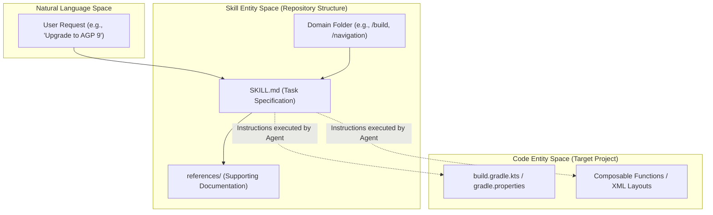
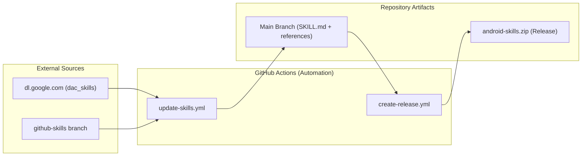

<!-- source: DeepWiki mcp.deepwiki.com · repo android/skills · page 1 Overview · fetched 2026-10-23 -->

# Overview

Relevant source files

The following files were used as context for generating this wiki page:

- [LICENSE.txt](LICENSE.txt)
- [README.md](README.md)

The **Android Skills** repository is a collection of AI-optimized, modular instructions and resources designed to help Large Language Models (LLMs) and AI agents execute Android development tasks according to Google's best practices [README.md:1-5](). These skills follow the [open-standard agent skills](https://agentskills.io/home) specification, providing a structured way to ground AI agents in specialized Android domains [README.md:7-9]().

### Core Purpose
The repository serves as a bridge between high-level developer intent and the complex, evolving ecosystem of Android development. By providing "Skills" in a standardized `SKILL.md` format, it ensures that AI agents can perform migrations, optimizations, and architectural shifts (like Navigation 3 or Jetpack Compose adoption) with high precision and adherence to official guidance [README.md:3-5]().

### System Architecture: From Natural Language to Code Execution
The following diagram illustrates how the repository structures "Skills" to bridge the gap between a developer's natural language request and the actual code modifications performed by an AI agent.

**Skill Execution Flow**

**Sources:** [README.md:1-9]().

---

## Key Concepts

### Agent Skills Specification
Android Skills are authored as `SKILL.md` files. These files act as technical specifications for specific tasks, such as upgrading the Android Gradle Plugin or migrating UI components. They are designed to be "injected" into an AI agent's context to provide the necessary constraints and steps for a workflow [README.md:7-12]().

### Domain-Driven Organization
Skills are organized into logical domains reflecting the Android development lifecycle:
*   **Build:** Automation and version upgrades (e.g., AGP 9).
*   **Jetpack Compose:** UI modernization and edge-to-edge implementation.
*   **Navigation:** State-driven navigation patterns (Navigation 3).
*   **Performance:** Code shrinking and R8 optimization.
*   **Play:** Integration with Google Play services and Billing.

### Repository Workflow
The repository is maintained through automated synchronization and release processes.

**Automation Overview**

**Sources:** [README.md:1-5](), [LICENSE.txt:49-65]().

---

## Wiki Navigation

To explore the repository in depth, refer to the following sections:

### [Getting Started](#1.1)
Learn how to use these skills with your AI agent. This section covers the `SKILL.md` format, how to ground LLMs with these files, and the repository's licensing under Apache 2.0.
*   **Key Topics:** Open-standard agent skills, LLM context injection, [Apache License 2.0 [LICENSE.txt:1-132]()]().

### [Repository Structure & Skill Catalog](#1.2)
A detailed map of the repository's directory layout. Understand where specific skills live and how the `references/` folders provide deep technical grounding for the AI.
*   **Key Topics:** Directory conventions, Domain mapping (Build, Compose, System), Reference material structure.

### [2.0 - 6.0] Technical Domain Deep Dives
Detailed guides for specific skill sets:
*   **Build & Performance:** AGP upgrades and R8 analysis.
*   **UI & Navigation:** Jetpack Compose migration, Edge-to-Edge, and Navigation 3.
*   **Integrations:** Play Billing Library migrations.

### [Update Skills Workflow](#7.1)
For contributors and maintainers, this section explains the GitHub Actions that keep the skills updated and package them for release.

### [8.0 Glossary](#8.0)
Definitions of terms and code pointers for repository-specific jargon.

---
**Sources:** [README.md:1-33](), [LICENSE.txt:1-132]().

---

