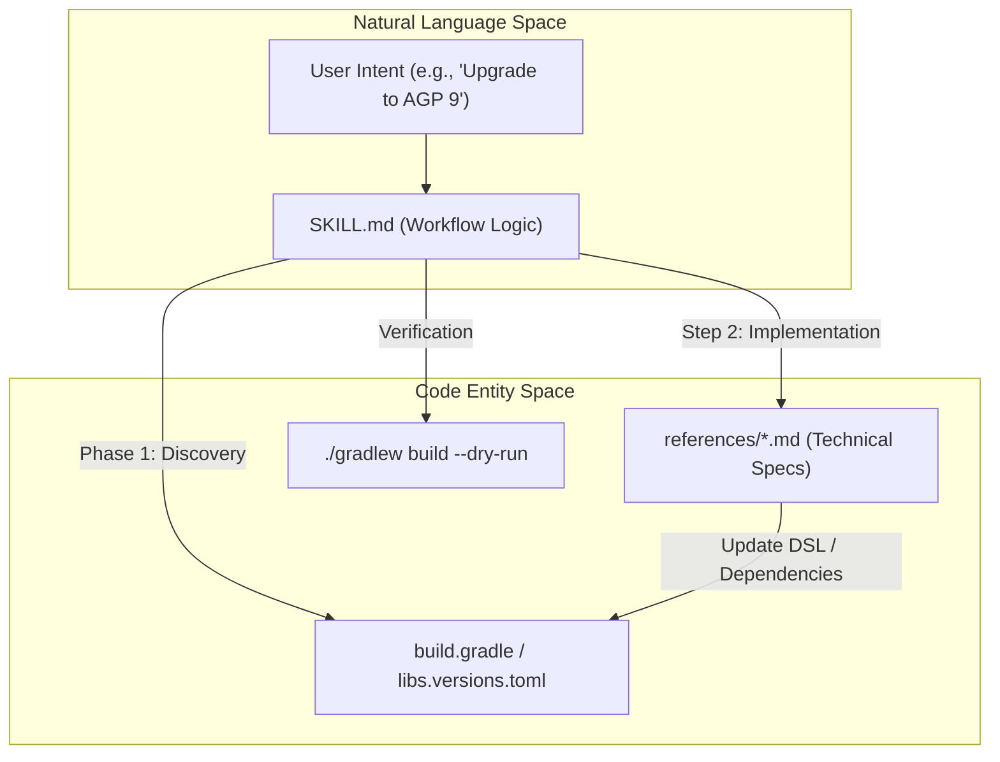
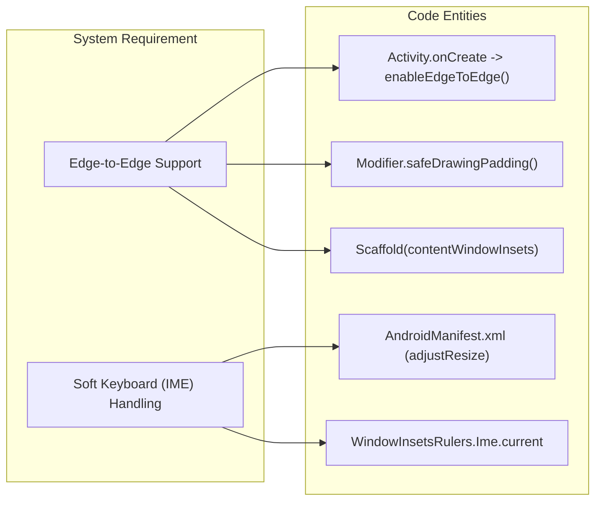

<!-- source: DeepWiki mcp.deepwiki.com · repo android/skills · page 1.2 Repository Structure & Skill Catalog · fetched 2026-10-23 -->

# Repository Structure & Skill Catalog

Relevant source files

The following files were used as context for generating this wiki page:

- [README.md](README.md)
- [build/agp/agp-9-upgrade/SKILL.md](build/agp/agp-9-upgrade/SKILL.md)
- [jetpack-compose/migration/migrate-xml-views-to-jetpack-compose/SKILL.md](jetpack-compose/migration/migrate-xml-views-to-jetpack-compose/SKILL.md)
- [navigation/navigation-3/SKILL.md](navigation/navigation-3/SKILL.md)
- [performance/r8-analyzer/SKILL.md](performance/r8-analyzer/SKILL.md)
- [play/play-billing-library-version-upgrade/SKILL.md](play/play-billing-library-version-upgrade/SKILL.md)
- [system/edge-to-edge/SKILL.md](system/edge-to-edge/SKILL.md)

This page provides a technical map of the Android Skills repository. It outlines the organizational hierarchy of skills by domain, explains the standardized directory layout, and details the internal structure of individual skill modules.

## Repository Overview

The repository is organized into domain-specific directories, each containing one or more "skills." A skill is a modular unit of AI-optimized instructions designed to guide an LLM through complex Android development tasks such as migrations, performance optimizations, or implementing new architectural patterns [README.md:3-9]().

### Domain Catalog

Skills are categorized into the following domains:

| Domain | Description | Key Skills |
| :--- | :--- | :--- |
| `build` | Automation and build system upgrades. | `agp-9-upgrade` |
| `jetpack-compose` | Modern UI development and migration from legacy Views. | `migrate-xml-views-to-jetpack-compose` |
| `navigation` | State-driven navigation and adaptive layouts. | `navigation-3` |
| `performance` | App size and runtime optimization. | `r8-analyzer` |
| `play` | Google Play services and Billing Library integrations. | `play-billing-library-version-upgrade` |
| `system` | OS-level integrations and modern Android standards. | `edge-to-edge` |

**Sources:** [build/agp/agp-9-upgrade/SKILL.md:2-4](), [jetpack-compose/migration/migrate-xml-views-to-jetpack-compose/SKILL.md:2-8](), [navigation/navigation-3/SKILL.md:2-7](), [performance/r8-analyzer/SKILL.md:2-6](), [play/play-billing-library-version-upgrade/SKILL.md:2-5](), [system/edge-to-edge/SKILL.md:2-6]()

---

## Skill Module Structure

Each skill resides in its own directory and follows a strict structural convention to ensure interoperability with AI agents.

### Directory Layout
A typical skill directory (e.g., `performance/r8-analyzer/`) contains:
1.  `SKILL.md`: The primary entry point containing the task specification, objective, and workflow [README.md:7-9]().
2.  `references/`: A subdirectory containing granular technical documentation, code snippets, and logic tables that the `SKILL.md` points to for specific implementation details [jetpack-compose/migration/migrate-xml-views-to-jetpack-compose/SKILL.md:52-59]().

### SKILL.md Anatomy
The `SKILL.md` file is structured into functional blocks:
*   **Frontmatter**: YAML metadata including `name`, `description`, and `keywords` [performance/r8-analyzer/SKILL.md:1-16]().
*   **Phases/Steps**: A deterministic sequence of actions (e.g., Discovery, Planning, Execution, Verification) [play/play-billing-library-version-upgrade/SKILL.md:20-85]().
*   **Guidelines/Mandatory Rules**: Constraints to ensure code quality and prevent common AI hallucinations [build/agp/agp-9-upgrade/SKILL.md:71-76](), [performance/r8-analyzer/SKILL.md:33-41]().

### Skill Data Flow
The following diagram illustrates how an AI agent traverses the skill structure to move from an initial user intent to a code-level change.

**Skill Execution and Reference Resolution**

**Sources:** [build/agp/agp-9-upgrade/SKILL.md:22-31](), [build/agp/agp-9-upgrade/SKILL.md:78-85](), [play/play-billing-library-version-upgrade/SKILL.md:25-35]()

---

## Skill Catalog Detail

### Build Domain: AGP 9 Upgrade
Focuses on migrating projects from AGP 8 to AGP 9. It enforces a sequence that includes moving to built-in Kotlin support and updating the Android Gradle Plugin DSL [build/agp/agp-9-upgrade/SKILL.md:33-60]().

### Jetpack Compose: XML Migration
Provides a 10-step methodology to convert legacy XML layouts to declarative Compose components. It utilizes interoperability APIs like `ComposeView` and `AndroidView` to allow incremental adoption [jetpack-compose/migration/migrate-xml-views-to-jetpack-compose/SKILL.md:33-45]().

### Navigation Domain: Navigation 3
Covers the implementation of the state-driven Navigation 3 framework. It includes recipes for `NavKey`, `NavHost`, and `NavDisplay`, as well as complex patterns like multiple back stacks and adaptive scenes [navigation/navigation-3/SKILL.md:20-32](), [navigation/navigation-3/SKILL.md:47-82]().

### Performance Domain: R8 Analyzer
A specialized diagnostic skill that audits `proguard-rules.pro` and `build.gradle` files to identify redundant or overly broad keep rules using a predefined impact hierarchy [performance/r8-analyzer/SKILL.md:18-31]().

### System Domain: Edge-to-Edge
Guides the implementation of full-screen UIs that draw behind system bars. It details the usage of `enableEdgeToEdge()` in Activities and the application of `WindowInsets` via `Scaffold` or modifiers like `safeDrawingPadding()` [system/edge-to-edge/SKILL.md:24-35](), [system/edge-to-edge/SKILL.md:37-53]().

### Mapping System Concepts to Code Entities
This diagram bridges high-level system requirements (like Edge-to-Edge) to the specific code symbols and configurations required.

**Edge-to-Edge Implementation Mapping**

**Sources:** [system/edge-to-edge/SKILL.md:30-34](), [system/edge-to-edge/SKILL.md:37-53](), [system/edge-to-edge/SKILL.md:107-112](), [system/edge-to-edge/SKILL.md:122-132]()

---

