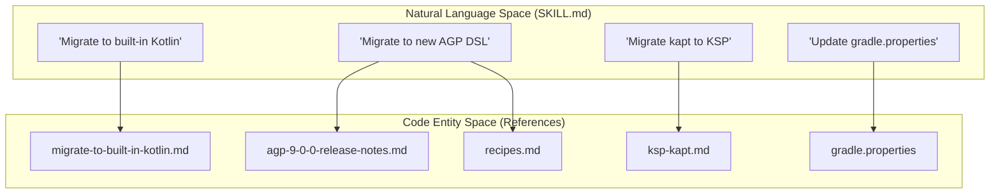
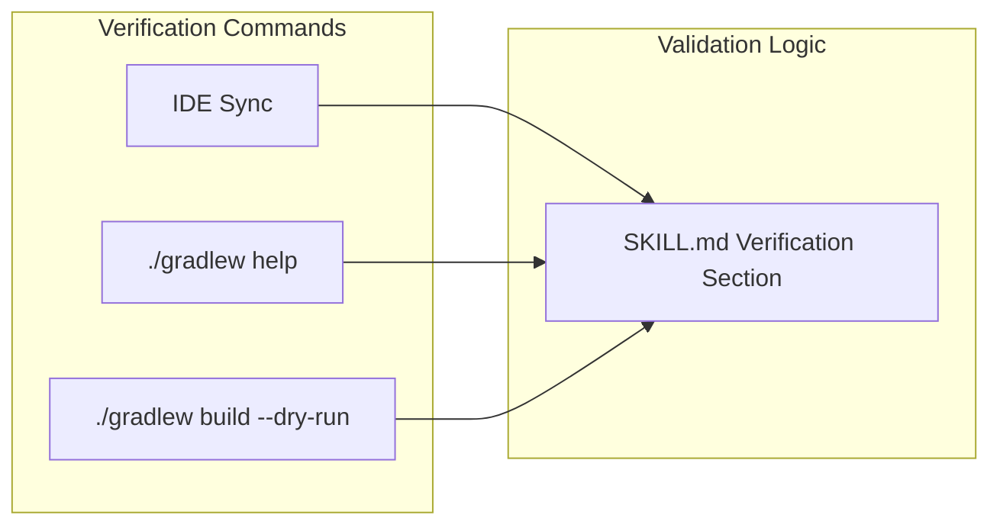

<!-- source: DeepWiki mcp.deepwiki.com · repo android/skills · page 2 Build Skills · fetched 2026-10-23 -->

# Build Skills

Relevant source files

The following files were used as context for generating this wiki page:

- [build/agp/agp-9-upgrade/SKILL.md](build/agp/agp-9-upgrade/SKILL.md)

The **Build Skills** section of the Android Skills repository provides automated workflows and guidance for modernizing Android build configurations. The primary focus of this domain is facilitating the transition to **Android Gradle Plugin (AGP) 9.0**, which introduces significant changes to how Kotlin is integrated, how the Gradle DSL is structured, and how annotation processing is handled.

The skills in this category are designed to be consumed by AI agents to perform complex refactoring tasks that ensure a project aligns with the latest Android build standards.

## AGP 9 Upgrade Overview

The `agp-9-upgrade` skill is the core component of this domain. It manages the transition from AGP 8.x to 9.x, focusing on five critical migration pillars. Before an agent initiates these steps, it must verify that the project has already utilized the **AGP Upgrade Assistant** in Android Studio to reach a baseline version of 9.0 [build/agp/agp-9-upgrade/SKILL.md:24-26]().

### The Five-Step Migration Workflow

The migration process is structured into a sequential pipeline to ensure build stability:

1.  **Built-in Kotlin Migration**: Moving away from external Kotlin Gradle plugin configurations to the integrated support provided by AGP 9 [build/agp/agp-9-upgrade/SKILL.md:37-39]().
2.  **DSL Refactoring**: Updating `build.gradle` files to use the new AGP 9 DSL, which deprecates several older configuration blocks [build/agp/agp-9-upgrade/SKILL.md:41-43]().
3.  **Annotation Processing**: Transitioning from `kapt` to `KSP` or `legacy-kapt`, ensuring KSP is at least version `2.3.6` [build/agp/agp-9-upgrade/SKILL.md:48-53]().
4.  **BuildConfig Handling**: Addressing changes in how custom `BuildConfig` fields are generated and accessed [build/agp/agp-9-upgrade/SKILL.md:55-58]().
5.  **Property Cleanup**: Removing deprecated flags from `gradle.properties`, such as `android.builtInKotlin` and `android.newDsl` [build/agp/agp-9-upgrade/SKILL.md:60-68]().

### Build Skill Architecture

The following diagram illustrates how the `agp-9-upgrade` skill maps its natural language instructions to the specific code entities and reference materials within the repository.

**Build Skill Entity Mapping**

Sources: [build/agp/agp-9-upgrade/SKILL.md:37-68]()

## Verification and Constraints

The Build Skills enforce strict operational guidelines to ensure efficiency and correctness during the upgrade process. Agents are instructed to avoid time-consuming tasks like running `clean` during verification and are prohibited from using specific workarounds like `android.disallowKotlinSourceSets=false` [build/agp/agp-9-upgrade/SKILL.md:71-78]().

Success is measured by three primary technical signals:
1.  **IDE Sync**: Successful Gradle IDE synchronization.
2.  **Help Task**: Execution of `./gradlew help`.
3.  **Dry Run**: Execution of `./gradlew build --dry-run`.

**Build Verification Flow**

Sources: [build/agp/agp-9-upgrade/SKILL.md:80-84]()

## Detailed Skill Documentation

For a deeper dive into the specific implementation details and reference guides, visit the child pages below:

*   **[AGP 9 Upgrade Skill](#2.1)**: Detailed walkthrough of the `agp-9-upgrade` `SKILL.md`, including prerequisites, specific migration steps, and troubleshooting for tools like Paparazzi [build/agp/agp-9-upgrade/SKILL.md:88-89]().
*   **[AGP 9 Reference Materials](#2.2)**: A deep dive into the technical reference documents bundled with the skill, covering the new DSL, KSP migration, and Gradle recipes.

Sources:
- [build/agp/agp-9-upgrade/SKILL.md:1-89]()

---

