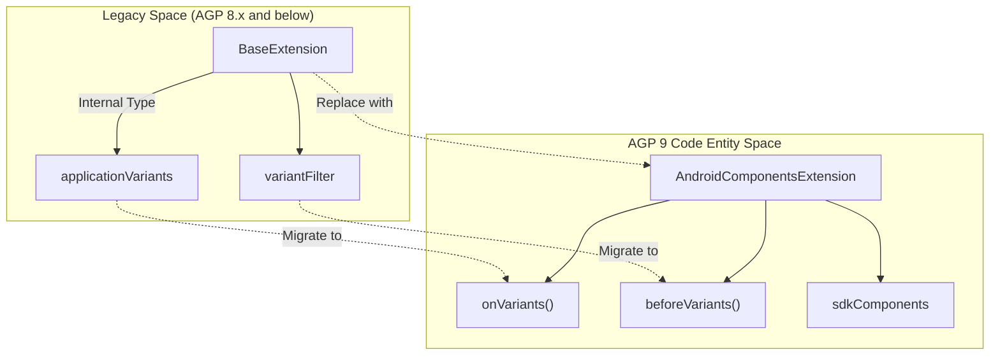
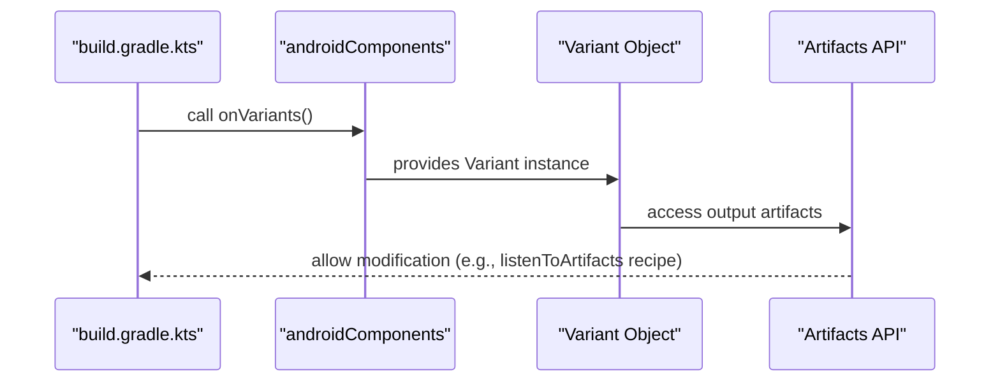

<!-- source: DeepWiki mcp.deepwiki.com · repo android/skills · page 2.1 AGP 9 Upgrade Skill · fetched 2026-10-23 -->

# AGP 9 Upgrade Skill

Relevant source files

The following files were used as context for generating this wiki page:

- [build/agp/agp-9-upgrade/SKILL.md](build/agp/agp-9-upgrade/SKILL.md)
- [build/agp/agp-9-upgrade/references/android/build/releases/agp-9-0-0-release-notes.md](build/agp/agp-9-upgrade/references/android/build/releases/agp-9-0-0-release-notes.md)
- [build/agp/agp-9-upgrade/references/recipes.md](build/agp/agp-9-upgrade/references/recipes.md)

The `agp-9-upgrade` skill provides a structured workflow for migrating Android projects to Android Gradle Plugin (AGP) version 9. This transition involves moving from deprecated internal DSL types to new public interfaces, adopting built-in Kotlin support, and updating annotation processing configurations.

## Prerequisites and Requirements

Before initiating the migration steps, the environment must meet specific version requirements to ensure compatibility with AGP 9.0.

### Version Compatibility Matrix
| Component | Minimum Version | Default/Recommended |
| :--- | :--- | :--- |
| **Gradle** | 9.1.0 | 9.1.0 |
| **SDK Build Tools** | 36.0.0 | 36.0.0 |
| **JDK** | 17 | 17 |
| **NDK** | N/A | 28.2.13676358 |
| **KSP** | 2.3.6 | 2.3.6+ |

Sources: [build/agp/agp-9-upgrade/references/android/build/releases/agp-9-0-0-release-notes.md:19-25](), [build/agp/agp-9-upgrade/SKILL.md:50-51]()

### Initial Validation
If the project's current AGP version is lower than 9, the migration must first be processed through the **Android Studio AGP Upgrade Assistant** to bridge the gap from AGP 8.x and preserve existing behaviors before applying the manual steps in this skill [build/agp/agp-9-upgrade/SKILL.md:24-26]().

## Migration Workflow

The migration is divided into five core steps to align the project with AGP 9 architecture.

### Step 1: Built-in Kotlin Migration
AGP 9 introduces built-in support for Kotlin, which is required because the legacy `org.jetbrains.kotlin.android` plugin is incompatible with the new AGP DSL [build/agp/agp-9-upgrade/references/android/build/releases/agp-9-0-0-release-notes.md:43-44]().

### Step 2: New AGP DSL Migration
AGP 9 removes access to old DSL types like `BaseExtension` and `applicationVariants`. Build logic must be refactored to use the `androidComponents` API [build/agp/agp-9-upgrade/references/android/build/releases/agp-9-0-0-release-notes.md:37-39]().

**DSL Logic Transformation**
| Old API (Deprecated/Removed) | New API (Replacement) |
| :--- | :--- |
| `applicationVariants` / `libraryVariants` | `androidComponents.onVariants` |
| `variantFilter` | `androidComponents.beforeVariants` |
| `sdkDirectory` / `ndkDirectory` | `androidComponents.sdkComponents` |
| `dexOptions` | Removed (Obsolete) |

Sources: [build/agp/agp-9-upgrade/references/android/build/releases/agp-9-0-0-release-notes.md:77-84]()

### Step 3: Annotation Processing (KSP/kapt)
Projects using KSP must upgrade to version `2.3.6` or higher [build/agp/agp-9-upgrade/SKILL.md:50-51](). For projects still using `kapt`, the skill directs users toward `legacy-kapt` or a full KSP migration [build/agp/agp-9-upgrade/SKILL.md:53]().

### Step 4: BuildConfig Configuration
Modules containing custom `BuildConfig` fields require specific handling under the new DSL. This often involves moving from direct DSL assignments to the `addCustomBuildConfigFields` recipe pattern [build/agp/agp-9-upgrade/references/recipes.md:26-28]().

### Step 5: `gradle.properties` Cleanup
Post-migration, legacy feature flags that are now default or removed in AGP 9 must be deleted from `gradle.properties` [build/agp/agp-9-upgrade/SKILL.md:62-68]():
1. `android.builtInKotlin`
2. `android.newDsl`
3. `android.uniquePackageNames`
4. `android.enableAppCompileTimeRClass`

## System Architecture and Data Flow

The following diagrams illustrate the transition from the legacy Gradle Extension model to the AGP 9 `androidComponents` architecture.

### DSL Transformation Mapping
This diagram bridges the natural language migration steps to the specific code entities in the AGP 9 API.

Sources: [build/agp/agp-9-upgrade/references/android/build/releases/agp-9-0-0-release-notes.md:77-82](), [build/agp/agp-9-upgrade/references/recipes.md:53-56]()

### Artifact Manipulation Flow
The following flow demonstrates how to perform common tasks (like renaming an APK) using the new `onVariants` lifecycle.

Sources: [build/agp/agp-9-upgrade/references/recipes.md:53-56](), [build/agp/agp-9-upgrade/references/android/build/releases/agp-9-0-0-release-notes.md:79]()

## Verification and Troubleshooting

### Verification Commands
After applying changes, execute the following commands in order to validate the build integrity. **Note:** Do not run the `clean` task as it is unnecessary for this verification [build/agp/agp-9-upgrade/SKILL.md:76]().

1. **IDE Sync:** Ensure Gradle sync completes without errors in Android Studio.
2. **Task Listing:** `./gradlew help` [build/agp/agp-9-upgrade/SKILL.md:83]()
3. **Dry Run:** `./gradlew build --dry-run` [build/agp/agp-9-upgrade/SKILL.md:84]()

### Troubleshooting Common Issues
*   **ClassCastException:** If the build logs show `cannot be cast to com.android.build.gradle.BaseExtension`, the project is still referencing internal legacy types that must be replaced with public interfaces [build/agp/agp-9-upgrade/references/android/build/releases/agp-9-0-0-release-notes.md:88-93]().
*   **Paparazzi:** Versions `v2.0.0-alpha04` and lower are incompatible with AGP 9. Upgrade Paparazzi to resolve build failures [build/agp/agp-9-upgrade/SKILL.md:88-89]().
*   **Kotlin Source Sets:** Never add `android.disallowKotlinSourceSets=false` to `gradle.properties` as a workaround [build/agp/agp-9-upgrade/SKILL.md:75]().

Sources: [build/agp/agp-9-upgrade/SKILL.md:75-89](), [build/agp/agp-9-upgrade/references/android/build/releases/agp-9-0-0-release-notes.md:88-93]()

---

