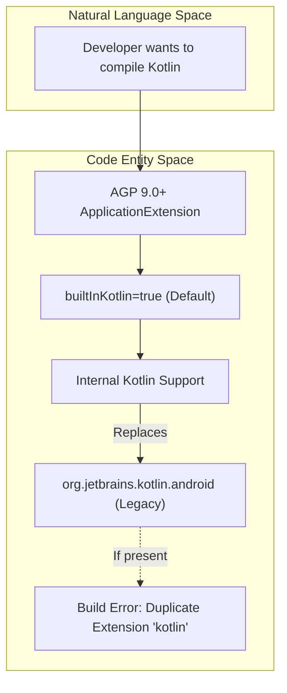

<!-- source: DeepWiki mcp.deepwiki.com · repo android/skills · page 2.2 AGP 9 Reference Materials · fetched 2026-10-23 -->

# AGP 9 Reference Materials

<details>
<summary>Relevant source files</summary>

The following files were used as context for generating this wiki page:

- [build/agp/agp-9-upgrade/references/android/build/migrate-to-built-in-kotlin.md](build/agp/agp-9-upgrade/references/android/build/migrate-to-built-in-kotlin.md)
- [build/agp/agp-9-upgrade/references/buildconfig.md](build/agp/agp-9-upgrade/references/buildconfig.md)
- [build/agp/agp-9-upgrade/references/ksp-kapt.md](build/agp/agp-9-upgrade/references/ksp-kapt.md)
- [build/agp/agp-9-upgrade/references/paparazzi-gradle-9.md](build/agp/agp-9-upgrade/references/paparazzi-gradle-9.md)
- [build/agp/agp-9-upgrade/references/recipes.md](build/agp/agp-9-upgrade/references/recipes.md)

</details>


This page provides a deep dive into the technical reference materials bundled with the AGP 9 upgrade skill. It covers the transition to built-in Kotlin support, the migration from `kapt` to KSP (or legacy-kapt), mandatory `BuildConfig` changes, Paparazzi compatibility workarounds, and the use of Gradle recipes for modernizing build logic.

## Built-in Kotlin Migration

Android Gradle Plugin 9.0 introduces built-in Kotlin support, enabled by default [build/agp/agp-9-upgrade/references/android/build/migrate-to-built-in-kotlin.md:1-2](). This eliminates the need for the `org.jetbrains.kotlin.android` plugin in standard Android modules [build/agp/agp-9-upgrade/references/android/build/migrate-to-built-in-kotlin.md:2-4]().

### Conflict Resolution
If the legacy plugin is not removed, Gradle will throw errors such as `Cannot add extension with name 'kotlin'` or explicitly state that the plugin is no longer required [build/agp/agp-9-upgrade/references/android/build/migrate-to-built-in-kotlin.md:32-39]().

### Migration Workflow
1.  **Remove Plugin:** Delete `id("org.jetbrains.kotlin.android")` or `alias(libs.plugins.kotlin.android)` from module-level and top-level build files [build/agp/agp-9-upgrade/references/android/build/migrate-to-built-in-kotlin.md:53-139]().
2.  **Update Version Catalog:** Remove the `kotlin-android` entry from `gradle/libs.versions.toml` [build/agp/agp-9-upgrade/references/android/build/migrate-to-built-in-kotlin.md:140-147]().
3.  **DSL Migration:** Move `android.kotlinOptions{}` to `kotlin.compilerOptions{}` [build/agp/agp-9-upgrade/references/android/build/migrate-to-built-in-kotlin.md:217-220]().

### Logic Flow: Built-in Kotlin Enforcement
The following diagram illustrates how AGP 9 handles Kotlin compilation compared to previous versions.

**AGP Kotlin Compilation Logic**

Sources: [build/agp/agp-9-upgrade/references/android/build/migrate-to-built-in-kotlin.md:1-40]()

## KSP and Kapt Migration

The `org.jetbrains.kotlin.kapt` plugin is incompatible with AGP 9's built-in Kotlin [build/agp/agp-9-upgrade/references/ksp-kapt.md:9-10](). Projects must either migrate to KSP or use a legacy bridge.

### Compatibility Check
To determine if a dependency supports KSP, developers must inspect the library JAR for the presence of:
`services/com.google.devtools.ksp.processing.SymbolProcessorProvider` [build/agp/agp-9-upgrade/references/ksp-kapt.md:14-18]().

### Migration Paths
*   **KSP Path:** Replace `kapt` configuration with `ksp` in dependencies.
*   **Legacy Path:** If a library is incompatible with KSP, apply the `com.android.legacy-kapt` plugin [build/agp/agp-9-upgrade/references/ksp-kapt.md:35-39](). This plugin must match the AGP version [build/agp/agp-9-upgrade/references/android/build/migrate-to-built-in-kotlin.md:154-156]().

Sources: [build/agp/agp-9-upgrade/references/ksp-kapt.md:1-39](), [build/agp/agp-9-upgrade/references/android/build/migrate-to-built-in-kotlin.md:148-170]()

## BuildConfig Changes

In AGP 9, `BuildConfig` generation is no longer implicit for modules containing custom fields.

### Implementation Steps
1.  **Enable Feature:** Set `buildConfig = true` within the `buildFeatures` block of the module [build/agp/agp-9-upgrade/references/buildconfig.md:4-12]().
2.  **Strict Typing:** For `String` types, the value must include literal escaped quotation marks (e.g., `value = "\"Some value\""`) [build/agp/agp-9-upgrade/references/buildconfig.md:43-54]().

**BuildConfig Configuration Mapping**
```mermaid
graph LR
    subgraph "Natural Language Space"
        A["Custom Field Requirement"]
    end

    subgraph "Code Entity Space"
        B["com.android.build.api.dsl.BuildFeatures"]
        C["buildConfig = true"]
        D["com.android.build.api.variant.BuildConfigField"]
        E["value = '\"quoted_string\"'"]
    end

    A --> B
    B --> C
    C --> D
    D --> E
```
Sources: [build/agp/agp-9-upgrade/references/buildconfig.md:1-54]()

## Paparazzi Compatibility

Paparazzi versions 2.0.0-alpha04 and lower use internal Gradle classes that are removed in Gradle 9 [build/agp/agp-9-upgrade/references/paparazzi-gradle-9.md:4-12]().

### Workaround
Until a compatible version is released, HTML test reports must be disabled for any module applying `app.cash.paparazzi` [build/agp/agp-9-upgrade/references/paparazzi-gradle-9.md:13-16]().

**Kotlin DSL Workaround:**
```kotlin
tasks.withType<Test>().configureEach {
  reports.html.required = false
}
```
[build/agp/agp-9-upgrade/references/paparazzi-gradle-9.md:18-23]()

## Gradle Recipes for New DSL

The removal of `applicationVariants` and `libraryVariants` requires a shift to the `AndroidComponentsExtension` API [build/agp/agp-9-upgrade/references/recipes.md:53-56]().

### Key Recipes
| Use-case | AGP 9 Replacement / Recipe |
| :--- | :--- |
| **Add BuildConfig Fields** | `addCustomBuildConfigFields` [build/agp/agp-9-upgrade/references/recipes.md:28]() |
| **Rename APK** | `listenToArtifacts` (using `onVariants`) [build/agp/agp-9-upgrade/references/recipes.md:29,54-56]() |

### Version Mapping
Recipes are maintained in specific branches of the `gradle-recipes` repository corresponding to AGP versions (e.g., `agp-9.0`, `agp-9.1`) [build/agp/agp-9-upgrade/references/recipes.md:16-20]().

Sources: [build/agp/agp-9-upgrade/references/recipes.md:1-59]()

---

