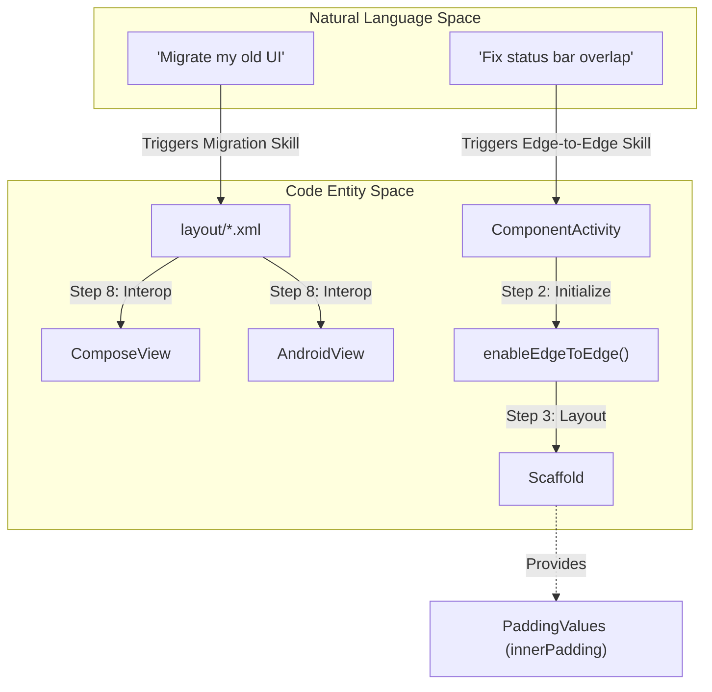
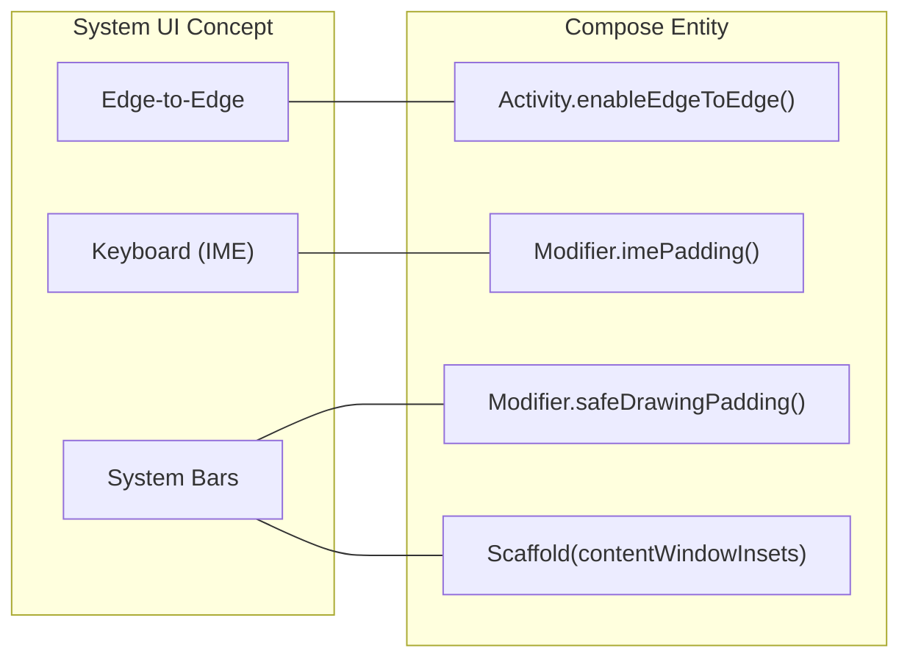

<!-- source: DeepWiki mcp.deepwiki.com · repo android/skills · page 3 Jetpack Compose Skills · fetched 2026-10-23 -->

# Jetpack Compose Skills

Relevant source files

The following files were used as context for generating this wiki page:

- [jetpack-compose/migration/migrate-xml-views-to-jetpack-compose/SKILL.md](jetpack-compose/migration/migrate-xml-views-to-jetpack-compose/SKILL.md)
- [system/edge-to-edge/SKILL.md](system/edge-to-edge/SKILL.md)

This section provides an overview of the skills available in the repository for developing, migrating, and optimizing Android applications using **Jetpack Compose**. These skills focus on transitioning from legacy View-based architectures to modern declarative UI and ensuring those UIs integrate correctly with system-level features like edge-to-edge display.

## Overview of Compose Skills

The repository currently categorizes Jetpack Compose expertise into two primary functional areas:

1.  **UI Migration**: A systematic approach to converting legacy XML layouts into Compose components while maintaining interoperability.
2.  **System Integration**: Implementing modern Android requirements, specifically edge-to-edge support and proper window inset handling.

### Skill Interconnectivity

The following diagram illustrates how these skills relate to the standard Android development lifecycle and the specific code entities involved.

**Compose Skill Landscape**

**Sources:**
* [jetpack-compose/migration/migrate-xml-views-to-jetpack-compose/SKILL.md:33-44]()
* [system/edge-to-edge/SKILL.md:30-35]()

---

## 3.1 Migrate XML Views to Jetpack Compose

The `migrate-xml-views-to-jetpack-compose` skill provides a 10-step structured workflow for converting legacy XML layouts into modern Compose code. It is designed to ensure visual parity and functional integrity through a "stable, safe, and visually consistent transition" [jetpack-compose/migration/migrate-xml-views-to-jetpack-compose/SKILL.md:22-24]().

### Key Workflow Phases
*   **Analysis & Planning**: Identifying the best XML candidates (e.g., simple leaf nodes or frequently updated screens) and performing a technical audit of the layout hierarchy [jetpack-compose/migration/migrate-xml-views-to-jetpack-compose/SKILL.md:48-66]().
*   **Environment Setup**: Configuring `build.gradle` or `libs.versions.toml` with the necessary Compose dependencies and compiler versions [jetpack-compose/migration/migrate-xml-views-to-jetpack-compose/SKILL.md:80-85]().
*   **Interoperability**: Using `ComposeView` to host Compose content within existing Views, or `AndroidView` to wrap legacy Views within a Compose hierarchy [jetpack-compose/migration/migrate-xml-views-to-jetpack-compose/SKILL.md:110-111]().
*   **Validation**: Utilizing **Compose Previews** and screenshot testing (via UI Automator or Espresso) to verify pixel-perfect parity before deleting the original XML [jetpack-compose/migration/migrate-xml-views-to-jetpack-compose/SKILL.md:113-123]().

For details, see [Migrate XML Views to Jetpack Compose](#3.1).

**Sources:**
* [jetpack-compose/migration/migrate-xml-views-to-jetpack-compose/SKILL.md:1-123]()

---

## 3.2 Edge-to-Edge Support Skill

The `edge-to-edge` skill focuses on making Compose applications adaptive to system bars (status and navigation bars). This is a requirement for apps targeting SDK 35 and later [system/edge-to-edge/SKILL.md:21-22]().

### Core Implementation Patterns
*   **Activation**: Calling `enableEdgeToEdge()` within `onCreate` before `setContent` [system/edge-to-edge/SKILL.md:32]().
*   **Inset Application**: Using `Scaffold` to receive `PaddingValues` (often named `innerPadding`) which are then applied to content to prevent UI elements from being obscured by system bars [system/edge-to-edge/SKILL.md:43-52]().
*   **IME Handling**: Managing the soft keyboard using `Modifier.imePadding()` or the more robust `Modifier.fitInside(WindowInsetsRulers.Ime.current)` to reduce jank [system/edge-to-edge/SKILL.md:107-113]().

The following diagram maps the high-level "Edge-to-Edge" concept to the specific modifiers and functions used in the codebase.

**Edge-to-Edge Technical Mapping**

For details, see [Edge-to-Edge Support Skill](#3.2).

**Sources:**
* [system/edge-to-edge/SKILL.md:1-176]()

---

