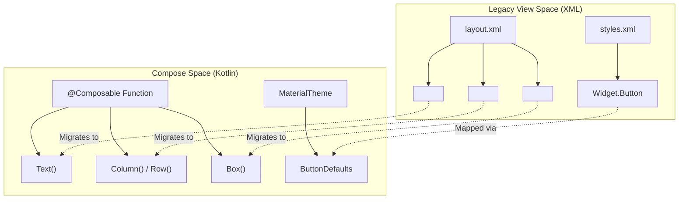
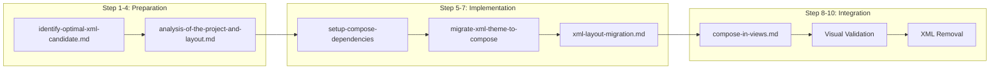

<!-- source: DeepWiki mcp.deepwiki.com · repo android/skills · page 3.1 Migrate XML Views to Jetpack Compose · fetched 2026-10-23 -->

# Migrate XML Views to Jetpack Compose

Relevant source files

The following files were used as context for generating this wiki page:

- [jetpack-compose/migration/migrate-xml-views-to-jetpack-compose/SKILL.md](jetpack-compose/migration/migrate-xml-views-to-jetpack-compose/SKILL.md)
- [jetpack-compose/migration/migrate-xml-views-to-jetpack-compose/references/analysis-of-the-project-and-layout.md](jetpack-compose/migration/migrate-xml-views-to-jetpack-compose/references/analysis-of-the-project-and-layout.md)
- [jetpack-compose/migration/migrate-xml-views-to-jetpack-compose/references/identify-optimal-xml-candidate.md](jetpack-compose/migration/migrate-xml-views-to-jetpack-compose/references/identify-optimal-xml-candidate.md)
- [jetpack-compose/migration/migrate-xml-views-to-jetpack-compose/references/xml-layout-migration.md](jetpack-compose/migration/migrate-xml-views-to-jetpack-compose/references/xml-layout-migration.md)

This page provides a high-level guide to the structured workflow for migrating legacy Android XML layouts to Jetpack Compose. The process ensures a stable, safe, and visually consistent transition by following a 10-step methodology focused on incremental adoption and interoperability [jetpack-compose/migration/migrate-xml-views-to-jetpack-compose/SKILL.md:22-25]().

## Migration Workflow Overview

The migration process is designed to maintain pixel-perfect visual parity while converting imperative View-based UI into declarative Compose components.

### 10-Step Migration Process
1.  **Identify Candidate**: Select the optimal XML for migration based on complexity and hierarchy [jetpack-compose/migration/migrate-xml-views-to-jetpack-compose/SKILL.md:48-52]().
2.  **Analyze Project**: Perform a technical audit of the layout and project context [jetpack-compose/migration/migrate-xml-views-to-jetpack-compose/SKILL.md:54-59]().
3.  **Create Plan**: Generate a step-by-step migration strategy [jetpack-compose/migration/migrate-xml-views-to-jetpack-compose/SKILL.md:61-66]().
4.  **Capture UI**: Establish a visual baseline via screenshots or automated tests [jetpack-compose/migration/migrate-xml-views-to-jetpack-compose/SKILL.md:68-78]().
5.  **Setup Dependencies**: Configure `build.gradle` or `libs.versions.toml` for Compose [jetpack-compose/migration/migrate-xml-views-to-jetpack-compose/SKILL.md:80-85]().
6.  **Setup Theming**: Initialize Compose theming or migrate minimum required XML styles [jetpack-compose/migration/migrate-xml-views-to-jetpack-compose/SKILL.md:87-97]().
7.  **Migrate Layout**: Convert XML tags to `@Composable` functions [jetpack-compose/migration/migrate-xml-views-to-jetpack-compose/SKILL.md:99-104]().
8.  **Replace Usages**: Integrate the new component using interoperability APIs [jetpack-compose/migration/migrate-xml-views-to-jetpack-compose/SKILL.md:106-111]().
9.  **Validate**: Compare Compose Previews against the baseline screenshot [jetpack-compose/migration/migrate-xml-views-to-jetpack-compose/SKILL.md:113-118]().
10. **Cleanup**: Safely remove the legacy XML and associated tests [jetpack-compose/migration/migrate-xml-views-to-jetpack-compose/SKILL.md:120-123]().

**Sources:** [jetpack-compose/migration/migrate-xml-views-to-jetpack-compose/SKILL.md:33-44]()

## Candidate Identification & Analysis

Before writing code, the project must be audited to identify low-risk, high-impact migration targets. Ideal candidates are "leaf nodes" at the bottom of the UI tree with minimal external dependencies [jetpack-compose/migration/migrate-xml-views-to-jetpack-compose/references/identify-optimal-xml-candidate.md:9-13]().

### Analysis Checklist
*   **Project Health**: Ensure the project builds and syncs before starting [jetpack-compose/migration/migrate-xml-views-to-jetpack-compose/references/analysis-of-the-project-and-layout.md:1-5]().
*   **Theming Review**: Map `colors.xml`, `dimens.xml`, and `styles.xml` to Compose `MaterialTheme` or custom design system tokens [jetpack-compose/migration/migrate-xml-views-to-jetpack-compose/references/analysis-of-the-project-and-layout.md:15-23]().
*   **Architecture**: Identify state management (e.g., `ViewModel`, `LiveData`, `Flow`) to ensure the new Composable integrates correctly [jetpack-compose/migration/migrate-xml-views-to-jetpack-compose/references/analysis-of-the-project-and-layout.md:33-38]().

**Sources:** [jetpack-compose/migration/migrate-xml-views-to-jetpack-compose/references/identify-optimal-xml-candidate.md:1-21](), [jetpack-compose/migration/migrate-xml-views-to-jetpack-compose/references/analysis-of-the-project-and-layout.md:1-42]()

## Interoperability Strategy

Migration rarely happens all at once. The workflow utilizes specific APIs to bridge the gap between the legacy View system and Compose.

| Strategy | Tool/API | Usage Context |
| :--- | :--- | :--- |
| **Compose in Views** | `ComposeView` | Adding a new Compose component into an existing XML layout or Fragment. |
| **Views in Compose** | `AndroidView` | Hosting a legacy View (e.g., a specialized MapView) inside a new Composable. |

For detailed implementation patterns of these APIs, see [Compose Migration Reference Materials](#3.1.1).

**Sources:** [jetpack-compose/migration/migrate-xml-views-to-jetpack-compose/SKILL.md:110-111]()

## Visual Parity & Validation

A critical phase of the migration is ensuring the new Compose UI matches the legacy XML.

### Validation Workflow
1.  **Baseline**: Capture a screenshot of the original XML using **UI Automator** or **Espresso** [jetpack-compose/migration/migrate-xml-views-to-jetpack-compose/SKILL.md:76-77]().
2.  **Implementation**: Create the Composable with a `@Preview` [jetpack-compose/migration/migrate-xml-views-to-jetpack-compose/SKILL.md:103-104]().
3.  **Comparison**: Iteratively adjust `Modifier` attributes (padding, alignment, weight) until the Preview matches the baseline [jetpack-compose/migration/migrate-xml-views-to-jetpack-compose/SKILL.md:115-117]().

**Sources:** [jetpack-compose/migration/migrate-xml-views-to-jetpack-compose/SKILL.md:68-78](), [jetpack-compose/migration/migrate-xml-views-to-jetpack-compose/SKILL.md:113-118]()

## System Mapping: XML to Compose

The following diagram bridges XML concepts to their Compose counterparts used during migration.

### UI Entity Mapping

**Sources:** [jetpack-compose/migration/migrate-xml-views-to-jetpack-compose/references/xml-layout-migration.md:1-6](), [jetpack-compose/migration/migrate-xml-views-to-jetpack-compose/references/xml-layout-migration.md:41-68]()

### Migration Lifecycle

**Sources:** [jetpack-compose/migration/migrate-xml-views-to-jetpack-compose/SKILL.md:33-44]()

## Detailed Reference Materials
For specific implementation details, refer to the following child pages:
*   [Compose Migration Reference Materials](#3.1.1): Detailed guides on dependency setup, Material 3 theme migration, and technical documentation for `ComposeView` and `AndroidView` interoperability.

---

