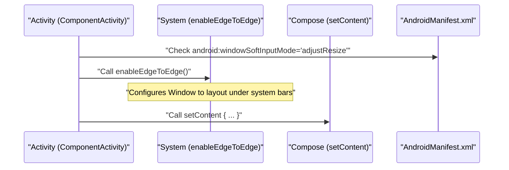
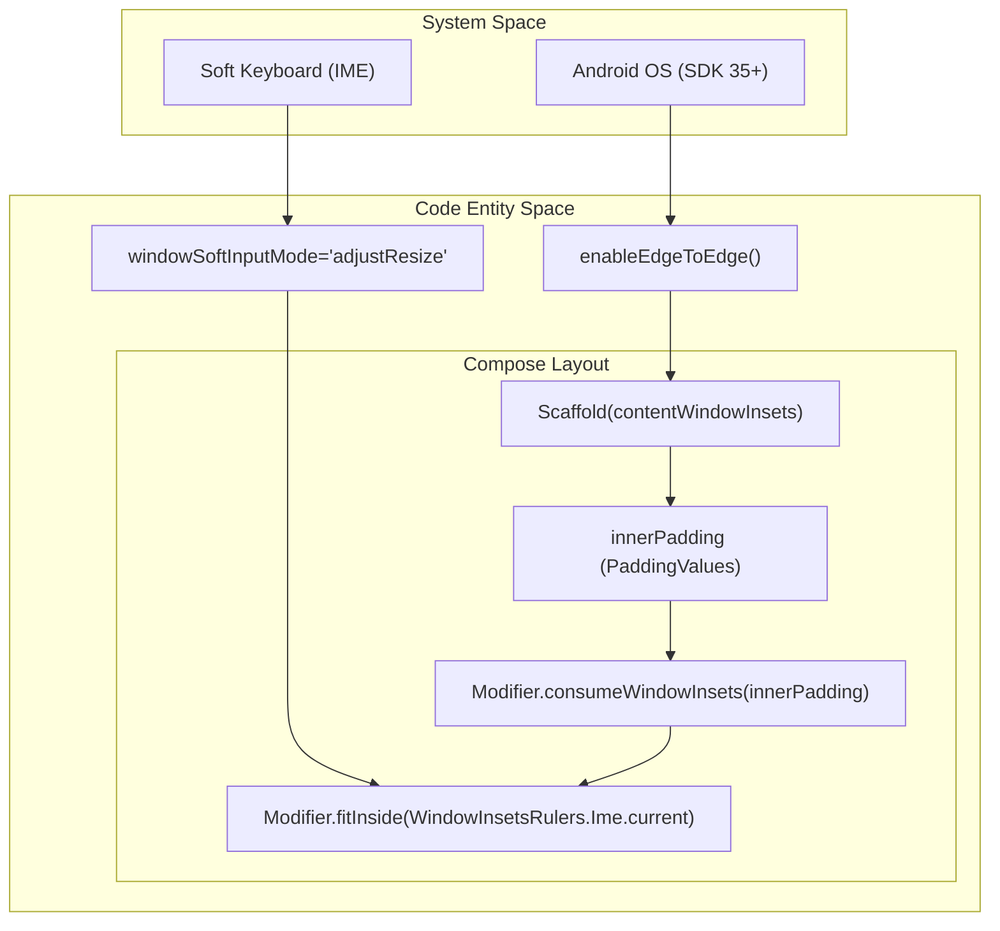

<!-- source: DeepWiki mcp.deepwiki.com · repo android/skills · page 3.2 Edge-to-Edge Support Skill · fetched 2026-10-23 -->

# Edge-to-Edge Support Skill

<details>
<summary>Relevant source files</summary>

The following files were used as context for generating this wiki page:

- [system/edge-to-edge/SKILL.md](system/edge-to-edge/SKILL.md)

</details>


The Edge-to-Edge Support Skill provides a technical framework for migrating Jetpack Compose applications to a full-screen experience where the UI draws behind system bars (status and navigation bars). This guide covers enabling the feature at the Activity level, managing system insets using Scaffolds and modifiers, handling Input Method Editor (IME) interactions, and ensuring visual legibility across different Android versions.

## Prerequisites and Planning

Before implementing edge-to-edge support, the project must meet specific environment requirements:
*   **Jetpack Compose:** The project must be built using Jetpack Compose [system/edge-to-edge/SKILL.md:21-21]().
*   **SDK Target:** The project must target SDK 35 or later [system/edge-to-edge/SKILL.md:22-22]().

The planning phase involves auditing all `Activity` classes to identify those lacking edge-to-edge support, as well as scanning for components that require specific inset handling, such as Lists, Floating Action Buttons (FABs), and text input fields (`TextField`, `OutlinedTextField`, `BasicTextField`) [system/edge-to-edge/SKILL.md:26-28]().

## Enabling Edge-to-Edge

To enable the feature, the `enableEdgeToEdge()` function must be called within the `onCreate` method of each Activity before `setContent` [system/edge-to-edge/SKILL.md:32-32](). Additionally, to ensure proper keyboard behavior, the `AndroidManifest.xml` must specify `android:windowSoftInputMode="adjustResize"` for activities using a soft keyboard [system/edge-to-edge/SKILL.md:33-33]().

### Activity Initialization Flow
The following diagram illustrates the setup sequence within an Android Activity.

**Title: Edge-to-Edge Activity Setup**

Sources: [system/edge-to-edge/SKILL.md:32-33]()

## Applying System Insets

Once edge-to-edge is enabled, the application must manually account for system bars to prevent UI elements from being obscured.

### Scaffold Integration
The preferred method for handling insets is using the `Scaffold` component. The `innerPadding` provided by the `Scaffold` content lambda accounts for system bars and internal components like TopAppBars or BottomAppBars [system/edge-to-edge/SKILL.md:40-45]().

### Inset Modifiers
For components outside of a `Scaffold`, specific modifiers are used:
*   `Modifier.safeDrawingPadding()`: Applies padding to avoid all system bars and the IME [system/edge-to-edge/SKILL.md:76-83]().
*   `Modifier.windowInsetsPadding(WindowInsets.safeDrawing)`: Provides granular control over specific insets [system/edge-to-edge/SKILL.md:76-76]().
*   `Modifier.fitInside(WindowInsetsRulers.SafeDrawing.current)`: Used for deeply nested components to align with rulers without excessive cumulative padding [system/edge-to-edge/SKILL.md:96-96]().

### Component Support Table
| Component Type | Inset Handling Strategy |
| :--- | :--- |
| **Material 3 Components** | Automatic handling for `TopAppBar`, `BottomAppBar`, `ModalBottomSheet`, `NavigationBar`, etc. [system/edge-to-edge/SKILL.md:59-71]() |
| **Material 2 Components** | Manual handling via `windowInsets` parameter (e.g., `TopAppBar(windowInsets = AppBarDefaults.topAppBarWindowInsets)`) [system/edge-to-edge/SKILL.md:72-73]() |
| **Adaptive Scaffolds** | `NavigationSuiteScaffold` manages its own components but does **not** propagate `PaddingValues`. Insets must be applied to individual inner screens [system/edge-to-edge/SKILL.md:105-105]() |

## IME (Keyboard) Handling

Handling the soft keyboard (IME) requires preventing the keyboard from overlapping input fields while avoiding "double padding" (where both the parent and child apply keyboard offsets).

### Recommended Patterns
1.  **WindowInsetsRulers (Preferred):** Using `Modifier.fitInside(WindowInsetsRulers.Ime.current)` reduces jank and avoids issues with unconsumed insets in the hierarchy [system/edge-to-edge/SKILL.md:110-110]().
2.  **imePadding:** Using `Modifier.imePadding()` before a `verticalScroll()` modifier [system/edge-to-edge/SKILL.md:111-111]().

### Inset Data Flow with Scaffold
This diagram maps the flow of inset data from the system through Compose entities.

**Title: Inset Data Flow and Entity Mapping**

Sources: [system/edge-to-edge/SKILL.md:32-33](), [system/edge-to-edge/SKILL.md:124-153]()

## Lists and Scrolling Content

For scrollable lists, insets should be applied as `contentPadding` rather than standard `Modifier.padding`. This ensures that list items are padded at the start and end of the list, but the content still scrolls behind the system bars [system/edge-to-edge/SKILL.md:27-27]().

```kotlin
// Example: Applying insets to LazyColumn
LazyColumn(
    contentPadding = innerPadding, // Accounts for system bars
    modifier = Modifier.consumeWindowInsets(innerPadding)
) {
    // List items
}
```
Sources: [system/edge-to-edge/SKILL.md:46-52]()

## Full-Screen Dialogs

Standard dialogs do not automatically support edge-to-edge. To enable this, the `DialogProperties` must be configured with `usePlatformDefaultWidth = false`. Inside the dialog, a `Box` or similar container should use `Modifier.safeDrawingPadding()` to ensure content is not clipped by the display cutout or system bars [system/edge-to-edge/SKILL.md:225-236]().

## Legibility and Contrast

When the application draws behind system bars, legibility becomes a concern. 
*   **Navigation Bar Contrast:** On older Android versions (pre-API 29), the system might not automatically handle contrast. `enableEdgeToEdge` allows setting `navigationBarLightScrim` and `navigationBarDarkScrim` to ensure the navigation icons remain visible [system/edge-to-edge/SKILL.md:214-222]().
*   **Scrims:** For custom headers that need to match system bar heights, use `Modifier.windowInsetsTopHeight(WindowInsets.systemBars)` [system/edge-to-edge/SKILL.md:99-101]().

Sources: [system/edge-to-edge/SKILL.md:1-240]()

---

