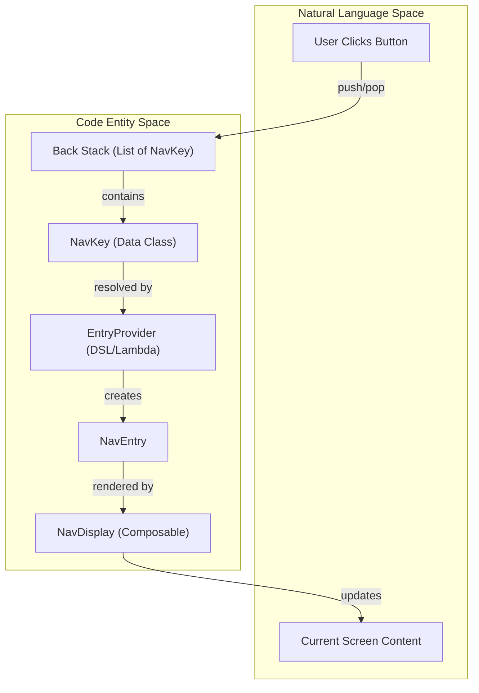
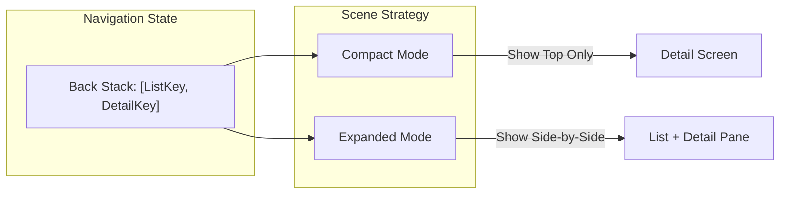

<!-- source: DeepWiki mcp.deepwiki.com · repo android/skills · page 4 Navigation 3 Skills · fetched 2026-10-23 -->

# Navigation 3 Skills

Relevant source files

The following files were used as context for generating this wiki page:

- [navigation/navigation-3/SKILL.md](navigation/navigation-3/SKILL.md)
- [navigation/navigation-3/references/android/guide/navigation/navigation-3/index.md](navigation/navigation-3/references/android/guide/navigation/navigation-3/index.md)

This section provides an overview of **Navigation 3**, a state-driven navigation library designed specifically for Jetpack Compose. Unlike previous iterations of Jetpack Navigation that relied on a static navigation graph, Navigation 3 treats the back stack as a simple list of keys, offering full control over navigation state and enabling advanced adaptive layouts.

## Overview of Navigation 3

Navigation 3 shifts the mental model from "navigating through a graph" to "managing a list of states." Each entry on the back stack represents content the user has navigated to, and the UI automatically updates to reflect changes in this list.

Key benefits include:
*   **Full Back Stack Control**: Navigating is as simple as adding or removing items from a standard Kotlin `List` [navigation/navigation-3/references/android/guide/navigation/navigation-3/index.md:1-4]().
*   **Adaptive Layouts**: Support for displaying multiple destinations simultaneously (e.g., List-Detail) based on window size [navigation/navigation-3/references/android/guide/navigation/navigation-3/index.md:9-9]().
*   **State Retention**: Automatic scoping for items in the back stack, allowing state to be retained while an item is present [navigation/navigation-3/references/android/guide/navigation/navigation-3/index.md:8-8]().
*   **Simplified Compose Integration**: Designed from the ground up for Compose, removing the need for string-based route parsing in favor of type-safe keys [navigation/navigation-3/references/android/guide/navigation/navigation-3/index.md:28-30]().

### High-Level Architecture

The following diagram illustrates how the core components of Navigation 3 interact to transform a list of keys into a rendered UI.

**Navigation 3 State Flow**

Sources: [navigation/navigation-3/references/android/guide/navigation/navigation-3/index.md:12-19]()

---

## Core Concepts

The foundation of Navigation 3 rests on three primary pillars:
1.  **NavKey**: Unique identifiers (usually data classes) representing a destination [navigation/navigation-3/references/android/guide/navigation/navigation-3/index.md:14-15]().
2.  **Back Stack**: A state-managed list of `NavKey` objects that determines what is currently "active" in the app [navigation/navigation-3/references/android/guide/navigation/navigation-3/index.md:16-16]().
3.  **NavDisplay**: A composable that observes the back stack and resolves keys into UI content using an `entryProvider` [navigation/navigation-3/references/android/guide/navigation/navigation-3/index.md:17-18]().

For a deep dive into the architecture, lifecycles, and comparison with Navigation 2, see **[Navigation 3 Core Concepts](#4.1)**.

---

## Basic Patterns & Recipes

Navigation 3 provides a streamlined API for common tasks. Implementation typically involves defining a `NavHost` or `NavDisplay` and providing a mechanism to save the navigation state across process death.

**Basic Component Mapping**
| Concept | Code Entity | Purpose |
| :--- | :--- | :--- |
| **Destination ID** | `NavKey` | Type-safe data class representing a screen. |
| **UI Container** | `NavDisplay` | Composable that manages transitions and animations. |
| **Route Resolver** | `entryProvider` | DSL or lambda that maps a `NavKey` to a `NavEntry`. |
| **Persistence** | `rememberSaveable` | Ensures the back stack survives configuration changes. |

For implementation details on basic setup, animations, and argument passing, see **[Navigation 3 Recipes: Basic Patterns](#4.2)**.
Sources: [navigation/navigation-3/SKILL.md:51-57](), [navigation/navigation-3/SKILL.md:83-85]()

---

## Advanced Patterns

Beyond simple stacks, Navigation 3 supports complex application requirements:
*   **Conditional Navigation**: Implementing auth guards or onboarding flows by swapping back stacks based on app state [navigation/navigation-3/SKILL.md:91-93]().
*   **Multiple Back Stacks**: Managing independent navigation histories for bottom navigation tabs [navigation/navigation-3/SKILL.md:87-89]().
*   **Result Passing**: Returning data between destinations using event buses or shared state [navigation/navigation-3/SKILL.md:106-109]().
*   **Deep Linking**: Mapping external URIs to complex synthetic back stacks [navigation/navigation-3/SKILL.md:61-65]().

For detailed recipes on these patterns and DI integration with Hilt or Koin, see **[Navigation 3 Recipes: Advanced Patterns](#4.3)**.

---

## Adaptive Layouts & Scenes

One of the most powerful features of Navigation 3 is the **Scenes API**. This allows the UI to adapt based on the device's configuration (e.g., phone vs. tablet) by reading multiple entries from the back stack simultaneously.

**Scene Resolution Logic**

Sources: [navigation/navigation-3/references/android/guide/navigation/navigation-3/index.md:29-30](), [navigation/navigation-3/SKILL.md:75-76]()

Key adaptive patterns include:
*   **List-Detail**: Showing a list and its details side-by-side on large screens [navigation/navigation-3/SKILL.md:75-75]().
*   **Supporting Panes**: Displaying supplementary content in a secondary pane [navigation/navigation-3/SKILL.md:81-81]().
*   **Material 3 Adaptive**: Leveraging standard Material components with Navigation 3 [navigation/navigation-3/SKILL.md:78-81]().

For implementation guides on building responsive UIs, see **[Navigation 3 Recipes: Adaptive Layouts & Scenes](#4.4)**.

---

