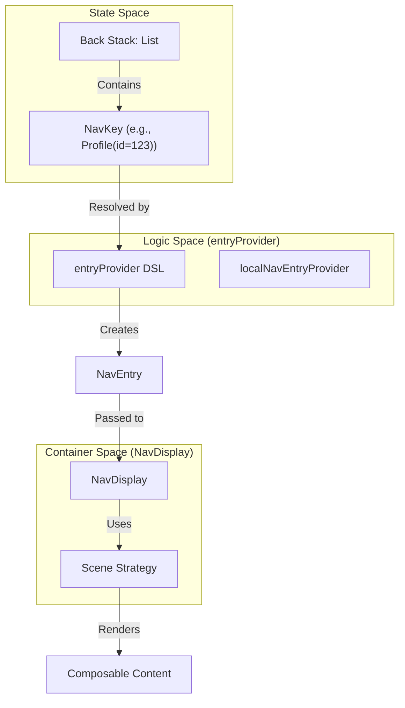
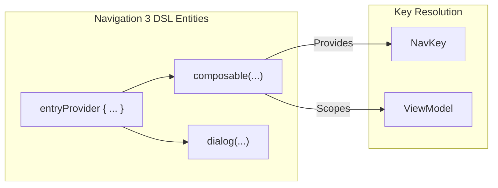

<!-- source: DeepWiki mcp.deepwiki.com · repo android/skills · page 4.1 Navigation 3 Core Concepts · fetched 2026-10-23 -->

# Navigation 3 Core Concepts

Relevant source files

The following files were used as context for generating this wiki page:

- [navigation/navigation-3/SKILL.md](navigation/navigation-3/SKILL.md)
- [navigation/navigation-3/references/android/guide/navigation/navigation-3/index.md](navigation/navigation-3/references/android/guide/navigation/navigation-3/index.md)
- [navigation/navigation-3/references/android/guide/navigation/navigation-3/migration-guide.md](navigation/navigation-3/references/android/guide/navigation/navigation-3/migration-guide.md)
- [navigation/navigation-3/references/android/guide/navigation/type-safe-destinations.md](navigation/navigation-3/references/android/guide/navigation/type-safe-destinations.md)

Navigation 3 is a state-driven navigation library for Jetpack Compose that treats the back stack as a simple list of keys. Unlike Navigation 2, which relies on a rigid graph structure and a `NavController` to manage mutations, Navigation 3 provides full control over navigation state, allowing developers to manage the back stack using standard Kotlin collections and Compose state primitives.

## Architectural Overview

The architecture of Navigation 3 shifts from a "command-based" approach (calling `navigate()`) to a "state-based" approach (modifying a list).

### Core Components

| Component | Role | Code Entity |
| :--- | :--- | :--- |
| **NavKey** | A unique, serializable identifier for a destination. | `NavKey` |
| **Back Stack** | A `MutableList` or `State<List>` of `NavKey` objects representing the history. | `List<NavKey>` |
| **NavEntry** | A wrapper that associates a `NavKey` with a lifecycle, `ViewModelStore`, and saved state. | `NavEntry` |
| **Entry Provider** | A mapping function or DSL that resolves a `NavKey` into a `NavEntry`. | `entryProvider` |
| **NavDisplay** | The Composable component that observes the back stack and renders the active entries. | `NavDisplay` |

### Data Flow Diagram: From Key to Screen
The following diagram illustrates how a `NavKey` in a back stack is transformed into a rendered UI component.

**Sources:** [navigation/navigation-3/references/android/guide/navigation/navigation-3/index.md:1-21](), [navigation/navigation-3/references/android/guide/navigation/navigation-3/migration-guide.md:137-150]()

---

## The Back Stack as State

In Navigation 3, the back stack is no longer hidden inside a `NavController`. It is a piece of state that you own.

*   **Manual Control**: To navigate forward, you append a `NavKey` to your list. To go back, you remove the last item [navigation/navigation-3/references/android/guide/navigation/navigation-3/index.md:1-4]().
*   **Persistence**: By using `rememberSaveable` with a custom `NavKey` saver (often provided by `rememberNavBackStack`), the entire navigation history survives process death and configuration changes [navigation/navigation-3/references/android/guide/navigation/navigation-3/migration-guide.md:137-142]().
*   **Multiple Back Stacks**: Since the back stack is just a list, implementing multiple back stacks (e.g., for a Bottom Navigation Bar) involves maintaining multiple state lists and switching which one is passed to the `NavDisplay` [navigation/navigation-3/SKILL.md:87-89]().

**Sources:** [navigation/navigation-3/references/android/guide/navigation/navigation-3/index.md:1-11](), [navigation/navigation-3/SKILL.md:54-55]()

---

## NavEntry and Lifecycle

Every destination in the back stack is encapsulated in a `NavEntry`. This object provides the necessary "hooks" for modern Android development:

1.  **Lifecycle**: Each entry has its own `LifecycleOwner`, allowing `LaunchedEffect` and other lifecycle-aware components to work correctly within a destination [navigation/navigation-3/references/android/guide/navigation/navigation-3/index.md:6-10]().
2.  **ViewModel Storage**: A `NavEntry` provides a `ViewModelStore`. This ensures that ViewModels are scoped to the destination and are cleared only when the entry is permanently removed from the back stack [navigation/navigation-3/SKILL.md:100-104]().
3.  **Saved State**: Entries can save their own internal UI state independently of other entries in the stack.

**Sources:** [navigation/navigation-3/references/android/guide/navigation/navigation-3/index.md:6-10](), [navigation/navigation-3/references/android/guide/navigation/navigation-3/migration-guide.md:113-123]()

---

## Entry Provider DSL

The `entryProvider` is the bridge between your data models (`NavKey`) and your UI code. It is typically defined using a DSL that mirrors the `NavGraph` from Navigation 2 but without the routing logic.

### Implementation Mapping
This diagram shows how code entities are organized within the `entryProvider`.

**Sources:** [navigation/navigation-3/references/android/guide/navigation/navigation-3/migration-guide.md:7-8](), [navigation/navigation-3/SKILL.md:55-55]()

---

## Scene Strategies and Adaptive Layouts

One of the primary advantages of Navigation 3 is the ability to display multiple destinations simultaneously. This is handled via **Scene Strategies**.

*   **NavDisplay**: The default container. It looks at the back stack and decides which entries to show based on the provided strategy [navigation/navigation-3/references/android/guide/navigation/navigation-3/index.md:17-19]().
*   **Adaptive Scenes**: You can create custom scenes that read multiple items from the back stack. For example, on a tablet, a `ListDetailScene` might render the second-to-last entry (the List) and the last entry (the Detail) side-by-side [navigation/navigation-3/SKILL.md:75-77]().
*   **Metadata**: Destinations can provide metadata to the `NavDisplay` to influence how they are rendered (e.g., specifying if a destination should be a dialog or a full-screen page) [navigation/navigation-3/references/android/guide/navigation/navigation-3/index.md:10-10]().

**Sources:** [navigation/navigation-3/references/android/guide/navigation/navigation-3/index.md:1-11](), [navigation/navigation-3/SKILL.md:78-82]()

---

## Comparison: Navigation 2 vs. Navigation 3

| Feature | Jetpack Navigation 2 | Navigation 3 |
| :--- | :--- | :--- |
| **Back Stack** | Managed internally by `NavController` | Managed by developer as a `List<NavKey>` |
| **Routing** | String-based or Type-safe (2.8+) | Strictly Type-safe via `NavKey` |
| **Graph** | Static `NavGraph` | Dynamic `entryProvider` |
| **Visibility** | Usually one destination at a time | Multiple destinations via Scene Strategies |
| **Animations** | Defined in `NavGraph` or `composable` | Defined in `NavDisplay` or Scene Strategy |

**Sources:** [navigation/navigation-3/references/android/guide/navigation/navigation-3/index.md:23-33](), [navigation/navigation-3/references/android/guide/navigation/navigation-3/migration-guide.md:1-9]()

---

