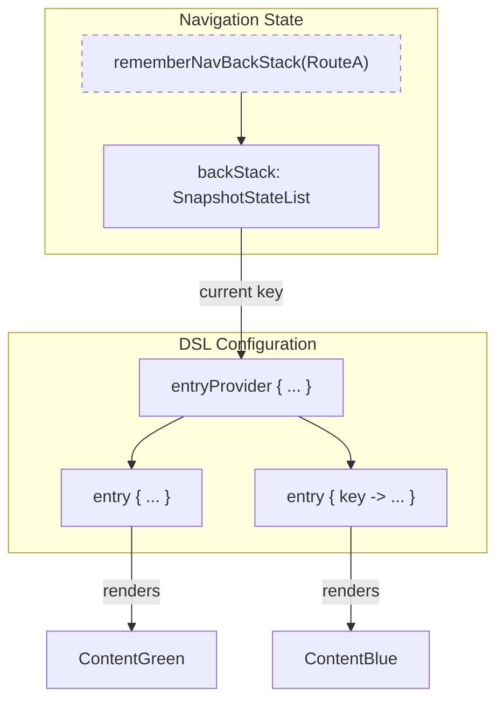
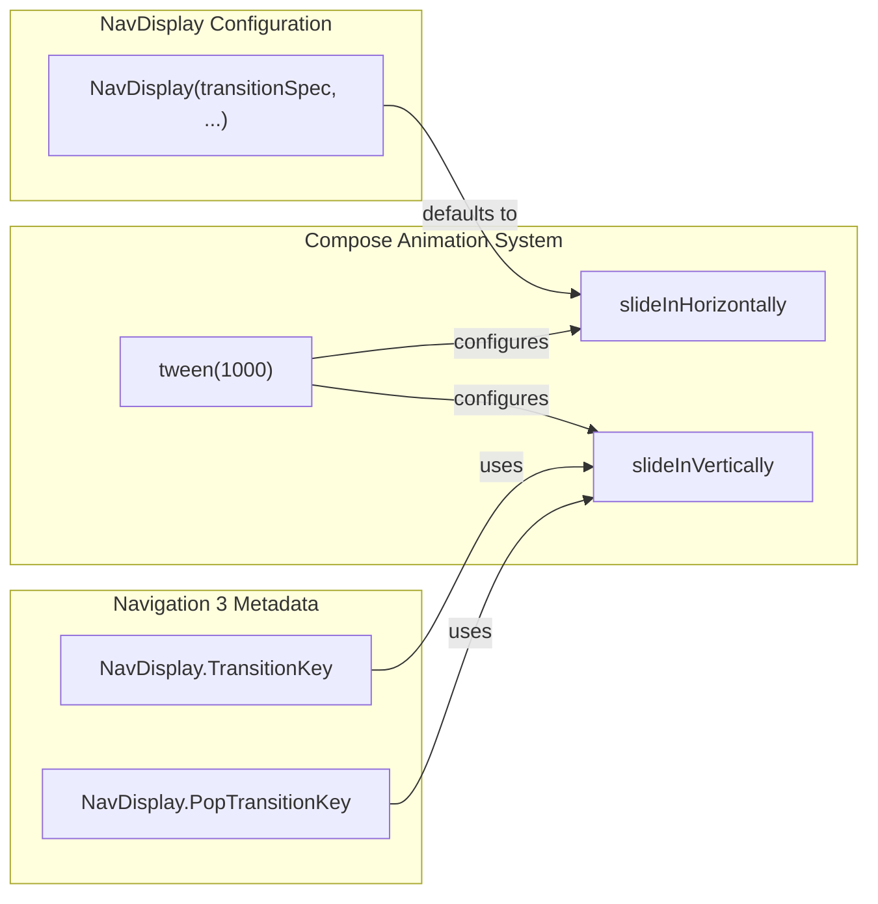

<!-- source: DeepWiki mcp.deepwiki.com · repo android/skills · page 4.2 Navigation 3 Recipes: Basic Patterns · fetched 2026-10-23 -->

# Navigation 3 Recipes: Basic Patterns

Relevant source files

The following files were used as context for generating this wiki page:

- [navigation/navigation-3/references/android/guide/navigation/navigation-3/recipes/animations.md](navigation/navigation-3/references/android/guide/navigation/navigation-3/recipes/animations.md)
- [navigation/navigation-3/references/android/guide/navigation/navigation-3/recipes/basic.md](navigation/navigation-3/references/android/guide/navigation/navigation-3/recipes/basic.md)
- [navigation/navigation-3/references/android/guide/navigation/navigation-3/recipes/basicdsl.md](navigation/navigation-3/references/android/guide/navigation/navigation-3/recipes/basicdsl.md)
- [navigation/navigation-3/references/android/guide/navigation/navigation-3/recipes/basicsaveable.md](navigation/navigation-3/references/android/guide/navigation/navigation-3/recipes/basicsaveable.md)
- [navigation/navigation-3/references/android/guide/navigation/navigation-3/recipes/common-ui.md](navigation/navigation-3/references/android/guide/navigation/navigation-3/recipes/common-ui.md)
- [navigation/navigation-3/references/android/guide/navigation/navigation-3/recipes/passingarguments.md](navigation/navigation-3/references/android/guide/navigation/navigation-3/recipes/passingarguments.md)

This page provides foundational implementation patterns for Navigation 3. It covers the transition from simple state management to robust, production-ready navigation structures including persistent back stacks, DSL-based configurations, argument passing via ViewModels, and custom transition animations.

## Basic Navigation Setup

The most fundamental implementation of Navigation 3 involves managing the back stack as a simple `MutableList` of objects and providing a mapping from those objects to Composables using `NavDisplay`.

### Implementation Details
*   **Back Stack**: Managed via `mutableStateListOf<Any>` [navigation/navigation-3/references/android/guide/navigation/navigation-3/recipes/basic.md:40-40]().
*   **Routes**: Defined as `data object` for static screens or `data class` for screens requiring parameters [navigation/navigation-3/references/android/guide/navigation/navigation-3/recipes/basic.md:49-51]().
*   **Navigation**: Performed by simply adding a new route instance to the back stack [navigation/navigation-3/references/android/guide/navigation/navigation-3/recipes/basic.md:68-70]().
*   **Back Handling**: Managed via the `onBack` lambda in `NavDisplay`, typically calling `removeLastOrNull()` on the back stack [navigation/navigation-3/references/android/guide/navigation/navigation-3/recipes/basic.md:63-63]().

### Data Flow: Basic State Navigation
The following diagram illustrates how a route object moves from the back stack through the `entryProvider` to become a rendered UI component.

| Entity | Role |
| :--- | :--- |
| `RouteA` / `RouteB` | Navigation keys (POJOs) representing destinations [navigation/navigation-3/references/android/guide/navigation/navigation-3/recipes/basic.md:49-51](). |
| `backStack` | A `SnapshotStateList` acting as the single source of truth for navigation state [navigation/navigation-3/references/android/guide/navigation/navigation-3/recipes/basic.md:59-59](). |
| `entryProvider` | A lambda that transforms a navigation key into a `NavEntry` [navigation/navigation-3/references/android/guide/navigation/navigation-3/recipes/basic.md:64-84](). |
| `NavDisplay` | The UI component that observes the back stack and renders the top entry [navigation/navigation-3/references/android/guide/navigation/navigation-3/recipes/basic.md:61-85](). |

**Sources:** [navigation/navigation-3/references/android/guide/navigation/navigation-3/recipes/basic.md:7-14]()

## DSL-Based Setup and Persistence

For more complex applications, Navigation 3 provides a Type-Safe DSL and mechanisms to ensure the navigation state survives configuration changes (like screen rotation).

### Persistent Back Stack
Using `rememberNavBackStack(initialKey)` creates a back stack that is saved via `SavedStateRegistry` [navigation/navigation-3/references/android/guide/navigation/navigation-3/recipes/basicdsl.md:9-9](). This requires:
1.  Routes to be `@Serializable` [navigation/navigation-3/references/android/guide/navigation/navigation-3/recipes/basicdsl.md:50-54]().
2.  Routes to implement the `NavKey` interface [navigation/navigation-3/references/android/guide/navigation/navigation-3/recipes/basicdsl.md:51-54]().

### Entry Provider DSL
Instead of a manual `when` block, the `entryProvider` block allows registering content for specific types using the `entry<T>` function [navigation/navigation-3/references/android/guide/navigation/navigation-3/recipes/basicdsl.md:11-11]().

**Sources:** [navigation/navigation-3/references/android/guide/navigation/navigation-3/recipes/basicdsl.md:9-12](), [navigation/navigation-3/references/android/guide/navigation/navigation-3/recipes/basicdsl.md:62-81]()

## Passing Arguments to ViewModels

Navigation 3 integrates with `ViewModel` to allow passing navigation keys (arguments) directly into the `ViewModel` constructor, specifically when using Hilt.

### Key Components
*   **`rememberViewModelStoreNavEntryDecorator()`**: Must be added to `NavDisplay`'s `entryDecorators` [navigation/navigation-3/references/android/guide/navigation/navigation-3/recipes/passingarguments.md:13-13](). This ensures each unique `NavEntry` (based on its `contentKey`) gets its own `ViewModelStore`, preventing shared state between different instances of the same route [navigation/navigation-3/references/android/guide/navigation/navigation-3/recipes/passingarguments.md:101-108]().
*   **Assisted Injection**: Used to inject the `NavKey` into the `ViewModel` at runtime [navigation/navigation-3/references/android/guide/navigation/navigation-3/recipes/passingarguments.md:9-11]().

### Implementation Example (Hilt)
1.  **ViewModel**: Annotate constructor with `@AssistedInject` and the key with `@Assisted` [navigation/navigation-3/references/android/guide/navigation/navigation-3/recipes/passingarguments.md:127-129]().
2.  **Factory**: Define an `@AssistedFactory` interface [navigation/navigation-3/references/android/guide/navigation/navigation-3/recipes/passingarguments.md:131-134]().
3.  **Call Site**: Use `hiltViewModel` with a `creationCallback` [navigation/navigation-3/references/android/guide/navigation/navigation-3/recipes/passingarguments.md:100-112]().

**Sources:** [navigation/navigation-3/references/android/guide/navigation/navigation-3/recipes/passingarguments.md:7-14](), [navigation/navigation-3/references/android/guide/navigation/navigation-3/recipes/passingarguments.md:81-84]()

## Common UI Patterns: Bottom Navigation

Implementing bottom navigation with multiple back stacks requires a wrapper to manage the relationship between top-level tabs and their respective histories.

### `TopLevelBackStack` Strategy
This pattern involves a custom class that:
1.  Maintains a `Map` of back stacks (one per tab) [navigation/navigation-3/references/android/guide/navigation/navigation-3/recipes/common-ui.md:13-13]().
2.  Tracks the `topLevelKey` (active tab) [navigation/navigation-3/references/android/guide/navigation/navigation-3/recipes/common-ui.md:14-14]().
3.  Exposes a "flattened" back stack to `NavDisplay` [navigation/navigation-3/references/android/guide/navigation/navigation-3/recipes/common-ui.md:15-15]().

### UI Integration
The `Scaffold`'s `bottomBar` uses `NavigationBarItem` to trigger `topLevelBackStack.addTopLevel(route)`, while the `NavDisplay` in the content area observes the combined state [navigation/navigation-3/references/android/guide/navigation/navigation-3/recipes/common-ui.md:19-24]().

**Sources:** [navigation/navigation-3/references/android/guide/navigation/navigation-3/recipes/common-ui.md:9-30](), [navigation/navigation-3/references/android/guide/navigation/navigation-3/recipes/common-ui.md:96-143]()

## Animations and Transitions

Navigation 3 allows defining animations at both the global level (`NavDisplay`) and the individual destination level.

### Global Transitions
`NavDisplay` accepts three transition specs [navigation/navigation-3/references/android/guide/navigation/navigation-3/recipes/animations.md:7-7]():
*   `transitionSpec`: Forward navigation.
*   `popTransitionSpec`: Backward navigation.
*   `predictivePopTransitionSpec`: Predictive back gestures.

### Destination Overrides
Individual entries can override global defaults by providing `metadata` containing specific transition keys [navigation/navigation-3/references/android/guide/navigation/navigation-3/recipes/animations.md:11-11]().

| Transition Key | Purpose |
| :--- | :--- |
| `NavDisplay.TransitionKey` | Custom enter/exit for this specific route [navigation/navigation-3/references/android/guide/navigation/navigation-3/recipes/animations.md:84-84](). |
| `NavDisplay.PopTransitionKey` | Custom back animation for this specific route [navigation/navigation-3/references/android/guide/navigation/navigation-3/recipes/animations.md:92-92](). |
| `NavDisplay.PredictivePopTransitionKey` | Custom predictive back behavior [navigation/navigation-3/references/android/guide/navigation/navigation-3/recipes/animations.md:101-101](). |

### System Mapping: Animation Entities

**Sources:** [navigation/navigation-3/references/android/guide/navigation/navigation-3/recipes/animations.md:7-11](), [navigation/navigation-3/references/android/guide/navigation/navigation-3/recipes/animations.md:81-108]()

---

