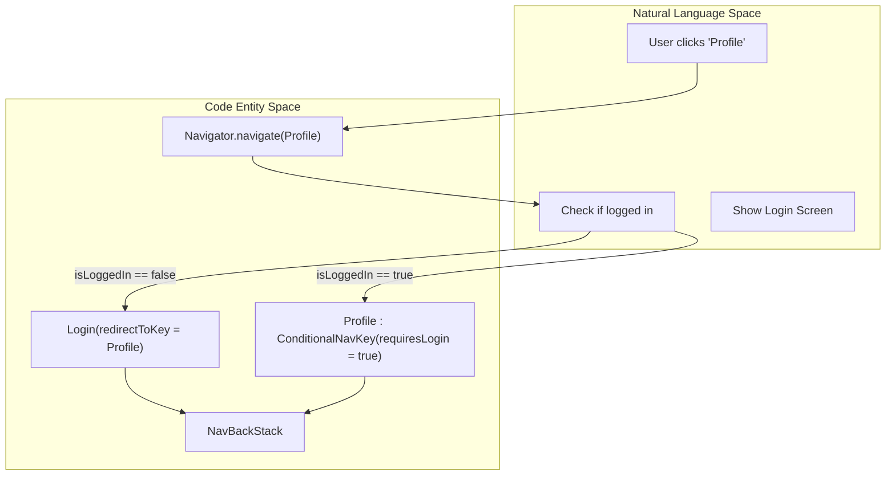
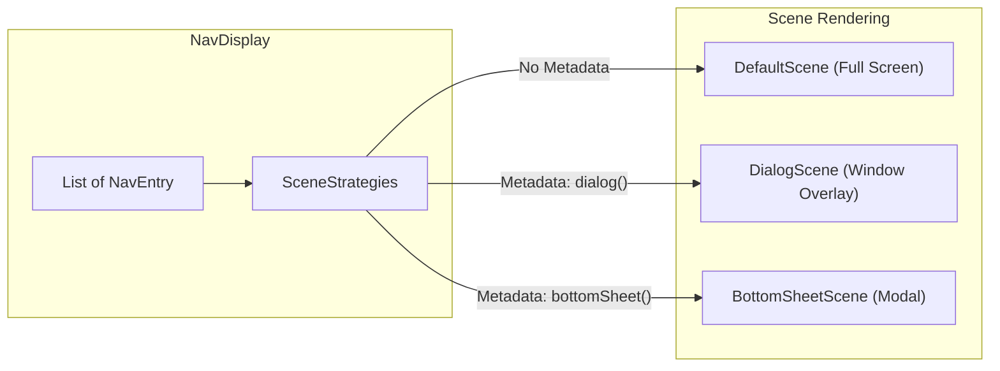

<!-- source: DeepWiki mcp.deepwiki.com · repo android/skills · page 4.3 Navigation 3 Recipes: Advanced Patterns · fetched 2026-10-23 -->

# Navigation 3 Recipes: Advanced Patterns

Relevant source files

The following files were used as context for generating this wiki page:

- [navigation/navigation-3/references/android/guide/navigation/navigation-3/recipes/bottomsheet.md](navigation/navigation-3/references/android/guide/navigation/navigation-3/recipes/bottomsheet.md)
- [navigation/navigation-3/references/android/guide/navigation/navigation-3/recipes/conditional.md](navigation/navigation-3/references/android/guide/navigation/navigation-3/recipes/conditional.md)
- [navigation/navigation-3/references/android/guide/navigation/navigation-3/recipes/deeplinks-advanced.md](navigation/navigation-3/references/android/guide/navigation/navigation-3/recipes/deeplinks-advanced.md)
- [navigation/navigation-3/references/android/guide/navigation/navigation-3/recipes/deeplinks-basic.md](navigation/navigation-3/references/android/guide/navigation/navigation-3/recipes/deeplinks-basic.md)
- [navigation/navigation-3/references/android/guide/navigation/navigation-3/recipes/dialog.md](navigation/navigation-3/references/android/guide/navigation/navigation-3/recipes/dialog.md)
- [navigation/navigation-3/references/android/guide/navigation/navigation-3/recipes/modular-hilt.md](navigation/navigation-3/references/android/guide/navigation/navigation-3/recipes/modular-hilt.md)
- [navigation/navigation-3/references/android/guide/navigation/navigation-3/recipes/modular-koin.md](navigation/navigation-3/references/android/guide/navigation/navigation-3/recipes/modular-koin.md)
- [navigation/navigation-3/references/android/guide/navigation/navigation-3/recipes/multiple-backstacks.md](navigation/navigation-3/references/android/guide/navigation/navigation-3/recipes/multiple-backstacks.md)
- [navigation/navigation-3/references/android/guide/navigation/navigation-3/recipes/results-event.md](navigation/navigation-3/references/android/guide/navigation/navigation-3/recipes/results-event.md)
- [navigation/navigation-3/references/android/guide/navigation/navigation-3/recipes/results-state.md](navigation/navigation-3/references/android/guide/navigation/navigation-3/recipes/results-state.md)

This page covers advanced implementation patterns for Navigation 3. Unlike basic navigation, these patterns involve state-driven logic for authentication, complex data flow between screens, managing multiple UI layers (dialogs/bottom sheets), and architecting multi-module applications with Dependency Injection.

## Conditional Navigation (Auth Guards)

Conditional navigation in Navigation 3 is implemented by centralizing redirection logic within a custom `Navigator` or a specialized `NavBackStack`. This pattern ensures that restricted destinations are protected by "guards" that intercept navigation attempts based on app state (e.g., `isLoggedIn`).

### Implementation Logic
1.  **Marker Interface/Property**: Use a property in the `NavKey` (often a sealed class) to identify restricted routes [navigation/navigation-3/references/android/guide/navigation/navigation-3/recipes/conditional.md:78-79]().
2.  **Redirection**: When `Navigator.navigate()` is called, the system checks the `requiresLogin` status. If the user is unauthenticated, it stores the intended destination and redirects the back stack to a `Login` route [navigation/navigation-3/references/android/guide/navigation/navigation-3/recipes/conditional.md:113-119]().
3.  **Resuming Navigation**: Upon successful login, the `Login` screen retrieves the `redirectToKey` and swaps itself for the original destination [navigation/navigation-3/references/android/guide/navigation/navigation-3/recipes/conditional.md:151-154]().

### Auth Guard Data Flow
The following diagram illustrates how the `Navigator` intercepts restricted keys.

**Navigation Interception Flow**

Sources: [navigation/navigation-3/references/android/guide/navigation/navigation-3/recipes/conditional.md:84-119]()

---

## Returning Results

Navigation 3 supports two primary patterns for passing data back to a previous screen: **Event-based** (transient) and **State-based** (persistent).

### Event-Based Results
Uses a shared `ResultEventBus` to facilitate one-time communication.
*   **Producer**: Calls `resultBus.sendResult(data)` [navigation/navigation-3/references/android/guide/navigation/navigation-3/recipes/results-event.md:10-11]().
*   **Consumer**: Uses a `ResultEffect` composable to listen for the specific data type. The lambda triggers once when the result is received [navigation/navigation-3/references/android/guide/navigation/navigation-3/recipes/results-event.md:11-11]().

### State-Based Results
Uses a `ResultStore` to treat the result as persistent state that survives configuration changes.
*   **Producer**: Updates the store via `resultStore.setResult(data)` [navigation/navigation-3/references/android/guide/navigation/navigation-3/recipes/results-state.md:10-10]().
*   **Consumer**: Observes state via `resultStore.getResultState<T>()`. Recomposition occurs automatically when the value changes [navigation/navigation-3/references/android/guide/navigation/navigation-3/recipes/results-state.md:11-11]().

Sources: [navigation/navigation-3/references/android/guide/navigation/navigation-3/recipes/results-event.md:5-13](), [navigation/navigation-3/references/android/guide/navigation/navigation-3/recipes/results-state.md:5-13]()

---

## Multiple Back Stacks

Navigation 3 manages multiple back stacks by maintaining a map of `NavBackStack` instances, typically associated with top-level destinations (e.g., Bottom Navigation tabs).

| Feature | Implementation Detail |
| :--- | :--- |
| **State Storage** | A `Map<NavKey, NavBackStack<NavKey>>` holds the stacks for each top-level route [navigation/navigation-3/references/android/guide/navigation/navigation-3/recipes/multiple-backstacks.md:150-150](). |
| **State Retention** | Each stack uses `rememberSaveableStateHolderNavEntryDecorator` to preserve UI state (like scroll positions) when switching tabs [navigation/navigation-3/references/android/guide/navigation/navigation-3/recipes/multiple-backstacks.md:173-176](). |
| **Exit Pattern** | Implements "exit through home": navigating back from the root of a non-start tab redirects to the `startRoute` stack [navigation/navigation-3/references/android/guide/navigation/navigation-3/recipes/multiple-backstacks.md:64-65](). |

Sources: [navigation/navigation-3/references/android/guide/navigation/navigation-3/recipes/multiple-backstacks.md:5-21](), [navigation/navigation-3/references/android/guide/navigation/navigation-3/recipes/multiple-backstacks.md:147-176]()

---

## Dialogs and Bottom Sheets

Overlay destinations (Dialogs and Bottom Sheets) are implemented using `SceneStrategy`. This allows the `NavDisplay` to render the destination in a separate window or layer rather than as a full-screen replacement.

### Overlay Implementation Steps
1.  **Define Strategy**: Create an instance of `DialogSceneStrategy` or `BottomSheetSceneStrategy` and pass it to `NavDisplay` [navigation/navigation-3/references/android/guide/navigation/navigation-3/recipes/dialog.md:74-79](), [navigation/navigation-3/references/android/guide/navigation/navigation-3/recipes/bottomsheet.md:74-79]().
2.  **Attach Metadata**: In the `entryProvider`, use `metadata` to flag specific keys as overlays [navigation/navigation-3/references/android/guide/navigation/navigation-3/recipes/dialog.md:91-93]().

**Overlay Architecture**

Sources: [navigation/navigation-3/references/android/guide/navigation/navigation-3/recipes/dialog.md:7-17](), [navigation/navigation-3/references/android/guide/navigation/navigation-3/recipes/bottomsheet.md:7-17]()

---

## Deep Linking

Deep linking in Navigation 3 involves parsing an incoming `Intent` into a `NavKey` and optionally constructing a "synthetic" back stack to provide a proper "Up" navigation experience.

### Basic Deep Linking
*   **Pattern Matching**: A `DeepLinkMatcher` compares the `Intent.data` URI against a list of `DeepLinkPattern` objects [navigation/navigation-3/references/android/guide/navigation/navigation-3/recipes/deeplinks-basic.md:124-131]().
*   **Key Decoding**: If a match is found, a `KeyDecoder` (leveraging `kotlinx.serialization`) converts the URI path and query parameters into a typed `NavKey` [navigation/navigation-3/references/android/guide/navigation/navigation-3/recipes/deeplinks-basic.md:147-152]().

### Advanced Deep Linking
Advanced scenarios involve managing the **Task Stack**. When a deep link is triggered with `FLAG_ACTIVITY_NEW_TASK`, the app must manually build the back stack history (e.g., `Home -> Category -> Detail`) so that the back button does not immediately exit the app [navigation/navigation-3/references/android/guide/navigation/navigation-3/recipes/deeplinks-advanced.md:15-17]().

Sources: [navigation/navigation-3/references/android/guide/navigation/navigation-3/recipes/deeplinks-basic.md:121-153](), [navigation/navigation-3/references/android/guide/navigation/navigation-3/recipes/deeplinks-advanced.md:55-66]()

---

## DI Integration (Hilt & Koin)

Modular applications use Dependency Injection to decouple feature modules from the main `app` module.

### Hilt Pattern
*   **EntryProviderInstaller**: Feature modules provide a lambda that adds their entries to a `NavDisplay` [navigation/navigation-3/references/android/guide/navigation/navigation-3/recipes/modular-hilt.md:53-57]().
*   **Multibinding**: Feature modules use `@IntoSet` to contribute their installers to a `Set<EntryProviderInstaller>` [navigation/navigation-3/references/android/guide/navigation/navigation-3/recipes/modular-hilt.md:51-52]().
*   **App Module**: Injects the set and iterates through it inside the `entryProvider` DSL [navigation/navigation-3/references/android/guide/navigation/navigation-3/recipes/modular-hilt.md:113-115]().

### Koin Pattern
*   **Navigation DSL**: Uses the `navigation<T> { ... }` DSL within Koin modules to define entry providers [navigation/navigation-3/references/android/guide/navigation/navigation-3/recipes/modular-koin.md:47-47]().
*   **Scope Management**: Entries are typically defined within an `activityRetainedScope` to ensure navigation state persists through configuration changes [navigation/navigation-3/references/android/guide/navigation/navigation-3/recipes/modular-koin.md:46-48]().

Sources: [navigation/navigation-3/references/android/guide/navigation/navigation-3/recipes/modular-hilt.md:5-20](), [navigation/navigation-3/references/android/guide/navigation/navigation-3/recipes/modular-koin.md:5-18]()

---

