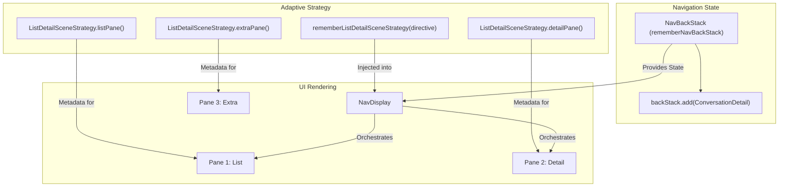
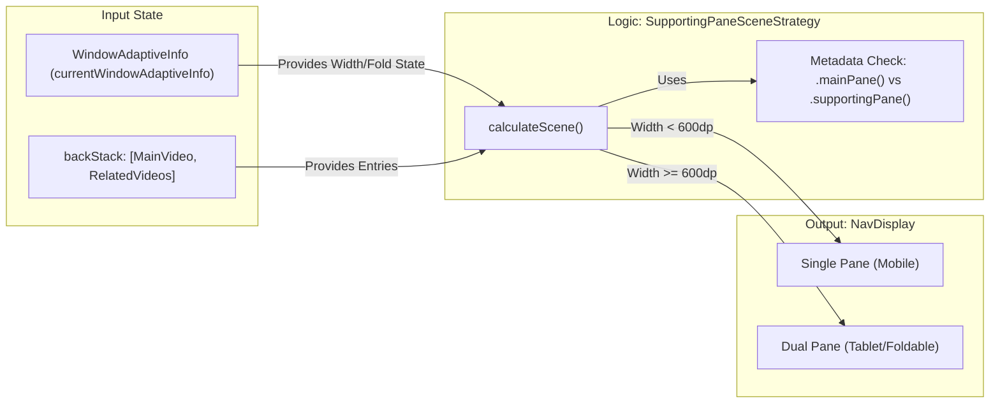

<!-- source: DeepWiki mcp.deepwiki.com · repo android/skills · page 4.4 Navigation 3 Recipes: Adaptive Layouts & Scenes · fetched 2026-10-23 -->

# Navigation 3 Recipes: Adaptive Layouts & Scenes

<details>
<summary>Relevant source files</summary>

The following files were used as context for generating this wiki page:

- [navigation/navigation-3/references/android/guide/navigation/navigation-3/recipes/material-listdetail.md](navigation/navigation-3/references/android/guide/navigation/navigation-3/recipes/material-listdetail.md)
- [navigation/navigation-3/references/android/guide/navigation/navigation-3/recipes/material-supportingpane.md](navigation/navigation-3/references/android/guide/navigation/navigation-3/recipes/material-supportingpane.md)
- [navigation/navigation-3/references/android/guide/navigation/navigation-3/recipes/scenes-listdetail.md](navigation/navigation-3/references/android/guide/navigation/navigation-3/recipes/scenes-listdetail.md)
- [navigation/navigation-3/references/android/guide/navigation/navigation-3/recipes/scenes-twopane.md](navigation/navigation-3/references/android/guide/navigation/navigation-3/recipes/scenes-twopane.md)

</details>


This page covers Navigation 3 recipes for building adaptive layouts that respond to different screen sizes, orientations, and form factors (like foldables). It details how to use the `SceneStrategy` API to implement custom multi-pane layouts and how to leverage Material 3 Adaptive integrations for standard patterns like List-Detail and Supporting Pane.

## Custom Scene-Based Adaptive Layouts

Navigation 3 uses the `SceneStrategy` to decide how to render the current back stack based on device configuration. Unlike traditional navigation where one route equals one screen, a `Scene` can compose multiple `NavEntry` objects into a single visual layout.

### List-Detail Scene Strategy

The List-Detail pattern displays a primary list and a secondary detail pane side-by-side on large screens, typically using a 40/60 split [navigation/navigation-3/references/android/guide/navigation/navigation-3/recipes/scenes-listdetail.md:58-62]().

**Implementation Logic:**
1.  **Breakpoint Check**: The strategy checks if the window width is at least `WIDTH_DP_MEDIUM_LOWER_BOUND` (600dp) [navigation/navigation-3/references/android/guide/navigation/navigation-3/recipes/scenes-listdetail.md:148-150]().
2.  **Metadata Identification**: It searches the back stack for entries tagged with `ListKey` and `DetailKey` [navigation/navigation-3/references/android/guide/navigation/navigation-3/recipes/scenes-listdetail.md:152-156]().
3.  **Scene Keying**: The `sceneKey` is derived from the `listEntry.contentKey`. This ensures that when the detail item changes, the scene itself remains stable, allowing the scene's internal `AnimatedContent` to handle the detail transition instead of the global `NavDisplay` [navigation/navigation-3/references/android/guide/navigation/navigation-3/recipes/scenes-listdetail.md:161-168]().

**Navigation Flow & Entities**

| Entity | Role | Source |
| :--- | :--- | :--- |
| `ListDetailSceneStrategy` | Determines if the 2-pane layout should be active. | [navigation/navigation-3/references/android/guide/navigation/navigation-3/recipes/scenes-listdetail.md:144]() |
| `ListDetailScene` | The `Scene` implementation that renders the `Row` layout. | [navigation/navigation-3/references/android/guide/navigation/navigation-3/recipes/scenes-listdetail.md:62]() |
| `LocalBackButtonVisibility` | `CompositionLocal` used to hide back buttons in the detail pane when side-by-side. | [navigation/navigation-3/references/android/guide/navigation/navigation-3/recipes/scenes-listdetail.md:122]() |

**Sources:** [navigation/navigation-3/references/android/guide/navigation/navigation-3/recipes/scenes-listdetail.md:5-115](), [navigation/navigation-3/references/android/guide/navigation/navigation-3/recipes/scenes-listdetail.md:144-171]()

### Two-Pane Scene Strategy

The Two-Pane recipe demonstrates a 50/50 split for two distinct destinations that are both present on the back stack [navigation/navigation-3/references/android/guide/navigation/navigation-3/recipes/scenes-twopane.md:37-42]().

**Key Characteristics:**
*   **Back Navigation**: Even though two entries are displayed, the `previousEntries` usually only drops the top-most entry. This prevents "double-popping" where adding one item forward would require two clicks to go back [navigation/navigation-3/references/android/guide/navigation/navigation-3/recipes/scenes-twopane.md:109-114]().
*   **Scene Key**: Uses a `Pair` of both entry keys to ensure the scene is recreated if either pane changes its primary identity [navigation/navigation-3/references/android/guide/navigation/navigation-3/recipes/scenes-twopane.md:105-107]().

**Sources:** [navigation/navigation-3/references/android/guide/navigation/navigation-3/recipes/scenes-twopane.md:37-66](), [navigation/navigation-3/references/android/guide/navigation/navigation-3/recipes/scenes-twopane.md:83-125]()

---

## Material 3 Adaptive Integration

For standard Material 3 patterns, Navigation 3 provides specialized strategies that wrap the Material 3 Adaptive library components.

### Material List-Detail

The `ListDetailSceneStrategy` from the Material 3 Adaptive library automatically adjusts between one, two, or three panes (List, Detail, and Extra) [navigation/navigation-3/references/android/guide/navigation/navigation-3/recipes/material-listdetail.md:13-18]().

**Pane Assignment via Metadata:**
*   `ListDetailSceneStrategy.listPane()`: Assigned to the primary list. Can include a `detailPlaceholder` for when no item is selected [navigation/navigation-3/references/android/guide/navigation/navigation-3/recipes/material-listdetail.md:103-108]().
*   `ListDetailSceneStrategy.detailPane()`: Assigned to the secondary content [navigation/navigation-3/references/android/guide/navigation/navigation-3/recipes/material-listdetail.md:119]().
*   `ListDetailSceneStrategy.extraPane()`: Assigned to tertiary content (e.g., a Profile view) [navigation/navigation-3/references/android/guide/navigation/navigation-3/recipes/material-listdetail.md:132]().

**Code Entity Mapping: Material List-Detail**

Title: Material List-Detail Data Flow

**Sources:** [navigation/navigation-3/references/android/guide/navigation/navigation-3/recipes/material-listdetail.md:9-21](), [navigation/navigation-3/references/android/guide/navigation/navigation-3/recipes/material-listdetail.md:96-137]()

### Material Supporting Pane

The `SupportingPaneSceneStrategy` is designed for layouts where a main content area is supplemented by an auxiliary pane (e.g., a video player with a list of related videos) [navigation/navigation-3/references/android/guide/navigation/navigation-3/recipes/material-supportingpane.md:3-18]().

**Back Navigation Customization:**
A key feature in this recipe is the use of `BackNavigationBehavior.PopUntilCurrentDestinationChange`. This ensures that pressing the back button dismisses the supporting pane (returning focus to the main pane) rather than navigating the entire app back immediately [navigation/navigation-3/references/android/guide/navigation/navigation-3/recipes/material-supportingpane.md:20-21](), [navigation/navigation-3/references/android/guide/navigation/navigation-3/recipes/material-supportingpane.md:101-104]().

**System Interaction Diagram**

Title: Supporting Pane Strategy Resolution


**Sources:** [navigation/navigation-3/references/android/guide/navigation/navigation-3/recipes/material-supportingpane.md:9-22](), [navigation/navigation-3/references/android/guide/navigation/navigation-3/recipes/material-supportingpane.md:101-141]()

## Implementation Details

### Configuration Overrides
In adaptive layouts, default spacers between panes might need to be removed to match specific designs. This is achieved by copying the `PaneScaffoldDirective` [navigation/navigation-3/references/android/guide/navigation/navigation-3/recipes/material-listdetail.md:91-95]():

```kotlin
val directive = remember(windowAdaptiveInfo) {
    calculatePaneScaffoldDirective(windowAdaptiveInfo)
        .copy(horizontalPartitionSpacerSize = 0.dp)
}
```

### Strategy Selection
`NavDisplay` accepts a list of `sceneStrategies`. It evaluates them in order; the first strategy to return a non-null `Scene` is used to render the UI [navigation/navigation-3/references/android/guide/navigation/navigation-3/recipes/material-listdetail.md:101](), [navigation/navigation-3/references/android/guide/navigation/navigation-3/recipes/material-supportingpane.md:109]().

**Sources:** [navigation/navigation-3/references/android/guide/navigation/navigation-3/recipes/material-listdetail.md:89-97](), [navigation/navigation-3/references/android/guide/navigation/navigation-3/recipes/material-supportingpane.md:91-104]()

---

