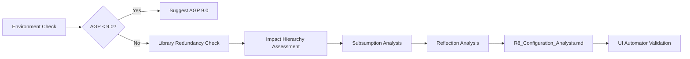

<!-- source: DeepWiki mcp.deepwiki.com · repo android/skills · page 5 Performance Skills · fetched 2026-10-23 -->

# Performance Skills

<details>
<summary>Relevant source files</summary>

The following files were used as context for generating this wiki page:

- [performance/r8-analyzer/SKILL.md](performance/r8-analyzer/SKILL.md)

</details>


The Performance Skills domain focuses on optimizing Android applications for size and execution efficiency, primarily through advanced configuration of the R8 compiler and ProGuard rules. This section provides an automated, structured approach to auditing build configurations and shrinking the application footprint by identifying redundant or overly broad keep rules.

The primary tool in this domain is the `r8-analyzer` skill, which implements a systematic 9-phase pipeline to evaluate an application's shrinking configuration [performance/r8-analyzer/SKILL.md:18-31]().

### R8 Analyzer Skill

The `r8-analyzer` skill is designed to identify redundancies, broad package-wide rules, and rules that subsume library consumer keep rules [performance/r8-analyzer/SKILL.md:2-6](). It automates the process of auditing `build.gradle`, `build.gradle.kts`, and `gradle.properties` to ensure the R8 environment is correctly configured according to modern standards [performance/r8-analyzer/SKILL.md:21-21]().

Key features of the analyzer include:
*   **AGP Version Validation**: Recommending upgrades to AGP 9.0 to leverage built-in optimizations [performance/r8-analyzer/SKILL.md:22-22]().
*   **Redundancy Filtering**: Automatically identifying rules for libraries (e.g., AndroidX, Kotlin, Retrofit) that are already handled by consumer ProGuard rules [performance/r8-analyzer/SKILL.md:23-23]().
*   **Subsumption Analysis**: Detecting broad rules that unnecessarily cover code already protected by more specific rules [performance/r8-analyzer/SKILL.md:24-24]().
*   **Reflection Mapping**: Analyzing code for reflection usage to narrow down broad keep rules into surgical configurations [performance/r8-analyzer/SKILL.md:25-25]().

For a detailed walkthrough of the analysis phases and validation steps, see **[R8 Analyzer Skill](#5.1)**.

### R8 Analyzer Reference Materials

The effectiveness of the performance analysis relies on a set of reference documents that define the impact of various keep rules and catalog known redundancies in the Android ecosystem. These materials allow the AI agent to categorize rules by their "weight" and potential for optimization.

The reference set includes:
*   **Keep Rules Impact Hierarchy**: A classification system used to prioritize which rules have the highest impact on code shrinking [performance/r8-analyzer/SKILL.md:23-23]().
*   **Redundant Rules Catalog**: A list of common libraries that provide their own rules, making manual entries in the app's ProGuard file unnecessary [performance/r8-analyzer/SKILL.md:23-23]().
*   **Reflection Guide**: Technical documentation for narrowing broad keep rules by identifying specific reflection-based access patterns [performance/r8-analyzer/SKILL.md:25-25]().

For a deep dive into these reference catalogs and the impact hierarchy, see **[R8 Analyzer Reference Materials](#5.2)**.

### System Mapping: Skill to Codebase

The following diagrams illustrate how the `r8-analyzer` skill bridges the gap between natural language optimization requests and the specific build artifacts it inspects.

#### Workflow Entity Mapping
This diagram shows how the skill workflow steps interact with specific codebase entities.

```mermaid
graph TD
    subgraph "Natural Language Space"
        "Optimize App Size" --> "Analyze Rules"
        "Troubleshoot ProGuard" --> "Analyze Rules"
    end

    subgraph "Code Entity Space"
        "Analyze Rules" --> SKILL["SKILL.md"]
        SKILL -- "Step 2: Inspect" --> GRADLE["build.gradle / .kts"]
        SKILL -- "Step 2: Inspect" --> PROP["gradle.properties"]
        SKILL -- "Step 4: Audit" --> PROGUARD["proguard-rules.pro"]
        
        SKILL -- "Step 4a: Reference" --> RED_RULES["REDUNDANT-RULES.md"]
        SKILL -- "Step 4b: Reference" --> HIERARCHY["KEEP-RULES-IMPACT-HIERARCHY.md"]
        SKILL -- "Step 6: Reference" --> REFLECTION["REFLECTION-GUIDE.md"]
    end
```
**Sources:** [performance/r8-analyzer/SKILL.md:18-31]()

#### R8 Analysis Pipeline
This diagram traces the logic flow from environment detection to final reporting.


**Sources:** [performance/r8-analyzer/SKILL.md:20-31]()

### Performance Optimization Table

| Analysis Phase | Target Files | Reference Material | Goal |
| :--- | :--- | :--- | :--- |
| **Environment** | `gradle.properties`, `build.gradle` | `CONFIGURATION.md` | Ensure R8 is enabled and AGP is up to date. |
| **Library Audit** | `proguard-rules.pro` | `REDUNDANT-RULES.md` | Remove rules for libraries like Room, Gson, and Retrofit. |
| **Impact Analysis** | `proguard-rules.pro` | `KEEP-RULES-IMPACT-HIERARCHY.md` | Rank rules by their effect on code stripping. |
| **Refinement** | App Source Code | `REFLECTION-GUIDE.md` | Replace broad `-keep class pkg.**` with specific rules. |

**Sources:** [performance/r8-analyzer/SKILL.md:21-31]()

---

