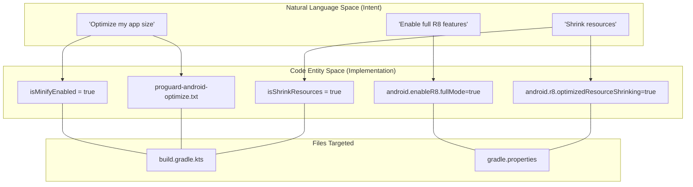
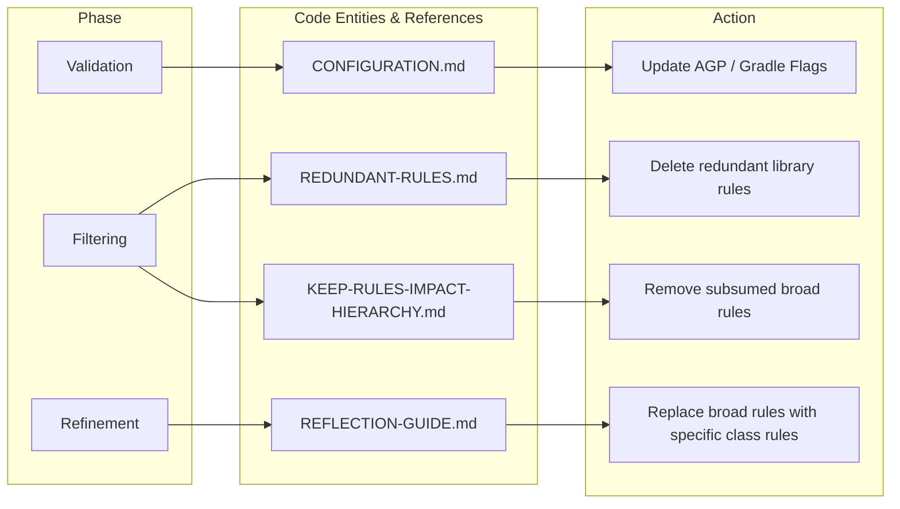

<!-- source: DeepWiki mcp.deepwiki.com · repo android/skills · page 5.1 R8 Analyzer Skill · fetched 2026-10-23 -->

# R8 Analyzer Skill

Relevant source files

The following files were used as context for generating this wiki page:

- [performance/r8-analyzer/SKILL.md](performance/r8-analyzer/SKILL.md)
- [performance/r8-analyzer/references/CONFIGURATION.md](performance/r8-analyzer/references/CONFIGURATION.md)
- [performance/r8-analyzer/references/android/topic/performance/app-optimization/enable-app-optimization.md](performance/r8-analyzer/references/android/topic/performance/app-optimization/enable-app-optimization.md)

The **R8 Analyzer Skill** is a specialized diagnostic tool designed to optimize Android application size and performance by auditing R8/ProGuard configurations. It identifies redundant rules, overly broad package-level keep rules, and opportunities for narrowing reflection-based rules to ensure maximum code shrinking and obfuscation efficiency.

[performance/r8-analyzer/SKILL.md:2-6]()

## Analysis Pipeline

The skill follows an 8-phase pipeline to transition from environment validation to actionable reporting.

### 1. Environment & Configuration Validation
The analyzer first inspects the build environment to ensure R8 is configured for maximum utilization. This involves checking `build.gradle`, `build.gradle.kts`, and `gradle.properties`.

*   **Minification Check**: Verifies `isMinifyEnabled` and `isShrinkResources` are `true` in the `release` build type. [performance/r8-analyzer/references/CONFIGURATION.md:6-22]()
*   **ProGuard File Selection**: Ensures the project uses `proguard-android-optimize.txt` instead of the non-optimized variant. [performance/r8-analyzer/references/CONFIGURATION.md:8-9]()
*   **AGP Versioning**: 
    *   If AGP < 9.0, it suggests an upgrade to leverage built-in optimizations. [performance/r8-analyzer/SKILL.md:22-22]()
    *   If 8.6 < AGP < 9.0, it checks for `android.r8.optimizedResourceShrinking=true`. [performance/r8-analyzer/references/CONFIGURATION.md:41-44]()
*   **Full Mode**: Confirms `android.enableR8.fullMode=false` is not present for AGP 8.0+. [performance/r8-analyzer/references/CONFIGURATION.md:38-39]()

### 2. Redundancy & Impact Assessment
The analyzer evaluates existing `.pro` files against a library-specific catalog and an impact hierarchy.

*   **Library Filtering**: Rules targeting common libraries (AndroidX, Kotlin, Retrofit, etc.) are flagged for removal because these libraries provide their own consumer keep rules. [performance/r8-analyzer/SKILL.md:23-23]()
*   **Impact Hierarchy**: Remaining rules are categorized by their "breadth" (e.g., keeping an entire package vs. a single class). [performance/r8-analyzer/SKILL.md:23-23]()

### 3. Subsumption & Reflection Analysis
*   **Subsumption**: Identifies "broader" rules that render "narrower" rules redundant (e.g., a `-keep class com.example.**` subsumes `-keep class com.example.MyClass`). [performance/r8-analyzer/SKILL.md:24-24]()
*   **Reflection Deep-Dive**: For rules that cannot be removed, the analyzer examines adjacent code for `java.lang.reflect` or `Class.forName()` usage to suggest the narrowest possible rule. [performance/r8-analyzer/SKILL.md:25-25]()

### 4. Reporting & Validation
The final output is a structured report (`R8_Configuration_Analysis.md`) containing concise actions (Remove vs. Refine) ordered by their impact on the codebase. [performance/r8-analyzer/SKILL.md:20-29]()

**Sources:**
* [performance/r8-analyzer/SKILL.md:18-31]()
* [performance/r8-analyzer/references/CONFIGURATION.md:1-44]()
* [performance/r8-analyzer/references/android/topic/performance/app-optimization/enable-app-optimization.md:104-131]()

---

## Data Flow: From Natural Language to Code Entities

The following diagrams illustrate how the high-level optimization goals map to specific code entities and build configurations.

### Configuration Logic Mapping
This diagram bridges the developer's intent to optimize with the specific Gradle properties and DSL elements targeted by the skill.

**Sources:**
* [performance/r8-analyzer/references/CONFIGURATION.md:11-44]()
* [performance/r8-analyzer/references/android/topic/performance/app-optimization/enable-app-optimization.md:58-80]()

### Keep Rule Analysis Workflow
This diagram maps the analysis phases to the internal reference documents used to evaluate code.

**Sources:**
* [performance/r8-analyzer/SKILL.md:20-29]()
* [performance/r8-analyzer/references/CONFIGURATION.md:1-4]()

---

## Technical Implementation Details

### AGP Version Checks
The analyzer applies different logic based on the detected Android Gradle Plugin version:

| AGP Version | Recommendation | Required Configuration |
| :--- | :--- | :--- |
| **< 8.0** | Upgrade to 9.0 | `android.enableR8.fullMode=true` |
| **8.0 - 8.6** | Upgrade to 9.0 | Full Mode enabled by default |
| **8.6 - 8.12** | Upgrade to 9.0 | `android.r8.optimizedResourceShrinking=true` |
| **>= 9.0** | None (Optimal) | No extra flags needed for resource shrinking |

**Sources:**
* [performance/r8-analyzer/SKILL.md:22-22]()
* [performance/r8-analyzer/references/CONFIGURATION.md:34-44]()
* [performance/r8-analyzer/references/android/topic/performance/app-optimization/enable-app-optimization.md:120-131]()

### UI Automator Validation
After suggesting changes to keep rules, the skill mandates a validation step using **UI Automator**. This is critical because R8 optimizations (like obfuscation and class merging) can break code that relies on implicit reflection or JNI transitions that aren't captured in static keep rules.

The developer is advised to:
1.  Identify packages affected by keep rule changes. [performance/r8-analyzer/SKILL.md:30-31]()
2.  Run UI Automator tests targeting those specific functional areas to detect `ClassNotFoundException` or `NoSuchMethodError` at runtime. [performance/r8-analyzer/SKILL.md:30-31]()

### Mandatory Constraints
To maintain the integrity of the codebase and the report, the skill follows these rules:
*   **No Direct Modification**: The analyzer never edits `.pro` files directly; it only provides instructions. [performance/r8-analyzer/SKILL.md:35-35]()
*   **Silence on Success**: If a specific category (e.g., redundant library rules) has no issues, that section is omitted from the report. [performance/r8-analyzer/SKILL.md:37-37]()
*   **No Internal Metadata**: The report must not mention the skill's internal files or exceptions. [performance/r8-analyzer/SKILL.md:38-41]()

**Sources:**
* [performance/r8-analyzer/SKILL.md:33-41]()

---

