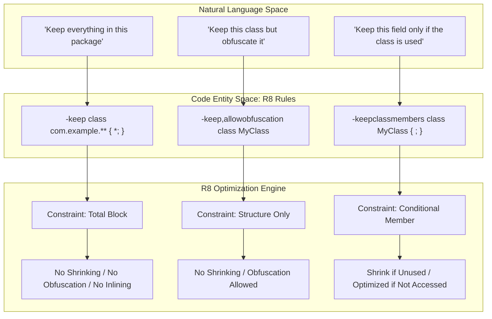
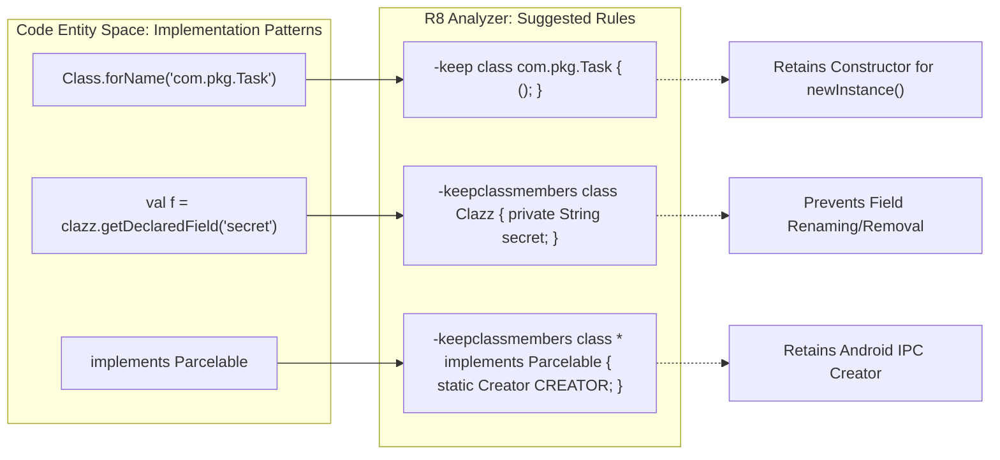

<!-- source: DeepWiki mcp.deepwiki.com · repo android/skills · page 5.2 R8 Analyzer Reference Materials · fetched 2026-10-23 -->

# R8 Analyzer Reference Materials

Relevant source files

The following files were used as context for generating this wiki page:

- [performance/r8-analyzer/references/KEEP-RULES-IMPACT-HIERARCHY.md](performance/r8-analyzer/references/KEEP-RULES-IMPACT-HIERARCHY.md)
- [performance/r8-analyzer/references/REDUNDANT-RULES.md](performance/r8-analyzer/references/REDUNDANT-RULES.md)
- [performance/r8-analyzer/references/REFLECTION-GUIDE.md](performance/r8-analyzer/references/REFLECTION-GUIDE.md)

This page provides deep-dive reference materials for the R8 Analyzer skill. It covers the technical hierarchy of keep rule impacts, a catalog of redundant rules for common Android libraries, and a reflection guide for narrowing broad rules into optimization-friendly configurations.

## Keep Rules Impact Hierarchy

Keep rules are not equal in their impact on R8's ability to optimize code. The hierarchy below ranks rules from the most restrictive (worst for optimization) to the most granular (best for optimization).

### Impact Levels and Optimization Constraints

| Level | Rule Type | Optimization Impact | Recommended Action |
| :--- | :--- | :--- | :--- |
| 1 | Package-Wide Wildcards | Prevents all optimization in package and subpackages. | Refine to specific classes. |
| 2 | Inversion Operator (`!`) | Can unintentionally keep the entire app except one class. | Remove and use narrow rules. |
| 3 | Full Class & Members | Retains class and all members exactly as defined. | Use `-keepclassmembers` if possible. |
| 4 | Member Wildcards | Retains all members but may allow class shrinking. | Specify only required members. |
| 5 | Modifiers (Shrinking/Obfuscation) | Allows specific optimizations while keeping structure. | Use `allowobfuscation`, `allowshrinking`. |
| 6 | Specific Method | Keeps only the named method and the class. | Ideal for single entry points. |
| 7 | Class-Name Only | Only the name is kept; unused members are removed. | Best for simple reflection. |
| 8 | Conditional Rules | Triggers only if other members exist. | Most narrow and friendly to R8. |

### Rule Structure Data Flow

The following diagram illustrates how different keep rule specifications restrict the R8 optimization engine.

**Diagram: R8 Optimization Constraint Flow**

**Sources:**
- [performance/r8-analyzer/references/KEEP-RULES-IMPACT-HIERARCHY.md:4-13]()
- [performance/r8-analyzer/references/KEEP-RULES-IMPACT-HIERARCHY.md:18-29]()
- [performance/r8-analyzer/references/KEEP-RULES-IMPACT-HIERARCHY.md:48-54]()
- [performance/r8-analyzer/references/KEEP-RULES-IMPACT-HIERARCHY.md:77-83]()

---

## Redundant Rules Catalog

Modern Android development relies on "Consumer Keep Rules" bundled within AAR/JAR files. Manual rules for these libraries often conflict with or broaden the optimized rules provided by library authors.

### Common Redundancies by Library

| Library / Component | Redundant Rule Pattern | Reason for Redundancy |
| :--- | :--- | :--- |
| **Android Components** | `-keep class * extends android.app.Activity` | AAPT2 automatically generates rules from `AndroidManifest.xml`. |
| **AndroidX / Kotlin** | `-keep class androidx.** { *; }` | Official libraries bundle their own specific consumer rules. |
| **Gson** | `-keep class com.google.gson.internal.**` | Gson 2.11.0+ bundles rules; `@SerializedName` handles field retention. |
| **Retrofit** | `-keep class retrofit2.** { *; }` | Retrofit 2.9.0+ detects HTTP annotations (`@GET`, etc.) automatically. |
| **Coroutines** | `-keep class kotlinx.coroutines.**` | `kotlinx-coroutines-core` includes internal rules for continuations. |

### Global Optimization Kill-Switches
The following rules should be removed immediately as they disable R8 entirely:
- `-dontshrink` [performance/r8-analyzer/references/REDUNDANT-RULES.md:12-12]()
- `-dontobfuscate` [performance/r8-analyzer/references/REDUNDANT-RULES.md:13-13]()
- `-dontoptimize` [performance/r8-analyzer/references/REDUNDANT-RULES.md:14-14]()

**Sources:**
- [performance/r8-analyzer/references/REDUNDANT-RULES.md:21-36]()
- [performance/r8-analyzer/references/REDUNDANT-RULES.md:39-52]()
- [performance/r8-analyzer/references/REDUNDANT-RULES.md:56-107]()
- [performance/r8-analyzer/references/REDUNDANT-RULES.md:110-145]()
- [performance/r8-analyzer/references/REDUNDANT-RULES.md:149-180]()

---

## Reflection & Dynamic Loading Guide

When R8 cannot statically determine that a class or member is used (e.g., via reflection), a keep rule is required. The goal is to match the code pattern to the narrowest possible rule.

### Pattern Mapping: Code to Keep Rule

**Diagram: Reflection Pattern to Rule Mapping**

### Specific Reflection Scenarios

1.  **Classes Loaded by Name:** When using `Class.forName()`, the keep rule must include the parameterless constructor `();` to allow `newInstance()` calls. [performance/r8-analyzer/references/REFLECTION-GUIDE.md:4-21]()
2.  **Annotation-Based Reflection:** Instead of keeping all methods, keep only those annotated with a specific marker.
    - Rule: `-keepclassmembers class * { @com.example.MyAnnotation *; }` [performance/r8-analyzer/references/REFLECTION-GUIDE.md:54-60]()
3.  **Optional Dependencies:** If your code uses `try-catch` around `Class.forName()` to check for optional modules, you must `-keep` that class to prevent R8 from removing it during the build of the optional module itself. [performance/r8-analyzer/references/REFLECTION-GUIDE.md:62-80]()
4.  **Private Member Access:** When using `getDeclaredField` followed by `isAccessible = true`, the specific field name and type must be preserved. [performance/r8-analyzer/references/REFLECTION-GUIDE.md:81-100]()

**Sources:**
- [performance/r8-analyzer/references/REFLECTION-GUIDE.md:4-21]()
- [performance/r8-analyzer/references/REFLECTION-GUIDE.md:42-60]()
- [performance/r8-analyzer/references/REFLECTION-GUIDE.md:81-100]()
- [performance/r8-analyzer/references/REFLECTION-GUIDE.md:102-121]()

---

