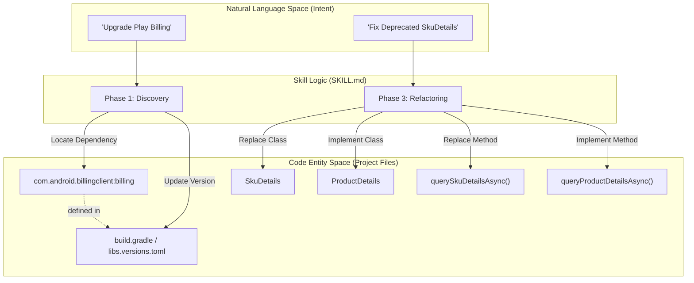
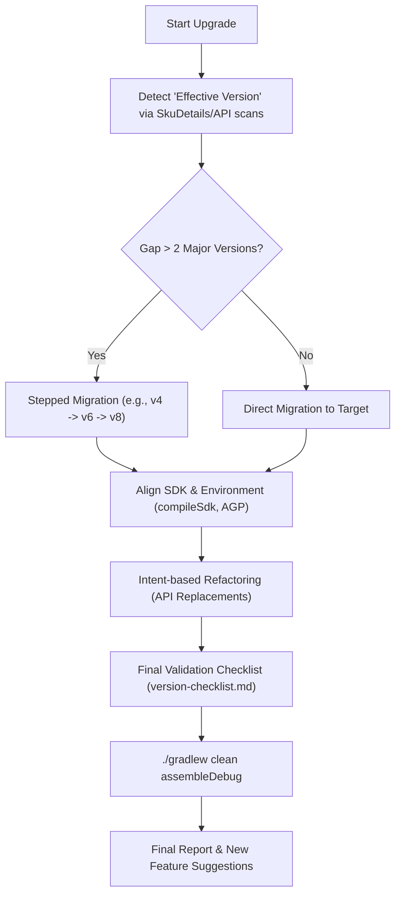

<!-- source: DeepWiki mcp.deepwiki.com · repo android/skills · page 6 Play Billing Skills · fetched 2026-10-23 -->

# Play Billing Skills

Relevant source files

The following files were used as context for generating this wiki page:

- [play/play-billing-library-version-upgrade/SKILL.md](play/play-billing-library-version-upgrade/SKILL.md)

The **Play Billing Skills** domain provides a structured methodology for upgrading the Google Play Billing Library (PBL) in Android applications. This skill ensures that migrations from legacy versions to the latest stable release are handled with situational awareness, accounting for both explicit version declarations and "Effective Versions" indicated by deprecated API usage.

## Purpose and Scope

The primary objective of the Play Billing skills is to automate and standardize the migration of billing logic, which is often sensitive and prone to breaking changes. The skill covers:
*   **Discovery**: Identifying the baseline version through dependency analysis and source code scanning [play/play-billing-library-version-upgrade/SKILL.md:25-35]().
*   **Path Calculation**: Determining whether a **Direct Migration** or a **Stepped Migration** is required based on the version gap [play/play-billing-library-version-upgrade/SKILL.md:37-41]().
*   **Environment Alignment**: Ensuring `compileSdk`, Android Gradle Plugin (AGP), and Kotlin versions meet the requirements of the target PBL version [play/play-billing-library-version-upgrade/SKILL.md:59-63]().
*   **Refactoring**: Replacing deprecated classes and methods (e.g., transitioning from `SkuDetails` to `ProductDetails`) [play/play-billing-library-version-upgrade/SKILL.md:64-71]().

### From Natural Language Intent to Code Entities

The following diagram illustrates how the migration skill bridges high-level developer intents to specific code entities and files within the Android project.

**Play Billing Migration Mapping**

Sources: [play/play-billing-library-version-upgrade/SKILL.md:27-34](), [play/play-billing-library-version-upgrade/SKILL.md:64-71]()

## Skill Components

The Play Billing upgrade process is divided into two primary areas: the execution logic and the reference data.

### Play Billing Library Version Upgrade Skill
This skill defines the operational phases of the upgrade. It prioritizes "Effective Version" detection—where the agent scans for deprecated artifacts like `SkuDetails` to determine the actual baseline, regardless of what the `build.gradle` file claims [play/play-billing-library-version-upgrade/SKILL.md:29-34](). It also enforces a **Stepped Migration** strategy if the project is more than two major versions behind the target [play/play-billing-library-version-upgrade/SKILL.md:39-41]().

For details, see [Play Billing Library Version Upgrade Skill](#6.1).

### Play Billing Migration Reference Materials
The reference materials provide the technical mapping required for the refactoring phase. This includes logic for replacing legacy APIs with their modern counterparts and a version-specific checklist to ensure no breaking changes are missed during the final validation [play/play-billing-library-version-upgrade/SKILL.md:80-84]().

For details, see [Play Billing Migration Reference Materials](#6.2).

## Migration Workflow Overview

The following diagram depicts the system flow from initial detection to the final build validation.

**PBL Upgrade Workflow**

Sources: [play/play-billing-library-version-upgrade/SKILL.md:37-41](), [play/play-billing-library-version-upgrade/SKILL.md:59-63](), [play/play-billing-library-version-upgrade/SKILL.md:78-85]()

| Phase | Key Activity | File/Logic Reference |
| :--- | :--- | :--- |
| **Discovery** | Scan `build.gradle` and source for `SkuDetails` | [SKILL.md:27-34]() |
| **Alignment** | Update `compileSdk` and Kotlin versions | [SKILL.md:59-63]() |
| **Refactoring** | Apply API replacements (e.g., `queryProductDetailsAsync`) | [SKILL.md:64-71]() |
| **Validation** | Run `assembleDebug` and `test` tasks | [SKILL.md:83-84]() |

Sources: [play/play-billing-library-version-upgrade/SKILL.md:27-84]()

---

