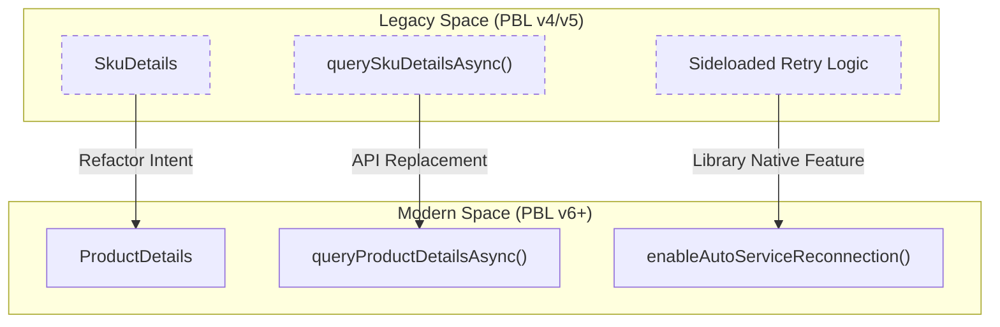
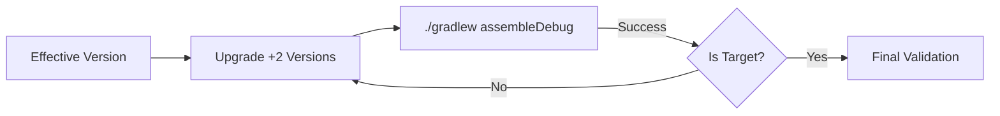

<!-- source: DeepWiki mcp.deepwiki.com · repo android/skills · page 6.1 Play Billing Library Version Upgrade Skill · fetched 2026-10-23 -->

# Play Billing Library Version Upgrade Skill

Relevant source files

The following files were used as context for generating this wiki page:

- [play/play-billing-library-version-upgrade/SKILL.md](play/play-billing-library-version-upgrade/SKILL.md)
- [play/play-billing-library-version-upgrade/references/android/google/play/billing/release-notes.md](play/play-billing-library-version-upgrade/references/android/google/play/billing/release-notes.md)

The **Play Billing Library (PBL) Version Upgrade Skill** is designed to automate and guide the migration of Android projects from legacy Google Play Billing versions to the latest stable release. It focuses on maintaining functional parity while adopting modern API patterns, ensuring environment alignment (SDK/AGP), and validating the migration through a structured, multi-phase process.

## Phase 1: Discovery & Situational Awareness

The upgrade process begins by determining the "Effective Version" of the library currently in use. This is critical because the version declared in build files may not reflect the actual API patterns used in the source code.

### Version Detection Logic
1.  **Primary Check**: The system searches for `com.android.billingclient:billing` within `build.gradle`, `build.gradle.kts`, or `libs.versions.toml` [play/play-billing-library-version-upgrade/SKILL.md:27-27]().
2.  **Effective Version Fallback**: If a build fails or discrepancies exist, the system scans for deprecated artifacts. For example, the presence of `SkuDetails` indicates an **Effective Version** of PBL v7 or earlier, regardless of the version string [play/play-billing-library-version-upgrade/SKILL.md:30-34]().

### Migration Path Calculation
The skill determines the safest path to the target version based on the distance between the current and target major versions.

| Distance | Path Type | Description |
| :--- | :--- | :--- |
| $\le$ 2 Major Versions | **Direct** | Upgrade directly to the target version [play/play-billing-library-version-upgrade/SKILL.md:38-38](). |
| > 2 Major Versions | **Stepped** | Upgrade in increments of two major versions (e.g., v4 $\to$ v6 $\to$ v8) [play/play-billing-library-version-upgrade/SKILL.md:39-40](). |

**Sources:**
- [play/play-billing-library-version-upgrade/SKILL.md:25-42]()

## Phase 2: Implementation & Refactoring

The migration involves aligning the development environment and refactoring code based on the intent of the original implementation rather than simple string replacement.

### Environment Alignment
Before code changes, the environment must meet the requirements of the target PBL version. For example, PBL 8 requires `compileSdk 35` [play/play-billing-library-version-upgrade/SKILL.md:61-61](). The skill also verifies compatibility with the Android Gradle Plugin (AGP) and Kotlin versions [play/play-billing-library-version-upgrade/SKILL.md:62-62]().

### Intent-Based Refactoring Flow
The diagram below illustrates how the skill maps legacy code entities to modern equivalents.

**PBL Migration Mapping**

**Sources:**
- [play/play-billing-library-version-upgrade/SKILL.md:59-71]()
- [play/play-billing-library-version-upgrade/SKILL.md:91-91]()

## Phase 3: Verification & Validation

Validation is performed sequentially for stepped migrations and concludes with a final comprehensive checklist.

### Stepped Migration Workflow
For stepped migrations, the system performs an intermediate build at every two-version jump to ensure stability.

**Sequential Verification Process**

### Final Validation Checklist
The skill utilizes a version-specific checklist to ensure no deprecated patterns remain:
1.  **Structural Analysis**: Uses "Find in Files" to ensure all items in `references/version-checklist.md` are addressed [play/play-billing-library-version-upgrade/SKILL.md:81-82]().
2.  **Unit Testing**: Execution of `./gradlew test` [play/play-billing-library-version-upgrade/SKILL.md:83-83]().
3.  **Clean Build**: Final verification via `./gradlew clean assembleDebug` and `./gradlew build` [play/play-billing-library-version-upgrade/SKILL.md:84-84]().

**Sources:**
- [play/play-billing-library-version-upgrade/SKILL.md:72-85]()

## Release Highlights (PBL 8.x)

Recent updates integrated into this skill include support for external payments and link-based offers.

| Version | Key Feature / API Change |
| :--- | :--- |
| **8.3.0** | Added `BillingProgram.EXTERNAL_PAYMENTS` and `enableBillingProgram` for external flows [play/play-billing-library-version-upgrade/references/android/google/play/billing/release-notes.md:9-17](). |
| **8.2.0** | Introduced `launchExternalLink` and deprecated `enableExternalOffer` [play/play-billing-library-version-upgrade/references/android/google/play/billing/release-notes.md:35-44](). |
| **8.1.0** | Added `isSuspended()` to `Purchase` object and `setSubscriptionProductReplacementParams()` [play/play-billing-library-version-upgrade/references/android/google/play/billing/release-notes.md:55-74](). |

**Sources:**
- [play/play-billing-library-version-upgrade/references/android/google/play/billing/release-notes.md:3-80]()

---

