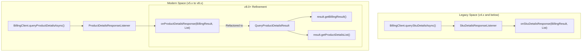
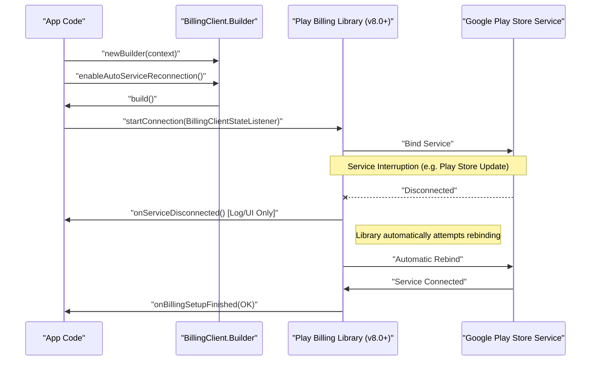

<!-- source: DeepWiki mcp.deepwiki.com · repo android/skills · page 6.2 Play Billing Migration Reference Materials · fetched 2026-10-23 -->

# Play Billing Migration Reference Materials

Relevant source files

The following files were used as context for generating this wiki page:

- [play/play-billing-library-version-upgrade/references/android/google/play/billing/release-notes.md](play/play-billing-library-version-upgrade/references/android/google/play/billing/release-notes.md)
- [play/play-billing-library-version-upgrade/references/migration-logic.md](play/play-billing-library-version-upgrade/references/migration-logic.md)
- [play/play-billing-library-version-upgrade/references/version-checklist.md](play/play-billing-library-version-upgrade/references/version-checklist.md)

This page provides technical reference materials for migrating the Google Play Billing Library (PBL) across major versions. It details the architectural shifts from legacy `SkuDetails` to modern `ProductDetails`, the transition to library-managed connections, and version-specific validation checklists.

## 1. Architectural Evolution: SkuDetails to ProductDetails

The most significant change in the Play Billing Library (starting with v5.0 and refined through v8.0) is the shift from a 1:1 SKU model to a "One Product, Multiple Offers" model.

### Data Model Mapping
In legacy versions, an ID mapped directly to a single price. In modern versions, a single `ProductDetails` object acts as a container for various pricing structures.

| Legacy Entity (`SkuDetails`) | Modern Entity (`ProductDetails`) | Description |
|:---|:---|:---|
| `getSku()` | `getProductId()` | The unique identifier for the product. |
| `getType()` | `getProductType()` | `INAPP` (one-time) or `SUBS` (subscription). |
| `getPrice()` | `SubscriptionOfferDetails` | For subscriptions, pricing is nested within base plans and offers. |
| `getFreeTrialPeriod()` | `PricingPhase` | Trials are now part of a list of pricing phases. |

### Querying Logic Comparison
The method for retrieving product information has shifted from returning a simple list to a result wrapper that includes a `BillingResult`.

**Legacy (v4 and below):**
Calls `querySkuDetailsAsync` and receives a `List<SkuDetails>`.

**Modern (v5 through v8):**
Calls `queryProductDetailsAsync`. In v8.0+, the callback signature requires a `QueryProductDetailsResult` object [play/play-billing-library-version-upgrade/references/migration-logic.md:21-29]().

### Product Query Data Flow
The following diagram illustrates the transition from the legacy query flow to the modern asynchronous result wrapper.

**Title: Billing Product Query Flow Transition**

**Sources:** [play/play-billing-library-version-upgrade/references/migration-logic.md:12-29](), [play/play-billing-library-version-upgrade/references/version-checklist.md:21-21](), [play/play-billing-library-version-upgrade/references/version-checklist.md:39-39]()

---

## 2. Connection Management (v8.0+ Reconnection Shift)

PBL 8.0 introduced a major shift in how the library handles service disconnections. Developers should no longer manually manage retry logic in `onServiceDisconnected`.

*   **Legacy Intent**: Developer-managed state with manual `startConnection()` calls or timers [play/play-billing-library-version-upgrade/references/migration-logic.md:5-6]().
*   **Modern Intent**: Library-managed state using `.enableAutoServiceReconnection()` in the `BillingClient.Builder` [play/play-billing-library-version-upgrade/references/migration-logic.md:9-10]().

**Title: Connection Lifecycle Management**

**Sources:** [play/play-billing-library-version-upgrade/references/migration-logic.md:3-10](), [play/play-billing-library-version-upgrade/references/version-checklist.md:40-40]()

---

## 3. Subscription Modernization (v6.0 - v8.0)

Subscription handling has moved away from standalone SKUs toward complex "Base Plans" and "Offers."

### Key API Replacements
*   **Proration to Replacement**: `ProrationMode` (legacy) is replaced by `ReplacementMode` (modern) within `SubscriptionUpdateParams` [play/play-billing-library-version-upgrade/references/migration-logic.md:38-39]().
*   **Purchase Tokens**: When upgrading/downgrading, use `setOldPurchaseToken()` instead of the deprecated `setOldSkuPurchaseToken()` [play/play-billing-library-version-upgrade/references/version-checklist.md:33-33]().
*   **Installment Plans**: v7.0+ introduces `InstallmentPlanDetails` within `SubscriptionOfferDetails`. Apps supporting high-ticket items should check for these details to render installment UI [play/play-billing-library-version-upgrade/references/migration-logic.md:40-44]().

### Security and Pending Transactions
As of v8.0, the `enablePendingPurchases()` call is mandatory and must be configured with specific parameters:
1.  **Required**: `.enableOneTimeProducts()` must be called on the `PendingPurchaseParams` builder [play/play-billing-library-version-upgrade/references/migration-logic.md:59-60]().
2.  **Optional**: `.enablePrepaidPlans()` is required if the app supports top-up subscriptions [play/play-billing-library-version-upgrade/references/migration-logic.md:60-61]().

---

## 4. Version-Specific Validation Checklist

This checklist summarizes the critical technical requirements for each major version jump.

| Target Version | Key Requirements | File Reference |
|:---|:---|:---|
| **v2.0** | Call `acknowledgePurchase()` or `consumeAsync()` within 3 days. | [version-checklist.md:9]() |
| **v4.0** | Replace synchronous `queryPurchases()` with `queryPurchasesAsync()`. | [version-checklist.md:15]() |
| **v5.0** | Full swap from `SkuDetails` to `ProductDetails`. | [version-checklist.md:21]() |
| **v6.0** | Use `ReplacementMode` instead of `ProrationMode`. | [version-checklist.md:26]() |
| **v7.0** | Set `compileSdk` to 34+; use `enablePendingPurchases(PendingPurchaseParams)`. | [version-checklist.md:31-32]() |
| **v8.0** | Set `compileSdk` to 35; use `enableAutoServiceReconnection()`; `minSdkVersion` 23+. | [version-checklist.md:37-41]() |

**Sources:** [play/play-billing-library-version-upgrade/references/version-checklist.md:1-42]()

---

## 5. SDK & Environment Requirements

Migration to newer PBL versions requires corresponding updates to the Android build environment:

*   **PBL 7.0**: Requires `compileSdk 34` or higher [play/play-billing-library-version-upgrade/references/migration-logic.md:65]().
*   **PBL 8.0**: Requires `compileSdk 35` and `minSdkVersion 23` [play/play-billing-library-version-upgrade/references/migration-logic.md:66](), [play/play-billing-library-version-upgrade/references/version-checklist.md:41]().
*   **Kotlin**: Update `kotlin-stdlib` to at least `1.9.x` to support new library coroutine extensions [play/play-billing-library-version-upgrade/references/migration-logic.md:67]().

**Sources:** [play/play-billing-library-version-upgrade/references/migration-logic.md:64-68](), [play/play-billing-library-version-upgrade/references/version-checklist.md:37-41]()

---

