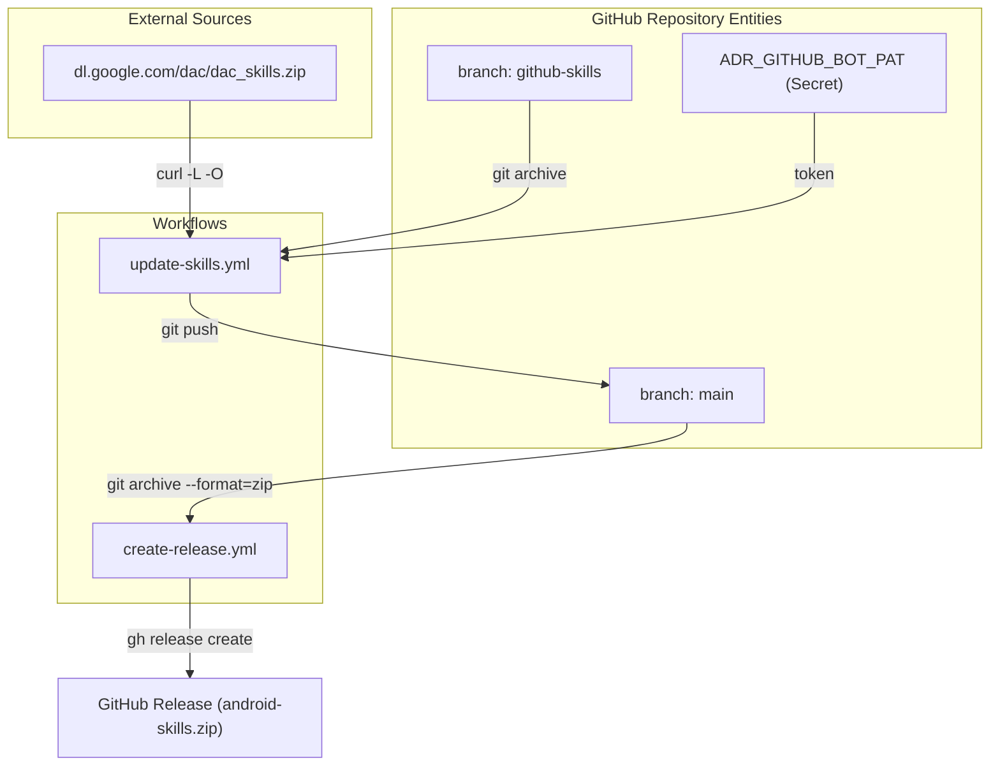

<!-- source: DeepWiki mcp.deepwiki.com · repo android/skills · page 7 Repository Automation & CI/CD · fetched 2026-10-23 -->

# Repository Automation & CI/CD

Relevant source files

The following files were used as context for generating this wiki page:

- [.github/workflows/create-release.yml](.github/workflows/create-release.yml)
- [.github/workflows/update-skills.yml](.github/workflows/update-skills.yml)

This section provides an overview of the automated processes that manage the lifecycle of the Android Skills repository. The repository utilizes GitHub Actions to maintain parity between internal Google skill sources and the public GitHub presence, as well as to facilitate the distribution of skill assets through formal releases.

## Automation Strategy

The repository automation is centered around two primary objectives:
1.  **Synchronization**: Ensuring the `main` branch reflects the latest validated skills from both the `github-skills` branch and external Google distribution points.
2.  **Distribution**: Providing a stable, packaged version of the skill catalog for consumption by AI agents and developers.

### Workflow Orchestration

The following diagram illustrates how the GitHub Actions workflows interact with the repository branches and external sources to maintain the skill catalog.

**CI/CD Data Flow & Entity Mapping**

**Sources:**
- [.github/workflows/update-skills.yml:1-70]()
- [.github/workflows/create-release.yml:1-32]()

---

## Update Skills Workflow

The `Update Skills` workflow is the primary synchronization mechanism for the repository. It is designed to aggregate skills from multiple sources, reconcile them, and update the `main` branch with a timestamped commit.

Key responsibilities include:
*   **Workspace Sanitization**: Removing existing non-hidden directories to prevent stale files from persisting after a source update [.github/workflows/update-skills.yml:22-25]().
*   **Ingestion**: Fetching `dac_skills.zip` from Google's download servers and extracting the contents [.github/workflows/update-skills.yml:27-36]().
*   **Branch Merging**: Using `git archive` to overlay content from the `github-skills` branch onto the workspace without polluting the git index [.github/workflows/update-skills.yml:38-60]().
*   **Automated Commits**: Pushing updates back to `main` using the `android-devrel-github-bot` identity [.github/workflows/update-skills.yml:62-69]().

For details, see [Update Skills Workflow](#7.1).

**Sources:**
- [.github/workflows/update-skills.yml:22-25]()
- [.github/workflows/update-skills.yml:27-36]()
- [.github/workflows/update-skills.yml:38-60]()
- [.github/workflows/update-skills.yml:62-69]()

---

## Create Release Workflow

The `Create Release` workflow manages the manual packaging and publication of the skill catalog. This workflow is triggered via `workflow_dispatch`, allowing maintainers to specify a version tag.

The workflow performs the following steps:
1.  **Archiving**: It executes `git archive` to package the current state of the `main` branch into a file named `android-skills.zip` [.github/workflows/create-release.yml:23-25]().
2.  **Publication**: It utilizes the GitHub CLI (`gh`) to create a new release on GitHub, attaching the zip archive and applying the user-provided `tag_name` [.github/workflows/create-release.yml:27-31]().

For details, see [Create Release Workflow](#7.2).

**Sources:**
- [.github/workflows/create-release.yml:4-10]()
- [.github/workflows/create-release.yml:23-25]()
- [.github/workflows/create-release.yml:27-31]()

---

## Workflow Comparison

| Feature | Update Skills | Create Release |
| :--- | :--- | :--- |
| **Trigger** | Manual (`workflow_dispatch`) | Manual (`workflow_dispatch`) |
| **Primary Input** | `github-skills` branch & `dl.google.com` | `tag_name` (string) |
| **Target** | `main` branch | GitHub Releases |
| **Identity** | `ADR_GITHUB_BOT_PAT` | `GITHUB_TOKEN` |
| **Key Command** | `git push origin main` | `gh release create` |

**Sources:**
- [.github/workflows/update-skills.yml:4-20]()
- [.github/workflows/create-release.yml:4-31]()

---

