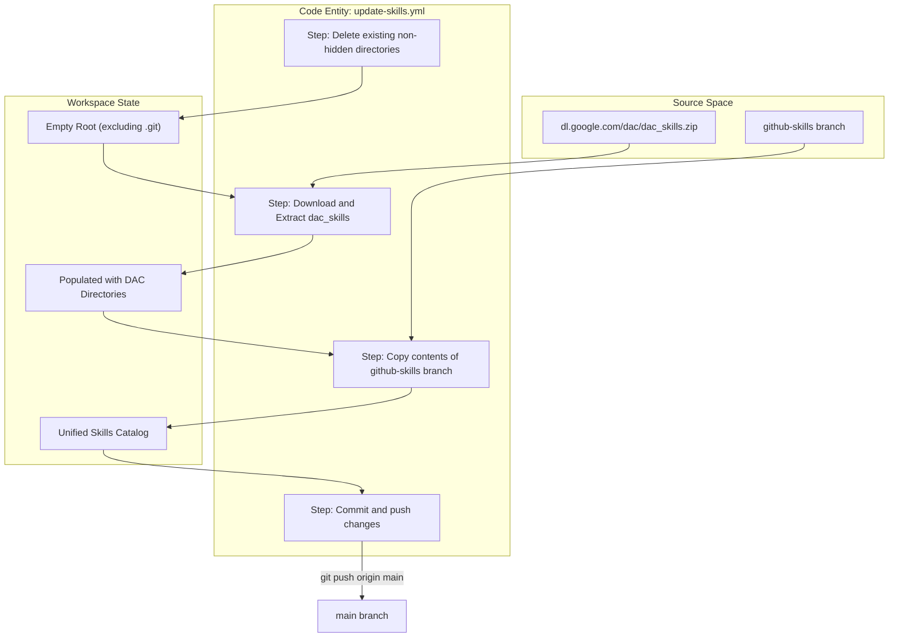
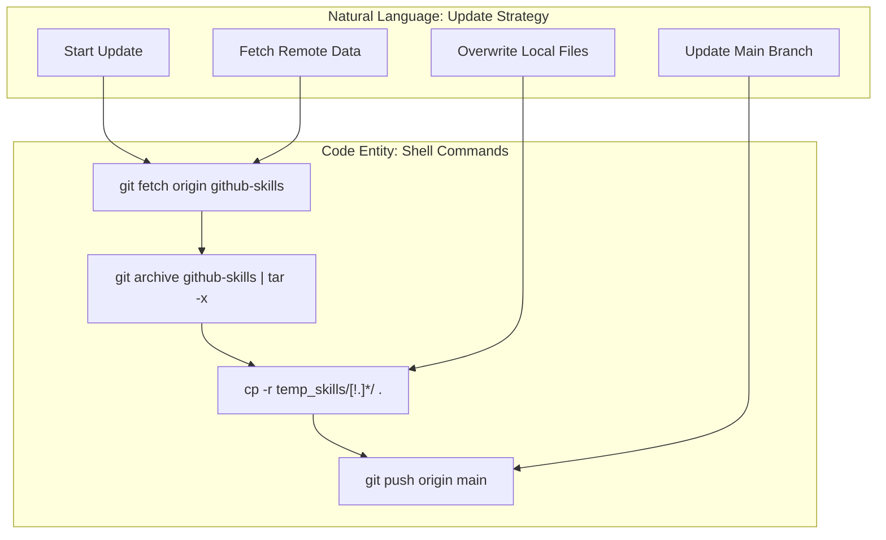

<!-- source: DeepWiki mcp.deepwiki.com · repo android/skills · page 7.1 Update Skills Workflow · fetched 2026-10-23 -->

# Update Skills Workflow

Relevant source files

The following files were used as context for generating this wiki page:

- [.github/workflows/update-skills.yml](.github/workflows/update-skills.yml)

The `Update Skills` workflow is the primary synchronization mechanism for the Android Skills repository. It automates the ingestion of skill data from external sources—specifically Google's internal Developer Android Center (DAC) and a specialized GitHub branch—to ensure the `main` branch remains the source of truth for AI-ready skill definitions.

### Workflow Purpose and Triggers

The workflow is defined in [.github/workflows/update-skills.yml:1-70](). It is designed to reconcile data from multiple origins into a single unified directory structure.

*   **Manual Trigger**: The workflow uses `workflow_dispatch`, allowing maintainers to trigger an update at any time via the GitHub Actions UI [.github/workflows/update-skills.yml:4]().
*   **Scheduled Trigger**: Although currently commented out, the infrastructure exists to run the update hourly via a cron job [.github/workflows/update-skills.yml:5-7]().
*   **Authentication**: It utilizes the `ADR_GITHUB_BOT_PAT` secret to perform administrative actions, such as pushing to the protected `main` branch [.github/workflows/update-skills.yml:20]().

---

### Data Flow and Workspace Preparation

The workflow follows a "clean slate" philosophy to ensure that no stale or deprecated skills persist in the repository if they have been removed from the source.

#### 1. Workspace Cleanup
After checking out the `main` branch, the runner executes a `find` command to delete all existing non-hidden directories in the root [.github/workflows/update-skills.yml:22-25](). This ensures that the final state of the repository exactly matches the union of the two ingestion sources.

#### 2. DAC Skills Ingestion
The first data source is a zip archive hosted on Google's infrastructure.
*   **Source**: `https://dl.google.com/dac/dac_skills.zip` [.github/workflows/update-skills.yml:29]().
*   **Process**: The workflow downloads the zip, extracts it to a `temp_extract` folder, and copies all top-level directories into the repository root [.github/workflows/update-skills.yml:30-35]().

#### 3. GitHub-Skills Branch Ingestion
The second source is the `github-skills` branch within the same repository. This branch is used for skills that are authored or maintained directly on GitHub rather than via internal Google systems.
*   **Process**: The workflow fetches the `github-skills` branch and uses `git archive` to export its contents into a `temp_skills` directory [.github/workflows/update-skills.yml:40-47]().
*   **Reconciliation**: The contents are then moved to the root, potentially overwriting directories of the same name from the DAC source, allowing GitHub-native content to take precedence or augment the catalog [.github/workflows/update-skills.yml:51-53]().

### Technical Implementation Diagram

The following diagram illustrates the transformation of the repository from a clean state to a populated state through the `update-skills` job.

**Update Skills Ingestion Pipeline**

**Sources:**
- [.github/workflows/update-skills.yml:13-70]()

---

### Reconciliation and Commit Logic

The workflow uses a specific bot identity to maintain a clean audit log of automated updates.

| Configuration Item | Value |
| :--- | :--- |
| **Bot Username** | `android-devrel-github-bot` |
| **Bot Email** | `android-devrel-github-bot@users.noreply.github.com` |
| **Commit Message** | `Updates skills (YYYY-MM-DD HH:MM)` |

The commit step uses `git add -A` to capture all additions, modifications, and deletions [.github/workflows/update-skills.yml:66](). To prevent workflow failure when no changes are detected (e.g., the remote sources haven't changed), it appends `|| echo "No changes to commit"` to the commit command [.github/workflows/update-skills.yml:68]().

### Logic Flow: Branch Merging vs. Extraction

The workflow avoids a standard `git merge` to prevent complex merge conflicts or history pollution from the `github-skills` branch. Instead, it treats the branch as a data container.

**Extraction Logic**

**Sources:**
- [.github/workflows/update-skills.yml:38-60]()
- [.github/workflows/update-skills.yml:62-70]()

### Security and Permissions

The workflow requires elevated permissions to modify the repository content:
1.  **Job Permissions**: The workflow explicitly requests `contents: write` [.github/workflows/update-skills.yml:10]().
2.  **Secret Usage**: The `ADR_GITHUB_BOT_PAT` (Personal Access Token) is used during the checkout phase [.github/workflows/update-skills.yml:20](). This token must have sufficient scopes to bypass branch protection rules on `main` if they are enabled.

**Sources:**
- [.github/workflows/update-skills.yml:9-10]()
- [.github/workflows/update-skills.yml:16-21]()

---

