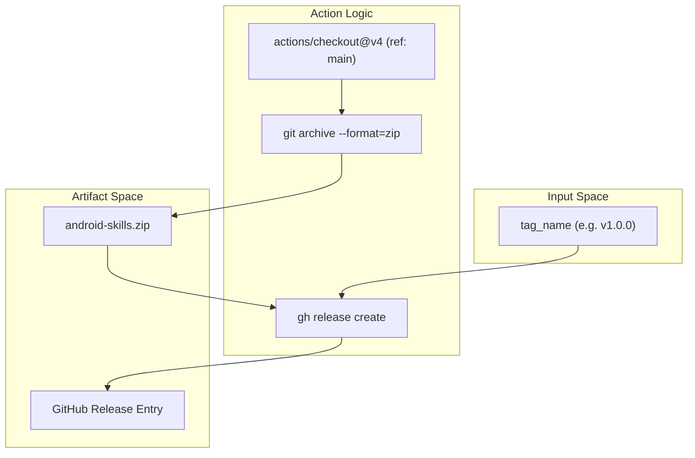
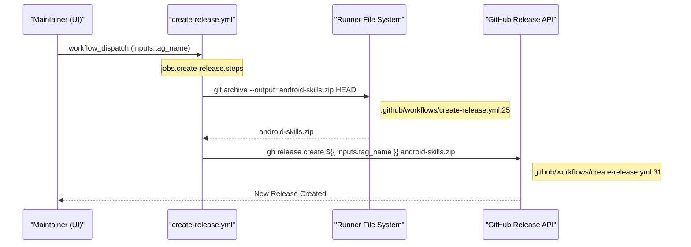

<!-- source: DeepWiki mcp.deepwiki.com · repo android/skills · page 7.2 Create Release Workflow · fetched 2026-10-23 -->

# Create Release Workflow

Relevant source files

The following files were used as context for generating this wiki page:

- [.github/workflows/create-release.yml](.github/workflows/create-release.yml)

The `Create Release` workflow is a GitHub Actions automation designed to package the repository's skills and reference materials into a distributable format and publish them as a formal GitHub Release. It is a manual process triggered by repository maintainers to snapshot the current state of the `main` branch.

### Workflow Purpose and Trigger
The workflow is defined in [.github/workflows/create-release.yml:1-1]() and is triggered via `workflow_dispatch` [.github/workflows/create-release.yml:4-4](). This manual trigger requires a single input: `tag_name` [.github/workflows/create-release.yml:6-9](). This input allows the operator to specify the version string (e.g., `v1.2.0`) for the new release.

### Permissions and Environment
To perform the release actions, the workflow requires `contents: write` permissions [.github/workflows/create-release.yml:11-12](). It executes on an `ubuntu-latest` runner [.github/workflows/create-release.yml:16-16]().

Sources: [.github/workflows/create-release.yml:1-16]()

---

### Implementation Details

The workflow consists of a single job, `create-release`, which executes three primary steps:

1.  **Checkout**: The workflow checks out the `main` branch specifically, ensuring that releases are always cut from the primary development line [.github/workflows/create-release.yml:18-21]().
2.  **Packaging**: It uses the `git archive` command to package the entire repository.
    *   **Format**: ZIP [.github/workflows/create-release.yml:25-25]().
    *   **Output Filename**: `android-skills.zip` [.github/workflows/create-release.yml:25-25]().
    *   **Source**: `HEAD` (the current state of the checked-out `main` branch) [.github/workflows/create-release.yml:25-25]().
3.  **Release Creation**: The workflow utilizes the GitHub CLI (`gh`) to create the release [.github/workflows/create-release.yml:27-31](). It authenticates using the standard `GITHUB_TOKEN` secret [.github/workflows/create-release.yml:29-29]().

#### Data Flow and CLI Command
The `gh release create` command uses the following parameters:
*   **Tag**: The `${{ inputs.tag_name }}` provided by the user [.github/workflows/create-release.yml:31-31]().
*   **Asset**: The `android-skills.zip` file created in the previous step [.github/workflows/create-release.yml:31-31]().
*   **Title**: Formatted as `"Release <tag_name>"` [.github/workflows/create-release.yml:31-31]().
*   **Notes**: A static string indicating a "Manual release of main branch contents." [.github/workflows/create-release.yml:31-31]().

**Release Generation Logic**

Sources: [.github/workflows/create-release.yml:18-31]()

---

### Process Flow: From Dispatch to Release

The following diagram illustrates the relationship between the GitHub Actions YAML configuration and the resulting system entities.

**Workflow Entity Mapping**

### Key Components Summary

| Component | Code Reference | Description |
| :--- | :--- | :--- |
| **Manual Input** | `inputs.tag_name` | The version tag assigned to the release. |
| **Checkout Target** | `ref: main` | Ensures releases are strictly derived from the `main` branch. |
| **Archive Tool** | `git archive` | Generates a clean ZIP of the repository without `.git` metadata. |
| **Archive Name** | `android-skills.zip` | The standard distribution filename for the skill catalog. |
| **Release Tool** | `gh release create` | The GitHub CLI command used to upload assets and create the tag. |

Sources: [.github/workflows/create-release.yml:5-9](), [.github/workflows/create-release.yml:21-21](), [.github/workflows/create-release.yml:25-25](), [.github/workflows/create-release.yml:31-31]()

---

