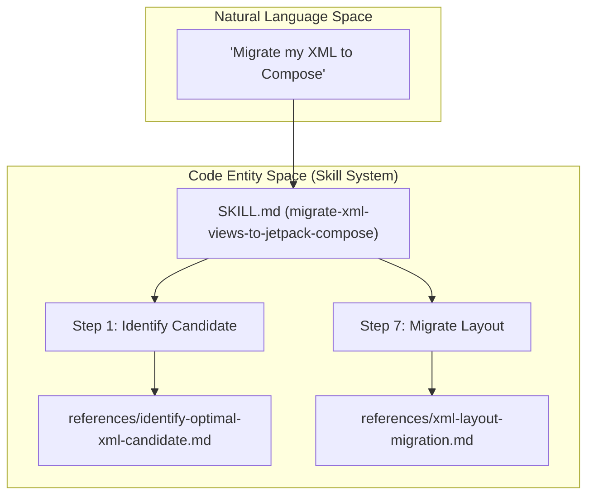
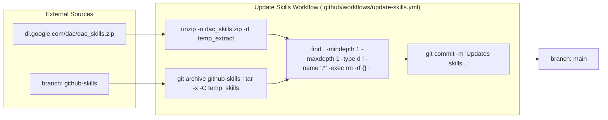

<!-- source: DeepWiki mcp.deepwiki.com · repo android/skills · page 8 Glossary · fetched 2026-10-23 -->

# Glossary

Relevant source files

The following files were used as context for generating this wiki page:

- [.github/workflows/update-skills.yml](.github/workflows/update-skills.yml)
- [README.md](README.md)
- [build/agp/agp-9-upgrade/SKILL.md](build/agp/agp-9-upgrade/SKILL.md)
- [jetpack-compose/migration/migrate-xml-views-to-jetpack-compose/SKILL.md](jetpack-compose/migration/migrate-xml-views-to-jetpack-compose/SKILL.md)
- [navigation/navigation-3/SKILL.md](navigation/navigation-3/SKILL.md)
- [navigation/navigation-3/references/android/guide/navigation/navigation-3/index.md](navigation/navigation-3/references/android/guide/navigation/navigation-3/index.md)
- [navigation/navigation-3/references/android/guide/navigation/navigation-3/recipes/conditional.md](navigation/navigation-3/references/android/guide/navigation/navigation-3/recipes/conditional.md)
- [navigation/navigation-3/references/android/guide/navigation/navigation-3/recipes/results-event.md](navigation/navigation-3/references/android/guide/navigation/navigation-3/recipes/results-event.md)
- [navigation/navigation-3/references/android/guide/navigation/type-safe-destinations.md](navigation/navigation-3/references/android/guide/navigation/type-safe-destinations.md)
- [performance/r8-analyzer/SKILL.md](performance/r8-analyzer/SKILL.md)
- [play/play-billing-library-version-upgrade/SKILL.md](play/play-billing-library-version-upgrade/SKILL.md)
- [system/edge-to-edge/SKILL.md](system/edge-to-edge/SKILL.md)

This glossary defines codebase-specific terms, abbreviations, and domain concepts used throughout the Android Skills repository. It provides technical definitions and maps these concepts to their implementations in the repository's structure and automation scripts.

## Core Repository Concepts

The following terms define the structure and management of the "Skills" themselves.

| Term | Definition |
| :--- | :--- |
| **Skill** | A modular unit of AI-optimized instructions (contained in a `SKILL.md` file) designed to help LLMs execute specific Android development tasks following Google's best practices [README.md:3-9](). |
| **SKILL.md** | The entry point for a skill, following the [open-standard agent skills](https://agentskills.io/home) specification. It contains metadata (author, keywords) and a structured workflow [jetpack-compose/migration/migrate-xml-views-to-jetpack-compose/SKILL.md:1-20](). |
| **References** | Supporting documentation (often in a `references/` subdirectory) that provides the "grounding" data for a skill, such as API mappings, migration logic, or release notes [build/agp/agp-9-upgrade/SKILL.md:19-20](). |
| **dac_skills** | Skills data ingested from `dl.google.com/dac/dac_skills.zip`. This represents the "official" distribution of Android developer documentation optimized for AI [.github/workflows/update-skills.yml:29-31](). |
| **github-skills** | A specific branch in the repository used to store and reconcile community or GitHub-specific skill contributions before they are merged into `main` [.github/workflows/update-skills.yml:40-47](). |

**Sources:** [README.md:1-9](), [.github/workflows/update-skills.yml:27-61](), [jetpack-compose/migration/migrate-xml-views-to-jetpack-compose/SKILL.md:1-20]().

---

## Domain-Specific Jargon

### Build & Performance
*   **AGP 9**: The 9th major version of the Android Gradle Plugin, characterized by the move to built-in Kotlin support and a new DSL [build/agp/agp-9-upgrade/SKILL.md:2-15]().
*   **Effective Version**: A heuristic used during Play Billing migrations. It is the version where specific deprecated APIs (like `SkuDetails`) were last available, used to determine the migration baseline regardless of the version string in `build.gradle` [play/play-billing-library-version-upgrade/SKILL.md:31-35]().
*   **Keep Rule Impact Hierarchy**: A classification system used by the R8 Analyzer to prioritize the removal or narrowing of ProGuard/R8 rules based on their broadness (e.g., package-wide vs. class-specific) [performance/r8-analyzer/SKILL.md:23-29]().

### Navigation 3
*   **NavKey**: A unique identifier for a destination in Navigation 3. It is typically a `@Serializable` Kotlin object or data class [navigation/navigation-3/references/android/guide/navigation/navigation-3/index.md:14-15](), [navigation/navigation-3/references/android/guide/navigation/navigation-3/recipes/conditional.md:78-80]().
*   **NavDisplay**: The Compose component responsible for rendering the UI associated with the current back stack state [navigation/navigation-3/references/android/guide/navigation/navigation-3/index.md:17-18]().
*   **Scene**: A layout strategy in Navigation 3 that allows for adaptive UIs, such as displaying multiple destinations (List-Detail) simultaneously [navigation/navigation-3/references/android/guide/navigation/navigation-3/index.md:8-10]().

### UI & Compose
*   **Edge-to-Edge**: A UI configuration where the app draws behind system bars (status and navigation bars). It requires `enableEdgeToEdge()` and specific inset handling [system/edge-to-edge/SKILL.md:3-6]().
*   **IME (Input Method Editor)** : The soft keyboard. Skills focus on preventing the IME from obscuring input fields using `imePadding` or `fitInside` [system/edge-to-edge/SKILL.md:28-29]().

**Sources:** [build/agp/agp-9-upgrade/SKILL.md:1-15](), [play/play-billing-library-version-upgrade/SKILL.md:29-35](), [navigation/navigation-3/references/android/guide/navigation/navigation-3/index.md:1-21](), [system/edge-to-edge/SKILL.md:1-35]().

---

## Technical Mapping: Skill Structure

The following diagram illustrates how a "Skill" in the repository bridges the gap between a natural language request and the underlying code entities.

### Natural Language to Code Entity Space: Migration Skill

**Sources:** [jetpack-compose/migration/migrate-xml-views-to-jetpack-compose/SKILL.md:1-102]().

---

## Technical Mapping: Automation Data Flow

The repository uses GitHub Actions to maintain the skill catalog. This diagram maps the automation names to the specific files and logic responsible for data reconciliation.

### Automation Logic and Data Flow

**Sources:** [.github/workflows/update-skills.yml:22-69]().

---

## Reference Table: Navigation 3 Entities

Navigation 3 introduces specific types that are referenced throughout the recipes.

| Code Entity | Purpose | Reference File |
| :--- | :--- | :--- |
| `NavKey` | Interface for serializable navigation destinations. | [navigation/navigation-3/references/android/guide/navigation/navigation-3/recipes/conditional.md:79]() |
| `NavBackStack` | Manages the list of `NavKey` entries. | [navigation/navigation-3/references/android/guide/navigation/navigation-3/recipes/conditional.md:57]() |
| `entryProvider` | DSL for mapping `NavKey` types to Composable content. | [navigation/navigation-3/references/android/guide/navigation/navigation-3/recipes/conditional.md:124]() |
| `NavDisplay` | The UI host for the back stack. | [navigation/navigation-3/references/android/guide/navigation/navigation-3/recipes/conditional.md:121]() |
| `ResultEventBus` | A pattern for passing transient data between destinations. | [navigation/navigation-3/references/android/guide/navigation/navigation-3/recipes/results-event.md:9]() |

**Sources:** [navigation/navigation-3/references/android/guide/navigation/navigation-3/recipes/conditional.md:57-164](), [navigation/navigation-3/references/android/guide/navigation/navigation-3/recipes/results-event.md:1-15]().