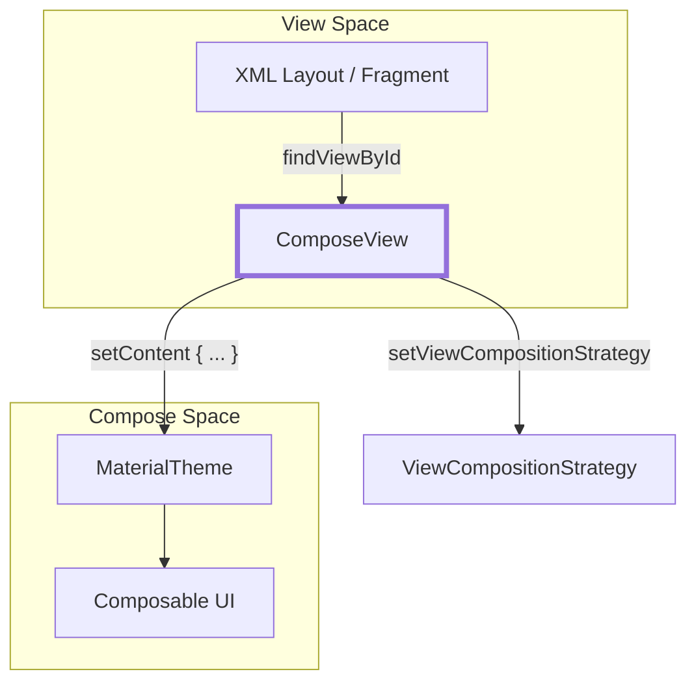
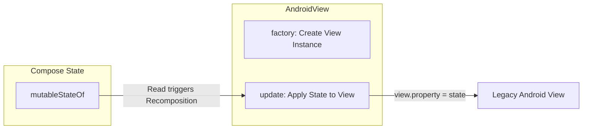

<!-- source: DeepWiki mcp.deepwiki.com · repo android/skills · extra page Compose Migration Reference Materials · fetched 2026-10-23 -->

# Compose Migration Reference Materials

Relevant source files

The following files were used as context for generating this wiki page:

- [jetpack-compose/migration/migrate-xml-views-to-jetpack-compose/references/android/develop/ui/compose/designsystems/migrate-xml-theme-to-compose.md](jetpack-compose/migration/migrate-xml-views-to-jetpack-compose/references/android/develop/ui/compose/designsystems/migrate-xml-theme-to-compose.md)
- [jetpack-compose/migration/migrate-xml-views-to-jetpack-compose/references/android/develop/ui/compose/migrate/interoperability-apis/compose-in-views.md](jetpack-compose/migration/migrate-xml-views-to-jetpack-compose/references/android/develop/ui/compose/migrate/interoperability-apis/compose-in-views.md)
- [jetpack-compose/migration/migrate-xml-views-to-jetpack-compose/references/android/develop/ui/compose/migrate/interoperability-apis/views-in-compose.md](jetpack-compose/migration/migrate-xml-views-to-jetpack-compose/references/android/develop/ui/compose/migrate/interoperability-apis/views-in-compose.md)
- [jetpack-compose/migration/migrate-xml-views-to-jetpack-compose/references/android/develop/ui/compose/setup-compose-dependencies-and-compiler.md](jetpack-compose/migration/migrate-xml-views-to-jetpack-compose/references/android/develop/ui/compose/setup-compose-dependencies-and-compiler.md)

This page provides technical reference materials for migrating an Android application from XML-based Views to Jetpack Compose. It covers the necessary dependency configurations, theme migration strategies to Material 3, and interoperability mechanisms for mixing Views and Compose within the same UI hierarchy.

## Dependency Setup and Compiler Configuration

To enable Jetpack Compose in an existing project, the build system must be configured to support the Compose Compiler and the required runtime libraries.

### Compose Compiler Gradle Plugin
Starting with Kotlin 2.0, the Compose Compiler is managed via a dedicated Gradle plugin [jetpack-compose/migration/migrate-xml-views-to-jetpack-compose/references/android/develop/ui/compose/setup-compose-dependencies-and-compiler.md:7-9]().

1.  **Plugin Declaration**: Add the plugin to the `libs.versions.toml` file or directly in the `build.gradle.kts` [jetpack-compose/migration/migrate-xml-views-to-jetpack-compose/references/android/develop/ui/compose/setup-compose-dependencies-and-compiler.md:22-26]().
2.  **Enable Build Features**: The `compose` flag must be enabled within the `android` block to enable Android Studio tooling support [jetpack-compose/migration/migrate-xml-views-to-jetpack-compose/references/android/develop/ui/compose/setup-compose-dependencies-and-compiler.md:86-101]().
3.  **Bill of Materials (BOM)**: Use the Compose BOM to manage library versions synchronously [jetpack-compose/migration/migrate-xml-views-to-jetpack-compose/references/android/develop/ui/compose/setup-compose-dependencies-and-compiler.md:149-152]().

### Core Dependencies
| Library Group | Purpose |
|---|---|
| `androidx.compose.ui:ui` | Main APIs for toolkit systems (input, measurement, layout) [jetpack-compose/migration/migrate-xml-views-to-jetpack-compose/references/android/develop/ui/compose/setup-compose-dependencies-and-compiler.md:160-160]() |
| `androidx.compose.material3:material3` | Material Design 3 components [jetpack-compose/migration/migrate-xml-views-to-jetpack-compose/references/android/develop/ui/compose/setup-compose-dependencies-and-compiler.md:155-155]() |
| `androidx.activity:activity-compose` | Integration with `ComponentActivity` for `setContent` [jetpack-compose/migration/migrate-xml-views-to-jetpack-compose/references/android/develop/ui/compose/setup-compose-dependencies-and-compiler.md:174-174]() |
| `androidx.compose.ui:ui-tooling-preview` | Android Studio Preview support [jetpack-compose/migration/migrate-xml-views-to-jetpack-compose/references/android/develop/ui/compose/setup-compose-dependencies-and-compiler.md:163-163]() |

**Sources:**
- [jetpack-compose/migration/migrate-xml-views-to-jetpack-compose/references/android/develop/ui/compose/setup-compose-dependencies-and-compiler.md:1-186]()

---

## Theme Migration to Material 3

Migrating from XML themes to Compose involves transitioning from named hex colors to semantic roles and replicating styles as Composable functions.

### Color Mapping
XML themes typically use hex-based naming (e.g., `colorPrimary`), whereas Material 3 in Compose uses semantic roles [jetpack-compose/migration/migrate-xml-views-to-jetpack-compose/references/android/develop/ui/compose/designsystems/migrate-xml-theme-to-compose.md:49-51]().

| XML Attribute | Material 3 Semantic Role (Compose) |
|---|---|
| `colorPrimary` | `primary` |
| `colorAccent` | `secondary` or `tertiary` |
| `android:colorBackground` | `background` |
| `colorSurface` | `surface` |
| `colorOutline` | `outline` |

### Typography and Shapes
Custom XML typography and shapes must be redefined as `Typography` and `Shapes` objects and provided to the `MaterialTheme` composable [jetpack-compose/migration/migrate-xml-views-to-jetpack-compose/references/android/develop/ui/compose/designsystems/migrate-xml-theme-to-compose.md:80-91]().

### Styles (styles.xml)
XML styles have no direct equivalent in Compose. Instead of replicating XML styles, create layered, reusable composable variations [jetpack-compose/migration/migrate-xml-views-to-jetpack-compose/references/android/develop/ui/compose/designsystems/migrate-xml-theme-to-compose.md:124-130]().
*   **Example**: Replace `<Button style="@style/MyPrimaryButton" />` with a custom `MyPrimaryButton()` composable [jetpack-compose/migration/migrate-xml-views-to-jetpack-compose/references/android/develop/ui/compose/designsystems/migrate-xml-theme-to-compose.md:132-135]().

**Sources:**
- [jetpack-compose/migration/migrate-xml-views-to-jetpack-compose/references/android/develop/ui/compose/designsystems/migrate-xml-theme-to-compose.md:1-151]()

---

## Interoperability: Compose in Views

To add Compose UI to an existing View-based design, use `ComposeView` or `ComponentActivity.setContent`.

### ComposeView Implementation
`ComposeView` is an Android `View` that can be included in XML layouts or instantiated programmatically [jetpack-compose/migration/migrate-xml-views-to-jetpack-compose/references/android/develop/ui/compose/migrate/interoperability-apis/compose-in-views.md:67-70]().

#### Data Flow: View to Compose

### ViewCompositionStrategy
Incremental migration requires explicit control over when the Composition is disposed to avoid state loss [jetpack-compose/migration/migrate-xml-views-to-jetpack-compose/references/android/develop/ui/compose/migrate/interoperability-apis/compose-in-views.md:41-49]().

| Strategy | Recommended Usage |
|---|---|
| `DisposeOnDetachedFromWindowOrReleasedFromPool` | **Default**. Mixed View/Compose screens or `RecyclerView` items [jetpack-compose/migration/migrate-xml-views-to-jetpack-compose/references/android/develop/ui/compose/migrate/interoperability-apis/compose-in-views.md:60-60](). |
| `DisposeOnViewTreeLifecycleDestroyed` | `ComposeView` in a Fragment's View [jetpack-compose/migration/migrate-xml-views-to-jetpack-compose/references/android/develop/ui/compose/migrate/interoperability-apis/compose-in-views.md:62-62](). |

**Sources:**
- [jetpack-compose/migration/migrate-xml-views-to-jetpack-compose/references/android/develop/ui/compose/migrate/interoperability-apis/compose-in-views.md:1-122]()

---

## Interoperability: Views in Compose

To include View-based elements (like `AdView` or custom legacy Views) in a Compose UI, use the `AndroidView` composable.

### AndroidView Implementation
`AndroidView` uses a `factory` lambda to instantiate the View and an `update` block for state-driven updates [jetpack-compose/migration/migrate-xml-views-to-jetpack-compose/references/android/develop/ui/compose/migrate/interoperability-apis/views-in-compose.md:7-13]().

#### Data Flow: Compose to View

### Key APIs for View Interop
*   **`AndroidViewBinding`**: Used to embed XML layouts directly using generated binding classes [jetpack-compose/migration/migrate-xml-views-to-jetpack-compose/references/android/develop/ui/compose/migrate/interoperability-apis/views-in-compose.md:61-74]().
*   **`AndroidFragment`**: Specifically for adding a `Fragment` into a Compose hierarchy [jetpack-compose/migration/migrate-xml-views-to-jetpack-compose/references/android/develop/ui/compose/migrate/interoperability-apis/views-in-compose.md:118-125]().
*   **`CompositionLocal`**: Access framework types like `Context` via `LocalContext.current` or the current View via `LocalView.current` [jetpack-compose/migration/migrate-xml-views-to-jetpack-compose/references/android/develop/ui/compose/migrate/interoperability-apis/views-in-compose.md:155-167]().

### View Reuse in Lazy Lists
When using `AndroidView` inside a `LazyColumn` or `LazyRow`, use the overload with `onReset` to allow Compose to reuse the underlying `View` instance [jetpack-compose/migration/migrate-xml-views-to-jetpack-compose/references/android/develop/ui/compose/migrate/interoperability-apis/views-in-compose.md:80-89]().

**Sources:**
- [jetpack-compose/migration/migrate-xml-views-to-jetpack-compose/references/android/develop/ui/compose/migrate/interoperability-apis/views-in-compose.md:1-173]()

---

