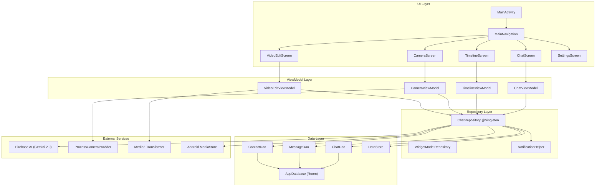
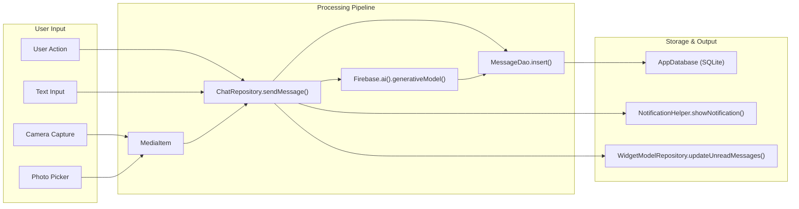

<!-- source: DeepWiki mcp.deepwiki.com · repo android/socialite · page 1 Overview · fetched 2026-10-23 -->

# Overview

<details>
<summary>Relevant source files</summary>

The following files were used as context for generating this wiki page:

- [README.md](README.md)
- [app/build.gradle.kts](app/build.gradle.kts)
- [app/google-services.json](app/google-services.json)
- [app/src/main/java/com/google/android/samples/socialite/README.md](app/src/main/java/com/google/android/samples/socialite/README.md)
- [app/src/main/java/com/google/android/samples/socialite/model/README.md](app/src/main/java/com/google/android/samples/socialite/model/README.md)
- [app/src/main/java/com/google/android/samples/socialite/repository/ChatRepository.kt](app/src/main/java/com/google/android/samples/socialite/repository/ChatRepository.kt)
- [app/src/main/java/com/google/android/samples/socialite/ui/camera/README.md](app/src/main/java/com/google/android/samples/socialite/ui/camera/README.md)
- [app/src/main/java/com/google/android/samples/socialite/ui/videoedit/README.md](app/src/main/java/com/google/android/samples/socialite/ui/videoedit/README.md)
- [app/src/main/res/values/strings.xml](app/src/main/res/values/strings.xml)
- [gradle/libs.versions.toml](gradle/libs.versions.toml)

</details>


This document provides a comprehensive overview of the SociaLite Android application, covering its purpose, architecture, core technologies, and main features. SociaLite is a sample application that demonstrates modern Android development practices using Jetpack components, AI integration, and media processing capabilities.

For detailed information about specific subsystems, see [Getting Started](#2), [Architecture](#3), [Core Features](#4), [User Interface](#5), and [System Integration](#6).

## Purpose and Scope

SociaLite is an Android sample application designed to showcase the implementation of features commonly found in social networking apps. The application serves as a comprehensive demonstration of modern Android development practices, leveraging various [Jetpack APIs](https://developer.android.com/jetpack/getting-started) and external services to achieve complex functionality with reliable performance across different devices.

**Sources:** [README.md:1-22]()

## Application Architecture

SociaLite follows the Model-View-ViewModel (MVVM) architectural pattern with a layered approach that promotes separation of concerns and maintainability.

### High-Level Architecture Diagram



**Sources:** [app/src/main/java/com/google/android/samples/socialite/README.md:1-13](), [app/src/main/java/com/google/android/samples/socialite/repository/ChatRepository.kt:61-71]()

### Core Technologies and Dependencies

The application is built using modern Android development technologies managed through Gradle's version catalog system.

| Category | Technologies | Version Catalog Reference |
|----------|-------------|---------------------------|
| **UI Framework** | Jetpack Compose, Material3 | `compose_bom = "2025.05.01"` |
| **Architecture** | Hilt DI, Room Database, ViewModel | `hilt = "2.56.1"`, `room = "2.7.1"` |
| **Media Processing** | Media3, CameraX, ExoPlayer | `media3 = "1.5.0"`, `camera = "1.5.0-beta01"` |
| **AI Integration** | Firebase AI, Gemini API | `firebaseBoM = "33.14.0"`, `generativeai = "0.9.0"` |
| **System Integration** | Glance Widgets, Notifications | `glance = "1.1.1"`, `core = "1.16.0"` |

**Sources:** [gradle/libs.versions.toml:15-67](), [app/build.gradle.kts:92-192]()

## Main Application Features

SociaLite implements several core features that demonstrate different aspects of Android development:

### Core Feature Set

- **Chat System**: Real-time messaging with AI-powered responses via Gemini API
- **Media Capture**: In-app camera with CameraX integration for photos and videos  
- **Media Processing**: Video editing capabilities using Media3 Transformer
- **Timeline Display**: Media gallery with ExoPlayer-based video playback
- **Smart Notifications**: Bubble notifications and direct reply functionality
- **Home Screen Widgets**: Glance-based favorite contact widgets
- **AI Integration**: Firebase AI with Gemini 2.0 Flash for intelligent chat responses

**Sources:** [README.md:23-42](), [app/src/main/res/values/strings.xml:17-93]()

### Data Flow Architecture



**Sources:** [app/src/main/java/com/google/android/samples/socialite/repository/ChatRepository.kt:96-206](), [app/src/main/java/com/google/android/samples/socialite/ui/chat/MediaItem.kt]()

## Project Structure

The application follows a multi-module structure with clear separation of concerns:

```
socialite/
├── app/                          # Main application module
│   ├── src/main/java/com/google/android/samples/socialite/
│   │   ├── data/                 # Data layer (Room, DAOs)
│   │   ├── model/                # Data models and entities
│   │   ├── repository/           # Business logic layer
│   │   ├── ui/                   # Jetpack Compose UI layer
│   │   │   ├── camera/          # Camera feature
│   │   │   ├── chat/            # Chat and messaging
│   │   │   ├── timeline/        # Media timeline
│   │   │   ├── videoedit/       # Video editing
│   │   │   └── settings/        # App settings
│   │   └── widget/              # Glance app widgets
│   ├── src/main/res/            # Android resources
│   └── build.gradle.kts         # Module build configuration
├── baselineprofile/             # Performance optimization profiles
├── gradle/libs.versions.toml    # Dependency version catalog
└── build.gradle.kts            # Root project configuration
```

**Sources:** [README.md:43-69](), [app/src/main/java/com/google/android/samples/socialite/README.md:1-13]()

## Getting Started

To run SociaLite:

1. **Clone and Build**: Open the project in Android Studio and sync dependencies
2. **Basic Functionality**: Run the `app` configuration for core features  
3. **AI Features** (Optional): Set up Firebase project and replace `google-services.json` for Gemini AI integration
4. **Enable AI Chatbot**: In Settings, toggle the "AI Chatbot" option after Firebase setup

The application requires Android API level 21+ and targets API level 35 with compilation against API level 36.

**Sources:** [README.md:70-80](), [app/build.gradle.kts:44-48](), [app/google-services.json:1-31]()

---

