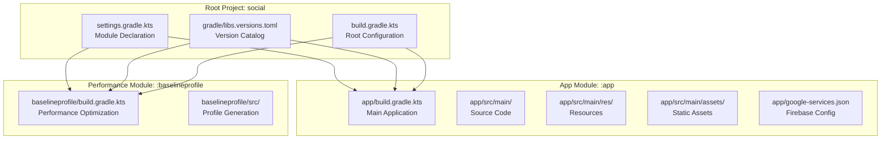
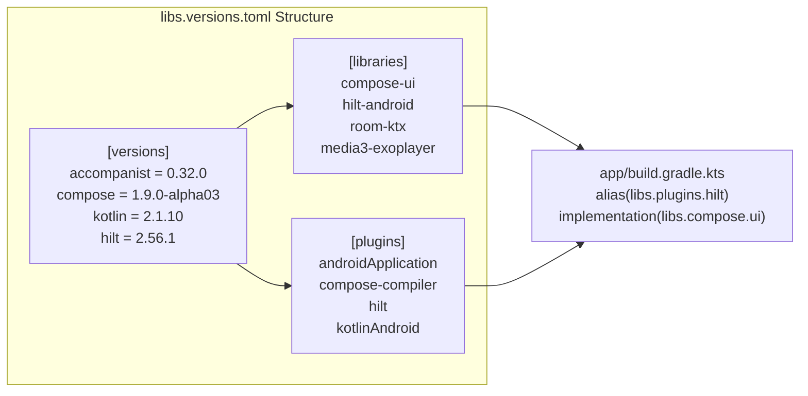
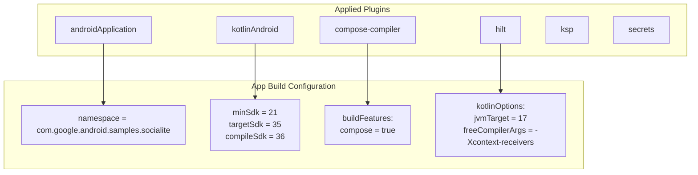
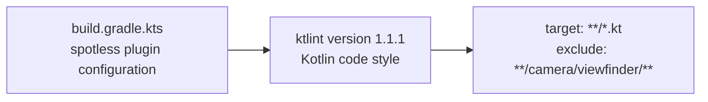
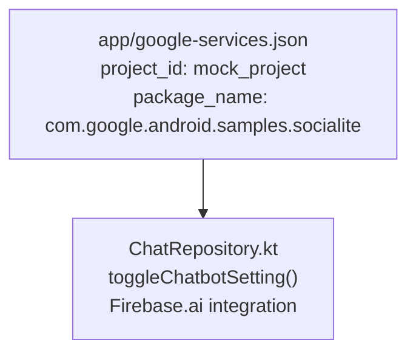
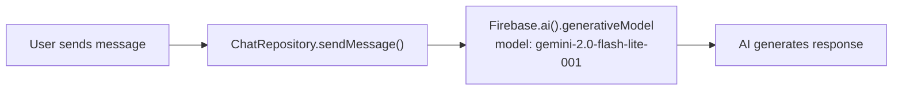
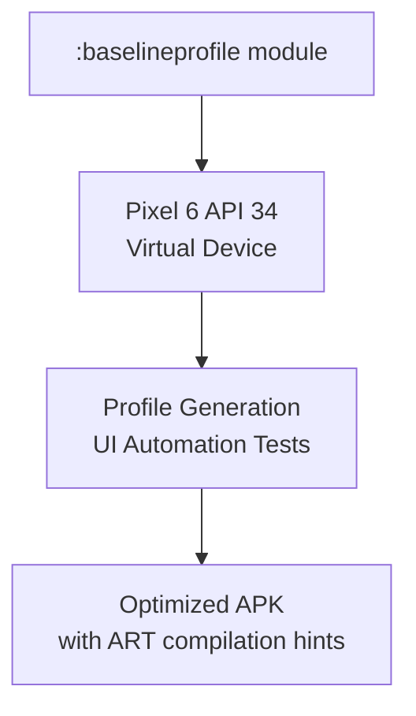
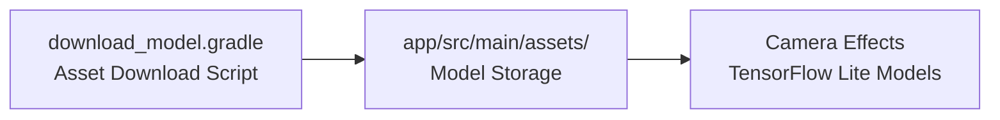

<!-- source: DeepWiki mcp.deepwiki.com · repo android/socialite · page 2 Getting Started · fetched 2026-10-23 -->

# Getting Started

<details>
<summary>Relevant source files</summary>

The following files were used as context for generating this wiki page:

- [README.md](README.md)
- [app/build.gradle.kts](app/build.gradle.kts)
- [app/google-services.json](app/google-services.json)
- [app/src/main/java/com/google/android/samples/socialite/repository/ChatRepository.kt](app/src/main/java/com/google/android/samples/socialite/repository/ChatRepository.kt)
- [app/src/main/res/values/strings.xml](app/src/main/res/values/strings.xml)
- [baselineprofile/.gitignore](baselineprofile/.gitignore)
- [baselineprofile/build.gradle.kts](baselineprofile/build.gradle.kts)
- [baselineprofile/src/main/AndroidManifest.xml](baselineprofile/src/main/AndroidManifest.xml)
- [build.gradle.kts](build.gradle.kts)
- [gradle/libs.versions.toml](gradle/libs.versions.toml)
- [settings.gradle.kts](settings.gradle.kts)

</details>


This document provides technical guidance for setting up, building, and running the SociaLite Android application. It covers the build system configuration, dependency management, and module structure required for development.

For information about the overall application architecture and component interactions, see [Architecture](#3). For details about specific features like chat, media, and AI integration, see [Core Features](#4).

## Prerequisites

The SociaLite project requires the following development environment:

| Component | Version | Configuration |
|-----------|---------|---------------|
| Android Studio | Latest stable | With Kotlin support |
| Java | 17 | JVM toolchain configured |
| Android SDK | API 21-36 | Min SDK 21, Target SDK 35, Compile SDK 36 |
| Gradle | 8.9+ | Managed by wrapper |

Sources: [app/build.gradle.kts:32-34](), [app/build.gradle.kts:42-47](), [app/build.gradle.kts:60-67]()

## Project Structure

SociaLite uses a multi-module Gradle project with dependency management via version catalogs:



Sources: [settings.gradle.kts:40-42](), [build.gradle.kts:19-29](), [gradle/libs.versions.toml:15-67]()

## Build System Configuration

### Version Catalog Management

The project uses Gradle's version catalog system for centralized dependency management:



Key dependency categories managed in the version catalog:

| Category | Key Libraries | Purpose |
|----------|---------------|---------|
| UI Framework | `compose-bom`, `compose-ui`, `compose-material3` | Jetpack Compose UI |
| Dependency Injection | `hilt-android`, `hilt-compiler` | Dependency management |
| Database | `room-ktx`, `room-compiler` | Local data persistence |
| Media Processing | `media3-exoplayer`, `camera-core`, `camera-compose` | Media capture and playback |
| AI Integration | `firebase-ai`, `generativeai` | Gemini AI capabilities |

Sources: [gradle/libs.versions.toml:70-147](), [gradle/libs.versions.toml:149-162](), [app/build.gradle.kts:92-192]()

### Build Configuration

The main application module configuration includes:



Sources: [app/build.gradle.kts:18-30](), [app/build.gradle.kts:40-52](), [app/build.gradle.kts:64-73]()

## Building and Running

### Standard Build Process

1. **Clone and Setup**:
   ```bash
   git clone https://github.com/android/socialite
   cd socialite
   ```

2. **Build with Gradle**:
   ```bash
   ./gradlew :app:assembleDebug
   ```

3. **Run Tests**:
   ```bash
   ./gradlew :app:testDebugUnitTest
   ./gradlew :app:connectedDebugAndroidTest
   ```

### Code Quality and Formatting

The project includes automated code formatting via Spotless:



Apply formatting before committing:
```bash
./gradlew spotlessApply
```

Sources: [build.gradle.kts:32-43](), [gradle/libs.versions.toml:141]()

## Firebase AI Integration (Optional)

### Default Configuration

The project includes a mock Firebase configuration for basic functionality:



### Production Setup

To enable full AI capabilities:

1. **Create Firebase Project**: Follow [Firebase AI setup guide](https://firebase.google.com/docs/ai-logic/get-started?platform=android&api=dev)

2. **Replace Configuration**: Replace `app/google-services.json` with your project's configuration

3. **Enable AI Features**: 
   - Launch app
   - Navigate to Settings screen
   - Toggle "AI Chatbot" setting

The `ChatRepository` class handles AI integration through the Firebase AI SDK:



Sources: [app/google-services.json:1-30](), [app/src/main/java/com/google/android/samples/socialite/repository/ChatRepository.kt:114-120](), [app/src/main/java/com/google/android/samples/socialite/repository/ChatRepository.kt:396-414]()

## Performance Optimization

### Baseline Profiles

The project includes a dedicated module for generating baseline profiles to improve app startup performance:



The baseline profile is automatically generated during release builds and included in the main app module.

Sources: [baselineprofile/build.gradle.kts:40-45](), [app/build.gradle.kts:114]()

## Asset Management

### Model Downloads

The project includes automatic download of ML models for camera effects:



Models are downloaded automatically during build unless manually placed in the assets directory.

Sources: [app/build.gradle.kts:84-90]()

---

