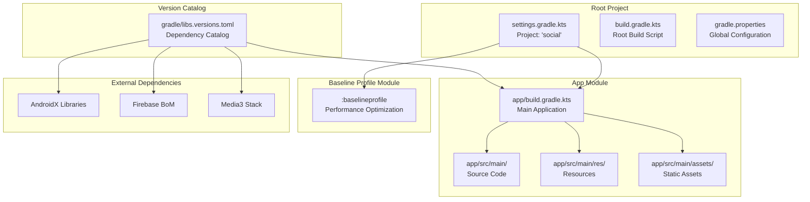
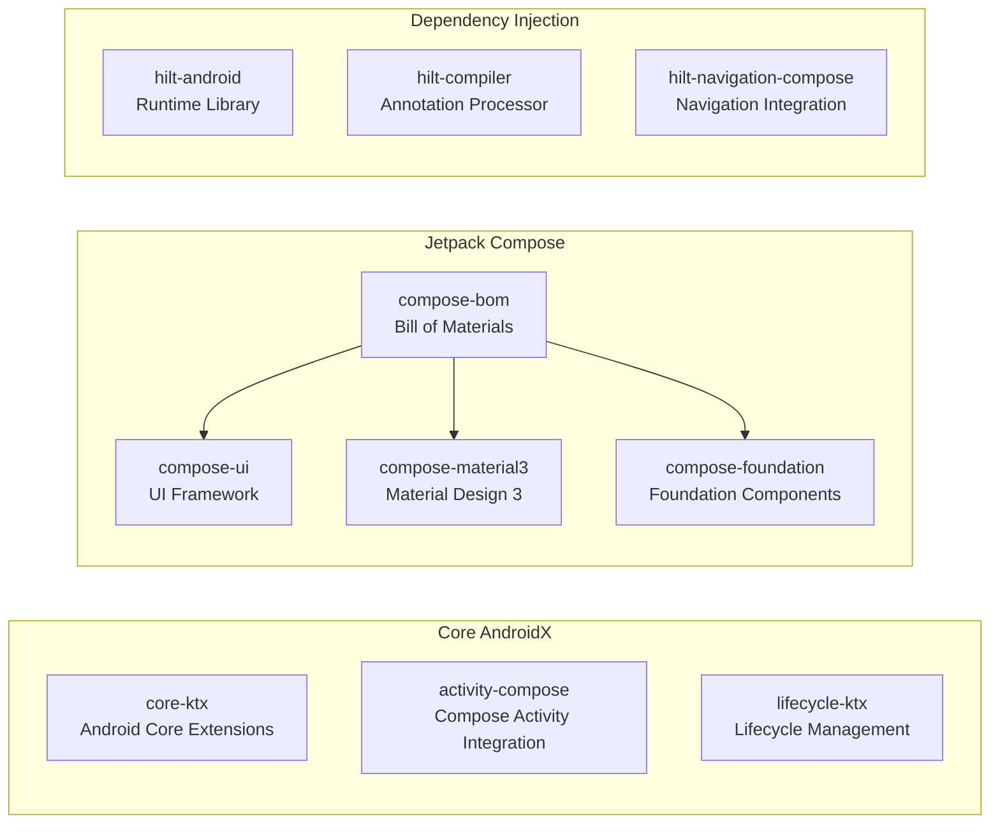

<!-- source: DeepWiki mcp.deepwiki.com · repo android/socialite · page 2.1 Build Configuration · fetched 2026-10-23 -->

# Build Configuration

<details>
<summary>Relevant source files</summary>

The following files were used as context for generating this wiki page:

- [README.md](README.md)
- [app/build.gradle.kts](app/build.gradle.kts)
- [app/google-services.json](app/google-services.json)
- [app/src/main/java/com/google/android/samples/socialite/repository/ChatRepository.kt](app/src/main/java/com/google/android/samples/socialite/repository/ChatRepository.kt)
- [app/src/main/res/values/strings.xml](app/src/main/res/values/strings.xml)
- [gradle.properties](gradle.properties)
- [gradle/libs.versions.toml](gradle/libs.versions.toml)
- [gradle/wrapper/gradle-wrapper.properties](gradle/wrapper/gradle-wrapper.properties)
- [settings.gradle.kts](settings.gradle.kts)

</details>


This document covers the Gradle build system configuration for the SociaLite Android application, including dependency management through version catalogs, multi-module project structure, and compilation settings. For information about the CI/CD pipeline and automated testing, see [CI/CD Pipeline](#2.2).

## Project Structure and Module Configuration

The SociaLite project follows a multi-module Gradle setup with centralized dependency management through version catalogs.

### Project Module Structure



**Sources:** [settings.gradle.kts:40-42](), [app/build.gradle.kts:1-193](), [gradle/libs.versions.toml:1-163]()

## Version Catalog System

The project uses Gradle's version catalog feature for centralized dependency management, defined in `gradle/libs.versions.toml`.

### Version Catalog Structure

```mermaid
graph TB
    subgraph "libs.versions.toml"
        VersionsSection["[versions]<br/>Version Declarations"]
        LibrariesSection["[libraries]<br/>Library Declarations"]
        PluginsSection["[plugins]<br/>Plugin Declarations"]
    end
    
    subgraph "Key Versions"
        AGP["agp = '8.9.3'<br/>Android Gradle Plugin"]
        Kotlin["kotlin = '2.1.10'<br/>Kotlin Compiler"]
        ComposeBom["compose_bom = '2025.05.01'<br/>Compose Bill of Materials"]
        Hilt["hilt = '2.56.1'<br/>Dependency Injection"]
        Media3["media3 = '1.5.0'<br/>Media Framework"]
    end
    
    subgraph "Core Libraries"
        ComposeUI["compose-ui<br/>UI Framework"]
        ActivityCompose["activity-compose<br/>Activity Integration"]
        HiltAndroid["hilt-android<br/>DI Runtime"]
        Media3Exoplayer["media3-exoplayer<br/>Video Player"]
        CameraX["camera-core<br/>Camera APIs"]
    end
    
    subgraph "Plugin Aliases"
        AndroidApp["androidApplication<br/>Android App Plugin"]
        ComposeCompiler["compose-compiler<br/>Compose Compiler"]
        KSP["ksp<br/>Symbol Processing"]
    end
    
    VersionsSection --> AGP
    VersionsSection --> Kotlin
    VersionsSection --> ComposeBom
    VersionsSection --> Hilt
    VersionsSection --> Media3
    
    LibrariesSection --> ComposeUI
    LibrariesSection --> ActivityCompose
    LibrariesSection --> HiltAndroid
    LibrariesSection --> Media3Exoplayer
    LibrariesSection --> CameraX
    
    PluginsSection --> AndroidApp
    PluginsSection --> ComposeCompiler
    PluginsSection --> KSP
```



**Sources:** [gradle/libs.versions.toml:15-67](), [gradle/libs.versions.toml:70-147](), [gradle/libs.versions.toml:149-163]()

### Key Version Specifications

| Component | Version | Purpose |
|-----------|---------|---------|
| `agp` | 8.9.3 | Android Gradle Plugin for Android builds |
| `kotlin` | 2.1.10 | Kotlin compiler and language features |
| `compose_bom` | 2025.05.01 | Jetpack Compose Bill of Materials |
| `hilt` | 2.56.1 | Dependency injection framework |
| `media3` | 1.5.0 | Media playback and processing |
| `camera` | 1.5.0-beta01 | CameraX implementation |

**Sources:** [gradle/libs.versions.toml:18](), [gradle/libs.versions.toml:40](), [gradle/libs.versions.toml:26](), [gradle/libs.versions.toml:37](), [gradle/libs.versions.toml:49](), [gradle/libs.versions.toml:21]()

## App Module Build Configuration

The main application module is configured in `app/build.gradle.kts` with Android-specific settings and extensive dependency declarations.

### Plugin Configuration

```kotlin
plugins {
    alias(libs.plugins.androidApplication)
    alias(libs.plugins.baselineprofile)
    alias(libs.plugins.compose.compiler)
    alias(libs.plugins.hilt)
    alias(libs.plugins.kotlinAndroid)
    alias(libs.plugins.kotlinSerialization)
    alias(libs.plugins.ksp)
    alias(libs.plugins.secrets)
    alias(libs.plugins.download)
    alias(libs.plugins.google.gms.google.services)
    alias(libs.plugins.parcelize)
}
```

**Sources:** [app/build.gradle.kts:18-30]()

### Android Configuration Block

The `android` configuration block defines compilation settings, build variants, and feature flags:

```kotlin
android {
    namespace = "com.google.android.samples.socialite"
    compileSdk = 36
    
    defaultConfig {
        applicationId = "com.google.android.samples.socialite"
        minSdk = 21
        targetSdk = 35
        versionCode = 1
        versionName = "1.0"
        testInstrumentationRunner = "androidx.test.runner.AndroidJUnitRunner"
        vectorDrawables.useSupportLibrary = true
    }
}
```

**Sources:** [app/build.gradle.kts:40-52]()

### Compilation Settings

| Setting | Value | Purpose |
|---------|-------|---------|
| `compileSdk` | 36 | Target Android API level for compilation |
| `minSdk` | 21 | Minimum supported Android API level |
| `targetSdk` | 35 | Target Android API level for optimization |
| `jvmTarget` | "17" | Java bytecode target version |
| `kotlinCompilerExtensionVersion` | libs.versions.composeCompiler.get() | Compose compiler version |

**Sources:** [app/build.gradle.kts:42](), [app/build.gradle.kts:46](), [app/build.gradle.kts:47](), [app/build.gradle.kts:65](), [app/build.gradle.kts:72]()

### Kotlin Compiler Options

```kotlin
kotlinOptions {
    jvmTarget = "17"
    freeCompilerArgs = listOf("-Xcontext-receivers")
}
```

The `-Xcontext-receivers` flag enables experimental context receiver functionality for advanced Kotlin language features.

**Sources:** [app/build.gradle.kts:64-67]()

## Dependency Management

The project organizes dependencies into logical groups using the version catalog system.

### Core Android Dependencies



**Sources:** [app/build.gradle.kts:119-133](), [app/build.gradle.kts:170-172]()

### Media and Camera Dependencies

The application includes comprehensive media processing capabilities:

| Library Group | Components | Purpose |
|---------------|------------|---------|
| **CameraX** | `camera-core`, `camera-compose`, `camera2`, `camera-effects`, `camera-lifecycle`, `camera-view` | Camera capture and processing |
| **Media3** | `media3-common`, `media3-effect`, `media3-exoplayer`, `media3-transformer`, `media3-ui`, `media3-ui-compose` | Video playback and editing |
| **ML Kit** | `segmentation-selfie`, `vision-common` | Computer vision features |

**Sources:** [app/build.gradle.kts:156-162](), [app/build.gradle.kts:163-169](), [app/build.gradle.kts:104-105]()

### Firebase and AI Integration

```kotlin
implementation(platform(libs.firebase.bom))
implementation(libs.firebase.ai)
```

Firebase dependencies are managed through a Bill of Materials (BoM) to ensure version compatibility across Firebase services.

**Sources:** [app/build.gradle.kts:184-185]()

## Build Features and Configuration

### Compose Configuration

```kotlin
buildFeatures {
    compose = true
}
composeOptions {
    kotlinCompilerExtensionVersion = libs.versions.composeCompiler.get()
}
```

**Sources:** [app/build.gradle.kts:68-73]()

### Packaging Options

```kotlin
packaging {
    resources {
        excludes += "/META-INF/{AL2.0,LGPL2.1}"
    }
}
```

This configuration excludes license files to prevent packaging conflicts.

**Sources:** [app/build.gradle.kts:74-78]()

### Asset Management

The project includes an asset download system for ML models:

```kotlin
project.ext.set("ASSET_DIR", "$projectDir/src/main/assets")
project.ext.set("TEST_ASSETS_DIR", "$projectDir/src/androidTest/assets")
apply {
    from("download_model.gradle")
}
```

**Sources:** [app/build.gradle.kts:84-90]()

## Repository Configuration

The project uses multiple Maven repositories for dependency resolution:

```kotlin
repositories {
    google()
    mavenCentral()
    maven {
        url = uri("https://androidx.dev/snapshots/builds/13508953/artifacts/repository")
    }
}
```

This includes access to AndroidX snapshot builds for testing pre-release components.

**Sources:** [settings.gradle.kts:31-37]()

## Global Gradle Properties

Key configuration properties are defined in `gradle.properties`:

| Property | Value | Purpose |
|----------|-------|---------|
| `org.gradle.jvmargs` | `-Xmx2048m -Dfile.encoding=UTF-8` | JVM memory and encoding settings |
| `android.useAndroidX` | `true` | Enable AndroidX library usage |
| `kotlin.code.style` | `official` | Kotlin code formatting standard |
| `org.gradle.configuration-cache` | `true` | Enable Gradle configuration caching |

**Sources:** [gradle.properties:9](), [gradle.properties:17](), [gradle.properties:19](), [gradle.properties:28]()

---

