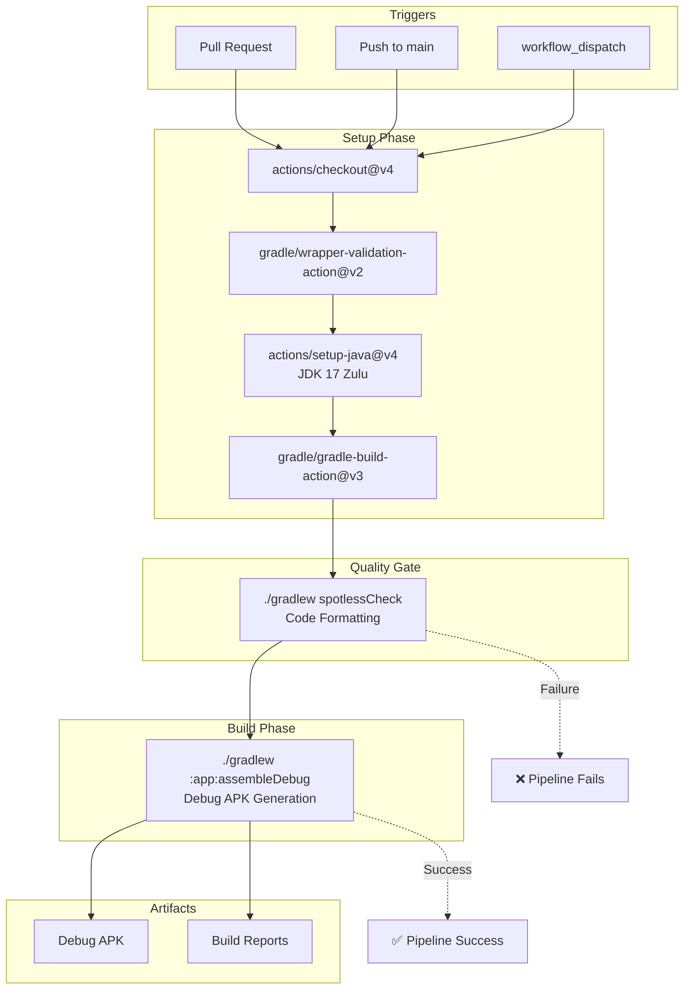
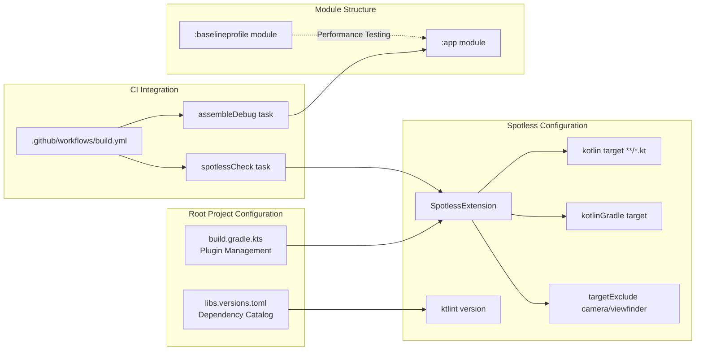

<!-- source: DeepWiki mcp.deepwiki.com · repo android/socialite · page 2.2 CI/CD Pipeline · fetched 2026-10-23 -->

# CI/CD Pipeline

<details>
<summary>Relevant source files</summary>

The following files were used as context for generating this wiki page:

- [.github/workflows/build.yml](.github/workflows/build.yml)
- [.gitignore](.gitignore)
- [.idea/vcs.xml](.idea/vcs.xml)
- [CONTRIBUTING.md](CONTRIBUTING.md)
- [LICENSE](LICENSE)
- [baselineprofile/.gitignore](baselineprofile/.gitignore)
- [baselineprofile/build.gradle.kts](baselineprofile/build.gradle.kts)
- [baselineprofile/src/main/AndroidManifest.xml](baselineprofile/src/main/AndroidManifest.xml)
- [build.gradle.kts](build.gradle.kts)

</details>


This document describes the Continuous Integration and Continuous Deployment (CI/CD) pipeline for the SociaLite application. The pipeline automates code quality checks, builds, and performance optimization using GitHub Actions and Gradle build tools.

For information about the overall build configuration and dependency management, see [Build Configuration](#2.1).

## Workflow Overview

The SociaLite project uses GitHub Actions to automate the CI/CD process. The pipeline is triggered on pull requests, pushes to the main branch, and manual workflow dispatches. The primary workflow ensures code quality and successful builds before changes are merged.

## GitHub Actions Configuration

### Workflow Triggers and Permissions

The main workflow is defined in [.github/workflows/build.yml:1-13]() and supports multiple trigger mechanisms:

| Trigger Type | Description |
|--------------|-------------|
| `workflow_dispatch` | Manual trigger from GitHub UI |
| `push` to `main` | Automatic trigger on main branch updates |
| `pull_request` | Automatic trigger on PR events (opened, synchronized, reopened) |

The workflow runs with specific permissions configured in [.github/workflows/build.yml:10-12]():
- `contents: write` - Allows reading repository contents and writing build artifacts
- `actions: read` - Permits reading workflow and action metadata

### Build Environment

The CI environment is configured in [.github/workflows/build.yml:15-17]() with the following specifications:

```yaml
runs-on: ubuntu-latest
timeout-minutes: 60
```

The pipeline uses Ubuntu as the base operating system with a 60-minute timeout to prevent hanging builds.

### Build Steps

The workflow executes the following steps in sequence:

1. **Repository Checkout** - Uses `actions/checkout@v4` for source code retrieval
2. **Gradle Wrapper Validation** - Ensures build script integrity using `gradle/wrapper-validation-action@v2`
3. **JDK Setup** - Configures Java 17 with Zulu distribution via `actions/setup-java@v4`
4. **Gradle Setup** - Initializes Gradle build system using `gradle/gradle-build-action@v3`
5. **Code Quality Check** - Runs Spotless formatting verification
6. **Application Build** - Compiles the debug variant of the main application

Sources: [.github/workflows/build.yml:19-40]()

## Code Quality Pipeline

### Spotless Integration

The project enforces consistent code formatting using the Spotless plugin, configured across all subprojects in [build.gradle.kts:31-43]():

```kotlin
subprojects {
    plugins.apply(rootProject.libs.plugins.spotless.get().pluginId)
    configure<SpotlessExtension> {
        kotlin {
            target("**/*.kt")
            targetExclude("**/camera/viewfinder/**")
            ktlint(libs.ktlint.get().version)
        }
        kotlinGradle {
            ktlint(libs.ktlint.get().version)
        }
    }
}
```

The configuration applies `ktlint` formatting rules to:
- All Kotlin source files (`**/*.kt`)
- Kotlin Gradle build scripts (`**/*.gradle.kts`)
- Excludes camera viewfinder components from formatting checks

### Quality Gate Enforcement

The CI pipeline enforces code quality through [.github/workflows/build.yml:35-36]():

```bash
./gradlew spotlessCheck
```

This step must pass before the build proceeds, ensuring all code adheres to the established formatting standards.

Sources: [build.gradle.kts:17-43](), [.github/workflows/build.yml:35-36]()

## Build Process

### Multi-Module Build

The build process targets the main application module using [.github/workflows/build.yml:38-39]():

```bash
./gradlew :app:assembleDebug
```

This command:
- Builds only the `:app` module in debug configuration
- Skips other modules like `:baselineprofile` during CI
- Produces a debug APK for validation purposes

### Performance Optimization

The project includes a dedicated baseline profile module for runtime performance optimization. The configuration in [baselineprofile/build.gradle.kts:29-44]() defines:

- Target project path pointing to the main app
- Managed virtual device configuration using Pixel 6 API 34
- Baseline profile generation settings for ART optimization

The baseline profile module uses separate testing dependencies including:
- UI Automator for automated interactions
- Macro Benchmark for performance measurement
- JUnit and Espresso for test infrastructure

Sources: [.github/workflows/build.yml:38-39](), [baselineprofile/build.gradle.kts:29-44]()

## CI/CD Pipeline Flow



Sources: [.github/workflows/build.yml:1-40]()

## Build Configuration Integration



Sources: [build.gradle.kts:31-43](), [.github/workflows/build.yml:35-39](), [baselineprofile/build.gradle.kts:29]()

## Repository Configuration

The project maintains standard repository hygiene through [.gitignore:1-24](), excluding:

- Build artifacts (`/build`, `.gradle`)
- IDE configurations (`.idea` directories)
- Local development files (`local.properties`)
- Platform-specific files (`.DS_Store`)

This ensures clean repository state and prevents environment-specific artifacts from entering version control.

Sources: [.gitignore:1-24]()

---

