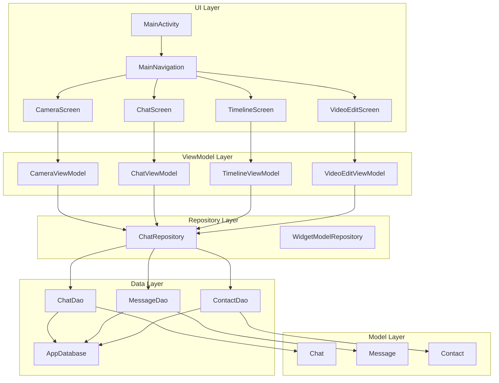
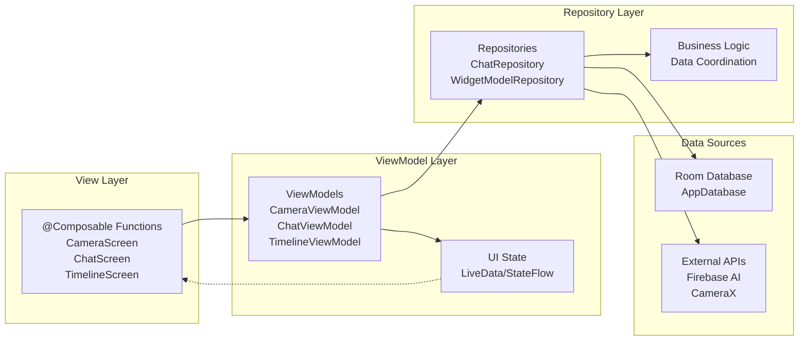
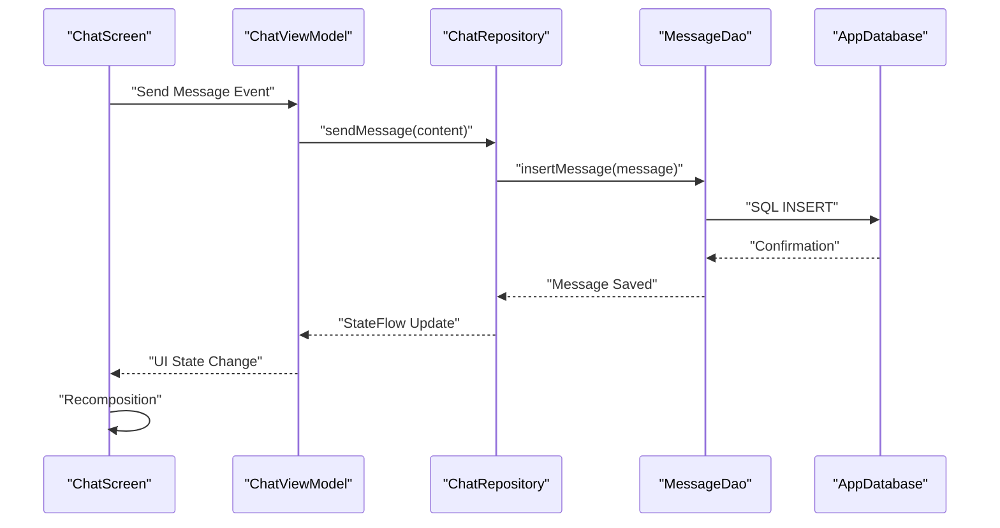
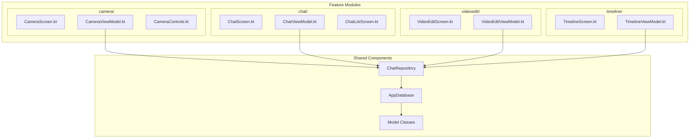
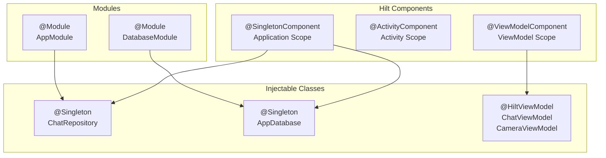

<!-- source: DeepWiki mcp.deepwiki.com · repo android/socialite · page 3 Architecture · fetched 2026-10-23 -->

# Architecture

Relevant source files

The following files were used as context for generating this wiki page:

- [app/src/main/java/com/google/android/samples/socialite/README.md](app/src/main/java/com/google/android/samples/socialite/README.md)
- [app/src/main/java/com/google/android/samples/socialite/data/README.md](app/src/main/java/com/google/android/samples/socialite/data/README.md)
- [app/src/main/java/com/google/android/samples/socialite/model/README.md](app/src/main/java/com/google/android/samples/socialite/model/README.md)
- [app/src/main/java/com/google/android/samples/socialite/ui/README.md](app/src/main/java/com/google/android/samples/socialite/ui/README.md)
- [app/src/main/java/com/google/android/samples/socialite/ui/camera/README.md](app/src/main/java/com/google/android/samples/socialite/ui/camera/README.md)
- [app/src/main/java/com/google/android/samples/socialite/ui/chat/README.md](app/src/main/java/com/google/android/samples/socialite/ui/chat/README.md)
- [app/src/main/java/com/google/android/samples/socialite/ui/videoedit/README.md](app/src/main/java/com/google/android/samples/socialite/ui/videoedit/README.md)

This document explains the overall MVVM (Model-View-ViewModel) architecture of the SociaLite application, including data flow patterns and layer interactions. It provides a high-level view of how the different components and modules work together to deliver the app's functionality.

For detailed information about the navigation system implementation, see [Navigation System](#3.1). For specifics about data persistence and the Repository pattern, see [Data Layer](#3.2).

## Overall Architecture Overview

SociaLite follows a clean architecture pattern with clear separation of concerns across multiple layers. The application is structured around the MVVM architectural pattern, which promotes testability, maintainability, and clear data flow.

### High-Level Layer Structure

Sources: [app/src/main/java/com/google/android/samples/socialite/README.md:7-11](), [app/src/main/java/com/google/android/samples/socialite/ui/README.md:5-8](), [app/src/main/java/com/google/android/samples/socialite/data/README.md:5-7]()

## MVVM Pattern Implementation

The application strictly follows the MVVM architectural pattern with clear responsibilities for each component:

### Package Structure and Responsibilities

| Layer | Package | Responsibilities | Key Classes |
|-------|---------|------------------|-------------|
| **UI Layer** | `ui/` | Jetpack Compose screens, user interactions | `CameraScreen`, `ChatScreen`, `TimelineScreen` |
| **ViewModel Layer** | `ui/*/` | UI state management, business logic coordination | `CameraViewModel`, `ChatViewModel` |
| **Repository Layer** | `repository/` | Data abstraction, business logic | `ChatRepository`, `WidgetModelRepository` |
| **Data Layer** | `data/` | Data access, persistence | `AppDatabase`, DAOs |
| **Model Layer** | `model/` | Data structures, entities | `Message`, `Chat`, `Contact` |

### Component Interaction Pattern

Sources: [app/src/main/java/com/google/android/samples/socialite/ui/README.md:7-9](), [app/src/main/java/com/google/android/samples/socialite/data/README.md:6-7]()

## Layer Interaction and Data Flow

### Unidirectional Data Flow

The application implements unidirectional data flow where data flows down through the layers and events flow up:

1. **User Interactions**: Captured in Compose UI components
2. **Event Handling**: ViewModels process user actions
3. **Data Operations**: Repositories handle business logic and data access
4. **State Updates**: ViewModels expose updated state to UI
5. **UI Recomposition**: Compose reacts to state changes

### Core Data Flow Example

Sources: [app/src/main/java/com/google/android/samples/socialite/ui/chat/README.md:7-8](), [app/src/main/java/com/google/android/samples/socialite/data/README.md:6]()

## Module Organization

### Feature-Based Module Structure

Each major feature is organized into its own module within the `ui/` package, following a consistent structure:

### Cross-Module Dependencies

| Module | Dependencies | Purpose |
|--------|-------------|---------|
| `camera/` | `ChatRepository`, CameraX APIs | Photo/video capture and effects |
| `chat/` | `ChatRepository`, Firebase AI | Messaging and AI responses |
| `videoedit/` | `ChatRepository`, Media3 Transformer | Video editing and processing |
| `timeline/` | `ChatRepository`, ExoPlayer | Media playback and timeline |

Sources: [app/src/main/java/com/google/android/samples/socialite/README.md:5-10](), [app/src/main/java/com/google/android/samples/socialite/ui/camera/README.md:5-6](), [app/src/main/java/com/google/android/samples/socialite/ui/videoedit/README.md:5-6]()

## Dependency Management

### Dependency Injection with Hilt

The application uses Hilt for dependency injection to manage object creation and provide dependencies across layers:

### Key Architectural Patterns

| Pattern | Implementation | Purpose |
|---------|---------------|---------|
| **Repository Pattern** | `ChatRepository` centralizes data access | Abstract data sources, provide clean API |
| **Observer Pattern** | `StateFlow`/`LiveData` in ViewModels | Reactive UI updates |
| **Dependency Injection** | Hilt annotations and modules | Loose coupling, testability |
| **Single Source of Truth** | Repository layer manages all data | Data consistency, conflict resolution |

Sources: [app/src/main/java/com/google/android/samples/socialite/data/README.md:6-7](), [app/src/main/java/com/google/android/samples/socialite/model/README.md:9]()

The architecture provides a solid foundation for the SociaLite application, enabling clean separation of concerns, testability, and maintainability while supporting complex features like real-time messaging, media processing, and AI integration.

---

