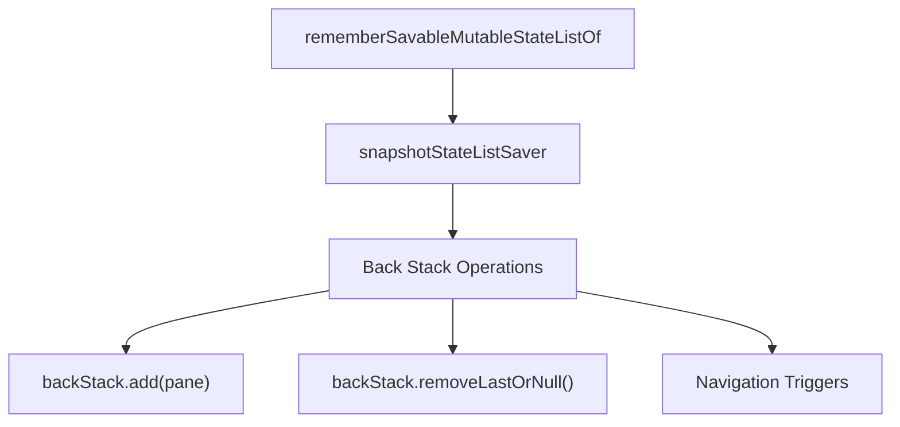
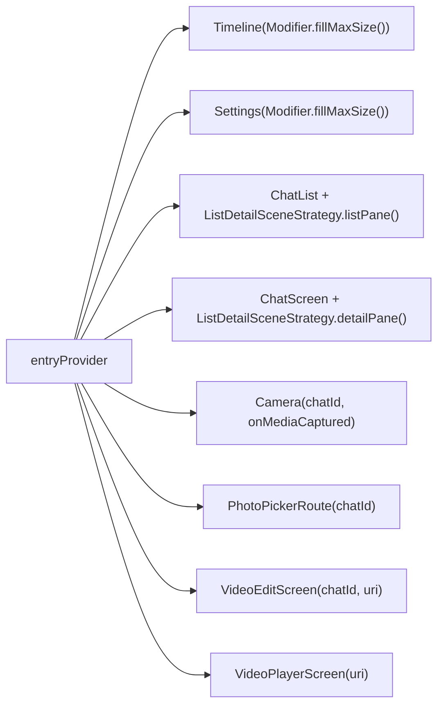
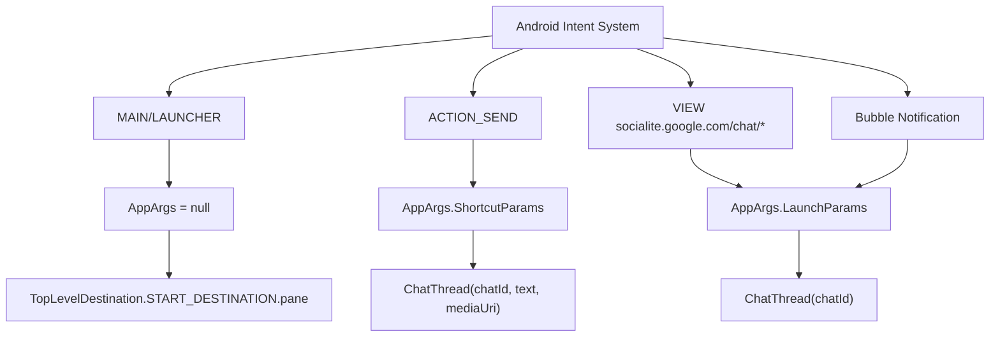
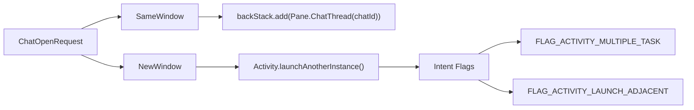
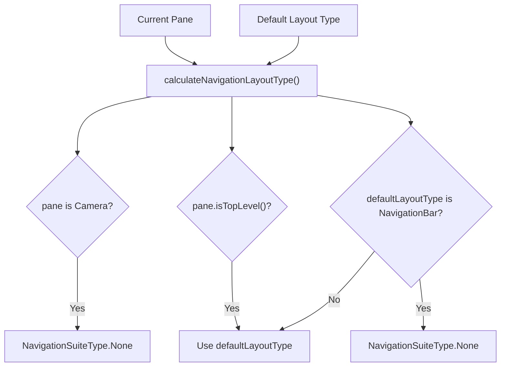
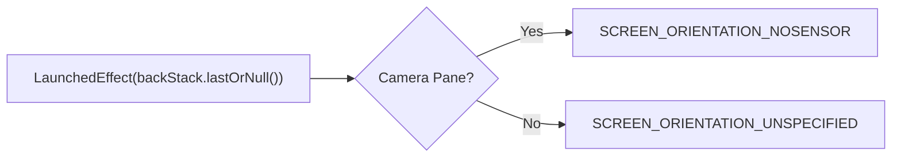
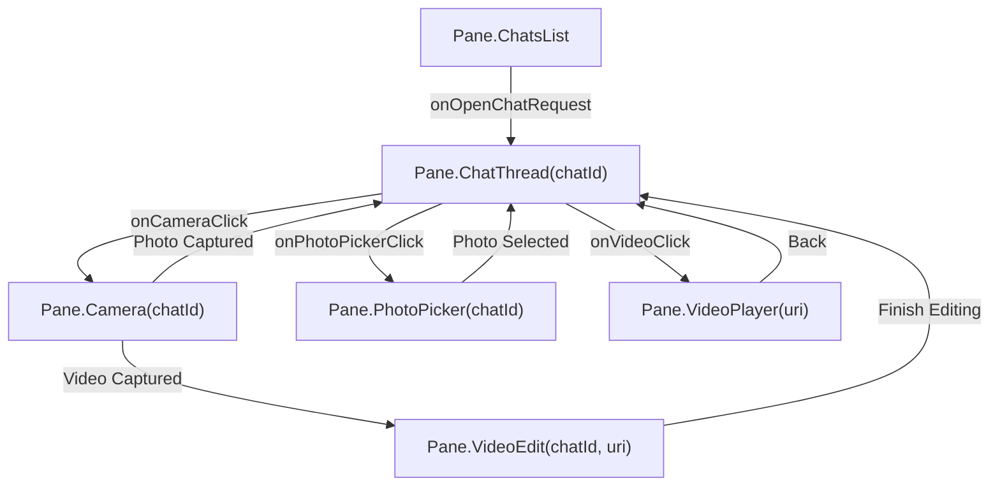
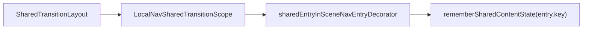

<!-- source: DeepWiki mcp.deepwiki.com · repo android/socialite · page 3.1 Navigation System · fetched 2026-10-23 -->

# Navigation System

<details>
<summary>Relevant source files</summary>

The following files were used as context for generating this wiki page:

- [app/src/main/AndroidManifest.xml](app/src/main/AndroidManifest.xml)
- [app/src/main/java/com/google/android/samples/socialite/AppArgs.kt](app/src/main/java/com/google/android/samples/socialite/AppArgs.kt)
- [app/src/main/java/com/google/android/samples/socialite/MainActivity.kt](app/src/main/java/com/google/android/samples/socialite/MainActivity.kt)
- [app/src/main/java/com/google/android/samples/socialite/ui/Main.kt](app/src/main/java/com/google/android/samples/socialite/ui/Main.kt)
- [app/src/main/java/com/google/android/samples/socialite/ui/chat/ChatScreen.kt](app/src/main/java/com/google/android/samples/socialite/ui/chat/ChatScreen.kt)
- [app/src/main/java/com/google/android/samples/socialite/ui/chat/ChatViewModel.kt](app/src/main/java/com/google/android/samples/socialite/ui/chat/ChatViewModel.kt)
- [app/src/main/java/com/google/android/samples/socialite/ui/chat/component/KeyEvent.kt](app/src/main/java/com/google/android/samples/socialite/ui/chat/component/KeyEvent.kt)
- [app/src/main/java/com/google/android/samples/socialite/ui/navigation/SocialiteNavigation.kt](app/src/main/java/com/google/android/samples/socialite/ui/navigation/SocialiteNavigation.kt)
- [app/src/main/res/xml/sharing_shortcuts.xml](app/src/main/res/xml/sharing_shortcuts.xml)

</details>


The Navigation System implements a pane-based navigation architecture that handles multiple entry points, adaptive UI layouts, and deep linking capabilities. This system manages screen transitions, back stack state, and intent-based navigation using Navigation3 library components and Material3 adaptive design patterns.

For information about UI components and screens, see [User Interface](#5). For details about data flow and business logic, see [Data Layer](#3.2).

## Overview

The navigation system uses a stack-based approach where each screen is represented as a `Pane` object. The system supports multiple entry points including launcher intents, deep links, share intents, and notification bubbles. Navigation state is maintained in a saveable back stack that persists across configuration changes.

```mermaid
graph TB
    AndroidSystem["Android System"]
    MainActivity["MainActivity"]
    BubbleActivity["BubbleActivity"]
    AppArgs["AppArgs"]
    MainNavigation["MainNavigation"]
    BackStack["backStack: SnapshotStateList<Pane>"]
    NavDisplay["NavDisplay"]
    SocialiteNavSuite["SocialiteNavSuite"]
    
    AndroidSystem --> MainActivity
    AndroidSystem --> BubbleActivity
    MainActivity --> AppArgs
    BubbleActivity --> AppArgs
    AppArgs --> MainNavigation
    MainNavigation --> BackStack
    BackStack --> NavDisplay
    BackStack --> SocialiteNavSuite
    NavDisplay --> "Screen Composables"
    SocialiteNavSuite --> "Navigation UI"
```

Sources: [app/src/main/java/com/google/android/samples/socialite/ui/Main.kt:68-310](), [app/src/main/java/com/google/android/samples/socialite/MainActivity.kt:38-107]()

## Core Navigation Components

### MainNavigation Function

The `MainNavigation` composable serves as the central navigation coordinator, managing the back stack and screen transitions using Navigation3 library components.

| Component | Type | Purpose |
|-----------|------|---------|
| `backStack` | `SnapshotStateList<Pane>` | Maintains navigation state with automatic save/restore |
| `NavDisplay` | Navigation3 Component | Renders screens based on back stack entries |
| `entryProvider` | Lambda | Maps `Pane` objects to `NavEntry` composables |
| `sceneStrategy` | `ListDetailSceneStrategy` | Handles adaptive list-detail layouts |

The system uses several navigation decorators for enhanced functionality:

```mermaid
graph LR
    NavEntry["NavEntry"]
    SharedElementDecorator["sharedEntryInSceneNavEntryDecorator"]
    SceneSetupDecorator["rememberSceneSetupNavEntryDecorator"]
    SavedStateDecorator["rememberSavedStateNavEntryDecorator"]
    ViewModelDecorator["rememberViewModelStoreNavEntryDecorator"]
    
    NavEntry --> SharedElementDecorator
    SharedElementDecorator --> SceneSetupDecorator
    SceneSetupDecorator --> SavedStateDecorator
    SavedStateDecorator --> ViewModelDecorator
```



Sources: [app/src/main/java/com/google/android/samples/socialite/ui/Main.kt:78-271]()

### Back Stack Management

Navigation state is managed through a saveable mutable state list that persists across process death:



Sources: [app/src/main/java/com/google/android/samples/socialite/ui/Main.kt:274-284]()

## Pane System

### Pane Definitions

The `Pane` sealed interface defines all possible navigation destinations in the application:

| Pane Type | Parameters | Purpose |
|-----------|------------|---------|
| `Timeline` | None | Media timeline view |
| `ChatsList` | None | Chat conversations list |
| `Settings` | None | Application settings |
| `ChatThread` | `chatId`, `text?`, `imageUri?` | Individual chat conversation |
| `Camera` | `chatId` | Camera capture interface |
| `PhotoPicker` | `chatId` | System photo picker |
| `VideoEdit` | `chatId`, `uri` | Video editing interface |
| `VideoPlayer` | `uri` | Full-screen video playback |

Sources: [app/src/main/java/com/google/android/samples/socialite/ui/navigation/SocialiteNavigation.kt:40-80]()

### Entry Provider Mapping

The `entryProvider` function maps each `Pane` type to its corresponding screen composable:



Sources: [app/src/main/java/com/google/android/samples/socialite/ui/Main.kt:131-248]()

## Intent Handling and Deep Linking

### AppArgs System

The `AppArgs` sealed interface processes different types of app launch scenarios:



### Intent Filter Configuration

The application handles multiple intent types through manifest declarations:

| Intent Type | Action | Data | Target Activity |
|-------------|--------|------|-----------------|
| Launcher | `MAIN` | None | `MainActivity` |
| Share Text | `SEND` | `text/plain` | `MainActivity` |
| Share Image | `SEND` | `image/*` | `MainActivity` |
| Deep Link | `VIEW` | `https://socialite.google.com/chat/*` | `MainActivity`, `BubbleActivity` |

Sources: [app/src/main/AndroidManifest.xml:78-108](), [app/src/main/java/com/google/android/samples/socialite/AppArgs.kt:28-78]()

### Multi-Instance Support

The system supports launching multiple app instances for enhanced multitasking:



Sources: [app/src/main/java/com/google/android/samples/socialite/ui/Main.kt:286-310](), [app/src/main/java/com/google/android/samples/socialite/AppArgs.kt:80-93]()

## Adaptive Navigation UI

### TopLevelDestination System

The navigation UI adapts to different screen sizes using Material3 adaptive components:

| Destination | Icon | Label Resource |
|-------------|------|----------------|
| `Timeline` | `Icons.Outlined.VideoLibrary` | `R.string.timeline` |
| `ChatsList` | `Icons.Outlined.ChatBubbleOutline` | `R.string.chats` |
| `Settings` | `Icons.Outlined.Settings` | `R.string.settings` |

### Navigation Layout Strategy

The `SocialiteNavSuite` determines navigation UI layout based on screen size and current destination:



Sources: [app/src/main/java/com/google/android/samples/socialite/ui/navigation/SocialiteNavigation.kt:118-133](), [app/src/main/java/com/google/android/samples/socialite/ui/navigation/SocialiteNavigation.kt:135-178]()

### Screen Orientation Management

The system manages screen orientation based on the current screen type:



Sources: [app/src/main/java/com/google/android/samples/socialite/ui/Main.kt:259-268]()

## Navigation Flow Examples

### Chat Navigation Flow

Starting from the chat list and navigating to various chat-related screens:



### Shared Element Transitions

The navigation system supports shared element transitions between screens using Navigation3's shared transition framework:



Sources: [app/src/main/java/com/google/android/samples/socialite/ui/Main.kt:88-113](), [app/src/main/java/com/google/android/samples/socialite/ui/Main.kt:115-116]()

---

