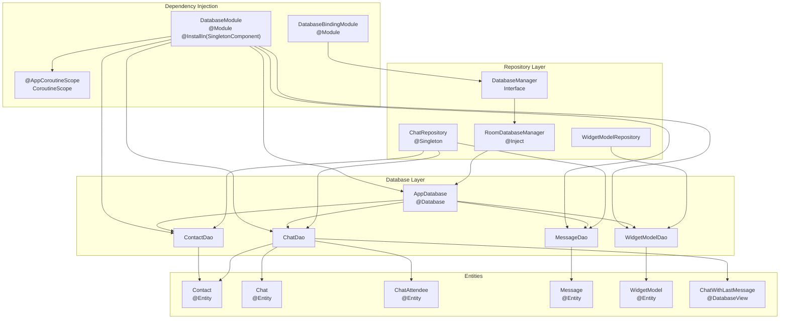
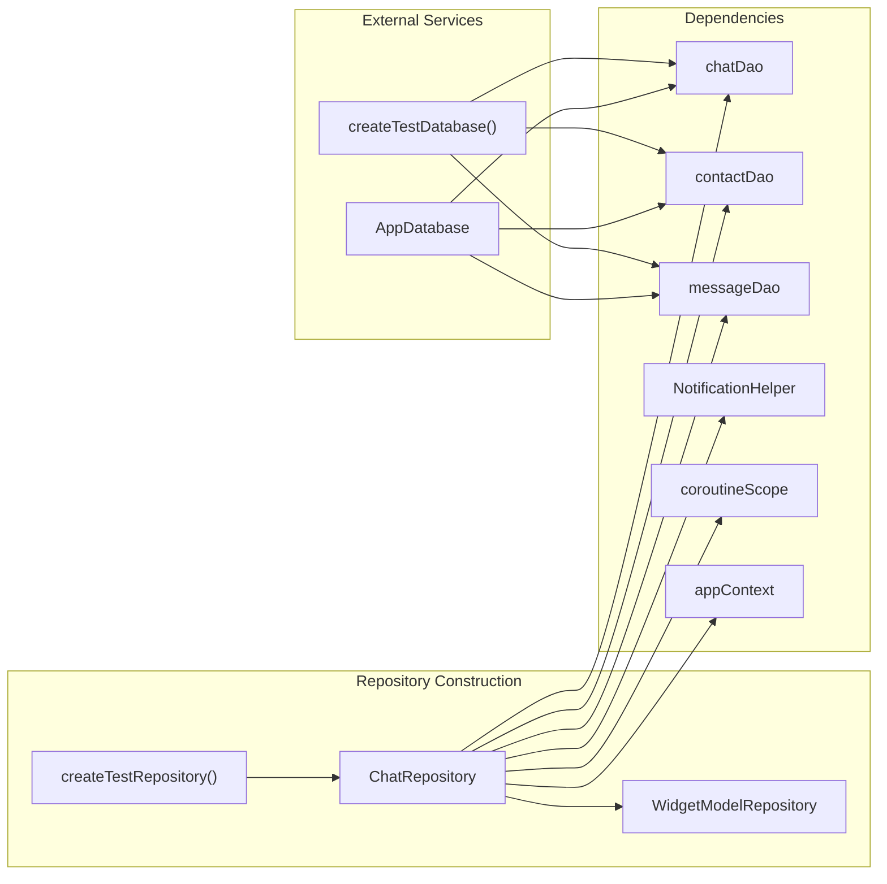
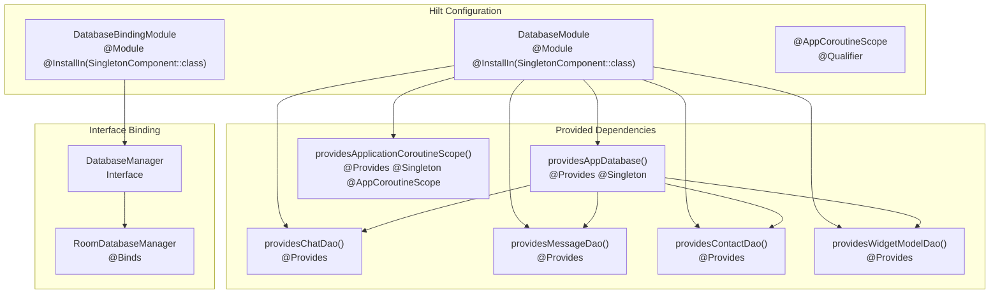

<!-- source: DeepWiki mcp.deepwiki.com · repo android/socialite · page 3.2 Data Layer · fetched 2026-10-23 -->

# Data Layer

<details>
<summary>Relevant source files</summary>

The following files were used as context for generating this wiki page:

- [app/src/androidTest/java/com/google/android/samples/socialite/data/AppDatabaseTest.kt](app/src/androidTest/java/com/google/android/samples/socialite/data/AppDatabaseTest.kt)
- [app/src/androidTest/java/com/google/android/samples/socialite/repository/TestRepository.kt](app/src/androidTest/java/com/google/android/samples/socialite/repository/TestRepository.kt)
- [app/src/main/java/com/google/android/samples/socialite/data/AppDatabase.kt](app/src/main/java/com/google/android/samples/socialite/data/AppDatabase.kt)
- [app/src/main/java/com/google/android/samples/socialite/data/DatabaseManager.kt](app/src/main/java/com/google/android/samples/socialite/data/DatabaseManager.kt)
- [app/src/main/java/com/google/android/samples/socialite/di/DatabaseModule.kt](app/src/main/java/com/google/android/samples/socialite/di/DatabaseModule.kt)
- [app/src/main/java/com/google/android/samples/socialite/ui/home/di/DevicePerformanceBindingModule.kt](app/src/main/java/com/google/android/samples/socialite/ui/home/di/DevicePerformanceBindingModule.kt)
- [app/src/main/java/com/google/android/samples/socialite/widget/model/WidgetModelDao.kt](app/src/main/java/com/google/android/samples/socialite/widget/model/WidgetModelDao.kt)

</details>


**Purpose and scope**: This document explains the data layer architecture of the SociaLite application, including the Room database setup, Repository pattern implementation, and dependency injection configuration with Hilt. For AI integration and external data sources, see [AI Integration](#4.2). For UI data binding patterns, see [User Interface](#5).

## Overview

The data layer follows a clean architecture pattern with three main components: the Room SQLite database for local persistence, repositories that encapsulate business logic and data access, and Hilt dependency injection to wire everything together. The `AppDatabase` serves as the central data store, while repositories like `ChatRepository` provide a clean API for the UI layer.



**Sources**: [app/src/main/java/com/google/android/samples/socialite/di/DatabaseModule.kt](), [app/src/main/java/com/google/android/samples/socialite/data/AppDatabase.kt](), [app/src/main/java/com/google/android/samples/socialite/data/DatabaseManager.kt]()

## Room Database Configuration

The `AppDatabase` is the central Room database that manages all local data persistence. It's configured as a singleton through Hilt and includes automatic initialization with sample data.

```mermaid
classDiagram
    class AppDatabase {
        <<@Database>>
        +contactDao() ContactDao
        +chatDao() ChatDao  
        +messageDao() MessageDao
        +widgetDao() WidgetModelDao
        +wipeAndReinitializeData()
    }
    
    class Contact {
        <<@Entity>>
        +id: Long
        +name: String
        +icon: String
        +replyModel: String
    }
    
    class Chat {
        <<@Entity>>
        +id: Long
    }
    
    class ChatAttendee {
        <<@Entity>>
        +chatId: Long
        +attendeeId: Long
    }
    
    class Message {
        <<@Entity>>
        +id: Long
        +chatId: Long
        +senderId: Long
        +text: String
        +timestamp: Long
    }
    
    class WidgetModel {
        <<@Entity>>
        +widgetId: Int
        +contactId: Long
    }
    
    class ChatWithLastMessage {
        <<@DatabaseView>>
        +id: Long
        +lastMessage: String
    }
    
    AppDatabase --> Contact
    AppDatabase --> Chat
    AppDatabase --> ChatAttendee
    AppDatabase --> Message
    AppDatabase --> WidgetModel
    AppDatabase --> ChatWithLastMessage
    
    Chat ||--o{ ChatAttendee
    Contact ||--o{ ChatAttendee
    Chat ||--o{ Message
    Contact ||--o{ Message
    Contact ||--o{ WidgetModel
```

The database is initialized with sample data through the `populateInitialData()` function that runs during database creation. This includes creating a "You" contact with ID 0, and populating predefined contacts with their associated chats and initial messages.

**Sources**: [app/src/main/java/com/google/android/samples/socialite/data/AppDatabase.kt:31-47](), [app/src/main/java/com/google/android/samples/socialite/data/AppDatabase.kt:55-120]()

## Data Access Objects (DAOs)

Each entity type has a corresponding DAO interface that provides typed database operations. The DAOs are automatically implemented by Room and injected through Hilt.

| DAO | Entity | Key Operations |
|-----|--------|----------------|
| `ChatDao` | `Chat`, `ChatAttendee` | Load chat details with attendees and last messages |
| `MessageDao` | `Message` | CRUD operations for messages in specific chats |
| `ContactDao` | `Contact` | Contact management and lookup |
| `WidgetModelDao` | `WidgetModel` | Widget configuration persistence |

The `WidgetModelDao` demonstrates typical DAO patterns with Flow-based reactive queries:

```kotlin
@Query("SELECT * FROM WidgetModel where widgetId = :widgetId")
fun loadWidgetModel(widgetId: Int): Flow<WidgetModel?>

@Query("SELECT * FROM WidgetModel where widgetId NOT IN (:widgetIds)")
fun findOrphanModels(widgetIds: List<Int>): List<WidgetModel>
```

**Sources**: [app/src/main/java/com/google/android/samples/socialite/widget/model/WidgetModelDao.kt:29-46](), [app/src/main/java/com/google/android/samples/socialite/data/AppDatabase.kt:43-46]()

## Repository Pattern Implementation

The repository layer abstracts data access and provides business logic coordination. The `ChatRepository` serves as the primary data orchestrator, coordinating between multiple DAOs and external services.



The repository construction pattern is demonstrated in the test setup, showing how dependencies are injected:

**Sources**: [app/src/androidTest/java/com/google/android/samples/socialite/repository/TestRepository.kt:26-38]()

## Dependency Injection with Hilt

The `DatabaseModule` configures all database-related dependencies as singletons, ensuring consistent data access across the application.



Key configuration details:

- **Database Creation**: `Room.databaseBuilder()` with callback for initial data population [app/src/main/java/com/google/android/samples/socialite/di/DatabaseModule.kt:50-59]()
- **DAO Providers**: Each DAO is provided through the database instance [app/src/main/java/com/google/android/samples/socialite/di/DatabaseModule.kt:62-71]()
- **Background Scope**: `@AppCoroutineScope` provides a dedicated coroutine scope for database operations [app/src/main/java/com/google/android/samples/socialite/di/DatabaseModule.kt:75-78]()
- **Interface Binding**: `DatabaseManager` interface is bound to `RoomDatabaseManager` implementation [app/src/main/java/com/google/android/samples/socialite/di/DatabaseModule.kt:85-86]()

**Sources**: [app/src/main/java/com/google/android/samples/socialite/di/DatabaseModule.kt:45-87]()

## Database Management and Testing

The `DatabaseManager` interface provides operations for database maintenance, with `RoomDatabaseManager` implementing the Room-specific logic:

```kotlin
interface DatabaseManager {
    fun wipeAndReinitializeDatabase()
}

class RoomDatabaseManager @Inject constructor(private val appDatabase: AppDatabase) : DatabaseManager {
    override fun wipeAndReinitializeDatabase() = appDatabase.wipeAndReinitializeData()
}
```

For testing, the data layer provides `createTestDatabase()` function that creates an in-memory database instance, allowing isolated testing of database operations without affecting the production database.

**Sources**: [app/src/main/java/com/google/android/samples/socialite/data/DatabaseManager.kt:21-27](), [app/src/androidTest/java/com/google/android/samples/socialite/data/AppDatabaseTest.kt:34-51]()

---

