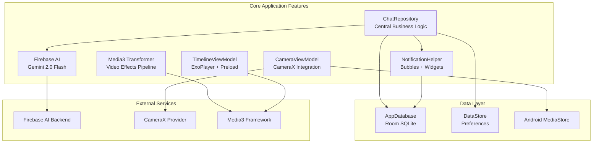
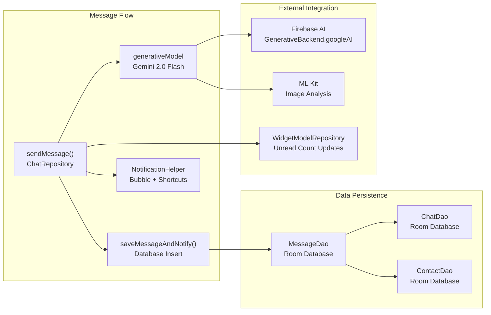
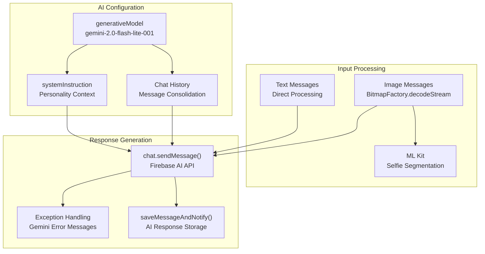
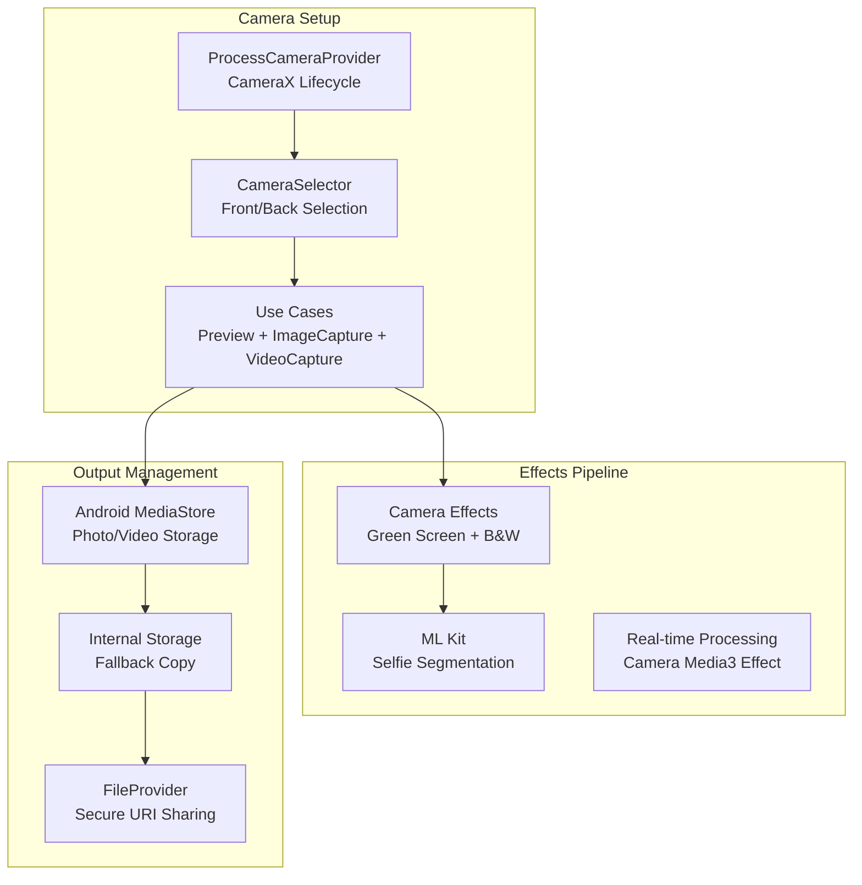
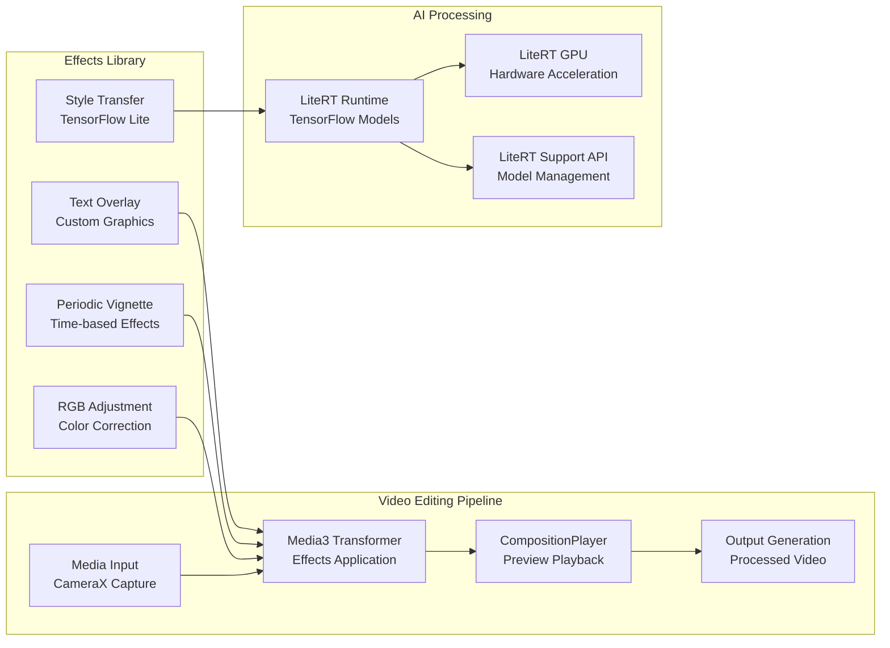
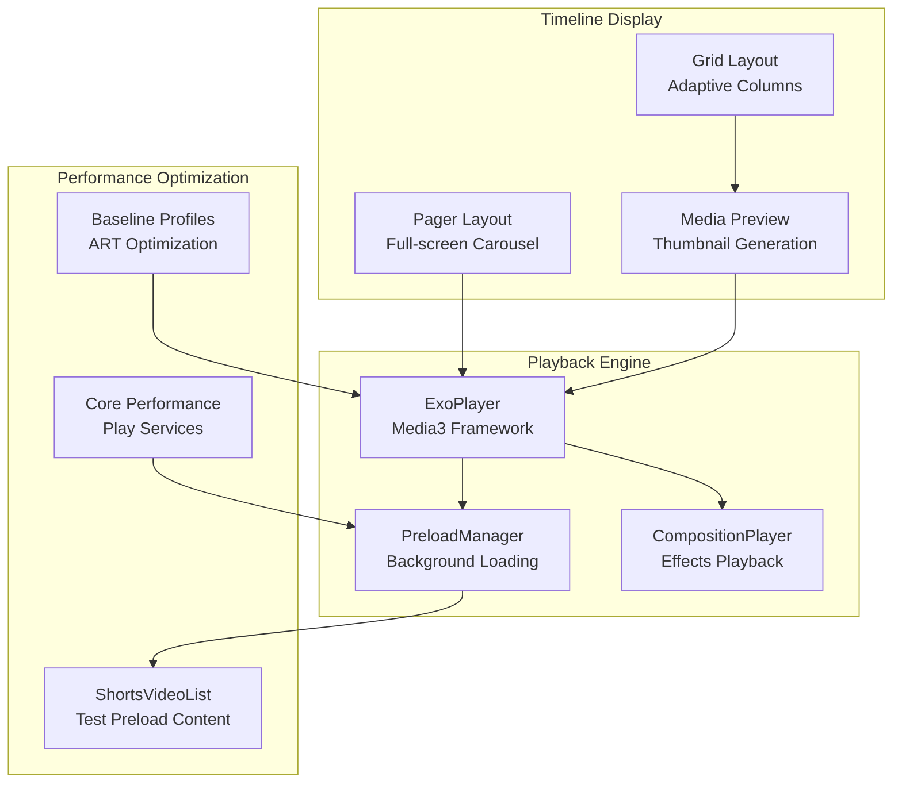

<!-- source: DeepWiki mcp.deepwiki.com · repo android/socialite · page 4 Core Features · fetched 2026-10-23 -->

# Core Features

Relevant source files

The following files were used as context for generating this wiki page:

- [README.md](README.md)
- [app/build.gradle.kts](app/build.gradle.kts)
- [app/google-services.json](app/google-services.json)
- [app/src/main/java/com/google/android/samples/socialite/README.md](app/src/main/java/com/google/android/samples/socialite/README.md)
- [app/src/main/java/com/google/android/samples/socialite/model/README.md](app/src/main/java/com/google/android/samples/socialite/model/README.md)
- [app/src/main/java/com/google/android/samples/socialite/repository/ChatRepository.kt](app/src/main/java/com/google/android/samples/socialite/repository/ChatRepository.kt)
- [app/src/main/java/com/google/android/samples/socialite/ui/camera/README.md](app/src/main/java/com/google/android/samples/socialite/ui/camera/README.md)
- [app/src/main/java/com/google/android/samples/socialite/ui/videoedit/README.md](app/src/main/java/com/google/android/samples/socialite/ui/videoedit/README.md)
- [app/src/main/res/values/strings.xml](app/src/main/res/values/strings.xml)
- [gradle/libs.versions.toml](gradle/libs.versions.toml)

This document provides an overview of the main application features in SociaLite, including chat messaging, AI integration, media capture and processing, timeline display, and system integration capabilities. This covers the functional components that users interact with directly.

For architectural patterns and data flow, see [Architecture](#3). For detailed UI implementation, see [User Interface](#5). For Android system integrations like notifications and widgets, see [System Integration](#6).

## Feature Overview

SociaLite implements a comprehensive social messaging application with the following core capabilities:

| Feature | Primary Components | Key Technologies |
|---------|-------------------|------------------|
| Chat System | `ChatRepository`, `ChatViewModel` | Room database, Firebase AI |
| AI Integration | Gemini 2.0 Flash, `generativeModel` | Firebase AI SDK, ML Kit |
| Media Capture | `CameraViewModel`, CameraX | Camera2, MediaStore |
| Media Processing | Media3 Transformer, `CompositionPlayer` | ExoPlayer, video effects |
| Timeline Playback | `TimelineViewModel`, preload manager | ExoPlayer, adaptive UI |
| System Integration | Notification bubbles, app widgets | Glance framework |

**Sources:** [gradle/libs.versions.toml:15-67](), [app/build.gradle.kts:92-192](), [app/src/main/java/com/google/android/samples/socialite/repository/ChatRepository.kt:62-71]()

## Chat and Messaging System

The messaging system centers around `ChatRepository` as the primary business logic coordinator, managing message persistence, AI responses, and notification delivery.

**Key Implementation Details:**

- **Message Processing**: [ChatRepository.kt:96-206]() handles outgoing messages, AI response generation, and notification triggering
- **AI Integration**: Uses `generativeModel` with system instruction for personality-based responses [ChatRepository.kt:115-120]()
- **Image Analysis**: Supports image input to AI model via `BitmapFactory.decodeStream()` [ChatRepository.kt:138-150]()
- **Chat History**: Combines consecutive messages from same sender for AI context [ChatRepository.kt:316-352]()

**Sources:** [app/src/main/java/com/google/android/samples/socialite/repository/ChatRepository.kt:84-206](), [gradle/libs.versions.toml:142-145]()

## AI Integration and Response Generation

The application integrates Firebase AI with Gemini 2.0 Flash model for intelligent chat responses, including image understanding capabilities.

**AI Features:**

- **Model Configuration**: Gemini 2.0 Flash Lite with personality-based system instructions [ChatRepository.kt:115-120]()
- **Multi-modal Input**: Text and image processing with `BitmapFactory` integration [ChatRepository.kt:138-150]()
- **Error Handling**: Comprehensive exception handling with user-friendly error messages [ChatRepository.kt:154-160]()
- **Chat Memory**: Message history consolidation for context preservation [ChatRepository.kt:316-352]()
- **Settings Toggle**: DataStore-based chatbot enable/disable functionality [ChatRepository.kt:396-414]()

**Sources:** [app/src/main/java/com/google/android/samples/socialite/repository/ChatRepository.kt:114-171](), [gradle/libs.versions.toml:62-64](), [app/build.gradle.kts:184-186]()

## Media Capture and Camera Integration

The camera system leverages CameraX for photo and video capture with real-time effects and permission management.

**Camera Implementation:**

- **CameraX Integration**: Uses `ProcessCameraProvider` for lifecycle-aware camera management
- **Effects Pipeline**: Real-time green screen and black & white effects via `camera-media3-effect` [gradle/libs.versions.toml:85]()
- **ML Kit Integration**: Selfie segmentation for green screen effects [gradle/libs.versions.toml:64]()
- **Permission Handling**: Comprehensive camera and microphone permission flow
- **Storage Management**: MediaStore integration with internal storage fallback [ChatRepository.kt:208-272]()

**Sources:** [gradle/libs.versions.toml:21-23,85-88](), [app/build.gradle.kts:156-161](), [app/src/main/java/com/google/android/samples/socialite/repository/ChatRepository.kt:208-272]()

## Media Processing and Video Editing

Video processing utilizes Media3 Transformer for effects application and CompositionPlayer for preview playback.

**Video Processing Features:**

- **Media3 Transformer**: Core video processing engine [gradle/libs.versions.toml:49,126]()
- **CompositionPlayer**: Real-time preview during editing
- **Effect Types**: RGB adjustment, periodic vignette, style transfer, text overlay [app/src/main/res/values/strings.xml:62-69]()
- **TensorFlow Lite**: AI-powered style transfer effects [gradle/libs.versions.toml:65,120-122]()
- **GPU Acceleration**: Hardware-accelerated processing via LiteRT GPU

**Sources:** [gradle/libs.versions.toml:49-50,65,120-126](), [app/build.gradle.kts:163-168](), [app/src/main/res/values/strings.xml:61-69]()

## Timeline and Media Playback

The timeline system provides smooth media browsing with ExoPlayer integration and intelligent preloading for performance optimization.

**Timeline Features:**

- **Adaptive Layout**: Grid and pager layouts for different screen sizes
- **ExoPlayer Integration**: Media3-based video playback [gradle/libs.versions.toml:49,123-128]()
- **Preload Manager**: Background loading for smooth scrolling [ChatRepository.kt:275-291]()
- **Performance Optimization**: Baseline profiles and Core Performance API [gradle/libs.versions.toml:20,30-31]()
- **Compose UI**: Media3 Compose integration for seamless UI [gradle/libs.versions.toml:50,128]()

**Sources:** [gradle/libs.versions.toml:49-50,123-128](), [app/build.gradle.kts:163-168](), [app/src/main/java/com/google/android/samples/socialite/repository/ChatRepository.kt:275-291]()

---

