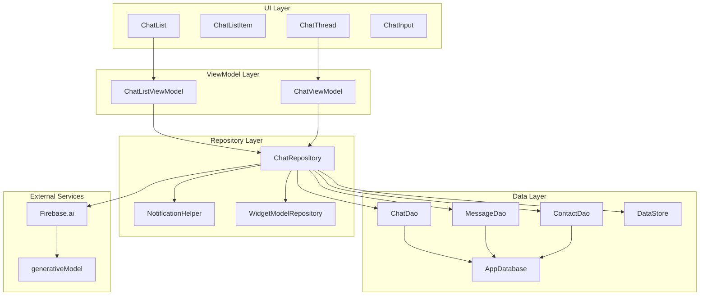
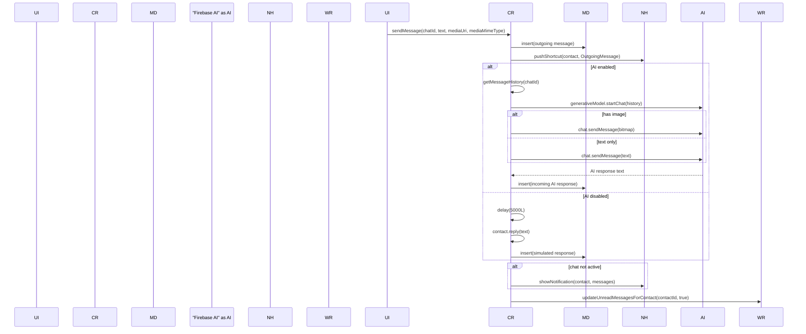
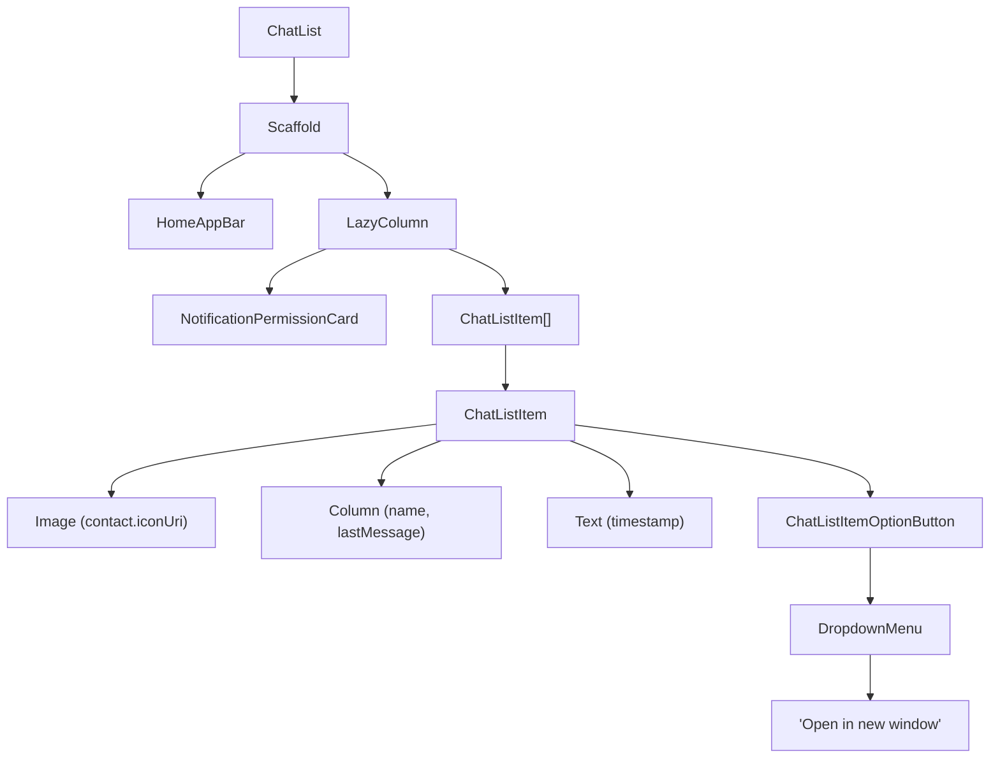
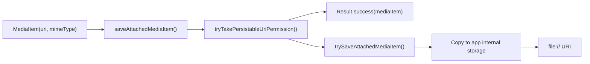

<!-- source: DeepWiki mcp.deepwiki.com · repo android/socialite · page 4.1 Chat System · fetched 2026-10-23 -->

# Chat System

<details>
<summary>Relevant source files</summary>

The following files were used as context for generating this wiki page:

- [README.md](README.md)
- [app/build.gradle.kts](app/build.gradle.kts)
- [app/google-services.json](app/google-services.json)
- [app/src/main/java/com/google/android/samples/socialite/repository/ChatRepository.kt](app/src/main/java/com/google/android/samples/socialite/repository/ChatRepository.kt)
- [app/src/main/java/com/google/android/samples/socialite/ui/home/chatlist/ChatList.kt](app/src/main/java/com/google/android/samples/socialite/ui/home/chatlist/ChatList.kt)
- [app/src/main/java/com/google/android/samples/socialite/ui/home/chatlist/ChatListItem.kt](app/src/main/java/com/google/android/samples/socialite/ui/home/chatlist/ChatListItem.kt)
- [app/src/main/java/com/google/android/samples/socialite/ui/home/chatlist/ChatOpenRequest.kt](app/src/main/java/com/google/android/samples/socialite/ui/home/chatlist/ChatOpenRequest.kt)
- [app/src/main/res/values/strings.xml](app/src/main/res/values/strings.xml)
- [gradle/libs.versions.toml](gradle/libs.versions.toml)

</details>


This document covers the messaging functionality in SociaLite, including the `ChatRepository` business logic, message sending/receiving flows, AI integration via Firebase Gemini, and chat-related UI components. For AI-specific implementation details, see [AI Integration](#4.2). For notification bubbles and shortcuts, see [Notifications and Bubbles](#6.1).

## System Architecture

The chat system follows a repository pattern with clear separation between data, business logic, and UI layers:



**Sources:** [app/src/main/java/com/google/android/samples/socialite/repository/ChatRepository.kt:1-415](), [app/src/main/java/com/google/android/samples/socialite/ui/home/chatlist/ChatList.kt:1-274]()

## Core Repository Components

### ChatRepository

The `ChatRepository` serves as the central business logic coordinator for all chat operations:

| Method | Purpose | Key Operations |
|--------|---------|----------------|
| `getChats()` | Retrieve all chat details | Returns `Flow<List<ChatDetail>>` from `chatDao.allDetails()` |
| `findChat(chatId)` | Get specific chat | Returns `Flow<ChatDetail?>` from `chatDao.detailById()` |
| `findMessages(chatId)` | Get chat messages | Returns `Flow<List<Message>>` from `messageDao.allByChatId()` |
| `sendMessage()` | Send message with AI response | Saves message, triggers AI response, sends notifications |
| `activateChat()` | Mark chat as active | Sets `currentChat`, dismisses notifications, updates widgets |

**Sources:** [app/src/main/java/com/google/android/samples/socialite/repository/ChatRepository.kt:62-415]()

### Data Access Objects

The chat system uses three primary DAOs:

- `ChatDao` - Manages chat entities and provides `allDetails()` and `detailById()` flows
- `MessageDao` - Handles message CRUD operations with `allByChatId()` and `insert()` methods  
- `ContactDao` - Manages contact information for chat participants

**Sources:** [app/src/main/java/com/google/android/samples/socialite/repository/ChatRepository.kt:32-34]()

## Message Sending Flow

The message sending process involves multiple coordinated steps:



**Sources:** [app/src/main/java/com/google/android/samples/socialite/repository/ChatRepository.kt:96-206]()

### AI Response Generation

When AI chatbot is enabled, the system uses Firebase AI with Gemini 2.0 Flash:

```kotlin
val generativeModel = Firebase.ai(backend = GenerativeBackend.googleAI()).generativeModel(
    modelName = "gemini-2.0-flash-lite-001",
    systemInstruction = content {
        text("Please respond to this chat conversation like a friendly ${detail.firstContact.replyModel}.")
    },
)
```

The AI integration supports both text and image inputs, with error handling for network issues and invalid responses.

**Sources:** [app/src/main/java/com/google/android/samples/socialite/repository/ChatRepository.kt:114-171]()

## Chat UI Components

### ChatList Display

The `ChatList` composable displays all active chats with permission handling:



**Sources:** [app/src/main/java/com/google/android/samples/socialite/ui/home/chatlist/ChatList.kt:73-151](), [app/src/main/java/com/google/android/samples/socialite/ui/home/chatlist/ChatListItem.kt:56-174]()

### Chat Opening Mechanisms

The system supports multiple ways to open chats:

| Method | Implementation | Target |
|--------|----------------|---------|
| Same Window | `ChatOpenRequest.SameWindow` | Current app context |
| New Window | `ChatOpenRequest.NewWindow` | Separate activity via `AppArgs.LaunchParams` |
| Drag & Drop | `draggableWithIntentToOpenChat()` | External window (API 35+) |

**Sources:** [app/src/main/java/com/google/android/samples/socialite/ui/home/chatlist/ChatOpenRequest.kt:22-36](), [app/src/main/java/com/google/android/samples/socialite/ui/home/chatlist/ChatList.kt:154-220]()

## Media Attachment Handling

The chat system supports media attachments through the `MediaItem` class and provides URI permission management:



**Sources:** [app/src/main/java/com/google/android/samples/socialite/repository/ChatRepository.kt:208-262]()

## Settings and Configuration

### AI Chatbot Toggle

The chat system includes a settings toggle for enabling/disabling AI responses:

- Setting stored in `DataStore<Preferences>` with key `enableChatbotKey`
- Flow `isBotEnabled` provides reactive state updates
- `toggleChatbotSetting()` validates Firebase project configuration before enabling

**Sources:** [app/src/main/java/com/google/android/samples/socialite/repository/ChatRepository.kt:72-414]()

### Chat State Management

The repository tracks active chat state through:
- `currentChat: Long` field for currently active chat ID
- `activateChat(chatId)` and `deactivateChat(chatId)` methods
- Integration with notification dismissal and widget updates

**Sources:** [app/src/main/java/com/google/android/samples/socialite/repository/ChatRepository.kt:78-383]()

---

