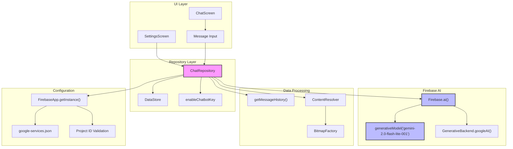
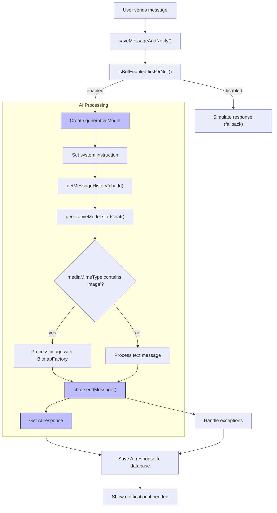
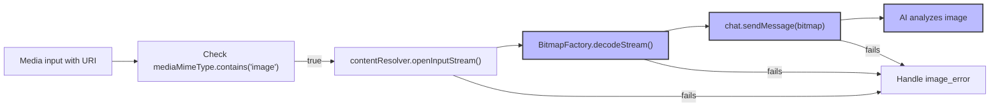
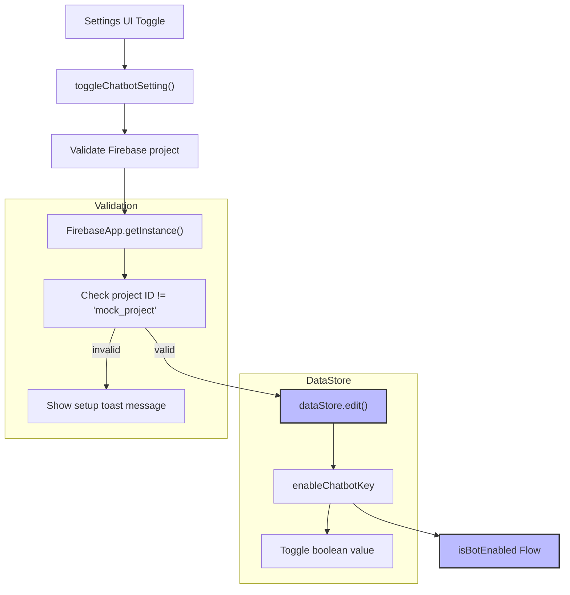

<!-- source: DeepWiki mcp.deepwiki.com · repo android/socialite · page 4.2 AI Integration · fetched 2026-10-23 -->

# AI Integration

Relevant source files

The following files were used as context for generating this wiki page:

- [README.md](README.md)
- [app/build.gradle.kts](app/build.gradle.kts)
- [app/google-services.json](app/google-services.json)
- [app/src/main/java/com/google/android/samples/socialite/repository/ChatRepository.kt](app/src/main/java/com/google/android/samples/socialite/repository/ChatRepository.kt)
- [app/src/main/res/values/strings.xml](app/src/main/res/values/strings.xml)
- [gradle/libs.versions.toml](gradle/libs.versions.toml)

This document covers the AI integration system in SociaLite, which provides intelligent chat responses using Firebase AI and the Gemini API. The system enables automated responses from chat contacts using Google's Gemini 2.0 Flash model, including support for text and image analysis.

For information about the broader chat messaging system, see [Chat System](#4.1). For media processing capabilities, see [Media Processing](#4.4).

## Overview

The AI integration in SociaLite provides intelligent chatbot functionality through Firebase AI services. The system uses Google's Gemini 2.0 Flash Lite model to generate contextual responses in chat conversations, with support for both text and image inputs. Users can enable or disable the AI chatbot through application settings, with fallback to simulated responses when disabled.

## Architecture

The AI integration is built around the `ChatRepository` class, which orchestrates AI interactions with Firebase services and manages conversation context.

### AI Integration Architecture

**Sources:** [app/src/main/java/com/google/android/samples/socialite/repository/ChatRepository.kt:1-416](), [gradle/libs.versions.toml:142-146](), [app/build.gradle.kts:184-186]()

## Firebase AI Setup

The Firebase AI integration uses the Google AI Client SDK to communicate with Gemini models. The configuration requires proper Firebase project setup and API key management.

### Dependencies

| Dependency | Version | Purpose |
|------------|---------|---------|
| `firebase-bom` | 33.14.0 | Firebase Bill of Materials |
| `firebase-ai` | (from BOM) | Firebase AI services |
| `generativeai` | 0.9.0 | Google AI Client SDK |

### Configuration Files

The system relies on `google-services.json` for Firebase configuration:

[app/google-services.json:1-30]()

The default configuration uses a mock project ID that must be replaced with a valid Firebase project for AI functionality to work.

**Sources:** [gradle/libs.versions.toml:33-62](), [app/build.gradle.kts:184-186](), [app/google-services.json:1-30]()

## Chat Generation System

The AI chat generation system processes user messages and generates contextual responses using conversation history and system instructions.

### Message Processing Flow

**Sources:** [app/src/main/java/com/google/android/samples/socialite/repository/ChatRepository.kt:96-206](), [app/src/main/java/com/google/android/samples/socialite/repository/ChatRepository.kt:114-121]()

### Model Configuration

The system configures the Gemini model with specific parameters:

[app/src/main/java/com/google/android/samples/socialite/repository/ChatRepository.kt:115-120]()

The model uses `GenerativeBackend.googleAI()` backend and includes system instructions that reference the contact's `replyModel` property to personalize responses.

**Sources:** [app/src/main/java/com/google/android/samples/socialite/repository/ChatRepository.kt:114-121]()

## Image Analysis

The AI system supports image analysis through bitmap processing and content resolution.

### Image Processing Pipeline

**Sources:** [app/src/main/java/com/google/android/samples/socialite/repository/ChatRepository.kt:138-150]()

The image processing implementation:

[app/src/main/java/com/google/android/samples/socialite/repository/ChatRepository.kt:138-150]()

**Sources:** [app/src/main/java/com/google/android/samples/socialite/repository/ChatRepository.kt:138-150]()

## Context Management

The AI system maintains conversation context through message history processing.

### Message History Processing

The `getMessageHistory()` function processes past messages to provide context to the AI model:

[app/src/main/java/com/google/android/samples/socialite/repository/ChatRepository.kt:316-352]()

Key processing steps:
1. Filter messages with non-empty text
2. Sort by timestamp
3. Combine consecutive messages from same sender
4. Convert to `Content` objects with appropriate roles ("user" or "model")
5. Remove the most recent message to avoid duplication

**Sources:** [app/src/main/java/com/google/android/samples/socialite/repository/ChatRepository.kt:316-352]()

## Settings and Configuration

The AI chatbot can be enabled or disabled through user preferences stored in `DataStore`.

### Settings Management

**Sources:** [app/src/main/java/com/google/android/samples/socialite/repository/ChatRepository.kt:72-76](), [app/src/main/java/com/google/android/samples/socialite/repository/ChatRepository.kt:396-414]()

### DataStore Configuration

The settings are managed through `DataStore<Preferences>`:

[app/src/main/java/com/google/android/samples/socialite/repository/ChatRepository.kt:72-76]()

**Sources:** [app/src/main/java/com/google/android/samples/socialite/repository/ChatRepository.kt:72-76]()

## Error Handling

The AI system includes comprehensive error handling for various failure scenarios.

### Error Types and Responses

| Error Type | Trigger | Response String Key |
|------------|---------|-------------------|
| Image processing failure | `openInputStream()` returns null | `R.string.image_error` |
| Gemini API error | Exception during `chat.sendMessage()` | `R.string.gemini_error` |
| Unknown error | Generic exception without message | `R.string.unknown_error` |
| Configuration error | Mock project detected | `R.string.set_api_key_toast` |

The error handling implementation:

[app/src/main/java/com/google/android/samples/socialite/repository/ChatRepository.kt:154-160]()

**Sources:** [app/src/main/java/com/google/android/samples/socialite/repository/ChatRepository.kt:154-160](), [app/src/main/res/values/strings.xml:80-83]()

## Integration Points

The AI system integrates with several other application components:

- **Chat UI**: Receives user input and displays AI responses
- **Settings Screen**: Provides toggle for enabling/disabling AI chatbot
- **Notification System**: Shows notifications for AI responses when app is backgrounded
- **Media System**: Processes image attachments for AI analysis
- **Widget System**: Updates unread message counts when AI responds

**Sources:** [app/src/main/java/com/google/android/samples/socialite/repository/ChatRepository.kt:62-71](), [app/src/main/java/com/google/android/samples/socialite/repository/ChatRepository.kt:192-205]()

---

