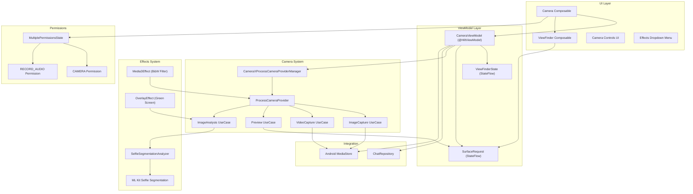
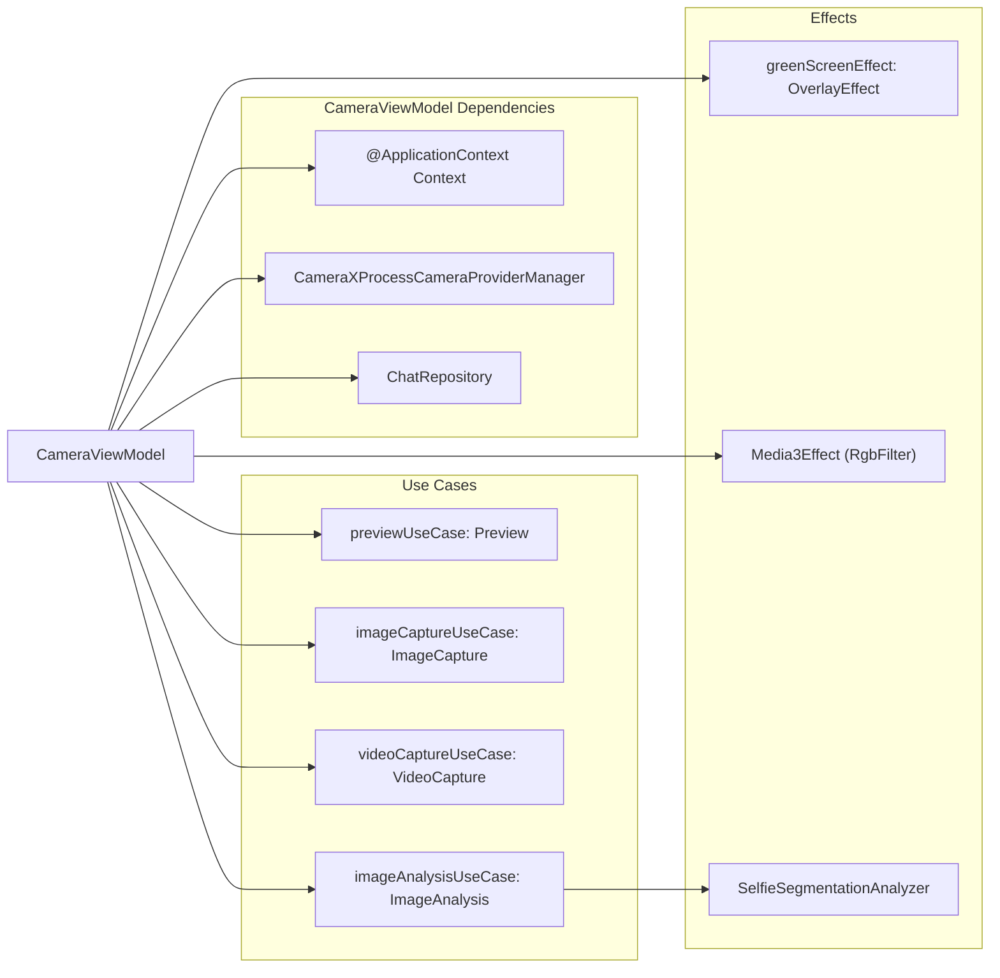
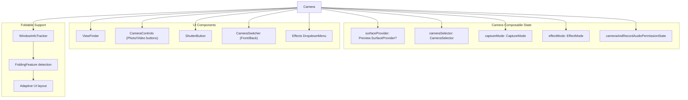
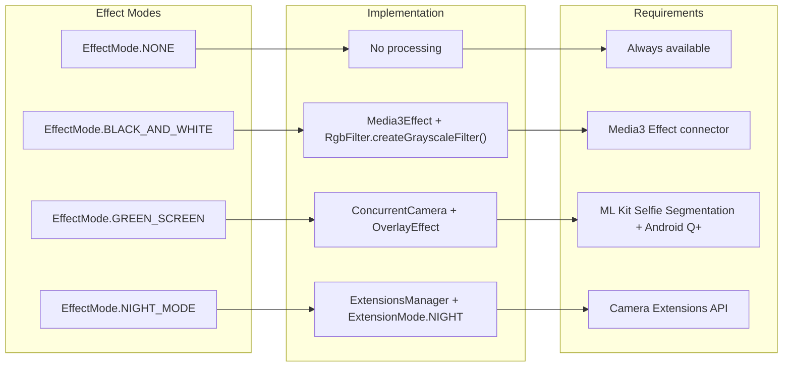
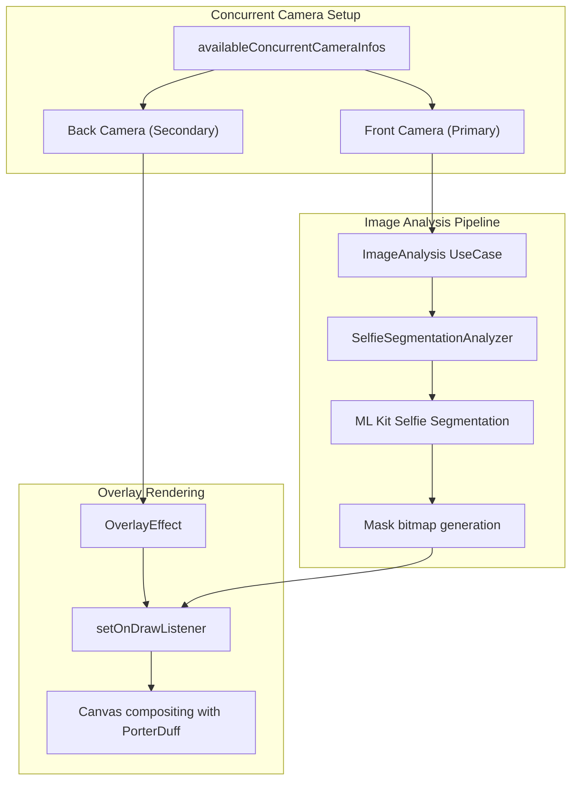
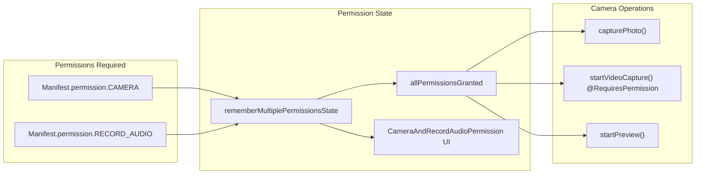
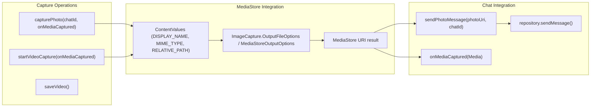

<!-- source: DeepWiki mcp.deepwiki.com · repo android/socialite · page 4.3 Media Capture · fetched 2026-10-23 -->

# Media Capture

Relevant source files

The following files were used as context for generating this wiki page:

- [app/src/main/java/com/google/android/samples/socialite/ui/camera/Camera.kt](app/src/main/java/com/google/android/samples/socialite/ui/camera/Camera.kt)
- [app/src/main/java/com/google/android/samples/socialite/ui/camera/CameraProviderManager.kt](app/src/main/java/com/google/android/samples/socialite/ui/camera/CameraProviderManager.kt)
- [app/src/main/java/com/google/android/samples/socialite/ui/camera/CameraViewModel.kt](app/src/main/java/com/google/android/samples/socialite/ui/camera/CameraViewModel.kt)
- [app/src/main/java/com/google/android/samples/socialite/ui/camera/ViewFinder.kt](app/src/main/java/com/google/android/samples/socialite/ui/camera/ViewFinder.kt)

This document covers the camera capture system in SociaLite, including photo and video capture, visual effects, permissions management, and integration with the chat system. For information about media processing and editing, see [Media Processing](#4.4). For media playback functionality, see [Timeline and Playback](#4.5).

## Architecture Overview

The media capture system is built on CameraX and follows the MVVM pattern with Jetpack Compose UI. The system supports both photo and video capture with real-time visual effects.

Sources: [app/src/main/java/com/google/android/samples/socialite/ui/camera/CameraViewModel.kt:1-615](), [app/src/main/java/com/google/android/samples/socialite/ui/camera/Camera.kt:1-486](), [app/src/main/java/com/google/android/samples/socialite/ui/camera/CameraProviderManager.kt:1-33]()

## Core Components

### CameraViewModel

The `CameraViewModel` serves as the central coordinator for camera operations, managing CameraX use cases, effects, and integration with the chat system.

| Component | Purpose | Key Dependencies |
|-----------|---------|------------------|
| `CameraViewModel` | Main camera business logic and state management | `CameraXProcessCameraProviderManager`, `ChatRepository` |
| `ViewFinderState` | Camera state (NOT_READY, READY, PREVIEW_STOPPED) | Exposed as `MutableStateFlow` |
| `SurfaceRequest` | Camera surface provider for preview | CameraX `Preview` use case |

Sources: [app/src/main/java/com/google/android/samples/socialite/ui/camera/CameraViewModel.kt:95-100](), [app/src/main/java/com/google/android/samples/socialite/ui/camera/CameraViewModel.kt:116-138]()

### Camera Composable

The main `Camera` composable provides the full camera UI experience with adaptive layouts for foldable devices.

Sources: [app/src/main/java/com/google/android/samples/socialite/ui/camera/Camera.kt:83-389](), [app/src/main/java/com/google/android/samples/socialite/ui/camera/Camera.kt:104-119]()

## Capture Modes and Effects

### Capture Modes

The system supports three distinct capture modes defined in the `CaptureMode` enum:

| Mode | Description | UI State |
|------|-------------|----------|
| `PHOTO` | Still image capture | White circular shutter button |
| `VIDEO_READY` | Ready to record video | Red circular shutter button |
| `VIDEO_RECORDING` | Currently recording | Red square stop button |

### Visual Effects

The camera system supports multiple real-time visual effects:

Sources: [app/src/main/java/com/google/android/samples/socialite/ui/camera/CameraViewModel.kt:648-653](), [app/src/main/java/com/google/android/samples/socialite/ui/camera/CameraViewModel.kt:289-300](), [app/src/main/java/com/google/android/samples/socialite/ui/camera/CameraViewModel.kt:302-354]()

### Green Screen Effect Implementation

The green screen effect uses concurrent cameras and ML Kit for real-time background removal:

Sources: [app/src/main/java/com/google/android/samples/socialite/ui/camera/CameraViewModel.kt:140-194](), [app/src/main/java/com/google/android/samples/socialite/ui/camera/CameraViewModel.kt:514-614](), [app/src/main/java/com/google/android/samples/socialite/ui/camera/CameraViewModel.kt:309-354]()

## Permissions and Lifecycle

### Permission Management

The camera system uses Accompanist's permission handling for required camera and audio permissions:

Sources: [app/src/main/java/com/google/android/samples/socialite/ui/camera/Camera.kt:94-99](), [app/src/main/java/com/google/android/samples/socialite/ui/camera/Camera.kt:192-388](), [app/src/main/java/com/google/android/samples/socialite/ui/camera/CameraViewModel.kt:419-451]()

### Lifecycle Integration

Camera operations are tied to the Android lifecycle through CameraX's lifecycle-aware components:

| Component | Lifecycle Binding | Purpose |
|-----------|------------------|---------|
| `ProcessCameraProvider` | `bindToLifecycle(lifecycleOwner, cameraSelector, useCaseGroup)` | Automatic camera resource management |
| `RotationProvider` | `addListener()` / `removeListener()` in `DisposableEffect` | Device rotation handling |
| `Preview.SurfaceProvider` | Bound to preview use case | Surface management for viewfinder |

Sources: [app/src/main/java/com/google/android/samples/socialite/ui/camera/CameraViewModel.kt:356-364](), [app/src/main/java/com/google/android/samples/socialite/ui/camera/Camera.kt:125-145]()

## Integration with Chat System

### Media Output and Storage

Captured media is automatically integrated with the chat system through the `ChatRepository`:

Sources: [app/src/main/java/com/google/android/samples/socialite/ui/camera/CameraViewModel.kt:372-417](), [app/src/main/java/com/google/android/samples/socialite/ui/camera/CameraViewModel.kt:453-462](), [app/src/main/java/com/google/android/samples/socialite/ui/camera/CameraViewModel.kt:420-451]()

### Media Data Types

The system uses a simple `Media` data class to represent captured content:

| Property | Type | Description |
|----------|------|-------------|
| `uri` | `Uri` | Content URI from MediaStore |
| `type` | `MediaType` | `PHOTO` or `VIDEO` enum value |

Sources: [app/src/main/java/com/google/android/samples/socialite/ui/camera/CameraViewModel.kt:409](), [app/src/main/java/com/google/android/samples/socialite/ui/camera/CameraViewModel.kt:442]()

---

