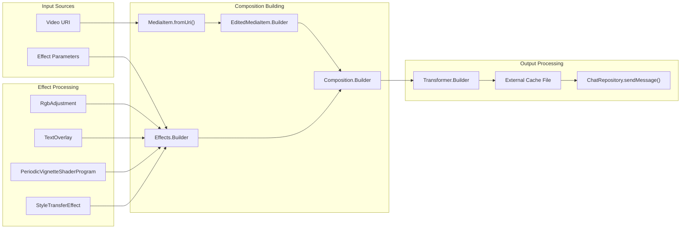
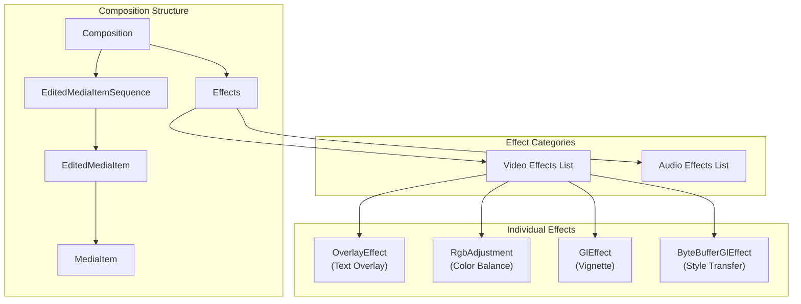
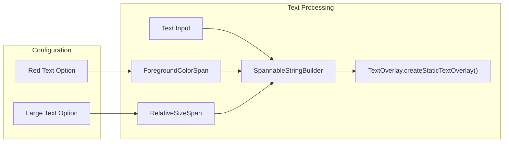
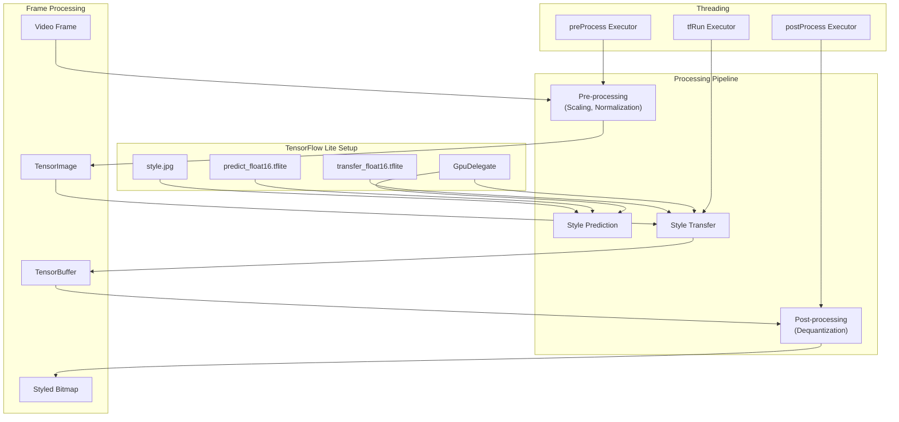
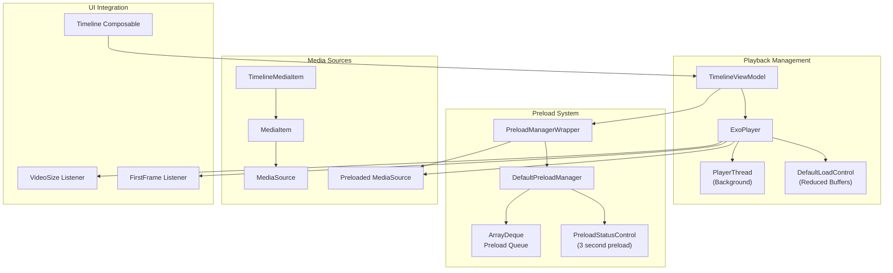
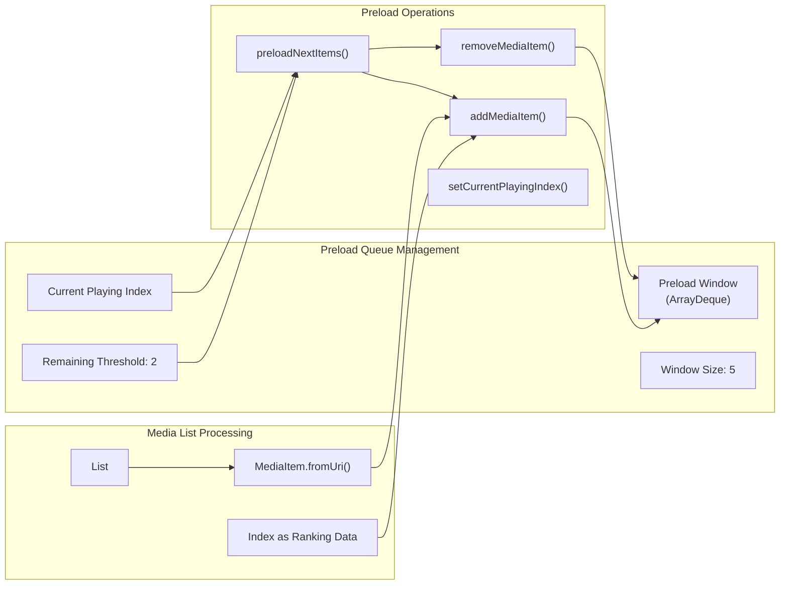
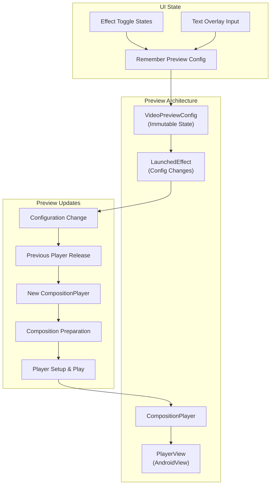
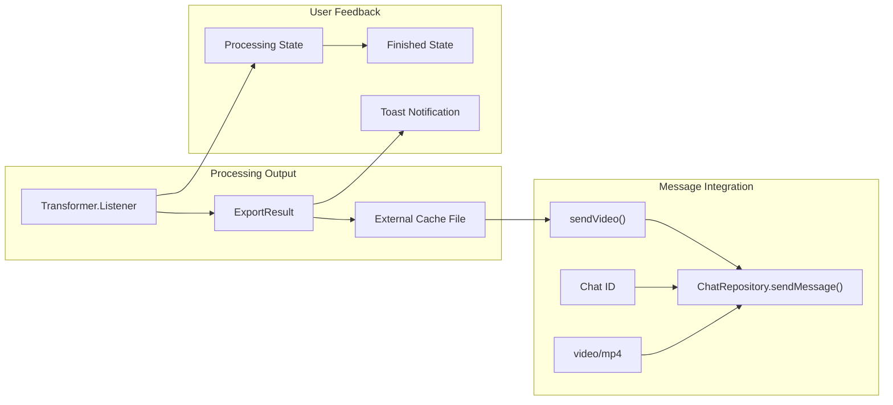

<!-- source: DeepWiki mcp.deepwiki.com · repo android/socialite · page 4.4 Media Processing · fetched 2026-10-23 -->

# Media Processing

Relevant source files

The following files were used as context for generating this wiki page:

- [app/src/main/java/com/google/android/samples/socialite/data/utils/ShortsVideoList.kt](app/src/main/java/com/google/android/samples/socialite/data/utils/ShortsVideoList.kt)
- [app/src/main/java/com/google/android/samples/socialite/ui/home/timeline/Timeline.kt](app/src/main/java/com/google/android/samples/socialite/ui/home/timeline/Timeline.kt)
- [app/src/main/java/com/google/android/samples/socialite/ui/home/timeline/TimelineViewModel.kt](app/src/main/java/com/google/android/samples/socialite/ui/home/timeline/TimelineViewModel.kt)
- [app/src/main/java/com/google/android/samples/socialite/ui/player/preloadmanager/PreloadManagerWrapper.kt](app/src/main/java/com/google/android/samples/socialite/ui/player/preloadmanager/PreloadManagerWrapper.kt)
- [app/src/main/java/com/google/android/samples/socialite/ui/videoedit/StyleTransferEffect.kt](app/src/main/java/com/google/android/samples/socialite/ui/videoedit/StyleTransferEffect.kt)
- [app/src/main/java/com/google/android/samples/socialite/ui/videoedit/VideoEditScreen.kt](app/src/main/java/com/google/android/samples/socialite/ui/videoedit/VideoEditScreen.kt)
- [app/src/main/java/com/google/android/samples/socialite/ui/videoedit/VideoEditScreenViewModel.kt](app/src/main/java/com/google/android/samples/socialite/ui/videoedit/VideoEditScreenViewModel.kt)

This document covers the media processing capabilities in SociaLite, including video editing, effects application, style transfer, and optimized playback infrastructure. The media processing system transforms captured or imported media through various effects and filters before integrating it back into the chat messaging system.

For media capture functionality, see [Media Capture](#4.3). For timeline UI and playback components, see [Timeline and Playback](#4.5).

## Video Editing Pipeline

The core video editing functionality is built around Media3's Transformer API, which provides a powerful framework for applying effects and transformations to video content. The system follows a composition-based architecture where effects are layered and applied in sequence.

The `VideoEditScreenViewModel` orchestrates the entire editing pipeline through the `applyVideoTransformation` method. It builds a composition containing the original media item and selected effects, then uses the Transformer to process and export the result.

**Sources:** [app/src/main/java/com/google/android/samples/socialite/ui/videoedit/VideoEditScreenViewModel.kt:110-149]()

## Composition Architecture

The system uses Media3's composition model to define video transformations declaratively. Each composition contains an `EditedMediaItemSequence` with applied effects and processing parameters.

The `prepareComposition` method in `VideoEditScreenViewModel` demonstrates how effects are assembled into a composition. HDR content is tone-mapped to SDR when style transfer effects are applied, ensuring compatibility across different video formats.

**Sources:** [app/src/main/java/com/google/android/samples/socialite/ui/videoedit/VideoEditScreenViewModel.kt:155-205]()

## Video Effects System

The application implements multiple categories of video effects, each using different APIs within the Media3 effects framework.

| Effect Type | Implementation | Purpose |
|-------------|----------------|---------|
| RGB Adjustment | `RgbAdjustment` | Color balance modification |
| Text Overlay | `TextOverlay` with `SpannableString` | Customizable text rendering |
| Periodic Vignette | `GlEffect` with custom shader | Dynamic vignette effect |
| Style Transfer | `ByteBufferGlEffect` with TensorFlow Lite | AI-powered style application |

### Text Overlay Processing

Text overlays support rich formatting through Android's `SpannableString` system. The implementation allows for color changes and size scaling:

The text overlay system applies spans based on user selections, supporting both color modification and size scaling simultaneously.

**Sources:** [app/src/main/java/com/google/android/samples/socialite/ui/videoedit/VideoEditScreenViewModel.kt:224-256]()

## Style Transfer Integration

The style transfer effect leverages TensorFlow Lite models to apply artistic styles to video frames. The implementation uses GPU acceleration and multi-threading for optimal performance.

The `StyleTransferEffect` class implements the `ByteBufferGlEffect.Processor<Bitmap>` interface, providing frame-by-frame processing with GPU acceleration. The system uses separate thread pools for different processing stages to maximize throughput.

**Sources:** [app/src/main/java/com/google/android/samples/socialite/ui/videoedit/StyleTransferEffect.kt:57-108]()

## Media Playback Infrastructure

The timeline system uses ExoPlayer with advanced preloading capabilities to ensure smooth playback of processed media content. The architecture separates playback control from preload management.

The `TimelineViewModel` manages a single ExoPlayer instance optimized for short-form video content. Buffer durations are reduced compared to standard playback scenarios, and the preload manager maintains a window of upcoming content.

**Sources:** [app/src/main/java/com/google/android/samples/socialite/ui/home/timeline/TimelineViewModel.kt:128-183]()

## Preload Management

The preload system optimizes the user experience by intelligently buffering upcoming media content. The `PreloadManagerWrapper` maintains a sliding window of preloaded content based on the current playback position.

The preload manager uses a target preload status of 3 seconds per video, balancing memory usage with smooth playback transitions. The system automatically invalidates and reprioritizes content as the user navigates through the timeline.

**Sources:** [app/src/main/java/com/google/android/samples/socialite/ui/player/preloadmanager/PreloadManagerWrapper.kt:81-118]()

## Real-time Preview System

The video editing interface provides real-time preview capabilities using Media3's `CompositionPlayer`. This allows users to see the effects of their edits before committing to the transformation process.

The preview system automatically updates whenever effect parameters change, providing immediate visual feedback. The `CompositionPlayer` handles the complex task of rendering compositions in real-time without requiring full export.

**Sources:** [app/src/main/java/com/google/android/samples/socialite/ui/videoedit/VideoEditScreen.kt:302-352]()

## Integration with Messaging System

Processed media content flows back into the chat system through the `ChatRepository`. The transformation pipeline outputs files to external cache storage before sending them as messages.

The system manages the complete lifecycle from effect application through file creation to message transmission. Error handling provides user feedback for failed transformations, while successful exports trigger automatic message sending.

**Sources:** [app/src/main/java/com/google/android/samples/socialite/ui/videoedit/VideoEditScreenViewModel.kt:87-108](), [app/src/main/java/com/google/android/samples/socialite/ui/videoedit/VideoEditScreenViewModel.kt:311-315]()

---

